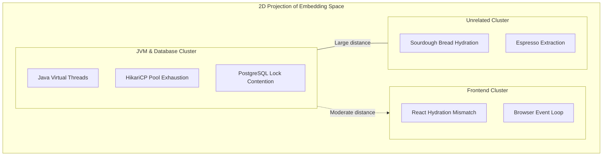
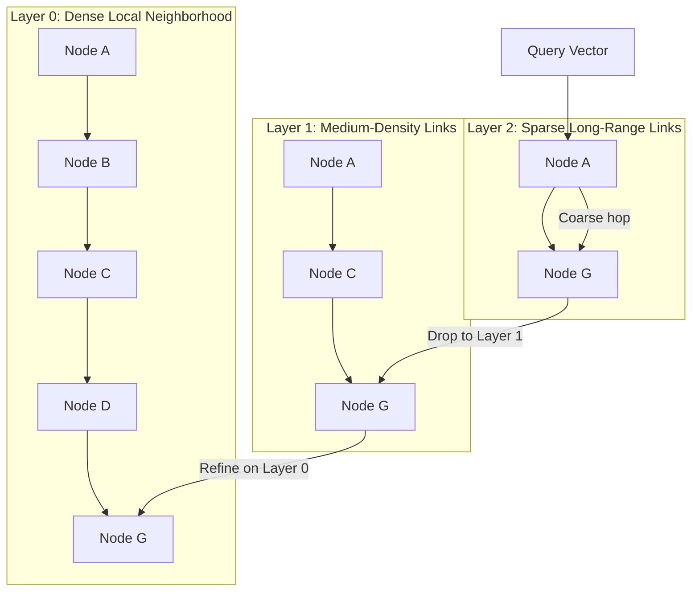
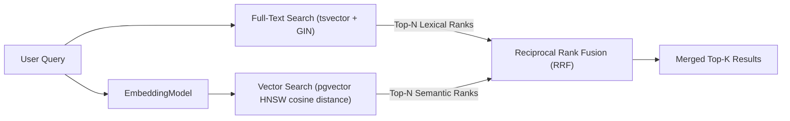

Traditional keyword search (SQL `ILIKE`, PostgreSQL `tsvector`, or Elasticsearch BM25) matches tokens literally, with stemming and basic synonyms. That works well when the user knows the exact phrase or code in the document, and fails when they describe a concept in different words. A search for *"connection pool running out of sockets"* will miss a troubleshooting guide titled *"HikariCP Exhaustion Under Long-Running Transactions"* even though it answers the exact question.

On the other hand, pure semantic search has the opposite blind spot. If an engineer searches for error code `ORA-01555` or SKU `SKU-8841-B`, an embedding model compresses that identifier into an approximate vector neighborhood and can easily rank a vaguely related article above the exact match.

Understanding how embeddings work, how vector indexes trade recall for speed, how to store and query vectors from Spring Boot, and how to combine vector similarity with full-text search lets you build search pipelines that handle both conceptual queries and exact identifiers cleanly.

---

## Text Embeddings: Vectors, Dimensions, and Cosine Similarity

An **embedding** is a fixed-length array of floating-point numbers produced by an embedding model (such as OpenAI's `text-embedding-3-small`, Cohere Embed, or an open-weight model like `nomic-embed-text` running on Ollama). The model maps text into a high-dimensional geometric space where passages with similar meaning land close together.

```text
"HikariCP connection starvation"  ->  [-0.0142,  0.0891, -0.0412, ...,  0.0031]  (1,536 floats)
"JDBC pool exhausted on load"     ->  [-0.0138,  0.0864, -0.0397, ...,  0.0028]  (1,536 floats)
"Sourdough starter hydration"     ->  [ 0.0781, -0.0125,  0.0914, ..., -0.0612]  (1,536 floats)
```



### Dimensions and Model Compatibility

Common embedding sizes are 384, 768, 1,024, 1,536, and 3,072 dimensions. Higher dimensionality captures finer semantic nuance at the cost of more RAM, larger disk footprints, and slightly slower distance math. Some modern models (including OpenAI's `text-embedding-3-*` family trained with Matryoshka Representation Learning) let you request fewer dimensions (for example, 512 instead of 1,536) with a modest recall trade-off and a 3x reduction in index memory.

One rule is absolute: **every vector in a given index must come from the same embedding model and dimension count.** Two different embedding models produce incompatible coordinate spaces. If you switch embedding models later, you must re-embed your corpus (ideally into a parallel column or table before cutting traffic over).

### Cosine Similarity vs. Euclidean and Inner Product

Three distance functions appear across vector databases:

- **Cosine Similarity** measures the cosine of the angle between two vectors, ignoring magnitude:
  ```text
  cosine_similarity(A, B) = (A . B) / (||A|| * ||B||)
  ```
  Values range from `-1.0` (opposite) through `0.0` (orthogonal) to `1.0` (same direction). Most databases store or sort by **Cosine Distance** (`1 - cosine_similarity`), where `0.0` is an exact match and smaller values rank first. Because cosine ignores vector length, it is the default choice for text search.
- **Euclidean Distance (L2)** measures straight-line distance between two points. It is sensitive to vector magnitude unless vectors are normalized.
- **Inner Product (Dot Product)** multiplies matching coordinates and sums them. When an embedding model outputs unit-normalized vectors (as OpenAI's models do), inner product produces the exact same ranking as cosine similarity with slightly less arithmetic.

---

## Approximate Nearest Neighbor Indexing: HNSW vs. IVFFlat

Comparing a query vector against every stored row is an exact **k-Nearest Neighbor (k-NN)** scan. It guarantees 100% recall, and for small tables (a few tens of thousands of rows) a sequential scan is often fast enough. At millions of 1,536-dimensional vectors, exact `O(N)` scanning burns seconds of CPU and memory bandwidth per query.

To keep latency in the single-digit millisecond range, vector stores use **Approximate Nearest Neighbor (ANN)** indexes that trade a small fraction of recall (typically targeting 95% to 99%) for dramatically faster lookups.



In PostgreSQL `pgvector`, you choose between two index types:

- **HNSW (Hierarchical Navigable Small World):** Builds a multi-layer proximity graph, similar in spirit to a skip list. Searches enter at the sparse top layer, take long hops toward the target neighborhood, and descend to the dense bottom layer for local refinement (`O(log N)` typical query behavior). You can create an HNSW index on an empty table, and it handles incremental inserts well. Key tuning parameters are `m` (links per node, default 16), `ef_construction` (graph build effort, default 64), and query-time `hnsw.ef_search` (default 40; raising it improves recall at the expense of latency). The main downside is memory: HNSW graphs are RAM-hungry, and build times grow on very large datasets.
- **IVFFlat (Inverted File with Flat compression):** Clusters vectors into `lists` Voronoi cells using k-means during index creation. Queries only scan the nearest `probes` clusters. IVFFlat uses less RAM and builds faster than HNSW, but requires representative data in the table before creating the index and needs periodic rebuilds if data distribution shifts heavily.

For most Spring Boot applications using `pgvector`, **HNSW** is the safer default. When memory gets tight on millions of 1,536-dimensional rows, `pgvector` 0.7+ also supports `halfvec` (16-bit floats), which cuts vector storage and HNSW memory roughly in half with minimal recall loss.

---

## Vector Databases: `pgvector`, Chroma, and Milvus

Before adding a brand-new database cluster to your infrastructure, compare what you actually need against the operational cost.

| Engine | Architecture | Where It Shines | Trade-Offs |
| :--- | :--- | :--- | :--- |
| **PostgreSQL + `pgvector`** | Extension inside your existing PostgreSQL database | Keeps business rows, permissions, full-text indexes, and embeddings in one ACID database; zero sync lag; familiar backups and tooling. | Memory sizing matters as HNSW indexes grow; very large corpora (tens of millions+ vectors with high QPS) require careful partitioning, `halfvec` quantization, or read replicas. |
| **Chroma** | Lightweight open-source vector store (embedded or client-server) | Fast local prototyping, small-to-medium standalone document collections, simple API and metadata filtering. | Not designed as a distributed multi-region system of record; lacks relational joins and ACID transactions with your core SQL tables. |
| **Milvus** | Distributed, cloud-native vector database (separates storage, query, and index nodes) | Tens of millions to billions of vectors, high concurrent QPS, GPU/DiskANN indexing, native multi-tenant partitioning. | Significant operational overhead (etcd, MinIO/S3, Pulsar/Kafka in distributed mode) unless using managed Zilliz Cloud; introduces dual-write sync with your primary database. |

### When `pgvector` Is Enough vs. When a Dedicated Engine Makes Sense

Most enterprise Java services already run PostgreSQL and store somewhere between 50,000 and 10 million document chunks. In that range, `pgvector` eliminates the **dual-write problem**: updating a product description or revoking a tenant's access happens in the same transaction as updating or filtering the embedding. No CDC pipeline or eventual-consistency drift to debug.

Reach for **Milvus** (or another dedicated distributed vector engine like Qdrant) when vector volume outgrows what fits comfortably in PostgreSQL RAM even with partitioning and `halfvec`, when you need specialized DiskANN or GPU-accelerated indexing, or when vector search is an independent high-QPS platform serving dozens of downstream teams. **Chroma** sits nicely at the other end: quick to spin up for prototypes, small internal knowledge tools, or standalone experiments where you do not want to manage PostgreSQL extensions.

---

## Storing and Querying Embeddings with Spring AI and Spring Data

There are two complementary ways to work with `pgvector` in Spring Boot 3: Spring AI's high-level `VectorStore` abstraction (great for standard RAG pipelines) and direct Spring Data / `JdbcClient` SQL (essential when embeddings live alongside domain columns or when you need custom hybrid SQL queries).

### Local PostgreSQL with `pgvector`

Start a PostgreSQL 16 container with `pgvector` preinstalled:

```bash
docker run -d \
  --name postgres-pgvector \
  -e POSTGRES_DB=knowledge_base \
  -e POSTGRES_USER=postgres \
  -e POSTGRES_PASSWORD=postgres \
  -p 5432:5432 \
  pgvector/pgvector:pg16
```

### Maven Dependencies (Spring AI 1.0 GA)

Import the Spring AI 1.0.0 GA BOM and add the `pgvector` store starter along with an embedding provider starter (OpenAI shown here; Ollama works the same way with a local embedding model such as `nomic-embed-text`):

```xml
<dependencyManagement>
    <dependencies>
        <dependency>
            <groupId>org.springframework.ai</groupId>
            <artifactId>spring-ai-bom</artifactId>
            <version>1.0.0</version>
            <type>pom</type>
            <scope>import</scope>
        </dependency>
    </dependencies>
</dependencyManagement>

<dependencies>
    <dependency>
        <groupId>org.springframework.ai</groupId>
        <artifactId>spring-ai-starter-vector-store-pgvector</artifactId>
    </dependency>
    <dependency>
        <groupId>org.springframework.ai</groupId>
        <artifactId>spring-ai-starter-model-openai</artifactId>
    </dependency>
    <dependency>
        <groupId>org.springframework.boot</groupId>
        <artifactId>spring-boot-starter-data-jdbc</artifactId>
    </dependency>
</dependencies>
```

Configure `application.yml`:

```yaml
spring:
  datasource:
    url: jdbc:postgresql://localhost:5432/knowledge_base
    username: postgres
    password: postgres
  ai:
    openai:
      api-key: ${OPENAI_API_KEY}
      embedding:
        options:
          model: text-embedding-3-small
    vectorstore:
      pgvector:
        index-type: HNSW
        distance-type: COSINE_DISTANCE
        dimensions: 1536
        initialize-schema: true
```

### Option A: Using Spring AI `VectorStore`

`VectorStore` handles calling your `EmbeddingModel`, persisting `Document` content plus JSON metadata, and translating portable metadata filter expressions into PostgreSQL `WHERE` clauses:

```java
package com.javahub.ai.search;

import org.springframework.ai.document.Document;
import org.springframework.ai.vectorstore.SearchRequest;
import org.springframework.ai.vectorstore.VectorStore;
import org.springframework.ai.vectorstore.filter.FilterExpressionBuilder;
import org.springframework.stereotype.Service;

import java.util.List;
import java.util.Map;

@Service
public class SpringAiVectorSearchService {

    private final VectorStore vectorStore;

    public SpringAiVectorSearchService(VectorStore vectorStore) {
        this.vectorStore = vectorStore;
    }

    public void ingestDocuments() {
        List<Document> docs = List.of(
                new Document(
                        "HikariCP throws SQLTransientConnectionException when active queries exceed maximumPoolSize.",
                        Map.of("tenantId", "acme", "category", "database")
                ),
                new Document(
                        "Java 21 virtual threads unmount from carrier threads during blocking socket I/O.",
                        Map.of("tenantId", "acme", "category", "java")
                )
        );
        vectorStore.add(docs);
    }

    public List<Document> search(String query, String tenantId, String category) {
        FilterExpressionBuilder b = new FilterExpressionBuilder();

        SearchRequest request = SearchRequest.builder()
                .query(query)
                .topK(5)
                .similarityThreshold(0.72)
                .filterExpression(
                        b.and(b.eq("tenantId", tenantId), b.eq("category", category)).build()
                )
                .build();

        return vectorStore.similaritySearch(request);
    }
}
```

### Option B: Direct Spring Data / `JdbcClient` with Domain Tables

In real applications, you often want embeddings stored directly on your own relational tables alongside foreign keys, tenant columns, and a generated full-text `tsvector` column. Define the schema via Flyway or Liquibase:

```sql
CREATE EXTENSION IF NOT EXISTS vector;

CREATE TABLE knowledge_articles (
    id          BIGSERIAL PRIMARY KEY,
    tenant_id   VARCHAR(64) NOT NULL,
    title       TEXT NOT NULL,
    body        TEXT NOT NULL,
    embedding   vector(1536) NOT NULL,
    tsv         tsvector GENERATED ALWAYS AS (
                    setweight(to_tsvector('english', coalesce(title, '')), 'A') ||
                    setweight(to_tsvector('english', coalesce(body, '')), 'B')
                ) STORED
);

-- HNSW index for cosine distance (<=>)
CREATE INDEX idx_articles_embedding_hnsw
    ON knowledge_articles
    USING hnsw (embedding vector_cosine_ops)
    WITH (m = 16, ef_construction = 64);

-- GIN index for PostgreSQL full-text search
CREATE INDEX idx_articles_tsv_gin
    ON knowledge_articles
    USING gin (tsv);

-- Standard B-Tree index for tenant isolation
CREATE INDEX idx_articles_tenant
    ON knowledge_articles (tenant_id);
```

Using Spring Boot's `JdbcClient` together with Spring AI's `EmbeddingModel` gives you full SQL control without giving up portable embedding generation. (If you prefer JPA/Hibernate, Hibernate 6.4+ also offers the `org.hibernate.orm:hibernate-vector` module for mapping `float[]` fields to `vector` columns with `@JdbcTypeCode(SqlTypes.VECTOR)`.)

```java
package com.javahub.ai.search;

import com.pgvector.PGvector;
import org.springframework.ai.embedding.EmbeddingModel;
import org.springframework.jdbc.core.simple.JdbcClient;
import org.springframework.stereotype.Repository;
import org.springframework.transaction.annotation.Transactional;

import java.util.List;

@Repository
public class ArticleVectorRepository {

    public record SearchHit(long id, String title, String body, double score) {}

    private final JdbcClient jdbc;
    private final EmbeddingModel embeddingModel;

    public ArticleVectorRepository(JdbcClient jdbc, EmbeddingModel embeddingModel) {
        this.jdbc = jdbc;
        this.embeddingModel = embeddingModel;
    }

    @Transactional
    public void saveArticle(String tenantId, String title, String body) {
        float[] vector = embeddingModel.embed(title + "\n" + body);

        jdbc.sql("""
                INSERT INTO knowledge_articles (tenant_id, title, body, embedding)
                VALUES (:tenantId, :title, :body, :embedding)
                """)
                .param("tenantId", tenantId)
                .param("title", title)
                .param("body", body)
                .param("embedding", new PGvector(vector))
                .update();
    }

    @Transactional(readOnly = true)
    public List<SearchHit> findByVectorSimilarity(String tenantId, String query, int limit) {
        float[] queryVector = embeddingModel.embed(query);

        // pgvector 0.8+: iterative scan prevents selective WHERE clauses from returning fewer than LIMIT rows
        jdbc.sql("SET LOCAL hnsw.iterative_scan = relaxed_order").update();
        jdbc.sql("SET LOCAL hnsw.ef_search = 80").update();

        return jdbc.sql("""
                SELECT id,
                       title,
                       body,
                       1 - (embedding <=> :queryVector) AS score
                FROM knowledge_articles
                WHERE tenant_id = :tenantId
                ORDER BY embedding <=> :queryVector
                LIMIT :limit
                """)
                .param("tenantId", tenantId)
                .param("queryVector", new PGvector(queryVector))
                .param("limit", limit)
                .query(SearchHit.class)
                .list();
    }
}
```

> [!NOTE]
> **Watch out for selective filters with HNSW:** In older versions of `pgvector`, PostgreSQL scanned `ef_search` candidates from the HNSW graph and applied `WHERE tenant_id = :tenantId` afterward. If a tenant owned only 1% of rows, a `LIMIT 5` query could return zero or two results. Upgrading to `pgvector` 0.8+ and enabling `hnsw.iterative_scan = relaxed_order` (or partitioning large multi-tenant tables by tenant) solves this cleanly.

---

## Hybrid Search: Combining Full-Text Search with Vector Search

Neither lexical search nor vector search wins on every query:

- **Full-text search** excels at exact error codes (`ERR_7021`), product SKUs, class names (`ConcurrentHashMap`), and rare acronyms.
- **Vector search** excels at conceptual questions, paraphrases, and synonyms where the user does not know the exact vocabulary in the documentation.

**Hybrid search** runs both retrieval paths over the same tenant-filtered corpus and merges their ranked lists.



### Why Reciprocal Rank Fusion (RRF)?

Combining raw scores directly (`0.5 * ts_rank + 0.5 * cosine_similarity`) is fragile because `ts_rank_cd` and cosine similarity have completely different distributions and scales. **Reciprocal Rank Fusion (RRF)** sidesteps score normalization by merging based on rank position alone:

```text
rrf_score(doc) = (1.0 / (k + rank_fts)) + (1.0 / (k + rank_vector))
```

The smoothing constant `k` (commonly set to `60`) prevents a single #1 ranking in one list from completely dominating a document that ranked consistently high in both lists. A document appearing in both the lexical top 5 and semantic top 5 rises to the very top.

### Hybrid Search SQL Query in PostgreSQL

Because both the `GIN` full-text index and the `HNSW` vector index live on `knowledge_articles`, you can execute the entire hybrid query inside PostgreSQL in one round trip:

```java
@Transactional(readOnly = true)
public List<SearchHit> hybridSearch(String tenantId, String query, int limit) {
    float[] queryVector = embeddingModel.embed(query);

    jdbc.sql("SET LOCAL hnsw.iterative_scan = relaxed_order").update();

    return jdbc.sql("""
            WITH semantic AS (
                SELECT id,
                       ROW_NUMBER() OVER (ORDER BY embedding <=> :queryVector) AS rank_ix
                FROM knowledge_articles
                WHERE tenant_id = :tenantId
                ORDER BY embedding <=> :queryVector
                LIMIT :candidateLimit
            ),
            keyword AS (
                SELECT id,
                       ROW_NUMBER() OVER (
                           ORDER BY ts_rank_cd(tsv, websearch_to_tsquery('english', :query)) DESC
                       ) AS rank_ix
                FROM knowledge_articles
                WHERE tenant_id = :tenantId
                  AND tsv @@ websearch_to_tsquery('english', :query)
                ORDER BY ts_rank_cd(tsv, websearch_to_tsquery('english', :query)) DESC
                LIMIT :candidateLimit
            ),
            fused AS (
                SELECT COALESCE(s.id, k.id) AS id,
                       COALESCE(1.0 / (:rrfK + s.rank_ix), 0.0) +
                       COALESCE(1.0 / (:rrfK + k.rank_ix), 0.0) AS rrf_score
                FROM semantic s
                FULL OUTER JOIN keyword k ON s.id = k.id
            )
            SELECT a.id, a.title, a.body, f.rrf_score AS score
            FROM fused f
            JOIN knowledge_articles a ON a.id = f.id
            ORDER BY f.rrf_score DESC
            LIMIT :limit
            """)
            .param("tenantId", tenantId)
            .param("query", query)
            .param("queryVector", new PGvector(queryVector))
            .param("candidateLimit", Math.max(limit * 4, 20))
            .param("rrfK", 60.0)
            .param("limit", limit)
            .query(SearchHit.class)
            .list();
}
```

Notice `websearch_to_tsquery('english', :query)`: unlike `to_tsquery`, it safely parses arbitrary user input (including quotes, hyphens, and punctuation) without throwing syntax errors on malformed boolean operators.

---

## Interview Questions

### Why is cosine similarity preferred over Euclidean distance for text embeddings, and when does inner product give the same result?

Cosine similarity evaluates the angle between two vectors rather than their magnitude, so a short query and a longer paragraph about the same topic still score closely. Euclidean (L2) distance is affected by vector length. When an embedding model produces unit-normalized vectors (magnitude equal to `1.0`), cosine similarity and inner product yield identical rankings, and inner product avoids the normalization division step.

### Compare HNSW and IVFFlat indexes in `pgvector`. How do you decide between them?

HNSW builds a multi-layer proximity graph that gives fast `O(log N)` queries, high recall, and works cleanly on empty tables with incremental inserts, at the cost of higher memory usage and slower index builds. IVFFlat clusters existing vectors into `lists` buckets and scans `probes` buckets per query; it uses less memory and builds faster, but requires training data upfront and can degrade in recall if data distribution changes without a rebuild. Most teams start with HNSW and move to `halfvec` or partitioning if memory becomes a constraint.

### When should a Java team choose PostgreSQL with `pgvector` versus Milvus or Chroma?

Use PostgreSQL + `pgvector` when you already operate PostgreSQL and your vector set fits comfortably in the millions to low tens of millions. Keeping relational records, RBAC/tenant columns, and embeddings in one ACID database avoids dual-write synchronization bugs. Choose Chroma for rapid local prototyping or small standalone document collections where minimal setup matters most. Choose Milvus when vector scale reaches tens or hundreds of millions of rows with high QPS, or when you need distributed storage/compute separation and DiskANN/GPU indexing.

### Why does hybrid search use Reciprocal Rank Fusion (RRF) instead of adding BM25/`ts_rank` and cosine similarity scores directly?

Lexical relevance scores (`ts_rank_cd` or BM25) are unbounded and vary heavily with query length and term frequency, whereas cosine similarity is bounded between `-1.0` and `1.0` (and often clustered tightly between `0.6` and `0.9` for real text). Adding raw scores directly causes whichever metric has larger variance to dominate. RRF converts each list into ordinal ranks and combines `1 / (k + rank)`, rewarding documents that perform well across both keyword and semantic retrieval without fragile per-corpus score calibration.
