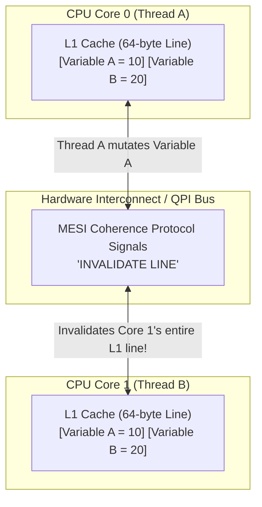

Formula 1 world champion Jackie Stewart famously observed: 

> *"You don't have to be an engineer to be a racing driver, but you do have to have Mechanical Sympathy. You have to understand what the machine is going through when you pitch it into a turn."*

In software engineering, **Mechanical Sympathy**—a term popularized in the JVM ecosystem by Martin Thompson and the architects of the LMAX Disruptor—is the discipline of designing software that works *in harmony* with the underlying physical hardware rather than fighting against it.

For decades, enterprise Java developers were taught to treat the JVM as an abstract, platform-independent virtual machine. We were told: *"Write once, run anywhere. Don't worry about CPU registers, cache lines, or memory controllers; the HotSpot JIT compiler and Garbage Collector will handle it."*

In standard web applications where 99% of latency is spent waiting on PostgreSQL queries or external REST calls, this abstraction is fine. But in High-Frequency Trading (HFT), real-time order-matching engines, telemetry ingestors, and ultra-low-latency financial infrastructure—where operations are measured in **nanoseconds**—abstracting away the hardware is fatal.

In this deep dive, we explore the physical reality of modern CPUs: cache hierarchies, 64-byte cache lines, the performance catastrophe of **False Sharing**, branch predictors, and hardware memory barriers.

---

### The Latency Numbers Every Systems Engineer Must Know

Modern CPUs operate at clock speeds between 3.5 GHz and 5.0 GHz. A single CPU clock cycle takes roughly **0.2 to 0.3 nanoseconds**. 

To understand why mechanical sympathy matters, look at the physical latency required for a CPU core to retrieve data from different tiers of the storage hierarchy:

| Memory Tier | Access Latency (Approx) | CPU Cycles (at 3 GHz) | Human Analogy (Scaled to 1 sec) |
| :--- | :--- | :--- | :--- |
| **CPU Registers** | ~0.3 ns | 1 cycle | 1 second |
| **L1 Data Cache (per core)** | ~1.0 ns | ~3-4 cycles | 3 seconds |
| **L2 Cache (per core)** | ~3.5 ns | ~12 cycles | 10 seconds |
| **L3 Cache (Shared across cores)**| ~12.0 ns | ~40 cycles | 40 seconds |
| **Main Memory (DRAM)** | ~60 - 80 ns | ~200 - 250 cycles | **3.5 minutes (Coffee break!)** |
| **NVMe SSD Read** | ~20,000 ns (20 µs) | ~60,000 cycles | 1.5 days |
| **Network round-trip (Same DC)** | ~500,000 ns (0.5 ms) | ~1,500,000 cycles | 5.5 weeks |
| **Internet NY to London** | ~65,000,000 ns (65 ms) | ~200,000,000 cycles | 6.5 years |

When your Java code suffers a **Cache Miss** and must fetch a reference from Main Memory (DRAM), the CPU core does not execute code; it stalls for over **200 clock cycles**, idling while waiting for electrons to travel across the motherboard memory bus.

If your algorithm performs pointer-chasing through linked data structures (`LinkedList`, deep object graphs), your CPU spends 95% of its time completely stalled on DRAM.

---

### The 64-Byte Cache Line and Spatial Locality

A CPU never reads a single primitive byte or 4-byte reference from memory. 

Whenever a CPU core requests an address, the memory controller fetches a continuous block of **64 bytes** (called a **Cache Line**) into the L1/L2 data cache.

```
+---------------------------------------------------------------+
|                      64-Byte Cache Line                       |
| [Slot 0] [Slot 1] [Slot 2] [Slot 3] ... [Slot 14] [Slot 15]   |
+---------------------------------------------------------------+
  <----------------- 16 integers (4 bytes each) ---------------->
```

This hardware reality dictates how Java data structures perform:

#### Spatial Locality in Arrays vs Linked Lists
When you allocate an `int[] array = new int[16]`, the integers reside in contiguous physical memory addresses. When the CPU reads `array[0]`, the hardware prefetcher pulls the entire 64-byte block into L1 cache in a single memory transaction. 

When your loop accesses `array[1]` through `array[15]`, every access is an instant **L1 Cache Hit** (~1 ns).

In contrast, a `LinkedList<Integer>` stores each element in a separate `Node` object on the heap:
1. Each `Node` object has a 16-byte object header and pointer fields scattered arbitrarily across the heap.
2. The `Integer` value is a boxed object located at another arbitrary heap address.
3. Every step through `node.next` requires a pointer dereference that incurs an L3 or DRAM cache miss. Traversing a `LinkedList` can be **30 to 50 times slower** than iterating an array of identical size, solely due to cache-line misses!

---

### The False Sharing Disaster: Cache Coherence Thrashing

While cache lines enable blazing spatial locality, they create one of the most insidious multithreaded performance traps in computer science: **False Sharing**.

To keep data consistent across multiple CPU cores, modern hardware uses a **Cache Coherence Protocol** (such as MESI: Modified, Exclusive, Shared, Invalid). 

If two independent threads running on Core 0 and Core 1 modify two completely independent variables that happen to sit within the **same 64-byte cache line**, the hardware is forced to constantly invalidate and reload the entire cache line across CPU sockets!



#### Witnessing False Sharing in Java

Consider this innocent-looking counter class updated by two concurrent threads:

```java
public class FalseSharingMetrics {
    // Both long values are 8 bytes each and sit adjacently in heap memory (same 64-byte cache line!)
    public volatile long core0Counter = 0L;
    public volatile long core1Counter = 0L;
}
```

When Thread 0 running on Core 0 increments `core0Counter`, the MESI protocol marks the entire 64-byte cache line in Core 1's L1 cache as **INVALID**. 

When Thread 1 on Core 1 attempts to increment `core1Counter`, it cannot read its L1 cache; it must stall while the line is flushed from Core 0 and reloaded across the hardware bus.

The two cores spend 90% of their execution time fighting over cache line ownership. A dual-threaded benchmark running on two cores can run **10 times slower than a single-threaded loop**!

---

### Eliminating False Sharing: Padding and @Contended

To eliminate False Sharing, we must ensure that high-frequency variables reside on separate, independent 64-byte cache lines.

#### Approach 1: Manual Cache Line Padding
In Java 7 and early Java 8, low-latency engineers padded fields by declaring unused `long` variables (8 bytes each) to push adjacent variables at least 64 bytes apart:

```java
public class PaddedAtomicCounter {
    // Cache Line Padding (56 bytes + 8 byte header = 64 bytes)
    public long p1, p2, p3, p4, p5, p6, p7;
    
    // The target high-frequency value
    public volatile long value = 0L;
    
    // Trailing Padding (prevents subsequent object fields from sharing the line)
    public long p8, p9, p10, p11, p12, p13, p14;
}
```

> [!WARNING]
> Modern HotSpot JIT compilers optimize class layouts and may reorder field declarations in memory, potentially rendering manual field padding ineffective!

#### Approach 2: The Modern Standard: @Contended (JEP 142)
Java 8 introduced `@jdk.internal.vm.annotation.Contended`. When applied to a field or class, the HotSpot compiler automatically isolates the annotated field by injecting 128 bytes of padding (accommodating both 64-byte cache lines and adjacent cache prefetchers):

```java
import jdk.internal.vm.annotation.Contended;

public class HighThroughputRingBufferSequencer {

    // HotSpot automatically places cursor on its own isolated 128-byte cache line
    @Contended
    public volatile long cursor = 0L;

    @Contended
    public volatile long minimumGatingSequence = 0L;
}
```

Because `@Contended` is an internal JDK annotation (used heavily inside `LongAdder`, `ConcurrentHashMap`, and `Thread`), application code must pass the JVM flag at boot:

```bash
java -XX:-RestrictContended -jar hft-engine.jar
```

With `@Contended`, throughput increases by up to **800%** on high-frequency concurrent counters.

---

### Branch Predictors and Speculative Execution

Modern CPUs feature deep instruction execution pipelines (often 15 to 20 stages deep). To keep the pipeline full, the CPU cannot wait for conditional `if/else` statements to be evaluated.

Instead, the CPU uses an advanced hardware neural network called a **Branch Predictor** with a **Branch Target Buffer (BTB)**:
1. The CPU guesses which branch will be taken based on historical execution patterns.
2. It speculatively executes instructions down the predicted path.
3. If the guess was correct, execution continues at maximum speed with zero pause.
4. **Branch Misprediction Penalty:** If the guess was wrong, the CPU must flush the entire 20-stage instruction pipeline, discard all speculative calculations, and reload the correct branch from memory. This wastes **15 to 20 CPU clock cycles** per misprediction!

#### Branch-Free Programming in Java

In ultra-low-latency financial code, branch mispredictions cause unpredictable latency spikes (jitter). 

Consider finding the maximum of two values in an order matching engine:

```java
// Branching logic: Vulnerable to Branch Mispredictions on random order sizes
public static int maxBranching(int a, int b) {
    if (a > b) {
        return a;
    } else {
        return b;
    }
}

// Branch-Free logic: Compiles down to CMOV (Conditional Move) or bitwise operations
public static int maxBranchFree(int a, int b) {
    int diff = a - b;
    int mask = diff >> 31; // 0 if a >= b, -1 (0xFFFFFFFF) if a < b
    return a - (diff & mask);
}
```

The branch-free version executes in deterministic clock cycles without ever flushing the CPU pipeline, delivering a stable, predictable latency distribution.

---

### Hardware Memory Barriers (Fences)

Modern superscalar CPUs execute instructions **Out-of-Order (OoO)** to maximize utilization of execution units (ALUs). 

A CPU may execute a memory write *after* a subsequent memory read if it detects no direct dependency in the same thread. While valid for single-threaded code, out-of-order execution breaks concurrent algorithms unless bounded by **Memory Barriers (Fences)**:

```
Types of CPU Memory Fences:
  1. LoadLoad:   Guarantees all preceding reads complete before subsequent reads.
  2. StoreStore: Guarantees all preceding writes are flushed to cache before subsequent writes.
  3. LoadStore:  Guarantees reads complete before subsequent writes.
  4. StoreLoad:  The heaviest fence (MFENCE). Forces all write buffers to flush to cache 
                 before any subsequent reads execute.
```

In Java, declaring a field `volatile` instructs the JIT compiler to emit architecture-specific memory barrier instructions (such as `MFENCE` or `lock addl` on x86, or `dmb ish` on ARM64).

#### Fine-Grained Fencing with VarHandle (Java 9+)
Prior to Java 9, developers had to choose between standard unchecked memory access or heavy `volatile` access (which always emits StoreLoad barriers).

Modern Java provides **`java.lang.invoke.VarHandle`**, granting access to fine-grained CPU memory ordering modes:

```java
public class RingBufferPublisher {
    private static final VarHandle CURSOR_HANDLE;

    static {
        try {
            CURSOR_HANDLE = MethodHandles.lookup()
                .findVarHandle(RingBufferPublisher.class, "cursor", long.class);
        } catch (ReflectiveOperationException e) {
            throw new ExceptionInInitializerError(e);
        }
    }

    private volatile long cursor = 0L;

    // Release Barrier (StoreStore / LoadStore): Guarantees message data is flushed 
    // to memory BEFORE the cursor index becomes visible to consumers!
    public void publish(long sequence) {
        CURSOR_HANDLE.setRelease(this, sequence);
    }

    // Acquire Barrier (LoadLoad / LoadStore): Guarantees consumers read the updated cursor
    // BEFORE reading message payload data!
    public long getPublishedCursor() {
        return (long) CURSOR_HANDLE.getAcquire(this);
    }
}
```

Using `setRelease` and `getAcquire` avoids the catastrophic performance cost of a full `StoreLoad` (`MFENCE`) instruction while providing mathematical correctness across CPU cores.

---

## Senior Engineer Interview Crucible

### What is False Sharing, and how does the MESI cache coherence protocol cause performance degradation across multiple CPU cores?
**Answer:** Modern CPUs load and manipulate memory in fixed 64-byte blocks called Cache Lines. Under the MESI protocol (Modified, Exclusive, Shared, Invalid), whenever a CPU core modifies a memory address, it broadcasts an invalidation signal across the interconnect bus, marking that entire 64-byte cache line as `Invalid` in the L1/L2 caches of all other CPU cores.

False Sharing occurs when two independent threads running on different cores read and write to completely independent variables that happen to be physically stored within the same 64-byte cache line in heap memory. Even though the threads never access the same variable, Core A's write forces Core B's cache line to be invalidated. When Core B attempts to read or write its own variable, it suffers an L1/L2 cache miss, stalling execution while fetching the line over the hardware bus. This triggers continuous bus contention and ping-ponging of cache lines, reducing multithreaded throughput by up to an order of magnitude.

### How does the `@Contended` annotation work at the JVM bytecode and memory layout level?
**Answer:** The `@jdk.internal.vm.annotation.Contended` annotation (introduced in JEP 142) informs the HotSpot JIT compiler and JVM object layout engine that an annotated field or class is subject to high-frequency concurrent contention. 

During class loading, HotSpot calculates the physical memory offsets of fields. When it encounters `@Contended`, it isolates that field by prepending and appending padding bytes (typically 128 bytes, which covers two standard 64-byte cache lines to protect against hardware prefetchers that pull adjacent line pairs). This guarantees that the annotated field resides on its own private cache line, completely isolated from other instance fields. To use it in non-JDK classes, the JVM flag `-XX:-RestrictContended` must be enabled at launch.

### Why is iterating a `LinkedList<Integer>` dramatically slower than iterating a primitive `int[]` array, even though both have `O(N)` algorithmic complexity?
**Answer:** While both have `O(N)` algorithmic complexity, they exhibit radically different **cache locality**:
- An `int[]` array allocates a contiguous block of primitive integers in memory. When the CPU accesses `array[0]`, the hardware prefetcher automatically loads the next 64 bytes (16 integers) into L1 Data Cache in a single memory operation (~1 ns access). Every subsequent element access in the cache line is an immediate cache hit with zero memory bus stalls.
- A `LinkedList<Integer>` is a linked graph of discrete heap objects. Each `Node` has a 16-byte object header and pointer references scattered arbitrarily throughout heap memory. Accessing each node requires dereferencing an object pointer to an address that is almost certainly not present in L1 or L2 cache. This incurs a Main Memory (DRAM) access stall (~60-80 ns) per node. Furthermore, each node points to a boxed `Integer` object, requiring a second pointer dereference. The CPU spends over 90% of its execution cycles stalled waiting for DRAM responses rather than executing instructions.

### What is the performance difference between a `volatile` write in Java and a `VarHandle.setRelease()` write on modern x86 hardware?
**Answer:** 
- A standard Java `volatile` write enforces sequential consistency (Happens-Before ordering for both reads and writes). On x86 processors (which already feature strong memory ordering: StoreStore and LoadLoad ordering are guaranteed by the hardware), HotSpot enforces sequential consistency for `volatile` writes by emitting an explicit `lock addl` or `MFENCE` instruction (a full **StoreLoad barrier**). This instruction forces the CPU to completely flush its internal store buffers to L1 cache, stalling the instruction pipeline until all pending writes are globally visible.
- `VarHandle.setRelease()` enforces **Release Semantics** (LoadStore and StoreStore ordering), guaranteeing that all previous memory writes within the thread are visible before the release write occurs, but it **does not** require a StoreLoad barrier. On x86 architectures, because the hardware never reorders stores with older stores or older loads, `setRelease()` compiles down to a plain machine instruction (`mov [addr], val`) without any expensive `MFENCE` or `lock` prefix. This provides thread safety with zero hardware pipeline stalls.

