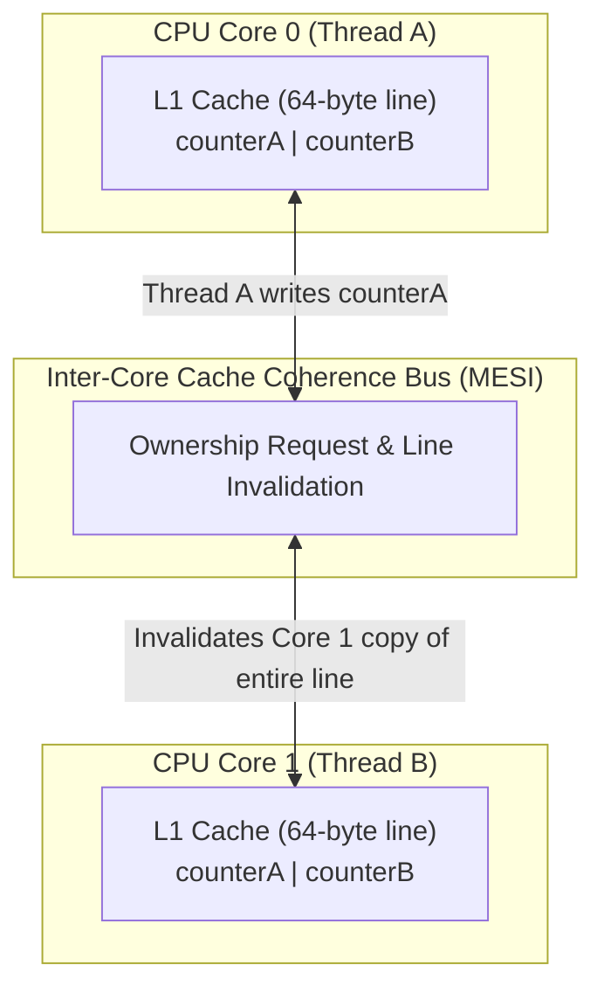

Formula 1 champion Jackie Stewart used the phrase "mechanical sympathy" to describe drivers who understand what the engine, gearbox, and tires are doing underneath them, even if they did not build the car. Martin Thompson brought the same term into the JVM community while designing the LMAX Disruptor: writing software that cooperates with how modern processors actually fetch memory, predict branches, and coordinate cores.

For most business applications, letting the JVM abstract away the hardware is the right call. When a web request spends 20 milliseconds waiting on a PostgreSQL query or a downstream HTTP call, saving 40 nanoseconds on a memory read makes no measurable difference. That trade-off flips in trading engines, market data feeds, high-volume telemetry pipelines, and core messaging infrastructure. Once latencies drop into single-digit microseconds or nanoseconds, your data layout and memory ordering matter more than almost any high-level abstraction.

## CPU Cache Hierarchy and Memory Latency

A modern server CPU running around 3.5 to 4.5 GHz executes a clock cycle roughly every 0.22 to 0.29 nanoseconds. Main memory (DRAM) has not sped up at anywhere near the same rate. To bridge that gap, processors sit behind three tiers of static RAM cache (L1, L2, and L3) that trade capacity for speed.

| Storage Tier | Typical Latency | Approximate Cycles (at 3.5 GHz) | Typical Size |
| :--- | :--- | :--- | :--- |
| CPU Registers | ~0.3 ns | 1 cycle | Tens of registers per core |
| L1 Data Cache (per core) | ~1 ns | 3 to 5 cycles | 32 KB to 48 KB |
| L2 Cache (per core) | ~3 to 5 ns | 12 to 18 cycles | 256 KB to 2 MB |
| L3 Cache (shared across cores) | ~12 to 20 ns | 40 to 70 cycles | 16 MB to 256+ MB |
| Main Memory (DRAM, local NUMA node) | ~60 to 100 ns | 200 to 350 cycles | Tens to hundreds of GB |
| NVMe SSD Read | ~15 to 50 µs | 50,000+ cycles | TB scale |

These numbers vary by microarchitecture and memory generation (DDR4 vs DDR5, local vs remote NUMA socket), but the ratios stay stark. When a Java thread dereferences an object pointer that misses L1, L2, and L3, the core waits for hundreds of cycles while the memory controller fetches bytes from DRAM. Even with out-of-order execution hiding some of that stall, pointer-heavy object graphs leave the execution units idle for most of the run.

## 64-Byte Cache Lines and Spatial Locality

CPUs do not transfer single `byte`, `int`, or `long` values between DRAM and cache. They move memory in fixed-size aligned blocks called **cache lines**. On x86-64 and most Linux ARM64 server chips, a cache line is **64 bytes**. On Apple Silicon (M-series), the cache line size is **128 bytes**, and many Intel and AMD x86 cores also run an adjacent-line spatial prefetcher that pulls pairs of 64-byte lines (128 bytes total) together.

```text
+------------------------------------------------------------------+
|                        64-Byte Cache Line                        |
| [int 0][int 1][int 2][int 3] ... [int 12][int 13][int 14][int 15]|
+------------------------------------------------------------------+
  <------------------ 16 primitive ints (4 bytes each) ----------->
```

Because memory arrives in cache-line chunks, contiguous layouts dramatically outperform pointer-chasing structures even when both have `O(n)` algorithmic complexity.

### Contiguous Arrays vs Linked Structures

An `int[]` stores its elements back-to-back in memory. Reading `values[0]` brings `values[0]` through `values[15]` into L1 in a single cache-line fill. Sequential reads also trigger the hardware stride prefetcher, which detects the linear access pattern and pulls upcoming cache lines into L1/L2 before the loop even asks for them.

A `LinkedList<Integer>` does the opposite:

1. Each element is wrapped in a `Node` object (object header plus `item`, `next`, and `prev` references).
2. Each `Integer` is a separate boxed heap object (typically 16 bytes with compressed OOPs).
3. Neither the nodes nor the boxed integers are guaranteed to stay contiguous as objects age and get compacted across heap regions.

Walking a `LinkedList<Integer>` requires two pointer hops per element (`node -> node.next` and `node -> node.item`). Every hop can miss cache, and the hardware prefetcher cannot easily predict where the next pointer leads. In JMH benchmarks on large collections, scanning a primitive `int[]` routinely finishes an order of magnitude faster than scanning a `LinkedList<Integer>` of the same length.

```java
// Cache-friendly: contiguous primitive memory, predictable stride for hardware prefetcher
public static long sumArray(int[] values) {
    long sum = 0L;
    for (int i = 0; i < values.length; i++) {
        sum += values[i];
    }
    return sum;
}

// Cache-hostile: double indirection (Node -> Integer) across scattered heap addresses
public static long sumList(java.util.LinkedList<Integer> values) {
    long sum = 0L;
    for (Integer value : values) {
        sum += value;
    }
    return sum;
}
```

For the same reason, low-latency Java code favors arrays of primitives, flat structs in off-heap buffers, and Structure-of-Arrays (SoA) layouts over deep trees of small wrapper objects.

## False Sharing and Cache Coherence

Cache lines help single-threaded loops, but they introduce a subtle multithreaded bottleneck called **false sharing**.

Each core has its own private L1 and L2 caches. To make sure two cores never observe inconsistent copies of the same memory address, multi-core CPUs run a hardware cache coherence protocol (variants of **MESI**: Modified, Exclusive, Shared, Invalid, such as MESIF on Intel or MOESI on AMD). Coherence operates at the granularity of an entire cache line, not an individual field.

If Thread A on Core 0 writes to `counterA`, and Thread B on Core 1 writes to `counterB`, and those two unrelated `long` fields happen to sit inside the same 64-byte cache line, the hardware treats them as shared state. Every write by Core 0 transitions the line to Modified and sends an invalidation request over the inter-core interconnect, marking Core 1's copy Invalid. When Core 1 writes `counterB`, it misses its L1 cache, pulls the line back from Core 0 (or L3), and invalidates Core 0 in return.



In Java, false sharing is easy to trigger by accident:

```java
public final class ContendedCounters {
    // Both 8-byte volatile fields sit next to each other in the same 64-byte cache line.
    public volatile long producerCount = 0L;
    public volatile long consumerCount = 0L;
}
```

Even though the producer only writes `producerCount` and the consumer only writes `consumerCount`, the two cores continuously bounce ownership of that single cache line back and forth. Under heavy contention, two threads updating adjacent `volatile long` fields can run several times slower than updating fields separated onto distinct cache lines.

### Eliminating False Sharing: Padding and `@Contended`

To stop false sharing, keep hot mutated fields on separate cache lines, ideally separated by 128 bytes so neither 64-byte lines, 128-byte Apple Silicon lines, nor x86 adjacent-line prefetchers overlap.

#### Manual Padding via Inheritance

Simply adding seven unused `long` fields next to a counter inside one class is fragile because HotSpot is allowed to reorder fields within a single class to minimize alignment gaps, and unused private fields can even be compacted in surprising ways. Libraries like the LMAX Disruptor solve this by splitting padding across a small inheritance hierarchy, because HotSpot lays out superclass fields before subclass fields:

```java
abstract class LhsPadding {
    protected byte
        p10, p11, p12, p13, p14, p15, p16, p17,
        p20, p21, p22, p23, p24, p25, p26, p27,
        p30, p31, p32, p33, p34, p35, p36, p37,
        p40, p41, p42, p43, p44, p45, p46, p47,
        p50, p51, p52, p53, p54, p55, p56, p57,
        p60, p61, p62, p63, p64, p65, p66, p67,
        p70, p71, p72, p73, p74, p75, p76, p77;
}

abstract class CounterValue extends LhsPadding {
    protected volatile long value = 0L;
}

public final class PaddedCounter extends CounterValue {
    protected byte
        p80, p81, p82, p83, p84, p85, p86, p87,
        p90, p91, p92, p93, p94, p95, p96, p97,
        p100, p101, p102, p103, p104, p105, p106, p107,
        p110, p111, p112, p113, p114, p115, p116, p117,
        p120, p121, p122, p123, p124, p125, p126, p127,
        p130, p131, p132, p133, p134, p135, p136, p137,
        p140, p141, p142, p143, p144, p145, p146, p147;

    public long get() {
        return value;
    }

    public void set(long newValue) {
        value = newValue;
    }
}
```

Another common trick in modern Java is placing counters inside a `long[]` at stride-16 offsets (`index * 16`, which is 128 bytes apart) and accessing them with `MethodHandles.arrayElementVarHandle(long[].class)`. That avoids subclass boilerplate and works cleanly without internal JDK flags.

#### HotSpot's `@Contended` Annotation (JEP 142)

The JDK itself uses `@jdk.internal.vm.annotation.Contended` (introduced in Java 8 under `sun.misc.Contended` and moved to `jdk.internal.vm.annotation` in Java 9) inside `Thread`, `ForkJoinPool`, `ConcurrentHashMap`, and `Striped64` (`LongAdder`). When HotSpot lays out an object with a `@Contended` field, it inserts padding (controlled by `-XX:ContendedPaddingWidth`, defaulting to **128 bytes**) around the field or contention group.

```java
import jdk.internal.vm.annotation.Contended;

public final class SequencerCursors {

    @Contended("producer")
    public volatile long producerCursor = 0L;

    @Contended("consumer")
    public volatile long consumerCursor = 0L;
}
```

> [!IMPORTANT]
> `@Contended` is an internal JDK API, not part of the public Java SE specification. By default, HotSpot ignores `@Contended` on classes outside the boot/platform class loaders, and the Java module system blocks compilation against `jdk.internal.vm.annotation`.

To compile and run application code that uses `@Contended` on Java 9 through Java 25, you must pass both the module export and the HotSpot unlock flag:

```bash
javac --add-exports java.base/jdk.internal.vm.annotation=ALL-UNNAMED SequencerCursors.java

java --add-exports java.base/jdk.internal.vm.annotation=ALL-UNNAMED \
     -XX:-RestrictContended \
     SequencerCursors
```

You can verify the exact field offsets HotSpot chose by inspecting the class layout with JOL (Java Object Layout) or `-XX:+PrintFieldLayout` in debug builds. If you ship a library whose users should not have to add JVM flags, stick to inheritance padding or strided arrays instead of `@Contended`.

## Branch Predictors, Pipelines, and Out-of-Order Execution

Modern CPU cores do not finish one instruction before starting the next. They break instructions into micro-operations (`uops`) and feed them through deep **instruction pipelines** (often 14 to 20+ stages) with multiple parallel execution ports (**superscalar execution**).

On top of pipelining, modern desktop and server CPUs perform **Out-of-Order (OoO) execution**. Instructions are decoded into a **Reorder Buffer (ROB)** (often holding 250 to 500+ instructions in flight). Whenever an instruction's operands are ready and an execution unit is free, the core executes it immediately, even if older instructions are still waiting on a cache miss. Results are retired in original program order so single-threaded behavior stays exact.

### Branch Prediction and Misprediction Penalties

Conditional branches (`if`, `switch`, loop checks) create a problem for deep pipelines: the front end needs to fetch the next instructions several cycles before the condition has even been evaluated. To avoid stalling on every `if`, the CPU uses a **Branch Predictor** (such as TAGE-based pattern history predictors combined with a **Branch Target Buffer** for jump destinations).

1. The predictor guesses whether the branch will be taken and begins fetching and executing down that path speculatively.
2. If the guess is right, the speculatively executed instructions simply commit, and the pipeline never stalls.
3. If the guess is wrong, the CPU flushes the speculative instructions from the pipeline, rolls back internal register renames, and starts fetching from the correct target. That misprediction typically costs **15 to 20 clock cycles**.

When branch outcomes follow a predictable pattern (for example, an error check that is almost always false, or processing sorted data), modern branch predictors exceed 99% accuracy. When outcomes are genuinely random (like filtering an unsorted stream of random prices around a midpoint), mispredictions happen roughly half the time and add noticeable latency jitter.

### Branch-Free Techniques in Java

You can often remove unpredictable branches by replacing conditional jumps with arithmetic or expressions that HotSpot's C2 compiler lowers into conditional move instructions (`CMOV` on x86-64, `CSEL` on ARM64).

```java
// Predictable branch only if prices are sorted; mispredicts frequently on random input
public static long sumAboveThresholdBranchy(int[] prices, int threshold) {
    long total = 0L;
    for (int price : prices) {
        if (price >= threshold) {
            total += price;
        }
    }
    return total;
}

// Branchless: computes a 0 or -1 mask without a conditional jump
// Works safely for non-negative values (or widen to long to prevent int subtraction overflow)
public static long sumAboveThresholdBranchless(int[] prices, int threshold) {
    long total = 0L;
    for (int price : prices) {
        long diff = (long) price - threshold;
        // Arithmetic right shift fills all 64 bits with the sign bit:
        // 0L when price >= threshold, -1L when price < threshold
        long mask = ~(diff >> 63);
        total += (price & mask);
    }
    return total;
}
```

Notice two practical details here:

- Subtracting two arbitrary `int` values (`a - b`) can overflow and invert the sign bit if you stay in 32-bit `int` (for example, `Integer.MAX_VALUE - (-1)`). Widening to `long` avoids that bug for all 32-bit `int` inputs.
- Do not hand-write obscure bit tricks blindly. HotSpot C2 already compiles `Math.max(a, b)` and many simple ternary expressions into `CMOV`/`CSEL` when branch profiling shows a near 50/50 split. Always verify with JMH and inspect the generated assembly via `-XX:+UnlockDiagnosticVMOptions -XX:+PrintAssembly` (with `hsdis`) or `perfasm` before sacrificing readability.

## Hardware Memory Barriers and CPU Memory Models

Out-of-order execution, per-core **store buffers**, and cache **invalidation queues** mean that reads and writes issued by one CPU core can become visible to other cores in a different order than they appear in source code.

When a core executes a store, it often places the write into a private FIFO **store buffer** and moves on immediately instead of stalling for cache-line ownership. A subsequent load on the same core can bypass the store buffer and read from L1 cache before the earlier store has drained to cache and become visible to other cores.

To constrain both compiler reordering and hardware reordering, processors provide **memory barriers** (also called **memory fences**). There are four fundamental barrier types, named after the pair of memory operations they separate:

| Barrier Type | Ordering Guarantee | Typical Role |
| :--- | :--- | :--- |
| **Load-Load** | All loads before the barrier complete before any loads after it. | Reading a published flag/cursor before reading the payload it guards. |
| **Store-Store** | All stores before the barrier become visible before any stores after it. | Writing payload fields before publishing a sequence number or ready flag. |
| **Load-Store** | All loads before the barrier complete before any stores after it. | Preventing a write from becoming visible before an earlier read finishes. |
| **Store-Load** | All stores before the barrier are drained and globally visible before any loads after it execute. | Full sequential consistency (e.g., Dekker's algorithm, `volatile` write followed by `volatile` read). |

### x86-64 (TSO) vs ARM64 (Weak Memory Ordering)

CPU architectures differ sharply in which reorderings they allow by default:

- **x86-64 uses Total Store Order (TSO).** The hardware already enforces `Load-Load`, `Load-Store`, and `Store-Store` ordering in hardware. The only reordering x86-64 permits on normal write-back memory is **Store-Load** (a later read bypassing an earlier buffered store to a different address). Consequently, on x86-64, `Load-Load`, `Load-Store`, and `Store-Store` barriers compile to **no hardware instructions at all** (they only restrict JIT compiler reordering). Only a `Store-Load` barrier requires an expensive instruction such as `lock addl` on the top of the stack (HotSpot's usual choice, often cheaper than `mfence` on modern x86) or `mfence`, draining the store buffer.
- **ARM64 (AArch64) uses a weak memory model.** The processor is free to reorder loads and stores across all four combinations unless instructed otherwise. On ARM64, HotSpot must emit actual instructions for acquire/release and fences: `ldar` (load-acquire), `stlr` (store-release), `dmb ishld` (load barrier), `dmb ishst` (store barrier), and `dmb ish` (full inner-shareable barrier).

This difference catches teams off guard when migrating Java services from Intel/AMD servers to AWS Graviton or Apple Silicon: a racy algorithm that appeared to work on x86-64 because TSO masked a missing release barrier can fail immediately on ARM64. Always code against the **Java Memory Model (JMM)** guarantees, never against x86-64 hardware quirks.

### Fine-Grained Memory Ordering with `VarHandle`

Before Java 9, most application developers only had plain fields (no cross-thread visibility guarantee) or `volatile` fields (full sequential consistency, emitting a `Store-Load` barrier on every write on x86-64). `java.lang.invoke.VarHandle` exposes the full spectrum of JMM access modes so you can pay only for the ordering your algorithm actually needs:

| Access Mode | Ordering Semantics | Barriers Required | x86-64 Cost | ARM64 Instruction |
| :--- | :--- | :--- | :--- | :--- |
| `get` / `set` (Plain) | No cross-thread ordering; JIT may hoist out of loops | None | Plain `mov` | Plain `ldr` / `str` |
| `getOpaque` / `setOpaque` | Coherence order per variable; prevents JIT loop hoisting | Compiler barrier only | Plain `mov` | Plain `ldr` / `str` |
| `getAcquire` | Prevents subsequent reads/writes from moving before this read | `Load-Load` + `Load-Store` | Plain `mov` | `ldar` |
| `setRelease` | Prevents prior reads/writes from moving after this write | `Load-Store` + `Store-Store` | Plain `mov` | `stlr` |
| `getVolatile` / `setVolatile` | Total sequential consistency across all volatile accesses | Release + `Store-Load` on write (or matching acquire/release pair) | `mov` + `lock addl` on write | `ldar` / `stlr` (hardware-ordered pair) |

Here is how a single-producer ring buffer publishes data using `setRelease` and `getAcquire` without paying for a `Store-Load` fence on the hot path:

```java
import java.lang.invoke.MethodHandles;
import java.lang.invoke.VarHandle;

public final class SpscSlotChannel {
    private static final VarHandle PUBLISHED_SEQ;

    static {
        try {
            PUBLISHED_SEQ = MethodHandles.lookup()
                .findVarHandle(SpscSlotChannel.class, "publishedSequence", long.class);
        } catch (ReflectiveOperationException e) {
            throw new ExceptionInInitializerError(e);
        }
    }

    private long payloadPrice;
    private int payloadQuantity;
    private long publishedSequence = -1L;

    // Producer thread: write payload first, then publish with release semantics.
    // Guarantees payloadPrice and payloadQuantity cannot be reordered after the sequence store.
    public void publish(long sequence, long price, int quantity) {
        this.payloadPrice = price;
        this.payloadQuantity = quantity;
        PUBLISHED_SEQ.setRelease(this, sequence);
    }

    // Consumer thread: read sequence with acquire semantics before reading payload.
    // Guarantees payload reads cannot be speculatively moved before the sequence load.
    public boolean pollIfReady(long expectedSequence, PriceConsumer consumer) {
        long current = (long) PUBLISHED_SEQ.getAcquire(this);
        if (current < expectedSequence) {
            return false;
        }
        consumer.accept(this.payloadPrice, this.payloadQuantity);
        return true;
    }

    @FunctionalInterface
    public interface PriceConsumer {
        void accept(long price, int quantity);
    }
}
```

`VarHandle` also provides standalone static fence methods (`VarHandle.fullFence()`, `VarHandle.acquireFence()`, `VarHandle.releaseFence()`, `VarHandle.loadLoadFence()`, and `VarHandle.storeStoreFence()`) for rare cases where you need a barrier decoupled from a single field read or write, such as batch-reading an array before releasing a cursor.

```java
// Example: using an explicit storeStoreFence after populating an off-heap or array payload
public void writeAndFence(long[] ring, int index, long value) {
    ring[index] = value;
    VarHandle.storeStoreFence();
}
```

In day-to-day code, prefer `setRelease`/`getAcquire` on a specific `VarHandle` over standalone fences because the JMM defines formal happens-before edges directly on release/acquire pairs, whereas standalone fences are harder to reason about and easier to misplace.

## Practical Questions

### What is false sharing, and why can adding padding speed up multithreaded code?
Cache coherence protocols like MESI track ownership in cache-line units (64 bytes on x86-64, 128 bytes on Apple Silicon), not individual variables. When two threads on different cores frequently write to separate fields that happen to occupy the same cache line, every write invalidates the other core's copy of the entire line. Both cores stall waiting for cache-line transfers over the interconnect. Separating those fields with padding (via inheritance padding, strided array indices, or `@Contended` with `-XX:-RestrictContended` and `--add-exports`) places each variable on its own cache line so both cores keep their line in Modified/Exclusive state locally.

### Why does HotSpot pad `@Contended` fields by 128 bytes by default instead of 64 bytes?
Even on x86-64 CPUs with 64-byte L1 cache lines, hardware spatial prefetchers often fetch adjacent pairs of cache lines (128 bytes) together into L2 cache. In addition, architectures such as Apple Silicon natively use 128-byte cache lines. Padding by 128 bytes on both sides protects the contended field from false sharing caused by both single cache lines and adjacent-line prefetching.

### Why is `VarHandle.setRelease()` significantly faster than a `volatile` write on x86-64, and does that same difference hold on ARM64?
A `volatile` write requires sequential consistency, which prevents a subsequent `volatile` read from being reordered ahead of the write (`Store-Load`). On x86-64, HotSpot enforces that by emitting a `lock addl` (or `mfence`) instruction after a `volatile` write, which drains the core's store buffer and stalls the pipeline. `setRelease()` only requires `Load-Store` and `Store-Store` ordering, which x86-64 TSO already guarantees in hardware, so `setRelease()` compiles to a plain `mov` instruction with no hardware fence. On ARM64, both `setRelease()` and `setVolatile()` compile to `stlr` (store-release), while `getAcquire()` and `getVolatile()` compile to `ldar` (load-acquire); ARM64's `stlr`/`ldar` pair natively provides sequential consistency between release-stores and acquire-loads without an extra `dmb ish`, so the gap between `setRelease` and `setVolatile` is much smaller on ARM64 than on x86-64.

### When should you avoid branchless bit-twiddling in Java?
Only write branchless code after profiling proves that a specific branch is both hot and unpredictable (for instance, `perf stat` showing a high branch-miss rate). If a branch is predictable (such as a fast-path check taken 99.9% of the time), the CPU's branch predictor handles it cheaply, and speculative execution can even outperform a data-dependent branchless expression because branchless code introduces a data dependency chain that limits instruction-level parallelism.
