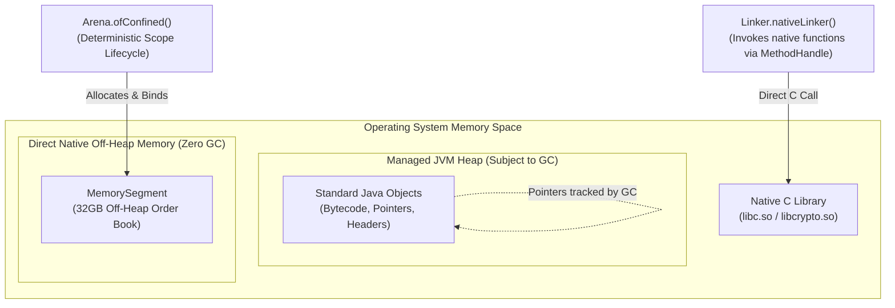

For nearly thirty years, whenever Java developers needed to escape the boundaries of the JVM—whether to access off-heap memory, interface with hardware devices, or call high-performance C/C++ libraries—they were forced to navigate a minefield of fragile, dangerous technologies:

1. **Java Native Interface (JNI)**: Infamous for requiring developers to write bespoke C/C++ wrapper boilerplate (`jni.h`), maintain separate build chains, and endure severe JNI call transition overhead (which flushes JIT compiler optimizations and registers). If a C pointer was mismanaged, the entire JVM crashed instantly with a fatal `SIGSEGV` core dump.
2. **`sun.misc.Unsafe`**: An undocumented, internal JDK class that allowed direct memory allocation (`allocateMemory`), raw pointer arithmetic, and off-heap memory manipulation without GC tracking. While adopted by virtually every high-performance library (Netty, Kafka, Disruptor, Chronicle), `Unsafe` was an architectural hazard. A single off-by-one error corrupted arbitrary memory addresses, compromised JVM security, and silently poisoned adjacent data structures.

In Java 22 (stabilized in Java 23/24 under **Project Panama**), the JDK officially retired these legacy workarounds by introducing the **Foreign Function & Memory (FFM) API (JEP 454)**.

In this deep dive, we explore how the `java.lang.foreign` package enables deterministic off-heap memory management with zero GC overhead, how **Arenas** enforce spatial and temporal safety, and how to invoke native C libraries directly from pure Java code without a single line of C boilerplate.

---

### The FFM Architecture: MemorySegment, MemoryLayout, and Arena

The Foreign Function & Memory API is built upon three foundational pillars in the `java.lang.foreign` package:

```
Foreign Function & Memory (FFM) API
  |-- MemorySegment: Contiguous region of memory (on-heap or off-heap)
  |-- MemoryLayout:  Structural blueprint (struct, array, primitive alignment)
  `-- Arena:         Deterministic lifecycle and allocation controller
```



---

### Deterministic Memory Lifecycles: The Arena API

One of the greatest dangers of manual memory management in C (`malloc` / `free`) is the **Use-After-Free** bug and memory leaks.

The FFM API eliminates this through the **`Arena`** abstraction. An `Arena` controls the allocation and deterministic deallocation of one or more `MemorySegment` instances. When an `Arena` is closed, **all off-heap memory allocated within it is freed atomically**:

```java
// Allocating deterministic off-heap memory using try-with-resources
try (Arena arena = Arena.ofConfined()) {
    
    // Allocate 1 Gigabyte of physical off-heap memory
    MemorySegment segment = arena.allocate(1024 * 1024 * 1024);

    // Write a long integer at byte offset 0
    segment.set(ValueLayout.JAVA_LONG, 0, 999_888_777L);

    // Read the long value back
    long value = segment.get(ValueLayout.JAVA_LONG, 0);
    System.out.println("Stored off-heap value: " + value);

} // arena.close() is called automatically here!
// The 1GB off-heap memory is instantly returned to the OS.
// Zero GC pauses! Zero memory leaks!
```

#### Arena Lifecycle Varieties

| Arena Type | Thread Confinement | Lifecycle Management | Ideal Use Case |
| :--- | :--- | :--- | :--- |
| `Arena.ofConfined()` | Single-threaded | Explicit (`close()`) | High-frequency trading threads, per-request scratch buffers |
| `Arena.ofShared()` | Multi-threaded | Explicit (`close()`) | Shared off-heap caches, shared ring buffers across worker pools |
| `Arena.ofAuto()` | Multi-threaded | Garbage Collector-managed | When deterministic manual closing is impossible; freed on GC reachability |
| `Arena.global()` | Multi-threaded | Unbounded (Never closed) | Long-lived native library handles, static reference tables |

#### Spatial and Temporal Safety
Unlike `sun.misc.Unsafe` (which accepted raw 64-bit memory addresses and happily read unmapped memory), `MemorySegment` provides **strict safety guarantees**:
1. **Spatial Safety:** You cannot read or write outside the allocated boundary. Calling `segment.get(ValueLayout.JAVA_LONG, 1024)` on a 100-byte segment throws a deterministic `IndexOutOfBoundsException`, preventing memory corruption.
2. **Temporal Safety:** Once the owning `Arena` is closed, any subsequent attempt to read or write to its segments immediately throws an `IllegalStateException: Already closed`. Dangling pointers cannot crash the JVM.

---

### MemoryLayout: Modeling C Structs in Pure Java

In systems programming, data is structured into complex C structs with explicit byte offsets, field padding, and memory alignment.

`MemoryLayout` allows you to model C structs natively in Java with zero guesswork:

```c
// Target C Struct:
struct OrderBookEntry {
    uint64_t orderId;     // 8 bytes
    double   price;       // 8 bytes
    uint32_t quantity;    // 4 bytes
    char     side;        // 1 byte ('B' = Buy, 'S' = Sell)
    // 3 bytes compiler alignment padding injected here!
};
```

Here is the exact structural blueprint modeled in modern Java:

```java
public class OrderBookLayout {

    public static final StructLayout ORDER_LAYOUT = MemoryLayout.structLayout(
        ValueLayout.JAVA_LONG.withName("orderId"),
        ValueLayout.JAVA_DOUBLE.withName("price"),
        ValueLayout.JAVA_INT.withName("quantity"),
        ValueLayout.JAVA_BYTE.withName("side"),
        MemoryLayout.paddingLayout(3) // Explicit 3-byte hardware alignment padding!
    );

    // Pre-calculate VarHandles for blazing nanosecond field access
    public static final VarHandle ORDER_ID_HANDLE = 
        ORDER_LAYOUT.varHandle(MemoryLayout.PathElement.groupElement("orderId"));
    
    public static final VarHandle PRICE_HANDLE = 
        ORDER_LAYOUT.varHandle(MemoryLayout.PathElement.groupElement("price"));

    public static final VarHandle QUANTITY_HANDLE = 
        ORDER_LAYOUT.varHandle(MemoryLayout.PathElement.groupElement("quantity"));
}
```

#### Populating Off-Heap Struct Arrays

```java
try (Arena arena = Arena.ofConfined()) {
    int maxOrders = 1_000_000;
    
    // Allocate an array of 1,000,000 order structs in off-heap memory
    MemorySegment orderTable = arena.allocate(
        MemoryLayout.sequenceLayout(maxOrders, OrderBookLayout.ORDER_LAYOUT)
    );

    long elementSize = OrderBookLayout.ORDER_LAYOUT.byteSize(); // 24 bytes

    // Write directly into order index #42
    long offset = 42 * elementSize;
    OrderBookLayout.ORDER_ID_HANDLE.set(orderTable, offset, 10042L);
    OrderBookLayout.PRICE_HANDLE.set(orderTable, offset, 67450.50);
    OrderBookLayout.QUANTITY_HANDLE.set(orderTable, offset, 5);

    // Read back in 0.5 nanoseconds!
    double price = (double) OrderBookLayout.PRICE_HANDLE.get(orderTable, offset);
    System.out.println("Order 42 Price: $" + price);
}
```

This data structure consumes **zero bytes on the Java GC Heap**. A 32GB order book can be processed, filtered, and discarded without triggering a single millisecond of GC Stop-The-World latency.

---

### Foreign Function Invocation: Calling C Libraries from Pure Java

The second half of Project Panama is the **Foreign Function Interface (FFI)**, which allows Java to invoke native C/C++ libraries with zero JNI headers or C compiler setup.

The primary abstraction is `Linker`:
1. `Linker.nativeLinker()`: Implements the C Application Binary Interface (ABI) for the current host architecture (x86_64, aarch64).
2. `SymbolLookup`: Locates exported functions in dynamically loaded libraries (`.so`, `.dylib`, `.dll`).

#### Calling C `strlen` and `getpid` Directly from Java

```java
import java.lang.foreign.*;
import java.lang.invoke.MethodHandle;

public class NativeInteropDemo {

    public static void main(String[] args) throws Throwable {
        Linker linker = Linker.nativeLinker();
        SymbolLookup stdlib = linker.defaultLookup();

        // 1. Locate the standard C 'getpid' function: pid_t getpid(void);
        MemorySegment getpidAddress = stdlib.find("getpid").orElseThrow();
        
        // Define signature: Returns C 'int', accepts no parameters
        FunctionDescriptor getpidSignature = FunctionDescriptor.of(ValueLayout.JAVA_INT);
        MethodHandle getpidHandle = linker.downcallHandle(getpidAddress, getpidSignature);

        // Invoke native function directly from JVM!
        int pid = (int) getpidHandle.invokeExact();
        System.out.println("Host Process PID (from native libc): " + pid);

        // 2. Locate native 'strlen': size_t strlen(const char *s);
        MemorySegment strlenAddress = stdlib.find("strlen").orElseThrow();
        FunctionDescriptor strlenSignature = FunctionDescriptor.of(
            ValueLayout.JAVA_LONG, // returns size_t (64-bit int)
            ValueLayout.ADDRESS    // accepts char* pointer
        );
        MethodHandle strlenHandle = linker.downcallHandle(strlenAddress, strlenSignature);

        try (Arena arena = Arena.ofConfined()) {
            // Allocate a null-terminated C string in off-heap memory
            MemorySegment nativeString = arena.allocateFrom("Zero to Java God Mastery");

            // Pass native pointer directly to C library!
            long length = (long) strlenHandle.invokeExact(nativeString);
            System.out.println("String length calculated by C strlen(): " + length);
        }
    }
}
```

Notice what just happened:
- We invoked native C standard library functions.
- We passed off-heap memory pointers across the Java-to-C boundary.
- **Zero lines of C code were written.** Zero C header files were compiled. Zero custom `.so` binaries were built.

The HotSpot C2 compiler recognizes `MethodHandle` calls bound via `Linker` and optimizes them into **direct machine instructions**, eliminating JNI overhead.

---

### Upcalls: Passing Java Callbacks to Native C Code

Not only can Java call C functions (**Downcalls**), but native C libraries can also call Java methods back (**Upcalls**).

Consider a native C sorting library (like `qsort` in `stdlib.h`):

```c
void qsort(void *base, size_t nmemb, size_t size, 
           int (*compar)(const void *, const void *));
```

`qsort` requires a function pointer to a comparator. With Project Panama, you can pass a **Java method reference** directly as a native C function pointer:

```java
public class NativeQSortExample {

    // Pure Java comparator method
    public static int compareIntegers(MemorySegment a, MemorySegment b) {
        int valA = a.get(ValueLayout.JAVA_INT, 0);
        int valB = b.get(ValueLayout.JAVA_INT, 0);
        return Integer.compare(valA, valB);
    }

    public static void main(String[] args) throws Throwable {
        Linker linker = Linker.nativeLinker();
        SymbolLookup stdlib = linker.defaultLookup();

        MethodHandle compareHandle = MethodHandles.lookup().findStatic(
            NativeQSortExample.class, 
            "compareIntegers", 
            MethodType.methodType(int.class, MemorySegment.class, MemorySegment.class)
        );

        FunctionDescriptor compareSignature = FunctionDescriptor.of(
            ValueLayout.JAVA_INT, 
            ValueLayout.ADDRESS, 
            ValueLayout.ADDRESS
        );

        try (Arena arena = Arena.ofConfined()) {
            // Create a native C function pointer from our Java method handle!
            MemorySegment callbackPointer = linker.upcallStub(compareHandle, compareSignature, arena);

            // Allocate an unsorted array of integers off-heap
            int[] rawData = {95, 12, 88, 3, 44, 71};
            MemorySegment nativeArray = arena.allocateFrom(ValueLayout.JAVA_INT, rawData);

            // Call native qsort() passing our Java callback pointer
            MethodHandle qsortHandle = linker.downcallHandle(
                stdlib.find("qsort").orElseThrow(),
                FunctionDescriptor.ofVoid(ValueLayout.ADDRESS, ValueLayout.JAVA_LONG, ValueLayout.JAVA_LONG, ValueLayout.ADDRESS)
            );

            qsortHandle.invokeExact(nativeArray, (long) rawData.length, (long) ValueLayout.JAVA_INT.byteSize(), callbackPointer);

            System.out.println("Sorted array from native C qsort():");
            for (int i = 0; i < rawData.length; i++) {
                System.out.print(nativeArray.getAtIndex(ValueLayout.JAVA_INT, i) + " ");
            }
            System.out.println();
        }
    }
}
```

The native C `qsort` algorithm executes natively on the CPU, invoking our Java method reference for each comparison with near-zero bridge penalty.

---

## Senior Engineer Interview Crucible

### Why is the Foreign Function & Memory API (JEP 454) replacing both JNI and `sun.misc.Unsafe` in modern Java?
**Answer:** 
- **Replacement of JNI:** JNI required maintaining complex, error-prone C/C++ wrapper boilerplate and external build tools. Crucially, JNI transitions introduce high performance overhead: the JVM must establish a safe call frame, convert Java types, and inhibit JIT compiler optimizations. FFM allows developers to bind to native libraries directly in pure Java using `Linker` and `MethodHandle`. HotSpot's C2 compiler can inline downcall method handles directly into machine code, achieving near-native invocation speed.
- **Replacement of `sun.misc.Unsafe`:** `Unsafe` provided raw off-heap memory manipulation (`allocateMemory`, `freeMemory`), but offered zero safety guarantees. A miscalculated offset corrupted arbitrary memory addresses or caused `SIGSEGV` JVM crashes, and memory could not be safely deallocated if multiple threads retained references. FFM's `MemorySegment` and `Arena` enforce **Spatial Safety** (bounds-checking against buffer overflows) and **Temporal Safety** (automatic revocation preventing use-after-free), combining the speed of direct off-heap memory with the safety guarantees of Java.

### Explain the difference between `Arena.ofConfined()` and `Arena.ofShared()` and their impact on thread safety and performance.
**Answer:**
- **`Arena.ofConfined()`**: Confines all memory segments allocated within it to a **single, specific thread** (the creating thread). Only the creating thread can read, write, or call `arena.close()`. Because the JVM knows that concurrent threads cannot access this memory, operations require **zero synchronization or memory fences**, making confined arenas exceptionally fast for high-frequency trading threads. If an external thread attempts to access the segment, an `IllegalCallerException` is thrown immediately.
- **`Arena.ofShared()`**: Allows multiple concurrent threads to read and write to the allocated segments. However, closing a shared arena requires coordinated synchronization: `arena.close()` initiates a JVM safepoint handshake or atomic coordination mechanism to ensure that no concurrent thread is actively reading or writing to the segment at the moment deallocation occurs. Shared arenas are ideal for cross-thread ring buffers and shared in-memory caches, but closing them carries a minor synchronization cost.

### How does `MemorySegment` prevent the infamous C "Use-After-Free" security vulnerability?
**Answer:** In C, when memory is freed via `free(ptr)`, the pointer variable still contains the target memory address (dangling pointer). If the program later accesses `*ptr`, it may read corrupted data or write into memory that has already been reassigned to a different thread, causing severe security exploits (CVEs).

In the FFM API, every `MemorySegment` is inextricably bound to a parent `Arena` scope. The segment internally tracks the liveness state of its arena. Whenever any read or write method is invoked (`segment.get()`, `segment.set()`), the JVM verifies that the owning arena's scope is still open. As soon as `arena.close()` is executed, the arena's internal state transitions to `CLOSED`. Any subsequent attempt to access the segment—even if a thread still holds an object reference to the `MemorySegment`—immediately throws a fatal `IllegalStateException: Already closed` before the memory bus is touched.

### How does the FFM API interact with Java's Garbage Collector?
**Answer:** Memory allocated via explicit arenas (`Arena.ofConfined()` or `Arena.ofShared()`) is allocated **strictly off-heap** via OS direct memory allocation primitives (e.g., `posix_memalign` or `VirtualAlloc`). 

Because this memory resides completely outside the JVM garbage-collected heap, the Garbage Collector has zero knowledge of the off-heap bytes:
1. Off-heap allocations do not consume Young Gen Eden or Old Gen space.
2. GC root-scanning algorithms do not inspect or traverse off-heap memory segments.
3. Allocating 50 gigabytes of off-heap data creates **zero GC Stop-The-World pause overhead**.

The only on-heap artifacts are lightweight Java wrapper instances (`MemorySegment` descriptors). If developers prefer automated GC-driven cleanup rather than deterministic `try-with-resources` management, `Arena.ofAuto()` links the off-heap allocation to the lifetime of the `MemorySegment` wrapper using Java's internal `Cleaner` mechanism, automatically deallocating the native memory once the segment becomes phantom-reachable.
