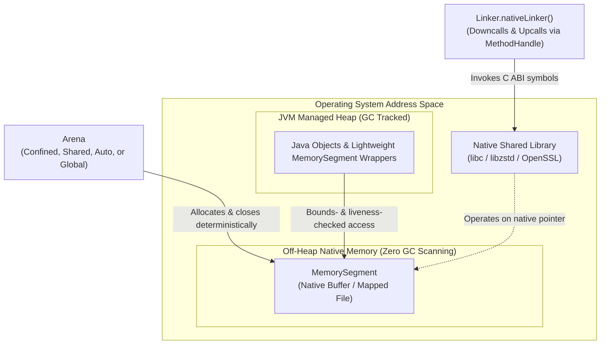

For decades, reaching outside the Java heap meant choosing between two uncomfortable escape hatches. If you needed to call a native C or C++ library, you wrote **JNI** glue code: C header stubs, a separate native build pipeline per OS/architecture, and careful manual reference management across a call boundary that HotSpot could not inline. If you needed raw off-heap memory for network buffers, caches, or storage engines, you reached for **`sun.misc.Unsafe`**—an unsupported internal class with no bounds checks, no lifecycle checks, and an open invitation to corrupt memory or crash the JVM with `SIGSEGV`.

The **Foreign Function & Memory (FFM) API** under Project Panama replaces both. After incubating across Java 14–18 and previewing in Java 19 (JEP 424), Java 20 (JEP 434), and Java 21 (JEP 442), the API was **finalized in Java 22 via JEP 454** in the `java.lang.foreign` package. Alongside it, JDK 23 (JEP 471) deprecated `sun.misc.Unsafe`'s memory-access methods for removal, and JDK 24 (JEP 498) began issuing runtime warnings when they are called.

## Core Building Blocks of `java.lang.foreign`

The FFM API separates off-heap memory and native interop into focused abstractions:

- **`MemorySegment`**: A contiguous region of memory—off-heap native memory, memory-mapped file space, or a view over an on-heap Java array—addressed with 64-bit `long` byte offsets.
- **`MemoryLayout`**: A declarative description of how bytes are organized inside a segment (primitive sizes, byte order, alignment, structs, unions, padding, and fixed-length sequences).
- **`Arena`**: Controls allocation and deallocation lifetimes for native `MemorySegment`s, enforcing thread confinement and temporal safety.
- **`Linker` and `SymbolLookup`**: Locate native functions in shared libraries and bind them to Java `MethodHandle`s (downcalls), or expose Java methods as native C function pointers (upcalls).



### Native Access Permissions (`--enable-native-access`)

Calling native C functions or reinterpreting raw memory addresses can still bypass Java's type and memory safety if a native library misbehaves. Rather than silently allowing any transitive dependency to call arbitrary C code, modern JDKs classify methods like `Linker.downcallHandle`, `SymbolLookup.libraryLookup`, and `MemorySegment.reinterpret` as **restricted methods**.

On Java 22+, running code that invokes restricted methods logs a warning unless you explicitly opt in at launch (and under JEP 472, future JDK releases will reject restricted calls without the flag):

```bash
java --enable-native-access=ALL-UNNAMED -cp target/classes com.example.NativeInteropDemo
```

For modular applications, replace `ALL-UNNAMED` with the specific module name that owns the native bridge so the rest of the dependency tree stays sandboxed.

## Deterministic Off-Heap Memory with `Arena`

A major limitation of `ByteBuffer.allocateDirect()` was non-deterministic cleanup: direct buffers relied on garbage collection and internal `Cleaner` hooks to call `free()`, leading to off-heap OOMs when the Java heap still had plenty of free space and GC did not run often enough.

With `Arena`, off-heap memory follows deterministic try-with-resources scoping. Closing the arena immediately frees every native `MemorySegment` allocated through it:

```java
import java.lang.foreign.Arena;
import java.lang.foreign.MemorySegment;
import java.lang.foreign.ValueLayout;

public class ArenaAllocationDemo {
    public static void main(String[] args) {
        try (Arena arena = Arena.ofConfined()) {
            // Allocate 64 MiB off-heap, zero-initialized, 8-byte aligned
            MemorySegment buffer = arena.allocate(64L * 1024 * 1024, 8);

            buffer.set(ValueLayout.JAVA_LONG, 0, 999_888_777L);
            long value = buffer.get(ValueLayout.JAVA_LONG, 0);
            System.out.println("Stored off-heap value: " + value);
        } // Deterministic native free happens right here; zero GC involvement
    }
}
```

### Choosing the Right Arena Type

| Arena Factory | Thread Access | Deallocation | Best Fit |
| :--- | :--- | :--- | :--- |
| `Arena.ofConfined()` | Single thread (creator only) | Explicit `close()` | Request-scoped buffers, single-threaded event loops, HFT worker threads |
| `Arena.ofShared()` | Multi-threaded | Explicit `close()` (coordinated across threads) | Shared off-heap caches, producer-consumer buffers, pooled native resources |
| `Arena.ofAuto()` | Multi-threaded | Automatic via GC (`Cleaner`) | Allocations whose lifetime cannot be lexically scoped |
| `Arena.global()` | Multi-threaded | Never freed (process lifetime) | Static native library lookups, long-lived lookup tables |

### Spatial, Temporal, and Thread Safety

`MemorySegment` closes the three big holes that made `sun.misc.Unsafe` hazardous:

1. **Spatial safety:** Every read or write checks byte bounds against `segment.byteSize()`. Accessing offset `1024` in a 100-byte segment throws `IndexOutOfBoundsException` instead of reading garbage or crashing the process. HotSpot C2 hoists and eliminates bounds checks inside counted loops much like it does for standard Java arrays.
2. **Temporal safety:** Every segment tracks the liveness of its owning `Arena.Scope`. Once `arena.close()` completes, any read or write through a lingering `MemorySegment` reference throws `IllegalStateException`. For `Arena.ofShared()`, closing uses a scoped memory access handshake (a lightweight thread-local handshake in HotSpot) so no concurrent thread can be mid-read when the underlying OS pages are unmapped.
3. **Thread confinement:** If another thread touches a segment allocated from `Arena.ofConfined()`, the JVM immediately throws `WrongThreadException`. Because only the owning thread can access or close a confined arena, HotSpot skips cross-thread close coordination on confined accesses, making `Arena.ofConfined()` the fastest choice for hot loops.

Because the allocated bytes live outside the Java heap, GC pause times do not scale with off-heap size. A 32 GiB off-heap order book or columnar index leaves only a tiny handful of `MemorySegment` wrapper objects for the garbage collector to scan.

## Modeling C Structs with `MemoryLayout` and `VarHandle`

When working with binary protocols, C structs, or dense off-heap tables, manually tracking byte offsets (`offset + 16`) is tedious and error-prone—especially once C alignment rules inject padding between fields.

Consider this C struct on a 64-bit platform:

```c
struct OrderBookEntry {
    int64_t order_id;   // offset 0,  8 bytes
    double  price;      // offset 8,  8 bytes
    int32_t quantity;   // offset 16, 4 bytes
    int8_t  side;       // offset 20, 1 byte ('B' or 'S')
    // 3 bytes trailing padding so total size (24) is a multiple of 8-byte max alignment
};
```

In Java 22+, you declare the exact same layout with `MemoryLayout.structLayout` and derive `VarHandle`s once at class initialization. Note that in JEP 454 (Java 22), `MemoryLayout.varHandle(...)` includes a `long baseOffset` coordinate as its second parameter so the same `VarHandle` can index any struct inside a larger buffer without slicing:

```java
import java.lang.foreign.Arena;
import java.lang.foreign.MemoryLayout;
import java.lang.foreign.MemoryLayout.PathElement;
import java.lang.foreign.MemorySegment;
import java.lang.foreign.StructLayout;
import java.lang.foreign.ValueLayout;
import java.lang.invoke.VarHandle;

public final class OrderBookTable {

    public static final StructLayout ORDER_LAYOUT = MemoryLayout.structLayout(
        ValueLayout.JAVA_LONG.withName("orderId"),
        ValueLayout.JAVA_DOUBLE.withName("price"),
        ValueLayout.JAVA_INT.withName("quantity"),
        ValueLayout.JAVA_BYTE.withName("side"),
        MemoryLayout.paddingLayout(3)
    );

    private static final VarHandle ORDER_ID =
        ORDER_LAYOUT.varHandle(PathElement.groupElement("orderId"));
    private static final VarHandle PRICE =
        ORDER_LAYOUT.varHandle(PathElement.groupElement("price"));
    private static final VarHandle QUANTITY =
        ORDER_LAYOUT.varHandle(PathElement.groupElement("quantity"));
    private static final VarHandle SIDE =
        ORDER_LAYOUT.varHandle(PathElement.groupElement("side"));

    public static void main(String[] args) {
        long capacity = 1_000_000L;
        long stride = ORDER_LAYOUT.byteSize(); // 24 bytes

        try (Arena arena = Arena.ofConfined()) {
            MemorySegment table = arena.allocate(ORDER_LAYOUT, capacity);

            long offset = 42L * stride;
            ORDER_ID.set(table, offset, 10042L);
            PRICE.set(table, offset, 67450.50);
            QUANTITY.set(table, offset, 5);
            SIDE.set(table, offset, (byte) 'B');

            double price = (double) PRICE.get(table, offset);
            int qty = (int) QUANTITY.get(table, offset);
            System.out.printf("Order 42: price=%.2f, qty=%d%n", price, qty);
        }
    }
}
```

Make sure all `StructLayout` and `VarHandle` fields are `static final`. When HotSpot C2 sees a constant `VarHandle`, it folds the offset computation and emits direct native load/store instructions rather than reflective dispatch.

## Calling Native C Libraries with `Linker` and `SymbolLookup`

The foreign function side of JEP 454 lets Java call C ABI functions directly without writing a single line of C or running `javah`/JNI builds.

Two types anchor the bridge:

- `Linker.nativeLinker()` knows the host platform's C ABI (System V AMD64 on Linux/macOS, Windows x64, AAPCS64 on ARM64).
- `SymbolLookup` finds function addresses in the C standard library (`linker.defaultLookup()`), libraries loaded by the class loader (`SymbolLookup.loaderLookup()`), or an explicit shared library path (`SymbolLookup.libraryLookup(Path, Arena)`).

### Downcalls: Java Calling C

To invoke a C function, look up its symbol address, describe its return and parameter types with a `FunctionDescriptor`, and ask the `Linker` for a `MethodHandle`:

```java
import java.lang.foreign.Arena;
import java.lang.foreign.FunctionDescriptor;
import java.lang.foreign.Linker;
import java.lang.foreign.MemorySegment;
import java.lang.foreign.SymbolLookup;
import java.lang.foreign.ValueLayout;
import java.lang.invoke.MethodHandle;

public class NativeStrlenDemo {

    private static final MethodHandle STRLEN;

    static {
        Linker linker = Linker.nativeLinker();
        SymbolLookup stdlib = linker.defaultLookup();

        // C signature: size_t strlen(const char *s);
        MemorySegment strlenAddr = stdlib.find("strlen").orElseThrow();
        FunctionDescriptor desc = FunctionDescriptor.of(
            ValueLayout.JAVA_LONG, // size_t on 64-bit platforms
            ValueLayout.ADDRESS    // const char *
        );
        STRLEN = linker.downcallHandle(strlenAddr, desc);
    }

    public static void main(String[] args) throws Throwable {
        try (Arena arena = Arena.ofConfined()) {
            // Allocates a null-terminated UTF-8 C string off-heap
            MemorySegment cString = arena.allocateFrom("Project Panama FFM API");
            long length = (long) STRLEN.invokeExact(cString);
            System.out.println("strlen() returned: " + length);
        }
    }
}
```

For very short, non-blocking C functions that never call back into Java (such as a fast checksum or math routine), you can pass `Linker.Option.critical(false)` (or `critical(true)` to allow passing on-heap Java arrays directly without copying off-heap) when creating the downcall handle. That lets the JVM skip thread-state transition overhead during the call, though it must only be used for genuinely short functions because the thread cannot reach a GC safepoint while inside the native call.

### Upcalls: Passing Java Callbacks to C

Many C libraries accept function pointers—for comparators, event callbacks, or custom allocators. `Linker.upcallStub` wraps a Java `MethodHandle` in a native function pointer whose lifetime is tied to an `Arena`.

Here is an example calling standard C `qsort` (`void qsort(void *base, size_t nmemb, size_t size, int (*compar)(const void *, const void *))`) with a Java comparator:

```java
import java.lang.foreign.AddressLayout;
import java.lang.foreign.Arena;
import java.lang.foreign.FunctionDescriptor;
import java.lang.foreign.Linker;
import java.lang.foreign.MemorySegment;
import java.lang.foreign.SymbolLookup;
import java.lang.foreign.ValueLayout;
import java.lang.invoke.MethodHandle;
import java.lang.invoke.MethodHandles;
import java.lang.invoke.MethodType;

public class NativeQSortDemo {

    public static int compareInts(MemorySegment a, MemorySegment b) {
        int left = a.get(ValueLayout.JAVA_INT, 0);
        int right = b.get(ValueLayout.JAVA_INT, 0);
        return Integer.compare(left, right);
    }

    public static void main(String[] args) throws Throwable {
        Linker linker = Linker.nativeLinker();
        SymbolLookup stdlib = linker.defaultLookup();

        // Attach targetLayout(JAVA_INT) so incoming C pointers arrive as 4-byte segments
        // rather than zero-length segments (which would throw IndexOutOfBoundsException).
        AddressLayout intPtr = ValueLayout.ADDRESS.withTargetLayout(ValueLayout.JAVA_INT);

        MethodHandle compareHandle = MethodHandles.lookup().findStatic(
            NativeQSortDemo.class,
            "compareInts",
            MethodType.methodType(int.class, MemorySegment.class, MemorySegment.class)
        );
        FunctionDescriptor compareDesc = FunctionDescriptor.of(
            ValueLayout.JAVA_INT,
            intPtr,
            intPtr
        );

        MethodHandle qsort = linker.downcallHandle(
            stdlib.find("qsort").orElseThrow(),
            FunctionDescriptor.ofVoid(
                ValueLayout.ADDRESS,
                ValueLayout.JAVA_LONG,
                ValueLayout.JAVA_LONG,
                ValueLayout.ADDRESS
            )
        );

        try (Arena arena = Arena.ofConfined()) {
            MemorySegment comparatorPtr = linker.upcallStub(compareHandle, compareDesc, arena);

            int[] unsorted = {95, 12, 88, 3, 44, 71};
            MemorySegment nativeArray = arena.allocateFrom(ValueLayout.JAVA_INT, unsorted);

            qsort.invokeExact(
                nativeArray,
                (long) unsorted.length,
                ValueLayout.JAVA_INT.byteSize(),
                comparatorPtr
            );

            for (int i = 0; i < unsorted.length; i++) {
                System.out.print(nativeArray.getAtIndex(ValueLayout.JAVA_INT, i) + " ");
            }
            System.out.println();
        }
    }
}
```

> [!WARNING]
> Without `.withTargetLayout(ValueLayout.JAVA_INT)`, a pointer passed from C into Java via `ValueLayout.ADDRESS` arrives as a **zero-length** `MemorySegment` because C pointers carry no bounds metadata. Reading from a zero-length segment throws `IndexOutOfBoundsException`. Attaching a target layout (when the pointed-to size is statically known) avoids needing unsafe `reinterpret()` calls inside the callback.

For large native libraries like OpenSSL, SQLite, or liburing, you rarely write `FunctionDescriptor`s by hand. The OpenJDK **`jextract`** tool parses C `.h` header files and generates strongly typed Java bindings using the FFM API automatically.

## High-Performance Direct Memory I/O

Before Project Panama, memory-mapped file I/O in Java meant `FileChannel.map(...)` returning a `MappedByteBuffer`. That API had two well-known production headaches:

1. **The 2 GiB ceiling:** Because `ByteBuffer` indexes with a signed 32-bit `int`, a single `MappedByteBuffer` cannot exceed `Integer.MAX_VALUE` bytes (~2.14 GiB). Mapping a 100 GiB append-only journal or database file forced libraries to maintain arrays of tiled buffers and handle records crossing 2 GiB boundaries.
2. **Non-deterministic unmapping:** `MappedByteBuffer` has no `close()` or `unmap()` method. The OS mapping stayed alive until GC collected the buffer and ran its internal `Cleaner`. On Windows, that prevented deleting or rotating files; on Linux, it could exhaust `vm.max_map_count` or pin virtual memory unexpectedly. Libraries resorted to calling `Unsafe.invokeCleaner(buffer)` just to unmap files reliably.

JEP 454 adds an overload on `FileChannel` that maps directly to a `MemorySegment` bound to an `Arena`:

```java
import java.io.IOException;
import java.lang.foreign.Arena;
import java.lang.foreign.MemorySegment;
import java.lang.foreign.ValueLayout;
import java.nio.channels.FileChannel;
import java.nio.file.Path;
import java.nio.file.StandardOpenOption;

public class MappedSegmentJournal {

    private static final long RECORD_SIZE = 16L; // 8-byte timestamp + 8-byte sequence

    public static void main(String[] args) throws IOException {
        Path journalPath = Path.of("order-journal.bin");
        long fileSize = 4L * 1024 * 1024 * 1024; // 4 GiB — exceeds MappedByteBuffer's 2 GiB limit

        try (FileChannel channel = FileChannel.open(
                 journalPath,
                 StandardOpenOption.CREATE,
                 StandardOpenOption.READ,
                 StandardOpenOption.WRITE);
             Arena arena = Arena.ofConfined()) {

            // Map the entire 4 GiB file into one contiguous MemorySegment
            MemorySegment mapped = channel.map(
                FileChannel.MapMode.READ_WRITE,
                0L,
                fileSize,
                arena
            );

            // Write directly into virtual memory pages (zero syscall per record)
            long recordIndex = 200_000_000L; // Beyond the 2 GiB offset mark
            long offset = recordIndex * RECORD_SIZE;

            mapped.set(ValueLayout.JAVA_LONG_UNALIGNED, offset, System.nanoTime());
            mapped.set(ValueLayout.JAVA_LONG_UNALIGNED, offset + 8, recordIndex);

            // Explicitly flush dirty pages to durable storage when required
            mapped.force();

        } // arena.close() deterministically calls munmap() before channel.close()
    }
}
```

Mapped `MemorySegment`s also expose page-cache lifecycle methods directly: `mapped.load()` hints to the OS to fault pages into RAM (useful during startup warmup to avoid minor page faults on the trading hot path), `mapped.isLoaded()` checks residency, `mapped.force()` flushes dirty pages to disk (`msync`), and `mapped.unload()` advises the kernel that pages can be reclaimed.

When you need to hand a `MemorySegment` to an existing NIO API (such as `SocketChannel.write` or `FileChannel.read`), call `segment.asByteBuffer()` for a zero-copy `ByteBuffer` view of any slice up to 2 GiB.

## Practical Questions

### How does JEP 454 improve on both JNI and `sun.misc.Unsafe`?
JNI required writing and compiling C wrapper code, converting JVM types across the native boundary, and paying a call-transition cost that prevented JIT inlining. `Linker` binds directly to C ABI symbols via `MethodHandle`s from pure Java, allowing HotSpot C2 to specialize and optimize the call path. Against `sun.misc.Unsafe`, `MemorySegment` and `Arena` add bounds checking (spatial safety), deterministic close revocation (temporal safety), and thread-confinement enforcement without forcing data onto the GC heap.

### What is the practical trade-off between `Arena.ofConfined()` and `Arena.ofShared()`?
`Arena.ofConfined()` allows only the creating thread to read, write, or close the arena's segments; any other thread gets a `WrongThreadException`. Because no other thread can access the memory concurrently, HotSpot avoids cross-thread synchronization on access and close. `Arena.ofShared()` allows safe multi-threaded access and explicit `close()`, which is ideal for shared caches or worker pools, but closing a shared arena requires a JVM thread-local handshake to guarantee no thread is mid-access when the native memory is freed.

### How does `MemorySegment` prevent use-after-free bugs in multi-threaded code?
Every `MemorySegment` is tied to an `Arena.Scope`. Each memory access checks that the scope is still alive. When `arena.close()` runs on a shared arena, the JVM flips the scope state and performs a thread-local handshake across threads to ensure any in-flight scoped memory access finishes before the underlying native memory is released or unmapped. Subsequent attempts to read or write through the closed segment throw `IllegalStateException` instead of touching freed addresses.

### Why is `FileChannel.map(..., Arena)` a big upgrade over `MappedByteBuffer`?
`MappedByteBuffer` was capped at 2 GiB per mapping because of 32-bit `int` indices and offered no deterministic `unmap()` method, leaving file descriptors and virtual memory pinned until GC ran. `FileChannel.map(MapMode, offset, size, arena)` returns a `MemorySegment` with 64-bit `long` offsets capable of mapping multi-gigabyte or multi-terabyte files in a single region, and deterministically unmaps the file the moment `arena.close()` executes.
