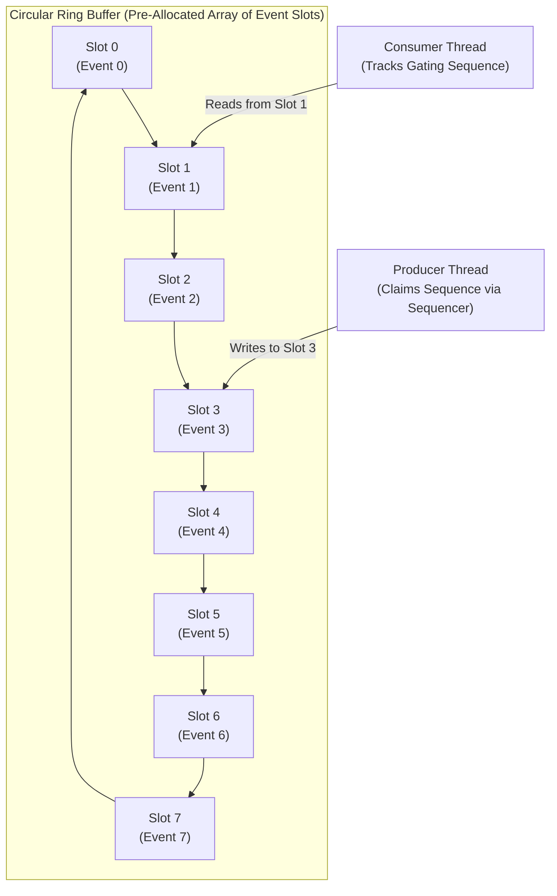
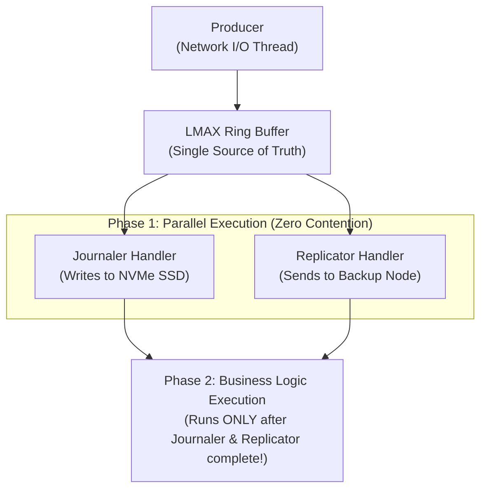

In 2011, a retail financial exchange in London called LMAX shocked the software world by publishing benchmark results for their new order-matching engine. 

While the banking industry was spending millions of dollars on massive distributed clusters and multi-threaded queue architectures—struggling to process 50,000 trades per second with multi-millisecond latency—LMAX demonstrated that a single JVM running on commodity off-the-shelf hardware could process **over 6 million orders per second on a single thread**, with a 99.99th percentile latency of less than **15 microseconds**.

The secret weapon behind this feat was the **LMAX Disruptor**: an open-source, lock-free, high-performance inter-thread messaging library. 

In this deep dive, we explore why traditional Java concurrent queues collapse under hardware contention, how circular Ring Buffers leverage power-of-two bit masking, how Sequencers synchronize threads without locks, and how to select the right Wait Strategy for sub-microsecond systems.

---

### Why Traditional Queues Collapse: The Contention Nightmare

When Java developers need to pass messages between threads, the standard choice is `java.util.concurrent.ArrayBlockingQueue` or `LinkedBlockingQueue`. 

While functionally correct, `BlockingQueue` architectures suffer from three fatal hardware bottlenecks:

1. **Lock Contention:** To coordinate producers and consumers, `ArrayBlockingQueue` uses a heavy `ReentrantLock`. Whenever a producer writes a message, it must acquire the lock, stalling all other producers and consumers. Locking at the operating system level invokes kernel futexes, forcing thread descheduling and context switches that cost **1,000 to 3,000 nanoseconds**.
2. **Cache Line False Sharing:** A queue has two ends: a `head` and a `tail`. In high-throughput systems, producers are constantly modifying the `tail` pointer while consumers are modifying the `head` pointer. In memory, these two pointers sit adjacent to one another. The hardware MESI cache coherence protocol continuously invalidates the L1 cache lines between the producing and consuming CPU cores, causing extreme memory bus thrashing.
3. **Dynamic Memory Allocation:** `LinkedBlockingQueue` allocates a new `Node` object on the heap for every single message passed through the queue. Passing 5 million messages per second creates 5 million short-lived objects per second, saturating JVM Eden space and triggering constant Young Generation Garbage Collection pauses.

```
Traditional Queue:   Lock contention + Cache line thrashing + Continuous GC allocations
LMAX Disruptor:      Lock-free + Padded cache lines + Zero allocations after boot
```

---

### The Ring Buffer Architecture

The foundational data structure of the Disruptor is the **Ring Buffer**: a pre-allocated, circular array of pre-instantiated message slots:



#### Zero Garbage Allocation at Runtime
In the Disruptor, message objects are **never allocated during runtime**. 
When the Ring Buffer boots up, it allocates every event slot upfront:
```java
// Pre-allocate all 1,048,576 event objects into memory at startup!
RingBuffer<OrderEvent> ringBuffer = RingBuffer.createSingleProducer(
    OrderEvent::new, 
    1024 * 1024 // Buffer size MUST be a power of two
);
```
When a producer sends an event, it does not insert a new object into the ring. Instead, it asks the Ring Buffer for a pre-allocated event slot, mutates its fields in-place, and publishes the sequence. **Zero heap allocation occurs. Zero garbage is generated. The Garbage Collector is never invoked.**

#### Power-of-Two Fast Bit Masking
In computer hardware, the modulo operator (`index = sequence % bufferSize`) is computationally expensive; an integer division instruction requires **20 to 40 CPU clock cycles**.

By mandating that the Ring Buffer size must strictly be a **Power of Two** (e.g., 1024, 65536, 1048576), the Disruptor replaces the expensive modulo operation with a lightning-fast bitwise AND operation that executes in **a single CPU clock cycle (< 0.3 nanoseconds)**:

```java
// Slow modulo operation (40 cycles)
int indexModulo = (int) (sequence % bufferSize);

// Blazing fast bitwise mask (1 cycle!)
int indexBitwise = (int) (sequence & (bufferSize - 1));
```

Because `bufferSize` is a power of two, `bufferSize - 1` is a continuous binary mask of `1` bits (e.g., `1024 - 1 = 1023` -> `00000011 11111111`). Bitwise ANDing with the 64-bit sequence cleanly wraps around the circular array indefinitely.

---

### Sequences, Barriers, and the Single Producer Principle

How do threads coordinate which slots they can safely read and write without taking locks?

The coordination mechanism relies on 64-bit monotonically increasing **Sequence** counters. Every sequence counter is isolated with 128 bytes of padding to prevent False Sharing.

#### The Single Producer Principle
In many ultra-low-latency architectures (like trading exchange gateways), a single network thread receives incoming market packets and publishes them to the core pipeline.

When you configure the Disruptor with `ProducerType.SINGLE`:
- **Zero Locks:** No mutex locks are ever acquired.
- **Zero Compare-And-Swap (CAS):** The producer does not even execute atomic CAS instructions (`lock cmpxchg`).
- It simply writes to a local `long` sequence counter using a plain volatile write or `VarHandle.setRelease()`.

#### Preventing Ring Buffer Wrap-Around
Because the Ring Buffer is a circular array, a fast producer could easily lap a slow consumer and overwrite unconsumed data.

To prevent this, the producer checks the **Gating Sequences** of all registered consumers before claiming a slot:

```
wrapPoint = targetSequence - bufferSize;
if (wrapPoint > minimumConsumerSequence) {
    // Ring buffer is full! Back off or yield until consumer catches up
}
```

The producer only reads the consumer's sequence counter when it gets close to wrapping the buffer. For thousands of events in between, the producer writes at maximum memory bus bandwidth without checking anything!

---

### Wait Strategies: Tuning the Latency vs CPU Dilemma

When a consumer thread is waiting for the producer to publish the next sequence in the ring buffer, how should it wait? 

The Disruptor provides pluggable **Wait Strategies**, allowing engineers to trade CPU utilization for nanosecond latency:

| Wait Strategy | Latency | Jitter | CPU Core Utilization | Ideal Production Scenario |
| :--- | :--- | :--- | :--- | :--- |
| **`BusySpinWaitStrategy`** | **< 100 ns** | Lowest | **100% CPU burn** (Continuous spinning) | Dedicated CPU cores, HFT order-matching engines |
| **`YieldingWaitStrategy`** | ~200 ns | Very Low | High (Spins 100 times, then `Thread.yield()`) | Low-latency microservices sharing cores with OS |
| **`SleepingWaitStrategy`** | ~1-5 µs | Low | Moderate (Spins, yields, then `LockSupport.parkNanos()`) | Asynchronous logging pipelines (Log4j2 async) |
| **`BlockingWaitStrategy`** | ~2-10 µs | High | Lowest (Uses `ReentrantLock` & Condition) | CPU-constrained cloud environments, dev machines |

#### The BusySpinWaitStrategy: Pure Mechanical Sympathy
For ultra-low-latency financial trading, `BusySpinWaitStrategy` is the gold standard:
```java
// Inside BusySpinWaitStrategy
while ((availableSequence = dependentSequence.get()) < sequence) {
    Thread.onSpinWait(); // Emits x86 PAUSE instruction: saves power and avoids pipeline flush!
}
```
The thread never goes to sleep. It stays pinned on its physical CPU core, running a tight spin-loop. When a new sequence arrives, the consumer processes the event within **tens of nanoseconds**, with zero OS context switch latency.

---

### Pipeline and Diamond Dependency Topologies

Traditional queues force linear point-to-point communication. If three services need to process an incoming order—say, Journaling to disk, Replicating over the network, and Executing business logic—a queue architecture requires chaining multiple queues and thread pools.

The Disruptor natively supports **Complex Dependency Graphs**:



In this **Diamond Topology**:
1. The `Journaler` and `Replicator` consume the exact same event slot from the Ring Buffer **in parallel** with zero thread contention.
2. The `BusinessLogic` handler is gated by both the `Journaler` and `Replicator` sequences. It executes only after both Phase 1 handlers have finished processing the slot.
3. No intermediate queues, no message cloning, and zero data copying.

---

### Production Implementation: Building a Sub-Microsecond Event Processor

Here is a complete, working Disruptor implementation in modern Java:

```java
public class HighFrequencyDisruptorEngine {

    // 1. The Pre-allocated Event
    public static class MarketTradeEvent {
        private long tradeId;
        private double price;
        private long quantity;
        private String symbol;

        public void set(long tradeId, double price, long quantity, String symbol) {
            this.tradeId = tradeId;
            this.price = price;
            this.quantity = quantity;
            this.symbol = symbol;
        }

        public long getTradeId() { return tradeId; }
        public double getPrice() { return price; }
        public String getSymbol() { return symbol; }
    }

    // 2. The Consumer Event Handler
    public static class TradeExecutionHandler implements EventHandler<MarketTradeEvent> {
        @Override
        public void onEvent(MarketTradeEvent event, long sequence, boolean endOfBatch) {
            // High-speed business logic executed in nanoseconds
            if (event.getPrice() > 1000.0) {
                // Execute trade...
            }
        }
    }

    public static void main(String[] args) {
        // Buffer size MUST be power of two: 2^16 = 65,536 slots
        int bufferSize = 1024 * 64; 

        Disruptor<MarketTradeEvent> disruptor = new Disruptor<>(
            MarketTradeEvent::new,
            bufferSize,
            DaemonThreadFactory.INSTANCE,
            ProducerType.SINGLE, // Blazing fast single-producer mode
            new BusySpinWaitStrategy() // Sub-microsecond latency
        );

        // Connect the consumer
        disruptor.handleEventsWith(new TradeExecutionHandler());

        // Start all threads
        RingBuffer<MarketTradeEvent> ringBuffer = disruptor.start();

        // High-frequency publishing loop (Zero allocations!)
        for (long i = 0; i < 1_000_000; i++) {
            long sequence = ringBuffer.next(); // Claim next slot
            try {
                MarketTradeEvent event = ringBuffer.get(sequence);
                // Mutate pre-allocated event in place!
                event.set(i, 67450.25, 10, "BTC-USD");
            } finally {
                // Publish sequence, making it visible to consumers with release barrier
                ringBuffer.publish(sequence); 
            }
        }
    }
}
```

---

## Senior Engineer Interview Crucible

### Why does `ArrayBlockingQueue` suffer from extreme performance degradation compared to the LMAX Disruptor under high concurrent load?
**Answer:** `ArrayBlockingQueue` degrades due to three fundamental hardware design constraints:
1. **Lock Contention:** It uses a single `ReentrantLock` (or dual head/tail locks) to protect queue operations. When multiple threads contend for the lock, the OS kernel deschedules the thread and invokes context switches, costing 1 to 3 microseconds per operation.
2. **Cache Line False Sharing:** The queue's `head` and `tail` pointers are updated simultaneously by consumers and producers. Because they reside within the same 64-byte cache line in memory, the hardware MESI coherence protocol invalidates L1/L2 caches across CPU cores on every single insert and remove.
3. **Dynamic Memory & Modulo Penalties:** Moving elements involves continuous array shifting or reference re-pointing, and calculating ring bounds via modulo arithmetic (`%`) costs 20 to 40 CPU clock cycles.

The Disruptor eliminates all three bottlenecks: it operates completely lock-free using sequence barriers, pads all sequence counters with 128 bytes to eliminate false sharing, pre-allocates all event memory at bootup, and replaces modulo arithmetic with single-cycle power-of-two bit masking (`sequence & (bufferSize - 1)`).

### What is the purpose of `Thread.onSpinWait()` in the `BusySpinWaitStrategy`?
**Answer:** When a thread runs a tight `while(true)` spin-loop waiting for a memory condition to change, the CPU's out-of-order execution engine speculatively executes hundreds of loop iterations ahead of time. When the memory value finally updates, the CPU detects a memory ordering violation and is forced to flush its entire instruction pipeline, wasting cycles and drawing excessive electrical power.

`Thread.onSpinWait()` (introduced in Java 9 via JEP 285) instructs the HotSpot compiler to emit the x86 `PAUSE` machine instruction (or `YIELD` on ARM). The `PAUSE` instruction:
1. Hints to the CPU core that it is in a spin-wait loop, temporarily throttling instruction execution to save power.
2. Prevents the CPU pipeline from suffering a severe pipeline-flush penalty when exiting the loop.
3. Allows hyper-threaded sibling cores sharing the same physical ALU to utilize execution resources while this core is spinning.

### How does the LMAX Disruptor prevent a fast producer from overwriting an event that a slow consumer has not yet finished reading?
**Answer:** The Disruptor maintains absolute safety through **Gating Sequences**. 

Every consumer maintains its own 64-bit monotonically increasing `Sequence` counter representing the latest event index it has successfully processed. 

When the producer requests the next sequence slot via `ringBuffer.next()`, the sequencer calculates the **Wrap Point**:
```java
long wrapPoint = targetSequence - bufferSize;
```
If `wrapPoint` is greater than the **minimum sequence among all registered consumers**, it means the circular buffer has completed a full lap and the target slot is still actively being read by the slowest consumer. The producer immediately halts its advance and executes a backoff or spin strategy until the slowest consumer's gating sequence advances past the wrap point. This ensures data is never overwritten without taking a single lock.

### Explain the batching effect in the Disruptor and why it causes throughput to increase as load increases.
**Answer:** In traditional queues, processing costs scale linearly with message volume: each message incurs a lock acquisition and release. Under heavy load, lock contention increases, causing queue throughput to collapse.

The Disruptor exhibits an inverted performance curve known as the **Batching Effect**:
When a consumer falls slightly behind because a burst of 1,000 events arrives from the producer, the consumer does not read events one by one with memory fences between them. When the consumer checks the available sequence:
```java
long availableSequence = sequenceBarrier.waitFor(nextSequence);
```
If `availableSequence` has jumped ahead by 1,000 slots (e.g., from slot 100 to slot 1100), the consumer retrieves the entire batch in a single read. It processes all 1,000 events sequentially in a tight L1-cache loop and publishes a single sequence update at the very end (`sequence.set(1100)`). 

Because the synchronization cost is amortized across 1,000 events rather than paid per-message, **the Disruptor's throughput actually increases under extreme load**, easily handling millions of messages per second during market volatility spikes.
