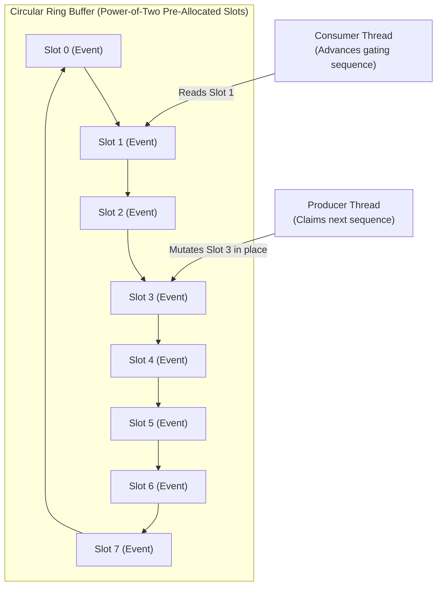
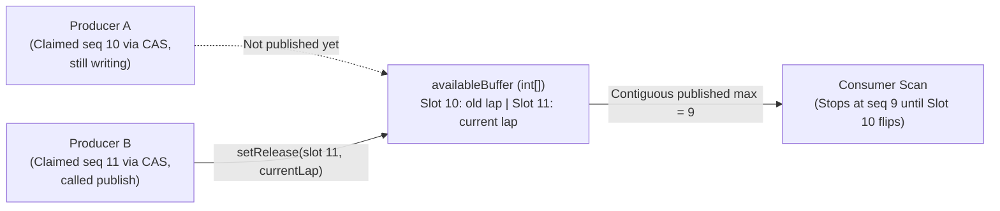
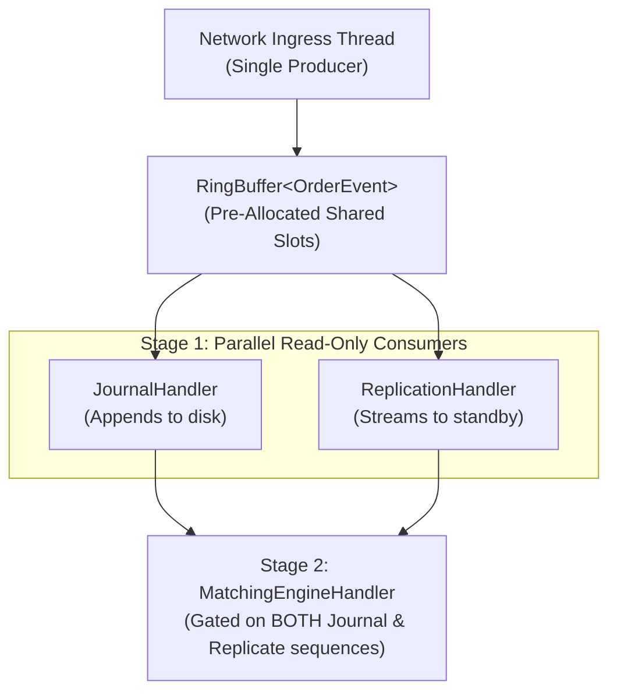

When LMAX built its retail financial exchange in London around 2011, their team discovered that business logic was rarely the bottleneck in Java messaging pipelines. Most CPU time went into passing events between threads using standard `java.util.concurrent` queues. Their solution—the **LMAX Disruptor**—pushed millions of events per second through a single JVM thread with microsecond-level tail latency, and its core design is now embedded inside tools like Log4j2's async loggers and countless trading and telemetry systems.

The Disruptor is not a drop-in queue with slightly better locking. It is a lock-free inter-thread coordination pattern built around cache lines, pre-allocated memory, and sequence numbers.

## Why Standard `BlockingQueue` Implementations Bottleneck

For ordinary backend services, `ArrayBlockingQueue` and `LinkedBlockingQueue` are reliable and easy to reason about. Under sustained high throughput (hundreds of thousands to millions of messages per second), they hit three hardware bottlenecks:

1. **Lock contention and kernel involvement:** `ArrayBlockingQueue` guards both `put` and `take` with a single `ReentrantLock`. When producers and consumers contend on that lock, threads block and get parked by the OS scheduler (via Linux `futex`), incurring context-switch costs in the microsecond range and flushing L1/L2 caches when the thread resumes on another core.
2. **Cache-line false sharing:** A bounded queue tracks a `putIndex` (tail), a `takeIndex` (head), and a `count` (or size). In `ArrayBlockingQueue`, those fields live inside the same object and typically land on the same 64-byte cache line. Even if you split read and write locks (as `LinkedBlockingQueue` does with `putLock` and `takeLock`), updating `count` (`AtomicInteger`) or adjacent head/tail fields triggers continuous MESI cache-line invalidations between producer and consumer cores.
3. **Heap allocation and pointer chasing:** `LinkedBlockingQueue` allocates a fresh `Node<E>` object for every enqueued element and discards it on dequeue. At several million messages per second, that churns Young Gen Eden space rapidly and scatters nodes across heap addresses, hurting cache locality.

The Disruptor addresses all three at once: pre-allocate the event slots once at startup, separate every mutable cursor onto its own padded cache line, and coordinate producers and consumers with monotonic sequence numbers instead of locks.

## Circular Ring Buffer and Power-of-Two Masking

At the heart of the Disruptor is a `RingBuffer<T>`: a fixed-size, circular array of pre-instantiated event objects created up front via an `EventFactory<T>`.



Instead of creating a new message object on every publish and pushing its reference into a queue, the producer claims the next sequence number, fetches the existing `Event` object already sitting in that slot, overwrites its primitive fields in place, and publishes the sequence. After startup, steady-state publishing allocates zero objects.

### Power-of-Two Index Masking

Mapping a monotonically increasing 64-bit `sequence` onto a fixed circular array normally uses modulo arithmetic (`sequence % bufferSize`). On x86-64 CPUs, integer division (`idiv`) is a multi-cycle instruction that takes roughly 20 to 40 cycles and is not fully pipelined.

The Disruptor requires `bufferSize` to be a **power of two** (for example, `1024`, `65536`, or `1048576`). When `bufferSize` is a power of two, `bufferSize - 1` is a bitmask of all ones in the lower bits (e.g., `65536 - 1 = 65535 = 0xFFFF`). Computing the array slot becomes a single-cycle bitwise AND:

```java
// Integer division (slow multi-cycle instruction)
int slowIndex = (int) (sequence % bufferSize);

// Single-cycle bitwise mask (requires bufferSize to be a power of two)
int indexMask = bufferSize - 1;
int fastIndex = (int) (sequence & indexMask);
```

Inside `RingBuffer`, the backing `Object[] entries` array is also padded at both ends (`BUFFER_PAD` null slots before slot 0 and after slot `bufferSize - 1`). That keeps the array's object header and length field—and any unrelated objects allocated right after the array—from sharing a cache line with the first or last event slots.

## Sequencer Architecture: Single-Producer vs Multi-Producer

All coordination in the Disruptor is driven by a **Sequencer**, which hands out sequence numbers to producers, tracks the cursor of published slots, and enforces backpressure against the slowest consumer. The Disruptor provides two distinct implementations because single-producer and multi-producer coordination have very different hardware costs.

### `SingleProducerSequencer`

When only one thread ever writes to the ring buffer (`ProducerType.SINGLE`), the sequencer needs **no locks and no Compare-And-Swap (CAS) instructions**.

- The producer keeps a private, non-volatile `nextValue` (the last claimed sequence) and a `cachedValue` (its cached copy of the slowest consumer's sequence).
- Before claiming `n` slots, it checks whether `wrapPoint = nextSequence - bufferSize` has overtaken `cachedValue`.
- Only when `wrapPoint > cachedValue` does the producer refresh `cachedValue` by reading all consumers' **gating sequences**. If the buffer is still full, it parks briefly (`LockSupport.parkNanos(1L)`) and rechecks until the slowest consumer frees space.
- For thousands of events between wrap-point checks, the producer never even reads a consumer cache line. Publishing simply writes `cursor.set(sequence)` with release semantics.

```java
// Conceptual logic inside SingleProducerSequencer.next(int n)
long nextSequence = this.nextValue + n;
long wrapPoint = nextSequence - bufferSize;
long cachedGatingSequence = this.cachedValue;

if (wrapPoint > cachedGatingSequence || cachedGatingSequence > this.nextValue) {
    long minSequence;
    while (wrapPoint > (minSequence = Util.getMinimumSequence(gatingSequences, this.nextValue))) {
        LockSupport.parkNanos(1L); // Buffer is full; wait for slowest consumer to catch up
    }
    this.cachedValue = minSequence;
}
this.nextValue = nextSequence;
return nextSequence;
```

### `MultiProducerSequencer`

When multiple producer threads publish concurrently (`ProducerType.MULTI`), claiming slots requires atomic coordination via a **CAS loop** (`cursor.compareAndSet(current, next)`).

However, CAS alone introduces a subtle concurrency hazard:

1. Producer A claims sequence `10` via CAS (`cursor` moves to `10`), then gets preempted by the OS before writing slot `10`'s payload.
2. Producer B claims sequence `11` via CAS (`cursor` moves to `11`), finishes writing slot `11`, and publishes `11`.
3. If consumers only watched `cursor`, they would see `11` and read half-written garbage from slot `10`!

To prevent this, `MultiProducerSequencer` maintains an **`availableBuffer`**—an `int[]` of the same length as the ring buffer. Every time a slot wraps around the ring, its "lap number" increments (`flag = (int) (sequence >>> indexShift)`).

- When Producer B finishes writing slot `11`, `publish(11)` writes `flag` into `availableBuffer[11 & indexMask]` with release semantics.
- Slot `10`'s entry in `availableBuffer` still holds the *previous* lap's flag until Producer A finishes and calls `publish(10)`.
- When consumers ask `getHighestPublishedSequence(nextSequence, availableSequence)`, the sequencer scans `availableBuffer` sequentially starting at `nextSequence` and stops at the first slot whose flag does not match the current lap. Consumers never observe a slot before its producer finishes publishing it.



Because `SingleProducerSequencer` avoids both the CAS instruction on `next()` and the `availableBuffer` writes/scans, single-producer mode has noticeably higher throughput and lower latency. Many low-latency designs intentionally funnel multiple inbound sources through separate single-producer ring buffers rather than sharing one multi-producer ring.

## Memory Barriers without Mutex Locks

Every cursor and consumer progress tracker in the Disruptor is a `Sequence` object holding a single 64-bit `long`. To stop false sharing between producer cursors and consumer gating sequences, `Sequence` isolates its `value` field with padding on both sides (via class inheritance padding in classic versions so HotSpot preserves layout order).

In Disruptor 4.x (which replaced `sun.misc.Unsafe` with standard `java.lang.invoke.VarHandle`), visibility between producers and consumers relies on **acquire/release memory ordering** instead of mutexes:

- **Producer publish:** After mutating the event fields in slot `s`, `ringBuffer.publish(s)` writes the sequence using release semantics (`VarHandle.setRelease` on `cursor` or `availableBuffer`). This guarantees that all prior stores to the event's fields become visible before the updated sequence is visible.
- **Consumer read via `SequenceBarrier`:** Consumers do not poll the `RingBuffer` directly; they wait on a `SequenceBarrier` that tracks upstream sequences (the producer's `cursor` plus any upstream consumer sequences in a pipeline). Reading `availableSequence` via `getVolatile`/`getAcquire` pairs with the producer's release write, establishing a happens-before relationship so the consumer sees every field written to slots up to `availableSequence`.

### The Batching Effect

In a traditional `BlockingQueue`, if a burst of 1,000 messages arrives, the consumer acquires and releases the queue lock 1,000 times. Under load, contention gets worse.

In the Disruptor, if a consumer is at sequence `100` and a burst pushes `availableSequence` to `1100`, a single call to `sequenceBarrier.waitFor(101)` returns `1100`. The consumer processes slots `101` through `1100` in a tight, cache-friendly loop with zero synchronization between items, updating its own gating sequence once at the end of the batch. `EventHandler.onEvent(event, sequence, endOfBatch)` passes `endOfBatch = true` on slot `1100`, letting handlers amortize expensive operations like flushing a socket or syncing a journal file across the entire batch.

## Wait Strategies: `YieldingWaitStrategy` vs `BusySpinWaitStrategy`

When a consumer catches up to the producer and no new sequence is ready yet, a pluggable `WaitStrategy` decides how that thread waits. This choice is a direct trade-off between latency/jitter and CPU utilization.

| Wait Strategy | Wake-up Latency | Jitter | CPU Usage When Idle | Typical Use Case |
| :--- | :--- | :--- | :--- | :--- |
| `BusySpinWaitStrategy` | Tens of nanoseconds | Lowest | 100% of a dedicated core | HFT engines, pinned isolated cores where logical threads <= physical cores |
| `YieldingWaitStrategy` | Hundreds of nanoseconds | Very low | High (spins 100 times, then `Thread.yield()`) | Low-latency services sharing a host with other threads |
| `SleepingWaitStrategy` | Low microseconds | Moderate | Low (spins, yields, then `LockSupport.parkNanos`) | Async logging (Log4j2), background journaling |
| `BlockingWaitStrategy` | Microseconds | Higher | Lowest (`ReentrantLock` + `Condition`) | CPU-constrained containers, general enterprise workloads |

### Comparing `BusySpinWaitStrategy` and `YieldingWaitStrategy`

`BusySpinWaitStrategy` never gives up the CPU core. It runs a tight spin loop checking the dependent sequence and calls `Thread.onSpinWait()` (added in Java 9 via JEP 285):

```java
// Simplified loop inside BusySpinWaitStrategy.waitFor(...)
long availableSequence;
while ((availableSequence = dependentSequence.get()) < sequence) {
    barrier.checkAlert();
    Thread.onSpinWait(); // Emits x86 PAUSE / ARM YIELD-or-ISB hint
}
return availableSequence;
```

Calling `Thread.onSpinWait()` emits the x86 `PAUSE` instruction (or ARM equivalent). Without it, a tight spin loop fills the CPU's out-of-order pipeline with speculative iterations of the loop; the moment `dependentSequence` changes, the processor suffers a memory-order violation pipeline flush and burns extra power. `PAUSE` throttles the spin slightly, reduces power/heat, frees execution resources for a hyper-threaded sibling (if HT is enabled), and exits the spin cleanly.

> [!WARNING]
> Only use `BusySpinWaitStrategy` when the total number of spinning consumer threads is strictly less than the number of available physical CPU cores (ideally pinned to isolated cores). If spinning threads outnumber physical cores, they starve the producer thread or OS daemons, causing massive latency spikes instead of lowering latency.

`YieldingWaitStrategy` is the safer low-latency default when you cannot dedicate an isolated core to every consumer. It spins in user space for `100` iterations first (catching bursts within nanoseconds), and if no event arrives, it calls `Thread.yield()` to give the OS scheduler a chance to run other runnable threads before retrying:

```java
// Simplified backoff inside YieldingWaitStrategy
int counter = 100;
long availableSequence;
while ((availableSequence = dependentSequence.get()) < sequence) {
    barrier.checkAlert();
    if (counter == 0) {
        Thread.yield();
    } else {
        --counter;
    }
}
return availableSequence;
```

## Diamond Dependencies and a Complete Disruptor Pipeline

With standard queues, wiring a fan-out / fan-in workflow (such as journaling an order to disk and replicating it to a backup node in parallel, then running matching logic only after both complete) requires multiple queues, serialization or object copying, and extra thread handoffs.

In the Disruptor, all consumers read from the **same** ring buffer slots without copying the event. Dependencies are expressed purely as `SequenceBarrier` gates:



Here is a complete Java example using the Disruptor 4.x API showing pre-allocated mutable events, diamond handler wiring, batch flushing via `endOfBatch`, and zero-allocation publishing:

```java
import com.lmax.disruptor.BusySpinWaitStrategy;
import com.lmax.disruptor.EventHandler;
import com.lmax.disruptor.RingBuffer;
import com.lmax.disruptor.dsl.Disruptor;
import com.lmax.disruptor.dsl.ProducerType;
import com.lmax.disruptor.util.DaemonThreadFactory;

public class OrderPipelineExample {

    // 1. Pre-allocated mutable event carrier (avoid per-event String allocation)
    public static final class OrderEvent {
        private long orderId;
        private int instrumentId;
        private long priceTicks; // Fixed-point price (e.g., 1 tick = 0.01)
        private int quantity;
        private byte side;       // 'B' or 'S'

        public void set(long orderId, int instrumentId, long priceTicks, int quantity, byte side) {
            this.orderId = orderId;
            this.instrumentId = instrumentId;
            this.priceTicks = priceTicks;
            this.quantity = quantity;
            this.side = side;
        }

        public long orderId() { return orderId; }
        public int instrumentId() { return instrumentId; }
        public long priceTicks() { return priceTicks; }
        public int quantity() { return quantity; }
        public byte side() { return side; }
    }

    // 2. Stage 1A: Journals inbound orders, flushing once per batch
    public static final class JournalHandler implements EventHandler<OrderEvent> {
        @Override
        public void onEvent(OrderEvent event, long sequence, boolean endOfBatch) {
            // Write raw fields into pre-allocated journal buffer...
            if (endOfBatch) {
                // Amortize flush across all events received in this batch
            }
        }
    }

    // 3. Stage 1B: Replicates orders in parallel with JournalHandler
    public static final class ReplicationHandler implements EventHandler<OrderEvent> {
        @Override
        public void onEvent(OrderEvent event, long sequence, boolean endOfBatch) {
            // Copy raw fields to outbound replication buffer...
        }
    }

    // 4. Stage 2: Runs only after both JournalHandler and ReplicationHandler pass this sequence
    public static final class MatchingEngineHandler implements EventHandler<OrderEvent> {
        @Override
        public void onEvent(OrderEvent event, long sequence, boolean endOfBatch) {
            if (event.quantity() > 0) {
                // Apply order to in-memory order book
            }
        }
    }

    public static void main(String[] args) {
        int bufferSize = 1 << 16; // 65,536 slots (power of two)

        Disruptor<OrderEvent> disruptor = new Disruptor<>(
            OrderEvent::new,
            bufferSize,
            DaemonThreadFactory.INSTANCE,
            ProducerType.SINGLE,
            new BusySpinWaitStrategy()
        );

        // Wire the diamond topology: Journal and Replicate run in parallel,
        // then MatchingEngine runs once both have completed each sequence.
        disruptor
            .handleEventsWith(new JournalHandler(), new ReplicationHandler())
            .then(new MatchingEngineHandler());

        RingBuffer<OrderEvent> ringBuffer = disruptor.start();

        // Publish 1,000,000 orders with zero runtime heap allocations
        for (long i = 1; i <= 1_000_000L; i++) {
            long sequence = ringBuffer.next();
            try {
                OrderEvent event = ringBuffer.get(sequence);
                event.set(i, 42, 6_745_025L, 10, (byte) 'B');
            } finally {
                // Always publish inside finally so a consumer never stalls forever on a gap
                ringBuffer.publish(sequence);
            }
        }

        disruptor.shutdown();
    }
}
```

Always call `ringBuffer.publish(sequence)` inside a `finally` block (or use `ringBuffer.publishEvent(...)` with a translator). If an exception interrupts the producer between `next()` and `publish()`, that sequence stays unpublished forever and every downstream consumer hangs waiting for it.

## Practical Questions

### How does `MultiProducerSequencer` prevent consumers from reading an unfinished slot when multiple threads publish concurrently?
In multi-producer mode, threads claim sequence numbers via CAS on `cursor`, so Thread B can claim and finish writing sequence `11` while Thread A is still populating sequence `10`. `MultiProducerSequencer` solves this with a parallel `int[] availableBuffer` sized to the ring buffer. Each `publish(seq)` stores the current lap number (`(int) (seq >>> indexShift)`) into `availableBuffer[seq & indexMask]` with release semantics. Consumers scan `availableBuffer` forward from their next expected sequence and stop before any slot whose lap flag has not yet been updated, ensuring strict contiguous visibility.

### Why must every consumer's sequence be tracked as a gating sequence?
Because the ring buffer is a fixed-size circular array, a fast producer will eventually wrap around and reuse earlier indices. By registering the terminal consumers' sequences as gating sequences on the sequencer, the producer checks `nextSequence - bufferSize > minGatingSequence` before claiming a slot. If the slowest consumer has not finished with that slot yet, the producer pauses until space opens up, preventing data overwrite without using locks.

### What is the danger of calling `EventHandler.onEvent` and storing a reference to the `OrderEvent` in a list for later?
The `OrderEvent` instance belongs to the ring buffer and will be overwritten by the producer once the ring wraps around. Keeping a reference to `event` after `onEvent` returns leads to silent data corruption as future events mutate that same object. If state needs to outlive the callback, copy the primitive fields into your own data structure (such as an order book entry or pre-allocated pool) before `onEvent` returns.

### When is `YieldingWaitStrategy` a better choice than `BusySpinWaitStrategy`?
`BusySpinWaitStrategy` pegs a CPU core at 100% forever and requires dedicated physical cores so spinning consumers never starve producers or OS tasks. On shared servers, Kubernetes pods with CPU quotas, or development machines where threads exceed physical cores, `YieldingWaitStrategy` (or `SleepingWaitStrategy`) avoids thread starvation while still catching bursts in user space before calling `Thread.yield()`.
