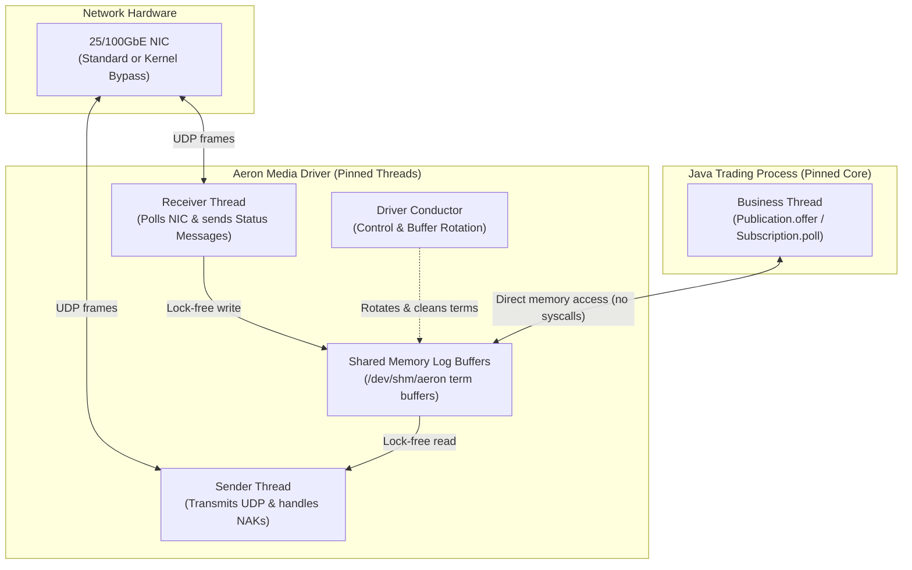
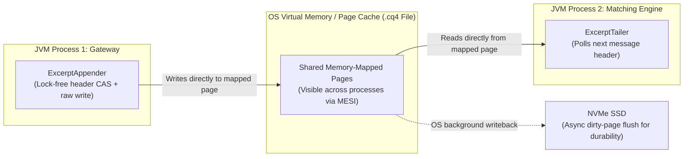
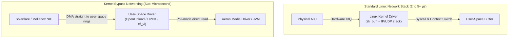
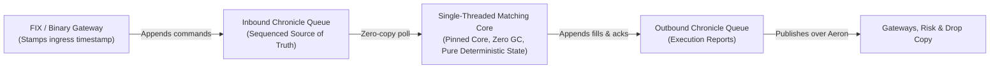

In standard microservices, a 5-millisecond HTTP or Kafka hop barely registers on a dashboard. In electronic trading, market-data distribution, and exchange matching engines, 5 milliseconds is several orders of magnitude too slow; wire-to-wire budgets live in single-digit microseconds or hundreds of nanoseconds.

At that scale, the bottlenecks are not your serialization format alone—they are the OS kernel, TCP semantics, and process boundaries. Every `SocketChannel.read()` crosses from user space into kernel space and copies bytes out of kernel socket buffers. Every dropped packet on a TCP stream stalls every message behind it.

Two open-source JVM technologies dominate this space: **Aeron** for reliable UDP unicast/multicast and lock-free IPC transport, and **Chronicle Queue** for ultra-low-latency persisted memory-mapped IPC and event journaling. Combined with kernel-bypass NICs and single-threaded event sourcing, they make deterministic sub-microsecond Java systems practical.

## The Microsecond Barrier: TCP vs UDP Multicast

TCP was designed to share congested wide-area networks fairly across untrusted links. Those exact protections hurt low-latency messaging inside a dedicated colocation LAN:

- **Head-of-line blocking:** TCP exposes an ordered byte stream. If packet 42 is dropped, the kernel buffers packets 43–60 and withholds all of them from the application until packet 42 is retransmitted and acknowledged, spiking tail latency from microseconds to milliseconds.
- **Unicast fan-out cost:** Sending a market tick to 50 trading strategies over TCP requires 50 separate socket writes, 50 kernel buffer copies, and 50 independent congestion windows. Downstream strategies receive the same market event at visibly different times (fan-out skew).
- **ACK chatter and slow start:** Continuous positive acknowledgments and congestion-control backoffs add overhead even on lossless 25/100 GbE switches.

**UDP multicast** solves fan-out at the network switch level: a publisher transmits a single datagram to a multicast group address (for example, `224.0.1.1:40123`), and the top-of-rack switch replicates that frame across subscriber ports in hardware simultaneously with near-zero skew. Because UDP itself is unreliable, protocols like Aeron layer a lightweight **Negative Acknowledgment (NAK)** reliability mechanism on top: during normal lossless operation, receivers send no per-packet ACKs; they only emit a NAK requesting targeted retransmission when they detect a sequence gap.

## Aeron Architecture: Media Driver, Log Buffers, and Flow Control

Created by Martin Thompson and Todd Montgomery (Real Logic), **Aeron** transports messages over UDP unicast, UDP multicast, or shared-memory IPC (`aeron:ipc`) with zero allocation on the hot path.

Instead of letting application threads touch sockets directly, Aeron isolates all network I/O inside a separate component called the **Media Driver** (which can run embedded inside the JVM for simplicity, or as a standalone C daemon `aeronmd` for lowest jitter and zero GC).



### Three-Term Rotating Log Buffers

Every Aeron stream maps to a set of **three pre-allocated rotating term buffers** (typically 16 MiB to 64 MiB each) stored as memory-mapped files in `/dev/shm` (Linux RAM-backed `tmpfs`):

```text
[Term N (Active: being written)] -> [Term N-1 (Dirty: draining / retransmit window)] -> [Term N-2 (Clean: zeroed & ready)]
```

- Publishers append frames to the active term using atomic tail increments (`getAndAdd`), incurring zero syscalls and zero heap allocations.
- When the active term fills, Aeron rotates into the pre-cleaned next term (`ADMIN_ACTION` is briefly returned to a publisher if rotation is in flight), while the Driver Conductor zeroes the oldest term in the background.
- Because the previous term remains readable in memory, the Sender can immediately satisfy a receiver's NAK retransmission request straight from the log buffer without interrupting the application thread.

### Receiver-Driven Flow Control

Aeron prevents fast senders from outrunning slow subscribers through **Status Messages (SM)** sent periodically by receivers back to the sender, advertising each receiver's consumption position and window size:

- **Unicast flow control:** The sender tracks the receiver's status message window and advances its publication limit accordingly.
- **Multicast flow control:** Operators pick a policy matching their business semantics:
  - **`MinMulticastFlowControl` (default):** Paces the publisher to the *slowest* active receiver so no subscriber drops messages.
  - **`MaxMulticastFlowControl`:** Paces to the *fastest* receiver; slow consumers fall behind and lose messages rather than stalling the whole exchange feed.
  - **`TaggedMulticastFlowControl`:** Paces only to critical tagged subscribers (such as matching engines) while letting non-critical analytics subscribers drop if they fall behind.

When a publisher reaches the publication limit, `publication.offer(...)` does not block—it immediately returns `Publication.BACK_PRESSURED`, keeping flow control explicit and non-blocking.

### Aeron Publisher and Subscriber in Java

Below is a working embedded-driver Aeron example showing proper handling of `Publication.offer` return codes (`BACK_PRESSURED`, `ADMIN_ACTION`, `NOT_CONNECTED`, `CLOSED`) and zero-copy `FragmentHandler` polling:

```java
import io.aeron.Aeron;
import io.aeron.Publication;
import io.aeron.Subscription;
import io.aeron.driver.MediaDriver;
import io.aeron.driver.ThreadingMode;
import io.aeron.logbuffer.FragmentHandler;
import org.agrona.concurrent.BusySpinIdleStrategy;
import org.agrona.concurrent.UnsafeBuffer;

import java.nio.ByteBuffer;

public final class AeronTradeTransport {

    private static final String CHANNEL = "aeron:ipc"; // Or "aeron:udp?endpoint=224.0.1.1:40123"
    private static final int STREAM_ID = 1001;
    private static final int MESSAGE_LENGTH = 20; // long tradeId + long priceTicks + int qty

    public static void main(String[] args) {
        MediaDriver.Context driverCtx = new MediaDriver.Context()
            .aeronDirectoryName("/dev/shm/aeron-trading")
            .threadingMode(ThreadingMode.DEDICATED)
            .conductorIdleStrategy(new BusySpinIdleStrategy())
            .senderIdleStrategy(new BusySpinIdleStrategy())
            .receiverIdleStrategy(new BusySpinIdleStrategy())
            .dirDeleteOnStart(true)
            .dirDeleteOnShutdown(true);

        try (MediaDriver driver = MediaDriver.launchEmbedded(driverCtx);
             Aeron aeron = Aeron.connect(
                 new Aeron.Context().aeronDirectoryName(driver.aeronDirectoryName()));
             Publication pub = aeron.addExclusivePublication(CHANNEL, STREAM_ID);
             Subscription sub = aeron.addSubscription(CHANNEL, STREAM_ID)) {

            while (!pub.isConnected()) {
                Thread.onSpinWait();
            }

            UnsafeBuffer sendBuffer = new UnsafeBuffer(ByteBuffer.allocateDirect(64));
            FragmentHandler handler = (buffer, offset, length, header) -> {
                long tradeId = buffer.getLong(offset);
                long priceTicks = buffer.getLong(offset + 8);
                int qty = buffer.getInt(offset + 16);
                if (tradeId == 100_000L) {
                    System.out.printf("Received trade %d: priceTicks=%d qty=%d%n",
                        tradeId, priceTicks, qty);
                }
            };

            long sent = 0L;
            long received = 0L;
            long totalMessages = 100_000L;

            while (received < totalMessages) {
                if (sent < totalMessages) {
                    long nextId = sent + 1;
                    sendBuffer.putLong(0, nextId);
                    sendBuffer.putLong(8, 6_745_050L);
                    sendBuffer.putInt(16, 5);

                    long result = pub.offer(sendBuffer, 0, MESSAGE_LENGTH);
                    if (result > 0L) {
                        sent = nextId;
                    } else if (result == Publication.BACK_PRESSURED
                            || result == Publication.ADMIN_ACTION) {
                        // Back off briefly: receiver window full or term buffer rotating
                        Thread.onSpinWait();
                    } else if (result == Publication.NOT_CONNECTED) {
                        Thread.onSpinWait();
                    } else if (result == Publication.CLOSED
                            || result == Publication.MAX_POSITION_EXCEEDED) {
                        throw new IllegalStateException("Publication unusable: " + result);
                    }
                }

                // Poll up to 10 fragments per duty cycle directly from shared memory (zero copy)
                int fragments = sub.poll(handler, 10);
                received += fragments;
            }
        }
    }
}
```

Notice `aeron.addExclusivePublication(...)`: when only one thread writes to a stream, an `ExclusivePublication` skips multi-producer CAS contention on the term tail just like the Disruptor's `SingleProducerSequencer`.

## Chronicle Queue: Memory-Mapped Inter-Process Communication (IPC)

When two separate JVM processes run on the same physical host (for example, a FIX gateway process feeding an order-matching process), sending messages over `localhost` TCP wastes microseconds inside the loopback kernel stack.

**Chronicle Queue** provides sub-microsecond persisted IPC by mapping append-only queue files (`.cq4` rolling files, typically hourly or daily) directly into the virtual address space of both processes using POSIX `mmap()`.



It is important to distinguish the two backing storage choices:

- **NVMe-backed filesystem (e.g., `/var/data/queues/orders`):** Both processes share the exact same Linux page-cache RAM pages, so cross-process handoff still runs at RAM/cache-coherence speed (often under a few hundred nanoseconds) with zero syscalls on the hot path, while the OS kernel asynchronously flushes dirty pages to NVMe storage so the queue survives process crashes and reboots.
- **`/dev/shm` (`tmpfs` RAM filesystem):** Keeps the `.cq4` files purely in RAM with zero disk writeback jitter—useful for ephemeral high-speed IPC—but data is lost if the machine reboots.

### Zero-Allocation Appender and Tailer Example

Using `DocumentContext` with `WireOut`/`WireIn` (or raw `BytesOut`/`BytesIn` for the absolute lowest overhead) lets Chronicle Queue write and read structured messages without allocating intermediate objects:

```java
import net.openhft.chronicle.queue.ChronicleQueue;
import net.openhft.chronicle.queue.ExcerptAppender;
import net.openhft.chronicle.queue.ExcerptTailer;
import net.openhft.chronicle.queue.impl.single.SingleChronicleQueueBuilder;
import net.openhft.chronicle.wire.DocumentContext;
import net.openhft.chronicle.wire.WireIn;
import net.openhft.chronicle.wire.WireOut;

import java.nio.file.Path;

public final class ChronicleOrderIpc {

    public static void writeOrder(
            ExcerptAppender appender,
            long timestampNanos,
            long orderId,
            long priceTicks,
            int qty,
            byte side) {
        try (DocumentContext dc = appender.writingDocument()) {
            WireOut wire = dc.wire();
            // Binary wire encoding directly into the memory-mapped page (zero GC)
            wire.write("ts").int64(timestampNanos)
                .write("id").int64(orderId)
                .write("px").int64(priceTicks)
                .write("qty").int32(qty)
                .write("side").int8(side);
        } // Header length committed atomically with release semantics on close()
    }

    public static boolean pollNextOrder(ExcerptTailer tailer, OrderConsumer consumer) {
        try (DocumentContext dc = tailer.readingDocument()) {
            if (!dc.isPresent()) {
                return false;
            }
            WireIn wire = dc.wire();
            long ts = wire.read("ts").int64();
            long id = wire.read("id").int64();
            long px = wire.read("px").int64();
            int qty = wire.read("qty").int32();
            byte side = wire.read("side").int8();
            consumer.onOrder(ts, id, px, qty, side);
            return true;
        }
    }

    @FunctionalInterface
    public interface OrderConsumer {
        void onOrder(long ts, long orderId, long priceTicks, int qty, byte side);
    }

    public static void main(String[] args) {
        Path queueDir = Path.of("data/inbound-orders");
        try (ChronicleQueue queue = SingleChronicleQueueBuilder.binary(queueDir).build()) {
            ExcerptAppender appender = queue.createAppender();
            ExcerptTailer tailer = queue.createTailer();

            writeOrder(appender, System.nanoTime(), 9001L, 6_745_025L, 25, (byte) 'B');

            pollNextOrder(tailer, (ts, id, px, qty, side) ->
                System.out.printf("Consumed order %d: px=%d qty=%d side=%c%n",
                    id, px, qty, (char) side));
        }
    }
}
```

In production, remember that `ExcerptAppender` and `ExcerptTailer` are **not thread-safe**—each thread must own its own appender or tailer instance. Pre-touching pages in the background (Chronicle's `Pretoucher`) avoids Linux minor page-fault spikes when a queue rolls onto a fresh 4 KB or 2 MB page.

## Kernel Bypass Networking (Solarflare OpenOnload and DPDK)

Even with Aeron and zero-allocation Java, standard Linux networking still puts the kernel in the path of every packet:

1. The NIC receives an Ethernet frame via DMA and triggers a hardware interrupt (IRQ).
2. The kernel driver allocates/populates an `sk_buff` structure and runs the IP/UDP/TCP stack.
3. The kernel wakes the thread, and `recv()`/`send()` switches privilege rings and copies data between kernel buffers and user space.

That path typically costs 2 to 5 microseconds on a good day and much more during interrupt storms.



**Kernel bypass** maps the NIC's hardware transmit and receive ring buffers directly into user-space memory. A pinned polling thread reads frames straight from DMA memory with no interrupts, no `sk_buff` allocations, and no kernel syscalls.

Two approaches dominate Java trading stacks:

- **AMD/Solarflare OpenOnload (`onload`):** Intercepts standard POSIX socket calls (`socket`, `sendto`, `recvfrom`, `epoll`) via `LD_PRELOAD` and routes them through a user-space TCP/UDP stack directly to the Solarflare NIC. Because it keeps the POSIX socket API intact, an unmodified JVM or Aeron Media Driver gains kernel bypass simply by launching under `onload`!
- **DPDK (Data Plane Development Kit) / `ef_vi`:** Provides raw user-space Ethernet ring access with maximum control and lowest latency, typically paired with Aeron's C Media Driver (`aeronmd` with DPDK/Solarflare extensions) rather than called directly from standard Java NIO sockets.

Here is how an operations team mounts `/dev/shm` with sufficient space for Aeron log buffers and launches a JVM (or `aeronmd`) with Solarflare OpenOnload's low-latency profile:

```bash
# Ensure /dev/shm tmpfs is large enough for Aeron CNC and term buffers (no disk I/O)
sudo mount -o remount,size=8G /dev/shm

# Launch with Solarflare OpenOnload kernel bypass and user-space busy spinning
# EF_POLL_USEC=100000 keeps the Onload stack spinning in user space instead of sleeping in the kernel
EF_POLL_USEC=100000 \
EF_SPIN_USEC=100000 \
EF_RX_TIMESTAMPING=1 \
onload --profile=latency \
  taskset -c 2-5 \
  java \
    -Xms16g -Xmx16g -XX:+AlwaysPreTouch \
    -Daeron.dir=/dev/shm/aeron-prod \
    -jar matching-engine.jar
```

## Designing Deterministic Sub-Microsecond Trading Engines

Fast transport only gets you half the way to a production trading engine. The other half is **deterministic event sourcing** (the core architectural pattern behind LMAX, Chronicle Services, and Aeron Cluster).

Instead of allowing multiple threads to lock and mutate an order book concurrently, a deterministic matching engine runs its core state machine on a **single pinned thread** with strict determinism rules:

1. **Journal first, process second:** Every inbound command (new order, cancel, replace, market tick) is sequenced and persisted to an append-only inbound Chronicle Queue (or replicated via Aeron Cluster Raft log) before reaching the matching core.
2. **No non-deterministic inputs inside the core:** The matching engine never calls `System.currentTimeMillis()`, `System.nanoTime()`, `UUID.randomUUID()`, `Math.random()`, or external I/O, and never iterates unordered `HashMap`s whose order affects business outcomes. Even wall-clock timestamps are stamped at the gateway edge and passed inside the inbound event!
3. **Pure in-memory state transitions:** Given the same sequence of inbound events, the matching core produces the exact same order book state and the exact same outbound execution reports, bit for bit.



Here is the core loop of a deterministic event-sourced matching engine reading from an inbound Chronicle Queue and emitting deterministic execution events to an outbound Chronicle Queue:

```java
import net.openhft.chronicle.queue.ChronicleQueue;
import net.openhft.chronicle.queue.ExcerptAppender;
import net.openhft.chronicle.queue.ExcerptTailer;
import net.openhft.chronicle.queue.impl.single.SingleChronicleQueueBuilder;
import net.openhft.chronicle.wire.DocumentContext;
import net.openhft.chronicle.wire.WireIn;
import net.openhft.chronicle.wire.WireOut;

import java.nio.file.Path;

public final class DeterministicMatchingLoop implements Runnable {

    private final ExcerptTailer inboundTailer;
    private final ExcerptAppender outboundAppender;
    private final OrderBook orderBook = new OrderBook(); // Primitive-backed, zero-GC book
    private volatile boolean running = true;

    public DeterministicMatchingLoop(ChronicleQueue inboundQueue, ChronicleQueue outboundQueue) {
        this.inboundTailer = inboundQueue.createTailer();
        this.outboundAppender = outboundQueue.createAppender();
    }

    @Override
    public void run() {
        while (running) {
            try (DocumentContext in = inboundTailer.readingDocument()) {
                if (!in.isPresent()) {
                    Thread.onSpinWait();
                    continue;
                }

                WireIn wire = in.wire();
                // Deterministic timestamp injected by ingress gateway — never call System.nanoTime() here
                long eventTimeNanos = wire.read("ts").int64();
                long orderId = wire.read("id").int64();
                long priceTicks = wire.read("px").int64();
                int qty = wire.read("qty").int32();
                byte side = wire.read("side").int8();

                int filledQty = orderBook.match(orderId, priceTicks, qty, side);

                // Emit deterministic outbound execution report
                try (DocumentContext out = outboundAppender.writingDocument()) {
                    WireOut outWire = out.wire();
                    outWire.write("ts").int64(eventTimeNanos)
                           .write("id").int64(orderId)
                           .write("filled").int32(filledQty)
                           .write("remaining").int32(qty - filledQty);
                }
            }
        }
    }

    public void stop() {
        this.running = false;
    }

    // Minimal placeholder representing a zero-allocation in-memory order book
    static final class OrderBook {
        int match(long orderId, long priceTicks, int qty, byte side) {
            // Deterministic matching logic using primitive arrays / pools
            return qty;
        }
    }

    public static void main(String[] args) {
        try (ChronicleQueue inbound = SingleChronicleQueueBuilder.binary(Path.of("data/in")).build();
             ChronicleQueue outbound = SingleChronicleQueueBuilder.binary(Path.of("data/out")).build()) {
            DeterministicMatchingLoop loop = new DeterministicMatchingLoop(inbound, outbound);
            // In production: pin this Runnable to an isolated CPU core via AffinityLock
            loop.run();
        }
    }
}
```

The payoff of this architecture goes beyond speed:

- **Instant disaster recovery and hot standby:** Replay the inbound Chronicle Queue from the start of the trading day (or from a periodic snapshot) and the engine rebuilds its exact in-memory state in seconds.
- **Exact production bug reproduction:** Copy the production inbound `.cq4` file to a staging machine and replay it in a debugger—every race-free state transition reproduces identically, down to the single microsecond and fill sequence.
- **Zero lock contention:** Because only one thread mutates the order book, there are no locks, no CAS retries, and the entire active book stays hot in that single core's L1/L2 caches.

## Practical Questions

### Why does Aeron use UDP with Negative Acknowledgments (NAK) instead of TCP?
TCP enforces strict byte-stream ordering and positive ACKs, so a single dropped packet triggers head-of-line blocking across the entire connection and stalls tail latency into milliseconds. TCP also cannot use hardware switch multicast, forcing publishers to send separate unicast copies to every subscriber. Aeron uses UDP (supporting hardware multicast fan-out) and adds its own NAK-based reliability: receivers stay silent when packets arrive in sequence and only request targeted retransmissions from the sender's in-memory term buffer when a sequence gap appears.

### What is the difference between backing Chronicle Queue on `/dev/shm` versus an NVMe-mounted filesystem?
`/dev/shm` is a Linux `tmpfs` RAM filesystem: files mapped there never touch a disk, avoiding any writeback jitter, but all data disappears if the host reboots. Mapping Chronicle Queue onto an NVMe-backed filesystem still gives two processes shared-memory RAM speed via the Linux OS page cache during steady-state reads and writes, while the kernel asynchronously flushes dirty pages to the NVMe drive in the background for crash recovery and regulatory audit trails.

### Why does `Publication.offer(...)` return `BACK_PRESSURED` or `ADMIN_ACTION` instead of blocking?
Blocking inside a hot event loop parks the thread, triggers kernel context switches, and stalls other work on that duty cycle (such as polling another subscription or sending heartbeats). Returning negative status codes keeps Aeron strictly non-blocking: `BACK_PRESSURED` tells the caller that a subscriber's flow-control window is full, while `ADMIN_ACTION` signals that the Media Driver is rotating the active term buffer and the caller should simply retry on the next iteration.

### Why must a deterministic matching engine never call `System.currentTimeMillis()` or `System.nanoTime()` internally?
If the core state machine reads the host wall clock to make decisions (like expiring time-in-force orders or stamping fills), replaying the exact same inbound command journal an hour later—or on a standby replica—produces different outputs and diverges from the primary state. Stamping time once at the ingress gateway and storing it inside the journaled command keeps the matching core a pure, replayable function of its inbound log.
