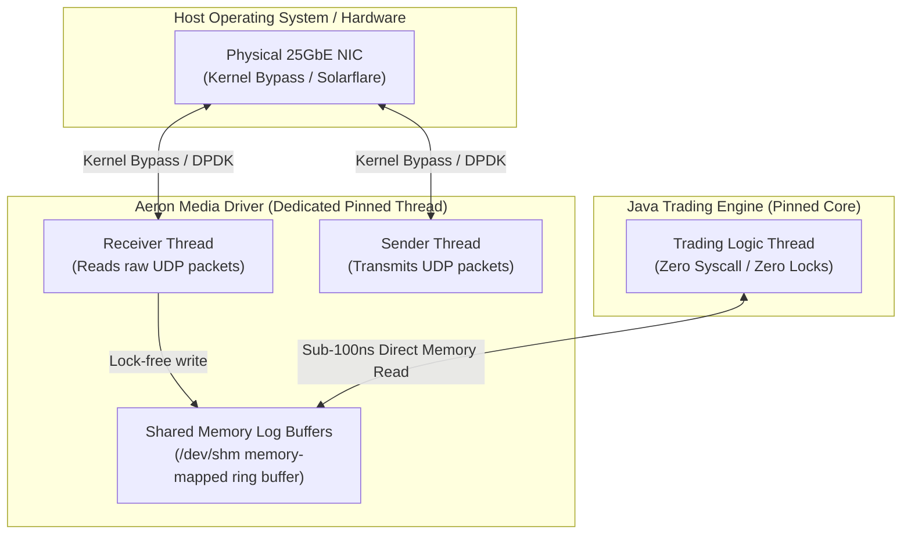
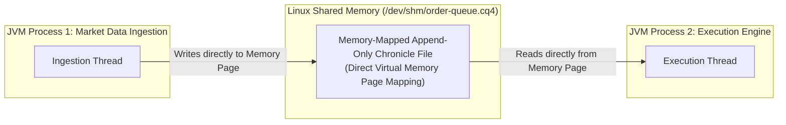

In enterprise microservices, communication latencies between 5 and 50 milliseconds over HTTP/REST or Kafka are widely accepted as fast. 

In High-Frequency Trading (HFT) and algorithmic market making, a communication latency of **5 milliseconds is a complete failure**. When trading algorithms compete to fill orders on global financial exchanges, trades are won or lost in **hundreds of nanoseconds**. 

At this extreme performance boundary, traditional network stacks fail catastrophically:
- **OS Kernel Traversal:** Standard Java `SocketChannel` calls force the CPU to switch from User Mode to Kernel Mode (`syscall`), copying bytes between user-space buffers and OS socket buffers.
- **TCP Head-of-Line Blocking:** If a single packet in a TCP stream is dropped or delayed, the entire connection freezes while waiting for TCP retransmission (costing milliseconds).
- **Context Switches:** Thread-per-client or standard selector loops force the operating system to deschedule threads, incurring thousands of nanoseconds of context-switch penalties.

To shatter the microsecond barrier, low-latency Java architectures deploy two revolutionary messaging technologies: **Aeron** (for ultra-high-throughput UDP messaging and IPC) and **Chronicle Queue** (for deterministic, memory-mapped shared-memory persistence).

In this deep dive, we explore how Aeron leverages the Media Driver pattern and lock-free log buffers, how Chronicle Queue achieves sub-100-nanosecond inter-process communication, and how **Kernel Bypass Networking** allows Java applications to read directly from the physical network interface card (NIC).

---

### The Architecture of Aeron: Shattering the Network Bottleneck

Created by Martin Thompson and Todd Montgomery at Real Logic, **Aeron** is the world's highest-performance messaging system for UDP unicast, UDP multicast, and Shared Memory Inter-Process Communication (IPC).

Unlike standard messaging libraries where the application thread directly manages network sockets, Aeron decouples message processing from network I/O through a dedicated daemon called the **Media Driver**:



#### The Power of the Media Driver Architecture:
1. **Zero System Calls in the Business Thread:** The Java trading thread never calls `socket.read()` or `socket.write()`. It reads and writes exclusively to **Shared Memory Log Buffers** located in `/dev/shm` (Linux RAM filesystem).
2. **Dedicated I/O Pinned Threads:** The Media Driver runs independently on dedicated, isolated CPU cores. It handles UDP transmission, reception, packet reordering, and flow control.
3. **Lock-Free Concurrency:** Communication between the Java application and the Media Driver uses lock-free ring buffers (identical to the LMAX Disruptor philosophy), achieving latencies **under 50 nanoseconds**.

---

### Aeron Log Buffers and Three-Buffer Active Rotation

How does Aeron handle continuous streaming without locks or memory allocation?

Aeron organizes every transmission stream into a set of **Three Rotating Term Buffers**:

```
Term Buffer Rotation (Active, Dirty, Reclaimed)
  [Buffer 0: Active (Writing)] ---> [Buffer 1: Dirty (Reading)] ---> [Buffer 2: Cleaned]
```

1. **Active Buffer:** The producer writes data to the active buffer. As long as space remains, writes proceed via lock-free atomic sequence increments (`VarHandle.getAndAdd()`).
2. **Buffer Full Transition:** When the active buffer fills (e.g., 64MB of data), Aeron rotates to the next clean term buffer.
3. **Background Reclaiming:** The Media Driver transmits the data over the network and resets the previous buffer in the background.

Because term buffers are pre-allocated memory-mapped files on disk or in `/dev/shm`, Aeron **never allocates a single byte of memory during transmission**.

#### Reliable UDP without TCP Overhead
TCP uses positive acknowledgments (ACKs) for every packet, creating round-trip latency overhead. Aeron operates over raw **UDP**, but implements a hyper-optimized **Negative Acknowledgment (NAK)** protocol:
- In healthy networks, receivers assume packets arrive in sequence with zero ACK overhead.
- Only when a sequence gap is detected does the receiver emit a lightweight NAK packet back to the sender, requesting a targeted retransmission from the sender's local log buffer.

---

### Shared-Memory Inter-Process Communication: Chronicle Queue

When two independent Java applications need to communicate on the **same physical server** (e.g., a Market Data Ingestion process passing normalized quotes to an Order Matching process), sending data over TCP `localhost` or standard IPC pipes is absurdly slow.

**Chronicle Queue** (pioneered by Peter Lawrey) provides sub-microsecond Inter-Process Communication (IPC) by leveraging **Memory-Mapped Files (`mmap`)**:



#### How Chronicle Queue Achieves 80-Nanosecond Latency:
1. **OS Page Cache Direct Access:** Chronicle Queue maps disk files directly into the virtual address space of both JVM processes using the POSIX `mmap()` system call.
2. **Zero Serialization Copying:** Data written by Process 1 is immediately visible in the memory space of Process 2 at the physical hardware cache level. There is no socket, no network stack, and no context switch.
3. **Zero-GC Off-Heap Architecture:** Messages are written as raw primitive bytes using flyweight encoders.
4. **Permanent Audit Trail:** Because the memory-mapped file is backed by NVMe storage, every single message is automatically and asynchronously persisted to disk by the Linux page cache dirty-page flusher, providing full disaster recovery.

---

### Building a High-Throughput Aeron Publisher and Subscriber

Here is a complete, working implementation of an ultra-low-latency Aeron messaging pipeline in pure Java:

#### The Aeron Publisher (Sending Trades)

```java
import io.aeron.Aeron;
import io.aeron.Publication;
import org.agrona.concurrent.UnsafeBuffer;
import java.nio.ByteBuffer;

public class HighSpeedAeronPublisher {

    public static void main(String[] args) {
        // Channel can be UDP (aeron:udp?endpoint=224.0.1.1:40123) or IPC (aeron:ipc)
        final String channel = "aeron:ipc";
        final int streamId = 1001;

        // Connect to the local running Media Driver
        try (Aeron aeron = Aeron.connect();
             Publication publication = aeron.addPublication(channel, streamId)) {

            // Pre-allocate a direct off-heap buffer for zero-GC encoding
            UnsafeBuffer buffer = new UnsafeBuffer(ByteBuffer.allocateDirect(128));

            System.out.println("Aeron Publication active on: " + channel);

            long tradeId = 0;
            while (true) {
                tradeId++;

                // Encode raw binary payload (Zero Garbage!)
                buffer.putLong(0, tradeId);
                buffer.putDouble(8, 67450.50);
                buffer.putInt(16, 5); // Quantity

                // Publish to shared-memory log buffer (Lock-free!)
                long result = publication.offer(buffer, 0, 20);

                if (result > 0) {
                    // Successfully published in under 50 nanoseconds!
                } else if (result == Publication.BACK_PRESSURED) {
                    // Consumer buffer is full; back off or retry
                    Thread.onSpinWait();
                }
            }
        }
    }
}
```

#### The Aeron Subscriber (Consuming Trades)

```java
import io.aeron.Aeron;
import io.aeron.Subscription;
import io.aeron.logbuffer.Header;
import org.agrona.DirectBuffer;

public class HighSpeedAeronSubscriber {

    public static void main(String[] args) {
        final String channel = "aeron:ipc";
        final int streamId = 1001;

        try (Aeron aeron = Aeron.connect();
             Subscription subscription = aeron.addSubscription(channel, streamId)) {

            System.out.println("Aeron Subscriber waiting for trades on: " + channel);

            // FragmentHandler: Invoked directly on incoming memory buffer (Zero Copy!)
            var handler = (DirectBuffer buffer, int offset, int length, Header header) -> {
                long tradeId = buffer.getLong(offset);
                double price = buffer.getDouble(offset + 8);
                int qty = buffer.getInt(offset + 16);

                // Execute trade logic with zero allocation
                if (price > 1000.0) {
                    // Process trade...
                }
            };

            // High-frequency polling loop
            while (true) {
                int fragmentsRead = subscription.poll(handler, 10);
                if (fragmentsRead == 0) {
                    Thread.onSpinWait(); // Sub-microsecond spin
                }
            }
        }
    }
}
```

---

### Kernel Bypass Networking: The Ultimate Frontier

In standard Linux, when a network packet arrives from the fiber optic cable:
1. The Network Interface Card (NIC) fires an interrupt (IRQ).
2. The CPU jumps into the Linux kernel network stack (`netif_receive_skb`).
3. The kernel copies the packet from the ring buffer into an `sk_buff` kernel structure.
4. The kernel validates IP and TCP/UDP headers.
5. The kernel wakes up the sleeping user-space Java thread.
6. The Java thread calls `recv()` or `read()`, forcing the kernel to **copy the packet a second time** into user-space JVM memory.

This entire pipeline costs **2,000 to 5,000 nanoseconds (2 to 5 microseconds)** of latency.

```mermaid
flowchart TD
    subgraph StandardLinux ["Standard Linux Network Stack (2 - 5 Microseconds)"]
        NIC1["Physical NIC"] -->|IRQ Interrupt| Kernel["Linux Kernel Driver<br/>(Copies to sk_buff)"]
        Kernel -->|Socket Buffer| Syscall["Syscall Context Switch<br/>(User / Kernel Mode)"]
        Syscall -->|Memory Copy| JVM1["Java User Space Buffer"]
    end

    subgraph KernelBypass ["Kernel Bypass Architecture (< 500 Nanoseconds!)"]
        NIC2["Physical NIC (Solarflare / Mellanox)"]
        DPDK["User-Space Driver (Solarflare OpenOnload / DPDK)"]
        JVM2["Aeron Media Driver / Java Direct Memory"]

        NIC2 -->|DMA Direct Memory Access| DPDK
        DPDK -->|Zero-Copy Direct Mapping| JVM2
    end
```



#### How Kernel Bypass Eliminates the Kernel
Using specialized enterprise NICs (such as **Solarflare Onload** or **Mellanox ConnectX** with **DPDK - Data Plane Development Kit**):
1. The physical NIC uses **Direct Memory Access (DMA)** to write raw Ethernet frames directly into the physical memory pages mapped to your Java application or Aeron Media Driver.
2. The Linux kernel network stack is **completely bypassed**. No interrupts, no `sk_buff` allocations, no context switches, and zero data copying.
3. The Java thread reads incoming network frames directly from physical NIC memory in **less than 500 nanoseconds**.

---

## Senior Engineer Interview Crucible

### Why does Aeron choose UDP over TCP for high-throughput, low-latency enterprise messaging?
**Answer:** TCP was designed for reliable data transmission over unreliable, congested, heterogeneous wide-area networks (WAN). Its mechanisms introduce catastrophic latency bottlenecks in low-latency systems:
1. **Head-of-Line Blocking:** In TCP, byte streams are strictly ordered. If a single packet is dropped or corrupted, the TCP stack halts delivery of all subsequent packets until a retransmission arrives, causing tail latency to explode from microseconds to milliseconds.
2. **Positive Acknowledgments (ACKs):** TCP requires receivers to continuously transmit ACKs back to the sender, consuming bandwidth and inducing round-trip latency stalls.
3. **Connection-Oriented Overhead:** TCP requires a 3-way handshake and maintains stateful per-socket buffers.

Aeron uses UDP because UDP is a pure, lightweight datagram protocol with zero connection state and zero head-of-line blocking. Aeron layers its own high-performance reliability protocol over UDP:
- It uses a **Negative Acknowledgment (NAK)** protocol: receivers notify senders only when a sequence gap is detected, eliminating ACK traffic during normal operations.
- It supports **Hardware UDP Multicast**, allowing a single publisher to broadcast market data to hundreds of subscribers across an exchange with zero duplicate transmission overhead on the sender.

### How does Chronicle Queue achieve sub-100-nanosecond inter-process communication without using network sockets?
**Answer:** Chronicle Queue bypasses network sockets entirely by using **Memory-Mapped Files (`mmap`)** located in the Linux shared memory filesystem (`/dev/shm`).

When Process A writes an event to Chronicle Queue:
1. It writes raw primitive bytes directly into a virtual memory page mapped to an off-heap file.
2. Because the memory page is mapped into the virtual address space of both Process A and Process B, the write is immediately visible in Process B's memory space via hardware cache coherence (MESI) in tens of nanoseconds.
3. No operating system system calls (`read`, `write`, `send`, `recv`), no context switches, and zero socket buffer copying occur.
4. The operating system's dirty-page flusher asynchronously syncs the memory pages to underlying NVMe storage in the background, providing durability without placing the disk on the critical latency path.

### What is the role of the Aeron Media Driver, and why is it architected as an independent process or thread?
**Answer:** The Aeron Media Driver is the standalone transport engine that mediates between the network (or shared memory) and the Java client application. It manages UDP socket polling, packet framing, NAK flow control, and log buffer rotation.

Architecting the Media Driver as an independent component provides two crucial performance advantages:
1. **Decoupling Business Logic from Network I/O:** The business thread never touches network sockets or system calls. It writes messages strictly into local memory-mapped log buffers in nanoseconds. The Media Driver's sender thread picks up the data and handles packet transmission asynchronously.
2. **Deterministic CPU Isolation:** In production, the Media Driver's receiver and sender threads are pinned to dedicated physical CPU cores using thread affinity. This ensures that network processing never competes for CPU cycles or evicts L1/L2 caches from the core running the core trading engine.

### What is Kernel Bypass Networking (e.g., Solarflare OpenOnload, DPDK), and how does it reduce tail latency in financial systems?
**Answer:** In standard Linux networking, packet reception involves a hardware interrupt (IRQ), transitioning execution to the kernel driver, copying packet data into kernel `sk_buff` structures, traversing the TCP/IP stack, and executing a context switch to copy the bytes into user-space Java memory (costing 2 to 5 microseconds).

Kernel Bypass Networking bypasses the Linux kernel completely. Hardware drivers (such as Solarflare OpenOnload or Intel DPDK) map the physical Network Interface Card's ring buffers directly into user-space memory using Direct Memory Access (DMA). When an Ethernet frame hits the NIC, the NIC writes the packet directly into user-space memory, and a user-space polling thread consumes the frame immediately. 

This eliminates:
1. Kernel-to-user memory copies.
2. Hardware interrupt (IRQ) handling penalties.
3. User-to-kernel context switches.

Kernel bypass reduces packet delivery latency from 3,000 nanoseconds down to **sub-500 nanoseconds**, and virtually eliminates the high tail-latency spikes caused by kernel scheduler interruptions.
