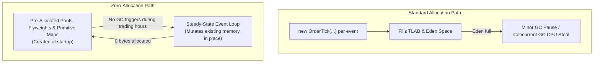

Modern JVM garbage collectors like Generational ZGC and Shenandoah can reclaim gigabytes per second with sub-millisecond pauses. For typical web services and microservices, that is more than fast enough, and writing clean, immutable objects is the right engineering choice.

In market-making engines, exchange gateways, and real-time risk checks, even a 200-microsecond pause or a sudden allocation burst skews p99.9 latency and causes missed fills or stale quotes. Rather than endlessly tweaking GC flags to shorten pauses, ultra-low-latency Java teams **starve the garbage collector**: allocate all required structures during startup warmup, and allocate **zero bytes on the heap per event** during steady-state execution. If Eden space never fills during trading hours, Minor GC never runs.

## Why Heap Allocations Still Hurt Even with Fast TLABs

Allocating an object in HotSpot is individually cheap because each thread owns a **Thread-Local Allocation Buffer (TLAB)** in Young Gen Eden—allocation is just a pointer bump and a bounds check. The real cost shows up downstream:

1. **Object header and alignment bloat:** Every Java object on a 64-bit JVM with Compressed OOPs carries a 12-byte header (8-byte mark word + 4-byte class pointer) and is padded to an 8-byte boundary. A boxed `Long` occupies 24 bytes on the heap to hold 8 bytes of data.
2. **GC write barriers and card marking:** Assigning object references (`order.account = account`) executes GC barrier instructions (card table updates in G1/Parallel, or colored-pointer load/store barriers in ZGC) on every mutation.
3. **Cache pollution and Minor GC pauses:** High allocation rates churn through L1/L2 caches with short-lived garbage, fill Eden quickly, and trigger Minor GC cycles that either pause threads (G1/Parallel) or steal CPU cycles and memory bandwidth from latency-sensitive threads (ZGC/Shenandoah).



## Escape Analysis and Scalar Replacement

HotSpot's C2 JIT compiler runs **Escape Analysis** (enabled by default via `-XX:+DoEscapeAnalysis`) to check whether a newly allocated object ever leaves the scope of the compiled method or thread:

- **NoEscape:** The object never leaves the method and is not published to another thread.
- **ArgEscape:** The object is passed to another method, which might or might not let it escape.
- **GlobalEscape:** The object is returned, stored into a field or static variable, or placed into a shared collection.

When C2 proves an object is `NoEscape`, it performs **Scalar Replacement** (`-XX:+EliminateAllocations`): it removes the heap allocation completely and splits the object's fields into independent local primitives stored in CPU registers or stack slots.

```java
public record PriceWindow(long bidTicks, long askTicks) {}

public static long midPriceTicks(long bid, long ask) {
    // NoEscape: HotSpot C2 scalar-replaces PriceWindow into two CPU registers.
    PriceWindow window = new PriceWindow(bid, ask);
    return (window.bidTicks() + window.askTicks()) >>> 1;
}
```

### Why You Cannot Blindly Rely on Escape Analysis

Escape Analysis is a useful bonus optimization, not a guarantee you can bet a latency SLA on. In real codebases, scalar replacement breaks quietly for several reasons:

- **Inlining failure:** If you pass the object to a helper method that C2 fails to inline—because the callee is too large (`-XX:FreqInlineSize`, `-XX:MaxInlineSize`), the call stack exceeds `-XX:MaxInlineLevel`, or the call site becomes megamorphic (3+ concrete implementations)—the object degrades to `GlobalEscape` and allocates on the heap.
- **Conditional escapes:** In standard HotSpot C2 (unlike GraalVM's Partial Escape Analysis), if *any* branch lets the object escape—even a rarely taken `if (debugEnabled) { auditList.add(obj); }`—C2 conservatively allocates the object on the heap on *every* path.
- **Dynamic array indexing:** Storing a newly created object inside an array accessed with a runtime-computed index prevents scalar replacement.
- **Control-flow merges and exceptions:** Merging two allocation sites into one local variable before a branch, or complex exception handlers, often causes C2 to abandon scalar replacement.

> [!WARNING]
> Treat any `new` statement inside a hot trading or packet-processing loop as an allocation bug until proven otherwise. Verify steady-state allocation rates empirically using **Java Flight Recorder (JFR)** (`jdk.ObjectAllocationInNewTLAB`, `jdk.ObjectAllocationOutsideTLAB`), **async-profiler** (`-e alloc`), or `-Xlog:gc*` under realistic traffic.

## Flyweight Pattern for Reusable Value Mutators

Instead of instantiating fresh DTOs or `record`s for each incoming network message, zero-allocation Java uses **mutable flyweights**: pre-allocated wrapper objects that either store primitive fields updated in place or point directly into an underlying byte buffer at a given offset.

Buffer-backed flyweights (the style used by Simple Binary Encoding / SBE and Agrona) are particularly effective because they avoid copying bytes out of the network buffer altogether:

```java
import org.agrona.DirectBuffer;
import org.agrona.MutableDirectBuffer;

// Zero-allocation flyweight wrapping a fixed 24-byte binary tick inside any DirectBuffer:
// [0..7] orderId (long) | [8..15] priceTicks (long) | [16..19] qty (int) | [20] side (byte)
public final class MarketTickFlyweight {
    public static final int ENCODED_LENGTH = 24;

    private DirectBuffer readBuffer;
    private int offset;

    public MarketTickFlyweight wrap(DirectBuffer buffer, int offset) {
        this.readBuffer = buffer;
        this.offset = offset;
        return this;
    }

    public long orderId() {
        return readBuffer.getLong(offset);
    }

    public long priceTicks() {
        return readBuffer.getLong(offset + 8);
    }

    public int quantity() {
        return readBuffer.getInt(offset + 16);
    }

    public byte side() {
        return readBuffer.getByte(offset + 20);
    }

    public static void encode(
            MutableDirectBuffer dest, int offset,
            long orderId, long priceTicks, int qty, byte side) {
        dest.putLong(offset, orderId);
        dest.putLong(offset + 8, priceTicks);
        dest.putInt(offset + 16, qty);
        dest.putByte(offset + 20, side);
    }
}
```

A single-threaded processor holds one `MarketTickFlyweight` field allocated once at startup and re-wraps it on every incoming packet:

```java
public final class MarketFeedProcessor {
    // Allocated once per worker thread at startup
    private final MarketTickFlyweight tick = new MarketTickFlyweight();

    public void onMessage(DirectBuffer buffer, int offset) {
        tick.wrap(buffer, offset);
        if (tick.side() == 'B' && tick.quantity() > 0) {
            evaluateBid(tick.orderId(), tick.priceTicks(), tick.quantity());
        }
    }

    private void evaluateBid(long orderId, long priceTicks, int qty) {
        // Process using primitives only; never retain 'tick' beyond this callback
    }
}
```

When state *must* survive past the callback (for example, resting orders sitting on an order book), pre-allocate a fixed-size **object pool** (an array-backed freelist or ring) at startup: borrow an `OrderNode` from the freelist on `NewOrder`, mutate its fields, and return it to the freelist on `Cancel` or `Fill`.

## Primitive Specialized Collections (Agrona and Eclipse Collections)

Standard `java.util` collections (`HashMap`, `ArrayList`, `TreeMap`) only store reference types because Java generics erase to `Object` (until Project Valhalla value types arrive).

Using `HashMap<Long, Long>` for an order lookup table triggers three simultaneous penalties:

1. **Autoboxing on every lookup and write:** `map.put(orderId, priceTicks)` allocates boxed `Long` objects (except small cached values `-128..127`).
2. **Per-entry wrapper overhead:** Each entry creates a `HashMap.Node` (32 bytes) pointing to two boxed `Long`s (24 bytes each)—around **80 bytes** of heap per entry to store 16 bytes of payload.
3. **Pointer chasing:** Lookups traverse `Node[] -> Node -> Key/Value`, causing multiple cache misses per probe.

Low-latency Java replaces `java.util` maps and sets with **open-addressing primitive collections** from **Agrona** or **Eclipse Collections**. Both store keys and values directly inside flat primitive arrays (`long[]`, `double[]`, `int[]`) with linear probing, eliminating boxing and `Node` allocations completely—provided you pre-size them at startup so they never resize during trading hours.

### Agrona (`Long2LongHashMap`)

Financial engines commonly store prices as fixed-point `long` ticks (for example, price multiplied by `10_000`) to avoid IEEE-754 floating-point rounding drift. Agrona's `Long2LongHashMap` stores both keys and values in a single interleaved `long[]` array so a key and its value sit adjacent in the same 64-byte cache line:

```java
import org.agrona.collections.Long2LongHashMap;

public final class OrderPriceTable {
    private static final long MISSING_VALUE = Long.MIN_VALUE;

    // Pre-sized to avoid rehashing during trading hours; load factor 0.55 keeps probe chains short
    private final Long2LongHashMap orderPrices =
        new Long2LongHashMap(1_000_000, 0.55f, MISSING_VALUE);

    public void recordOrder(long orderId, long priceTicks) {
        orderPrices.put(orderId, priceTicks); // Zero boxing, zero Node allocation
    }

    public long findPrice(long orderId) {
        return orderPrices.get(orderId); // Returns MISSING_VALUE if absent
    }

    public void removeOrder(long orderId) {
        orderPrices.remove(orderId);
    }
}
```

### Eclipse Collections (`LongDoubleHashMap`)

When you need floating-point primitives or a richer collection API (including primitive lists, sets, bags, and `forEachKeyValue` iteration without allocating `Map.Entry` iterators), **Eclipse Collections** provides full primitive-to-primitive maps such as `LongDoubleHashMap` (`MutableLongDoubleMap`):

```java
import org.eclipse.collections.api.map.primitive.MutableLongDoubleMap;
import org.eclipse.collections.impl.map.mutable.primitive.LongDoubleHashMap;

public final class RiskExposureLedger {
    private final MutableLongDoubleMap accountExposure = new LongDoubleHashMap(250_000);

    public void addExposure(long accountId, double delta) {
        // Mutates primitive double[] slot in place with zero boxing
        accountExposure.addToValue(accountId, delta);
    }

    public double exposureFor(long accountId) {
        return accountExposure.getIfAbsent(accountId, 0.0);
    }
}
```

Watch out for `for (var entry : map.entrySet())` on any map—that allocates an iterator and boxed entries. Use primitive-specialized callbacks like `orderPrices.longForEach((k, v) -> ...)` or `accountExposure.forEachKeyValue((k, v) -> ...)` with non-capturing lambdas (or reusable consumer fields) to iterate allocation-free.

## CPU Core Pinning and Thread Affinity via JNI/JNA

Even a perfectly allocation-free Java thread suffers latency jitter if the Linux Completely Fair Scheduler (CFS) preempts it or migrates it from Core 2 to Core 7:

- Core 7's L1 and L2 caches are cold, forcing hundreds of cache misses as the working set migrates across cores.
- The Branch Target Buffer (BTB) and Translation Lookaside Buffer (TLB) are cold on the new core.
- If Core 7 was in a power-saving sleep state (ACPI C-state), waking it adds 10 to 50 microseconds of delay.
- If Core 7 sits on a different physical CPU socket (NUMA node), memory reads cross the inter-socket link.

Java's standard `Thread` API does not expose CPU affinity, so low-latency apps invoke the OS affinity syscalls (`sched_setaffinity` on Linux, `SetThreadAffinityMask` on Windows) through JNA/JNI libraries such as OpenHFT's **Java-Thread-Affinity** (or directly via Project Panama's `Linker`).

```java
import net.openhft.affinity.Affinity;
import net.openhft.affinity.AffinityLock;

public final class PinnedMatchingWorker {

    public static void startOnCore(int cpuId, Runnable hotLoop) {
        Thread worker = new Thread(() -> {
            // Pin this OS thread exclusively to the specified logical CPU via JNA/sched_setaffinity
            try (AffinityLock lock = AffinityLock.acquireLock(cpuId)) {
                System.out.println("Pinned " + Thread.currentThread().getName()
                    + " to CPU " + Affinity.getCpu());
                hotLoop.run();
            }
        }, "matching-engine-core-" + cpuId);

        worker.start();
    }
}
```

Pinning a Java thread is only half the battle. Without OS-level isolation, Linux can still schedule kernel threads, timer ticks, or other processes onto your core. Production low-latency Linux hosts pair thread affinity with kernel boot parameters in `/etc/default/grub`:

```bash
# Reserve cores 2-5 from the general Linux scheduler, disable periodic timer ticks
# when a single runnable task occupies the core, and offload RCU callbacks to core 0-1.
GRUB_CMDLINE_LINUX_DEFAULT="isolcpus=2,3,4,5 nohz_full=2,3,4,5 rcu_nocbs=2,3,4,5 intel_idle.max_cstate=0 processor.max_cstate=1"
```

Teams also disable Hyper-Threading (SMT) in BIOS—or isolate both sibling logical CPUs of each physical core—so a background OS thread on the sibling logical CPU cannot evict L1 cache lines or contend for ALU execution ports.

## Garbage-Free Logging with Log4j2 Asynchronous Appenders

Logging is one of the sneakiest sources of garbage in Java. A single innocuous SLF4J or standard Log4j call:

```java
// Allocates boxed Long, boxed Double, Object[] varargs array, LogEvent, and temporary Strings
logger.info("Order matched: id={}, price={}, qty={}", orderId, price, qty);
```

can quietly allocate hundreds of bytes per log line. At 100,000 events per second, logging alone fills Eden space every few seconds.

**Log4j2** (2.6+) includes a genuine **garbage-free logging mode** built on three pieces:

1. **Asynchronous loggers backed by the LMAX Disruptor:** Setting `log4j2.contextSelector` to `AsyncLoggerContextSelector` routes log events through a pre-allocated ring buffer of reusable `RingBufferLogEvent` slots instead of allocating a `LogEvent` per call.
2. **Thread-local reusable buffers and direct encoders:** `ReusableMessageFactory` formats parameterized messages into a thread-local `StringBuilder`, and direct encoders write characters straight into a reusable `ByteBuffer` without allocating intermediate `String` or `byte[]` objects.
3. **Unboxed primitive formatting (`Unbox.box`):** Because Java has no `info(String, long, long, int)` overloads for every primitive combination, passing raw primitives to `info(String, Object, Object, Object)` still autoboxes them. Log4j2 provides `org.apache.logging.log4j.util.Unbox.box(...)`, which formats primitives into a thread-local ring of reusable `StringBuilder`s (32 slots by default) so no `Long`/`Double`/`Integer` wrapper is allocated.

Launch the JVM with the async selector and garbage-free flags:

```bash
java \
  -Dlog4j2.contextSelector=org.apache.logging.log4j.core.async.AsyncLoggerContextSelector \
  -Dlog4j2.enableThreadlocals=true \
  -Dlog4j2.enableDirectEncoders=true \
  -Dlog4j2.asyncLoggerRingBufferSize=262144 \
  -Dlog4j2.asyncLoggerWaitStrategy=Yield \
  -jar trading-engine.jar
```

Then wrap primitives with `Unbox.box(...)` (and stick to up to 10 parameters so Log4j2's fixed-arity overloads avoid creating an `Object[]` varargs array):

```java
import org.apache.logging.log4j.LogManager;
import org.apache.logging.log4j.Logger;
import static org.apache.logging.log4j.util.Unbox.box;

public final class TradeAuditLogger {
    private static final Logger LOGGER = LogManager.getLogger(TradeAuditLogger.class);

    public void logFill(long orderId, long priceTicks, int quantity) {
        // Uses Log4j2's 3-arg overload + Unbox thread-local StringBuilders: zero heap allocation
        if (LOGGER.isInfoEnabled()) {
            LOGGER.info(
                "Order filled: id={}, priceTicks={}, qty={}",
                box(orderId),
                box(priceTicks),
                box(quantity)
            );
        }
    }
}
```

Keep two practical caveats in mind with Log4j2 garbage-free mode:

- Not every appender or layout is garbage-free. Use `RandomAccessFile` or `RollingRandomAccessFile` with `PatternLayout` (avoiding regex `%replace` converters or `%throwable` stack-trace formatting on the hot path).
- If you run inside a servlet container, Log4j2 automatically disables thread-locals to avoid classloader memory leaks unless you explicitly force `log4j2.isWebapp=false`.

## Practical Questions

### What causes HotSpot's Escape Analysis to abandon Scalar Replacement on a seemingly local object?
HotSpot C2 only scalar-replaces an object when it can prove the reference never escapes any reachable path inside the compiled method. Passing the object to a method that fails to inline (due to bytecode size, call depth, or megamorphic dispatch), letting it escape along *any* conditional branch (even a rarely executed `if (debug)` branch), storing it into a dynamically indexed array, or assigning it to an instance/static field all force HotSpot to fall back to heap allocation.

### Why does Agrona's `Long2LongHashMap` outperform `java.util.HashMap<Long, Long>` for both GC and CPU cache efficiency?
`HashMap<Long, Long>` boxes both key and value into separate 24-byte heap objects and wraps each entry in a 32-byte `HashMap.Node` linked list bucket. Every lookup chases multiple pointers across scattered heap addresses and triggers GC allocations on inserts. `Long2LongHashMap` uses open addressing over a single flat `long[]` backing array storing keys and values side by side: there is zero boxing, zero `Node` allocation, and probing walks sequentially through contiguous cache lines.

### Why is `AffinityLock.acquireLock(cpuId)` alone not enough to eliminate OS scheduling jitter?
Pinning a Java thread keeps Linux from migrating *your* thread to another core, but it does not stop the Linux scheduler from placing *other* runnable threads, kernel worker threads, timer ticks, or RCU callbacks onto that same core. Pairing thread affinity with `isolcpus`, `nohz_full`, and `rcu_nocbs` (plus disabling deep CPU C-states) removes OS interference from those cores completely.

### Why do you still need `Unbox.box(...)` when using Log4j2 in garbage-free mode?
Even with `AsyncLoggerContextSelector` and `ReusableMessageFactory` enabled, Log4j2's `Logger.info(String, Object, Object)` methods accept `Object` parameters. Passing a raw Java `long` or `double` makes `javac` emit `Long.valueOf(...)` or `Double.valueOf(...)` autoboxing calls before Log4j2 is even invoked. `Unbox.box(primitive)` formats the primitive directly into a pre-allocated thread-local `StringBuilder` so Log4j2 receives a `CharSequence` with zero heap allocation.
