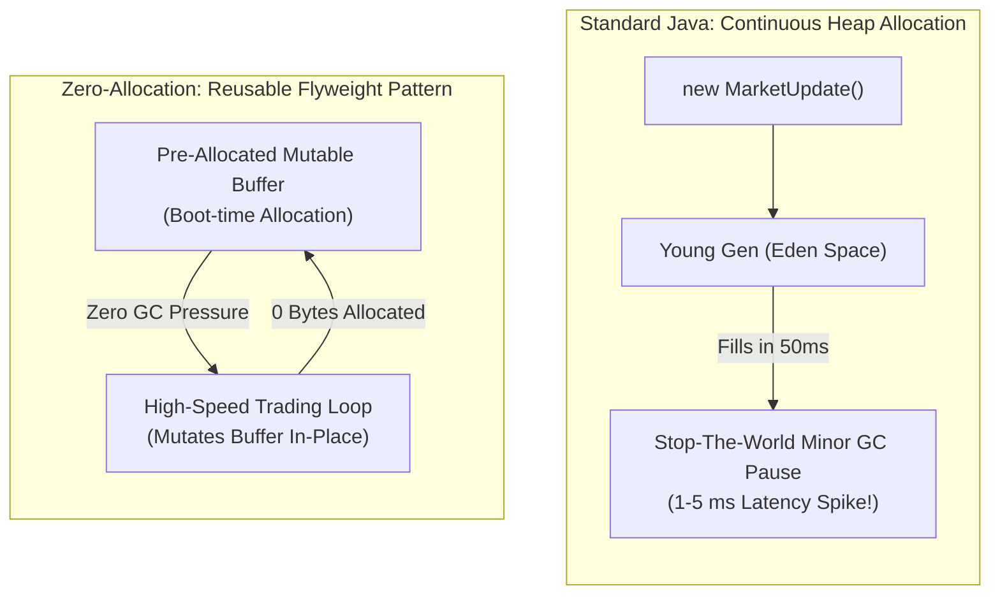

In traditional enterprise Java, garbage generation is considered a natural byproduct of programming. Developers allocate DTOs, stream pipelines, lambda captures, string concatenations, and JSON objects without a second thought. Modern garbage collectors like G1GC, ZGC, and Shenandoah do an incredible job of cleaning up hundreds of megabytes per second with pause times under a millisecond.

However, in High-Frequency Trading (HFT), sub-millisecond market making, and ultra-low-latency order matching, **even a 500-microsecond pause is an eternity**. 

If a market price updates on the Chicago Mercantile Exchange (CME) and your trading engine pauses for just 200 microseconds to clean Young Gen Eden space, another algorithmic firm will execute ahead of you, and your firm will take the loss on stale quotes. 

In this elite domain, the goal is not to "tune" the Garbage Collector; the goal is to **starve the Garbage Collector completely**. By writing **Zero-Allocation Java**, you ensure that during normal trading hours, the application allocates **0 bytes on the heap per transaction**, rendering GC pauses physically impossible.

In this deep dive, we explore the mechanics of Escape Analysis and why it fails, the Flyweight pattern for mutable state reuse, primitive-specialized collections, CPU core pinning (Thread Affinity), and garbage-free logging architectures.

---

### The Anatomy of Heap Allocation Overhead

Why is allocating an object on the JVM heap expensive?

1. **Object Header Overhead:** Every single object instance in HotSpot carries a 12-to-16-byte object header (8-byte Mark Word + 4-to-8-byte Klass Word). A simple `new Integer(42)` consumes **24 bytes of heap memory** (including padding) to store a 4-byte number!
2. **TLAB Allocation Pressure:** While Thread-Local Allocation Buffers (TLABs) make `new Object()` fast (a simple bump-the-pointer operation), fast allocations quickly fill Eden space.
3. **Card Table & GC Bookkeeping:** Every reference assignment (`order.customer = customer`) requires the JVM to execute a **Write Barrier**, marking bits in the Card Table to track cross-generational pointers.
4. **Cache Locality Destruction:** Scattered heap objects degrade CPU L1/L2 cache locality, incurring 60-80 ns DRAM fetch penalties on every pointer dereference.



---

### Escape Analysis: The Promise and The Trap

HotSpot's C2 JIT compiler features **Escape Analysis** (JEP 64). Escape Analysis inspects an object's lifetime to determine if it ever escapes the compiling method or thread:

```java
public double calculateMidPrice(double bid, double ask) {
    // Does this object escape the method?
    PriceRange range = new PriceRange(bid, ask); 
    return (range.bid() + range.ask()) / 2.0;
}
```

If the JIT compiler proves that `range` never escapes `calculateMidPrice()`, it performs **Scalar Replacement**: it disassembles the object into its constituent primitive fields (`double bid`, `double ask`) and allocates them directly in **CPU registers** or on the execution stack. **No heap allocation occurs.**

#### Why You Cannot Rely on Escape Analysis in Low-Latency Code
While Escape Analysis sounds like a silver bullet, it is notoriously fragile in real-world code:
- **Global Escapes:** Storing an object into a field, collection, or static reference immediately defeats Escape Analysis.
- **Method Escapes:** Passing an object as an argument to another method that the JIT compiler cannot inline (e.g., due to exceeding the `-XX:MaxInlineLevel=9` or `-XX:MaxInlineSize=35` bytecode limits) breaks Escape Analysis.
- **Polymorphism:** If a method call site is bimorphic or megamorphic, inlining fails, causing scalar replacement to abort and forcing heap allocation.
- **Control Flow Complexity:** Unrolled loops or complex exception blocks cause HotSpot's escape analyzer to give up conservatively.

> [!CRITICAL]
> In sub-microsecond engineering, **never trust Escape Analysis to eliminate allocations**. If you create `new Object()` inside an inner event loop, treat it as a bug.

---

### The Flyweight Pattern: Mutable Value Reusers

Instead of allocating immutable DTOs or Records for every event, zero-allocation architectures use **pre-allocated, mutable flyweight carriers**:

```java
// Antipattern: Allocating a new Record on every incoming market tick
public void onRawPacket(ByteBuffer buffer) {
    long orderId = buffer.getLong();
    double price = buffer.getDouble();
    int qty = buffer.getInt();
    
    // Allocates new heap object on EVERY message!
    OrderEvent event = new OrderEvent(orderId, price, qty); 
    processOrder(event);
}

// Enterprise Zero-Allocation: Reusable Flyweight Carrier
public class MarketTickFlyweight {
    private long orderId;
    private double price;
    private int quantity;

    // Mutator resets state in place without allocating a single byte!
    public MarketTickFlyweight wrap(long orderId, double price, int quantity) {
        this.orderId = orderId;
        this.price = price;
        this.quantity = quantity;
        return this;
    }

    public long orderId() { return orderId; }
    public double price() { return price; }
    public int quantity() { return quantity; }
}
```

In the event handler:

```java
public class MarketDataProcessor {

    // Pre-allocated once at boot time per thread!
    private final MarketTickFlyweight reusableTick = new MarketTickFlyweight();

    public void onRawPacket(ByteBuffer buffer) {
        long orderId = buffer.getLong();
        double price = buffer.getDouble();
        int qty = buffer.getInt();

        // Mutate the existing flyweight instance
        reusableTick.wrap(orderId, price, qty);

        // Process directly
        executeStrategy(reusableTick);
    }
}
```

---

### The Trap of java.util Collections: Boxing and Pointer Overhead

Standard Java collections in `java.util` (`HashMap`, `ArrayList`, `HashSet`) cannot store primitives; they only store reference types (`Object`).

Consider mapping an account ID (`long`) to a balance (`double`) using `java.util.HashMap<Long, Double>`:
1. Every insertion forces **Autoboxing**: `Long.valueOf(id)` allocates 24 bytes; `Double.valueOf(balance)` allocates 24 bytes.
2. A single `HashMap.Node` object consumes **32 bytes** (hash, key reference, value reference, next pointer).
3. Total memory consumed per entry: **80 bytes** to store 16 bytes of useful data (500% memory overhead!).
4. Iterating the map causes random pointer-chasing across the heap, triggering continuous L1/L2 cache misses.

#### Primitive Specialized Collections
Ultra-low-latency systems replace `java.util` collections with **Open-Addressing Primitive Collections** (such as **Agrona**, **Eclipse Collections**, or **Koloboke**):

```java
import org.agrona.collections.Long2DoubleHashMap;

public class UltraFastAccountLedger {

    // Pre-allocated flat primitive arrays: long[] keys, double[] values
    // Zero boxing! Zero Node objects! Zero Garbage!
    private final Long2DoubleHashMap balances = 
        new Long2DoubleHashMap(1_000_000, 0.6f, -1.0);

    public void updateBalance(long accountId, double amount) {
        // Direct primitive lookup in contiguous memory (100% L1 cache friendly!)
        balances.put(accountId, amount);
    }

    public double getBalance(long accountId) {
        return balances.get(accountId);
    }
}
```

Under open-addressing, keys and values are stored directly inside flat primitive arrays (`long[]` and `double[]`). There are **no `Node` objects, no pointers, and zero heap allocations during `put()` and `get()`**.

---

### CPU Core Pinning and Thread Affinity

In modern operating systems, the Linux kernel scheduler routinely migrates threads between different CPU cores to balance thermal load and core utilization.

In ultra-low-latency systems, **Thread Migration is catastrophic**:
1. When Thread A is moved from Core 2 to Core 7, Core 7's L1 and L2 caches are completely cold.
2. Thread A stalls for hundreds of cycles while its cache lines are flushed from Core 2 and reloaded into Core 7.
3. The thread experiences unpredictable latency jitter (a 100-microsecond spike on a previously 5-microsecond path).

#### Pinning Java Threads with Java Thread Affinity
Using native JNI/JNA libraries (such as Peter Lawrey's **Java-Thread-Affinity** or Agrona), low-latency Java applications lock critical worker threads to isolated physical CPU cores:

```java
import net.openhft.affinity.Affinity;
import net.openhft.affinity.AffinityLock;

public class PinnedTradingEngine {

    public static void main(String[] args) {
        // Dedicate a background thread pinned to an isolated CPU core
        Thread matchingEngineThread = new Thread(() -> {
            
            // Acquire an exclusive lock on an isolated physical CPU core (e.g., Core 3)
            try (AffinityLock lock = AffinityLock.acquireCore()) {
                System.out.println("Thread successfully pinned to CPU Core: " + Affinity.getCpu());

                // Enter the sub-microsecond processing loop
                while (true) {
                    processIncomingOrders();
                }
            }
        });

        matchingEngineThread.setName("hft-matching-engine");
        matchingEngineThread.start();
    }
}
```

To prevent the Linux operating system from scheduling general OS tasks onto your pinned cores, configure the Linux kernel bootloader parameters in `/etc/default/grub`:

```bash
# Isolate CPU Cores 2, 3, 4, 5 from standard Linux kernel scheduling
GRUB_CMDLINE_LINUX_DEFAULT="isolcpus=2,3,4,5 nohz_full=2,3,4,5 rcu_nocbs=2,3,4,5"
```

Once isolated, your Java thread owns the physical hardware core exclusively. It experiences zero OS context switches, zero thread migrations, and zero cache evictions.

---

### Garbage-Free Logging with Log4j2

Logging is one of the most common sources of hidden heap allocations in enterprise Java:

```java
// Antipattern: The Hidden Garbage Minefield
log.info("Order matched: id={}, price={}, side={}", orderId, price, side);
```

Behind the scenes, this single log line creates:
1. `Long.valueOf(orderId)` (Autoboxing allocation).
2. `Double.valueOf(price)` (Autoboxing allocation).
3. An `Object[]` array containing the three arguments.
4. An internal `LogEvent` instance.
5. Multiple temporary `String` allocations during message formatting.

If an engine logs 100,000 events per second, standard logging libraries allocate **gigabytes of garbage per minute**!

#### Configuring Log4j2 in Garbage-Free Mode
Log4j2 includes a native **Garbage-Free Logging Engine**. By setting JVM system properties, Log4j2 reuses thread-local `StringBuilder` buffers and emits logs asynchronously without allocating objects:

```properties
# Enable Garbage-Free Logging in Log4j2
log4j2.enableThreadlocals=true
log4j2.enableDirectEncoders=true
log4j.asyncLoggerWaitStrategy=Yield
```

```java
// Garbage-Free Logging with Log4j2 Parameterized Message
// Uses unboxed primitive log overloads (zero object creation!)
logger.info("Order matched: id={}, price={}", (Unbox) orderId, (Unbox) price);
```

Log4j2 encodes the text directly into reusable off-heap byte buffers, sending the data to an asynchronous disk thread via the LMAX Disruptor with zero heap garbage.

---

## Senior Engineer Interview Crucible

### What is Escape Analysis, and what are the specific conditions that prevent HotSpot C2 from performing Scalar Replacement?
**Answer:** Escape Analysis (JEP 64) is an optimization phase in HotSpot's C2 compiler that analyzes the escape state of an object allocated within a method:
- **NoEscape:** The object does not escape the allocating method or thread.
- **ArgEscape:** The object escapes via method invocation arguments, but does not outlive the calling method.
- **GlobalEscape:** The object escapes the method and thread entirely (stored in a field, static variable, or returned from the method).

When an object is categorized as `NoEscape`, the compiler performs **Scalar Replacement**: it disassembles the object into its individual primitive fields, allocating them directly in CPU registers or on the stack, completely bypassing the heap. 

Scalar replacement fails when:
1. The object is assigned to an instance or static field (`GlobalEscape`).
2. The object is passed to a method call site that exceeds JIT inlining limits (due to megamorphic dispatch or deep call stacks).
3. The object is stored in an array whose index is dynamically computed (HotSpot cannot scalar-replace dynamic array elements).
4. The method contains complex control flow or loop unrolling boundaries that exceed the compiler's analytical budget.

### Why do standard Java collections like `java.util.HashMap` cause severe cache locality degradation compared to open-addressing primitive collections like Agrona's `Long2DoubleHashMap`?
**Answer:** A `java.util.HashMap` uses separate chaining for collision resolution. Each entry in the map is represented by a separate `HashMap.Node` heap object containing 32 bytes of pointer overhead (`hash`, `key`, `value`, `next`). Furthermore, primitive types must be boxed into heap objects (`Long`, `Double`), creating additional object headers.

This architecture destroys cache locality:
1. When retrieving a value, the CPU accesses the internal `Node[]` array, dereferences a pointer to a `Node` object located at a random heap address, and then dereferences the `value` pointer to another random heap address. Each dereference incurs an L2/L3 cache miss or a 60-80 ns DRAM stall.
2. An open-addressing primitive collection (like Agrona's `Long2DoubleHashMap`) stores keys and values in two parallel, contiguous primitive arrays (`long[] keys`, `double[] values`) without `Node` objects or boxing. Because primitive data resides contiguously in physical memory, accessing an entry loads adjacent keys into the CPU's 64-byte L1 cache line in a single memory cycle, resulting in near-100% cache hits.

### How does Thread Affinity reduce latency jitter in ultra-low-latency Java systems?
**Answer:** In standard Linux systems, the Completely Fair Scheduler (CFS) continuously migrates threads between available CPU cores to balance system load and core temperatures. 

When a low-latency thread is migrated to a new core:
1. The new core's L1 and L2 data and instruction caches are completely cold. The thread stalls while its memory structures are transferred over the inter-core interconnect bus.
2. The CPU's branch target buffer (BTB) history is absent on the new core, resulting in immediate branch misprediction penalties.
3. If the core was previously in a power-saving sleep state (C-state), the thread suffers a wake-up latency penalty (often 10 to 50 microseconds).

By using Thread Affinity to pin a critical Java thread to a dedicated physical CPU core (and configuring the Linux kernel with `isolcpus` to prevent OS background tasks from using that core), the thread maintains exclusive ownership of the hardware execution units. Its L1/L2 caches remain permanently hot, eliminating thread-migration jitter.

### Explain how Log4j2 achieves "Garbage-Free" asynchronous logging.
**Answer:** Traditional logging frameworks format log messages by creating temporary `String` instances, boxing primitive parameters (`Long`, `Double`), allocating an `Object[]` array for varargs parameters, and allocating a `LogEvent` object per log statement.

Log4j2 eliminates garbage generation through three core mechanisms:
1. **Thread-Local Reusable Formatters:** Log4j2 maintains pre-allocated, thread-local `StringBuilder` instances. Log messages are formatted directly into these reusable buffers without instantiating intermediate `String` objects.
2. **Unboxed Primitive Overloads:** The Logger API provides specialized overloads (e.g., `info(String, long, double)`) that accept primitives directly, avoiding autoboxing.
3. **Direct Encoders & Disruptor Ring Buffers:** Instead of creating a new `LogEvent` object per message, Log4j2 utilizes the LMAX Disruptor with pre-allocated `RingBufferLogEvent` slots. The message text is converted directly into bytes within a reusable off-heap `ByteBuffer` and streamed asynchronously to disk, resulting in zero heap object allocations during steady-state logging.

