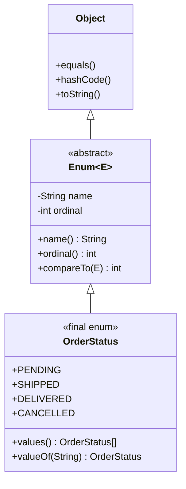

In languages like C, C++, and early TypeScript, an `enum` is little more than a glorified integer wearing a disguise. 

If `RED = 0`, `APPLE = 0`, and `MONDAY = 0`, the compiler treats them all as interchangeable 32-bit numbers. You could pass `MONDAY` into a function expecting a traffic light color, and the compiler wouldn't blink:

```c
// C Language: Primitive integers in disguise
enum Color { RED, GREEN, BLUE };
enum Day { MONDAY, TUESDAY };

void paintCar(enum Color c);
paintCar(MONDAY); // Completely valid C code!
```

When James Gosling and the Java team introduced `enum` in **Java 5**, they rejected primitive integers entirely. They asked: *"Why should an enumerated constant be a dumb integer when it could be a first-class, type-safe Object?"*

In Java, an `enum` is a **full-fledged Class**. It can possess instance variables, constructors, instance methods, implement interfaces, and execute polymorphic algorithms. 

Let's look under the hood at how the JVM compiles enums into bytecode, explore the high-speed bitwise mechanics of `EnumSet`, and uncover the subtle ordinal traps that cause data corruption in production databases.

---

## Bytecode Deconstruction: What is an Enum Really?

When you declare a simple enum in Java:

```java
public enum OrderStatus {
    PENDING,
    SHIPPED,
    DELIVERED,
    CANCELLED;
}
```

The Java compiler does not output integer constants. It synthesizes a **full, final class** that inherits directly from `java.lang.Enum<E>`:

```java
// What javac secretly generates behind the scenes:
public final class OrderStatus extends java.lang.Enum<OrderStatus> {
    
    // 1. Static Final Constants (Singletons allocated on Heap!)
    public static final OrderStatus PENDING = new OrderStatus("PENDING", 0);
    public static final OrderStatus SHIPPED = new OrderStatus("SHIPPED", 1);
    public static final OrderStatus DELIVERED = new OrderStatus("DELIVERED", 2);
    public static final OrderStatus CANCELLED = new OrderStatus("CANCELLED", 3);

    private static final OrderStatus[] $VALUES = new OrderStatus[] { 
        PENDING, SHIPPED, DELIVERED, CANCELLED 
    };

    // 2. Private Constructor (Enforced by the JVM)
    private OrderStatus(String name, int ordinal) {
        super(name, ordinal);
    }

    public static OrderStatus[] values() {
        return (OrderStatus[]) $VALUES.clone(); // Returns defensive copy
    }

    public static OrderStatus valueOf(String name) {
        return (OrderStatus) java.lang.Enum.valueOf(OrderStatus.class, name);
    }
}
```



### Architectural Consequences of This Structure:
1. **Strict Type Safety:** You cannot pass `Day.MONDAY` into a method expecting `OrderStatus`. The compiler enforces distinct types.
2. **Immutable Identity:** Because only one instance of each constant is allocated during class loading, you can safely compare enums using **`==` reference equality** rather than `.equals()`.
3. **No Subclassing:** Because `OrderStatus` is compiled as `final` and extends `java.lang.Enum`, **an enum cannot extend any other class**, nor can any class extend an enum.

---

## State and Behavior: Rich Domain Models

Because enums are classes, they can encapsulate state and operations. 

Never use an enum just to hold a name. Attach the domain data and calculations directly to the constants:

```java
public enum Currency {
    USD("$", 1.00),
    EUR("€", 1.08),
    GBP("£", 1.27),
    JPY("¥", 0.0065);

    // Encapsulated state
    private final String symbol;
    private final double usdConversionRate;

    // Enum constructors are strictly private (omitting modifier defaults to private)
    Currency(String symbol, double usdConversionRate) {
        this.symbol = symbol;
        this.usdConversionRate = usdConversionRate;
    }

    // Business operation
    public double convertToUsd(double amount) {
        return amount * this.usdConversionRate;
    }

    public String format(double amount) {
        return String.format("%s%.2f", symbol, amount);
    }
}
```

Usage reads like clean English:
```java
Currency currency = Currency.EUR;
System.out.println(currency.format(150.0)); // "€150.00"
System.out.println("USD Equivalent: " + currency.convertToUsd(150.0)); // "$162.00"
```

---

## Constant-Specific Class Bodies: The Strategy Pattern

What if different enum constants need to perform completely different algorithmic logic? 

Beginners often write an ugly `switch` or `if-else` ladder inside a single method:
```java
// ❌ UGLY & FRAGILE: Adding a new operation requires updating the switch
public double apply(double a, double b) {
    switch(this) {
        case PLUS: return a + b;
        case MINUS: return a - b;
    }
}
```

The professional approach is **Constant-Specific Method Implementations**. You declare an `abstract` method on the enum, and each constant implements its own class body:

```java
public enum Operation {
    PLUS("+") {
        @Override
        public double apply(double a, double b) {
            return a + b;
        }
    },
    MINUS("-") {
        @Override
        public double apply(double a, double b) {
            return a - b;
        }
    },
    MULTIPLY("*") {
        @Override
        public double apply(double a, double b) {
            return a * b;
        }
    },
    DIVIDE("/") {
        @Override
        public double apply(double a, double b) {
            if (b == 0) {
                throw new ArithmeticException("Division by zero.");
            }
            return a / b;
        }
    };

    private final String symbol;

    Operation(String symbol) {
        this.symbol = symbol;
    }

    // Every single constant is forced by the compiler to implement this!
    public abstract double apply(double a, double b);

    public String getSymbol() {
        return symbol;
    }
}
```

```java
double result = Operation.MULTIPLY.apply(6, 7); // 42.0
```

Under the hood, `javac` actually creates an **anonymous subclass** for each constant that overrides `apply()`. If you add a new constant (like `POWER`), the compiler will refuse to compile until you implement `apply()`.

---

## The Lethal Production Trap: The `ordinal()` Hazard

Every Java enum carries an automatic integer property called **`ordinal()`**, representing its zero-indexed position in the declaration:

```java
OrderStatus.PENDING.ordinal();   // 0
OrderStatus.SHIPPED.ordinal();   // 1
OrderStatus.DELIVERED.ordinal(); // 2
```

> [!CAUTION]
> **Never Persist Enums by `ordinal()` to a Database!**
> Many JPA/Hibernate mapping tutorials lazily write `@Enumerated(EnumType.ORDINAL)`. This is a ticking time bomb in enterprise systems!
> 
> Imagine a junior developer reorders the enum constants or inserts a new status `PROCESSING` between `PENDING` and `SHIPPED`:
> ```java
> public enum OrderStatus {
>     PENDING,    // 0
>     PROCESSING, // 1  <-- NEW CONSTANT INSERTED!
>     SHIPPED,    // 2  (Was 1 yesterday!)
>     DELIVERED;  // 3  (Was 2 yesterday!)
> }
> ```
> Every row in your production SQL database that previously stored `1` (which meant `SHIPPED`) now maps to `PROCESSING`! Millions of delivered customer packages suddenly revert to processing state.
> 
> **Production Rule:** Always persist enums by their immutable string **`name()`** or assign an explicit, immutable business code field (e.g. `private final int code;`).

---

## Hardware-Level Speed: `EnumSet` and `EnumMap`

Java provides two specialized collection classes engineered specifically for enums. They are among the fastest data structures in the entire standard library:

### `EnumSet`: High-Speed Bitwise Vectors
In C/C++, developers use bitwise bitmasks (`0x01 | 0x02 | 0x04`) to represent sets of flags. 

In Java, **`EnumSet`** gives you that exact hardware-level speed with 100% type safety. 

```java
public enum Permission { READ, WRITE, EXECUTE, DELETE }

// Create an EnumSet
Set<Permission> userPermissions = EnumSet.of(Permission.READ, Permission.WRITE);
```

**How does it work inside memory?**
If your enum has 64 or fewer constants (which is true for 99.9% of enums), the JVM uses **`RegularEnumSet`**. 
Under the hood, it does not allocate an array or a hash table—it stores the set inside a **single 64-bit primitive `long` bit-vector**! 
Operations like `.contains()`, `.add()`, and `.retainAll()` execute as **single-cycle CPU bitwise instructions** (`AND`, `OR`, `XOR`).

### `EnumMap`: Array-Indexed Lookup
If you need a map where the keys are enums, never use `HashMap<MyEnum, V>`. 

Use **`EnumMap<MyEnum, V>`**:
- Internally, an `EnumMap` is backed by a **flat, dense array** indexed by `key.ordinal()`.
- It requires zero hashing, zero hash collision resolution, and zero linked-node traversal.
- It delivers instantaneous `O(1)` reads and writes that hit CPU cache lines directly.

---

## The Ultimate Singleton Guarantee

In *Effective Java*, Joshua Bloch famously wrote:

> *"A single-element enum type is the best way to implement a singleton."*

Why is an enum singleton superior to traditional classes with private constructors?

```java
public enum ConfigurationRegistry {
    INSTANCE;

    private final Properties settings = new Properties();

    ConfigurationRegistry() {
        // Load configuration files securely during initialization
    }

    public String getProperty(String key) {
        return settings.getProperty(key);
    }
}
```

An enum singleton provides three ironclad JVM guarantees:

1. **Thread-Safe Initialization:** The JVM guarantees that enum constants are instantiated serially under class-loading synchronization locks.
2. **Serialization Immunity:** Standard singletons duplicate themselves when serialized and deserialized unless you implement complex `readResolve()` hooks. The JVM provides built-in serialization handling for enums that guarantees duplicate instances can never be created.
3. **Reflection-Proof:** An attacker can use Java Reflection (`Constructor.setAccessible(true)`) to instantiate private class constructors. But if reflection attempts to invoke an enum constructor, the JVM throws an explicit exception:
   ```text
   java.lang.IllegalArgumentException: Cannot reflectively create enum objects
   ```

---

## Summary & Mental Model Checkpoint

1. **First-Class Classes**: Enums extend `java.lang.Enum<E>` and compile into static final singleton instances on the Heap.
2. **Rich State & Behavior**: Enums can define private fields, explicit constructors, and instance methods.
3. **Constant-Specific Bodies**: Enforce the Strategy Pattern at compile time by implementing abstract methods per constant.
4. **Never Use `ordinal()` for Storage**: Ordinal integer positions shift when constants are added; always persist immutable string names or explicit IDs.
5. **Bitwise Speed**: Use `EnumSet` for bit-vector performance and `EnumMap` for array-indexed key lookups.
6. **The Perfect Singleton**: Single-element enums provide thread-safety, serialization safety, and reflection immunity.

---

## 🎯 Senior Engineer Interview Questions

### Why is using `==` preferred over `.equals()` when comparing Java Enum constants?
> **Answer:** Both evaluate to the exact same result because an Enum guarantees that only one instance of each constant exists per ClassLoader (reference identity equals logical identity). However, `==` offers two distinct advantages:
> 1. **Compile-Time Type Safety:** `enumA == enumB` will produce a compilation error if the two enums belong to different types, whereas `.equals()` will compile and silently return `false` at runtime.
> 2. **Null-Safety:** `status == OrderStatus.PENDING` will safely evaluate to `false` if `status` is `null`, whereas `status.equals(OrderStatus.PENDING)` will throw a `NullPointerException`.

### How does `EnumSet` achieve superior performance over a standard `HashSet`?
> **Answer:** A standard `HashSet` is backed by a `HashMap`, requiring object hashing, bucket index calculation, linked node traversal, and memory overhead for `Node` entries. In contrast, `EnumSet` is backed by a primitive bit-vector (a single 64-bit `long` in `RegularEnumSet` for enums with up to 64 elements). Set operations (membership, union, intersection) are performed via direct CPU bitwise instructions (`&`, `|`, `~`), consuming minimal memory and executing in single clock cycles.

### Why does Java's Reflection API explicitly prohibit the instantiation of enum classes?
> **Answer:** The language specification mandates that the set of enum constants defined in the source code is exhaustive, immutable, and strictly controlled by the ClassLoader. Allowing reflective instantiation via `Constructor.newInstance()` would break the singleton invariant of enum constants, disrupting `==` reference identity, corrupting `EnumMap` and `EnumSet` bitmask assumptions, and creating invalid enum states. The JDK's `Constructor.newInstance()` method explicitly checks for the `ENUM` modifier and throws an `IllegalArgumentException`.

### What is the difference between an Enum's `name()` and `toString()` methods?
> **Answer:** `name()` is a `final` method that returns the exact declared identifier of the enum constant as written in the source code; it cannot be overridden, ensuring programmatic stability. `toString()` returns the identifier by default, but it can be overridden by the developer to provide a formatted, human-readable display string (e.g. returning "United States Dollar" for `USD`). For persistence and serialization, code should always rely on `name()`.
