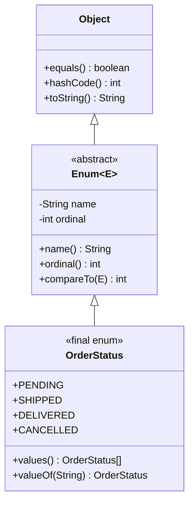

Before Java 5, representing a fixed set of values usually meant declaring a group of `public static final int` constants, a pattern known as the "int enum" pattern. It had obvious flaws: there was no type safety (passing `DAY_MONDAY` into a method expecting a `COLOR_*` constant compiled without warning), printed values showed meaningless numbers like `2` instead of `"SHIPPED"`, and adding behavior meant scattering `switch` statements across the codebase.

Java 5 introduced `enum` as a specialized kind of class rather than a thin wrapper around integers. Every enum constant is an object with a strict compile-time type, and an enum can hold fields, constructors, methods, and interface implementations.

---

## What `javac` Generates for an Enum

Start with a simple enum:

```java
public enum OrderStatus {
    PENDING,
    SHIPPED,
    DELIVERED,
    CANCELLED
}
```

When you compile this file, `javac` generates a class that extends `java.lang.Enum<OrderStatus>`. Conceptually, the compiled bytecode looks like this:

```java
// Conceptual representation of what javac generates
public final class OrderStatus extends java.lang.Enum<OrderStatus> {

    public static final OrderStatus PENDING = new OrderStatus("PENDING", 0);
    public static final OrderStatus SHIPPED = new OrderStatus("SHIPPED", 1);
    public static final OrderStatus DELIVERED = new OrderStatus("DELIVERED", 2);
    public static final OrderStatus CANCELLED = new OrderStatus("CANCELLED", 3);

    private static final OrderStatus[] VALUES = {
        PENDING, SHIPPED, DELIVERED, CANCELLED
    };

    private OrderStatus(String name, int ordinal) {
        super(name, ordinal);
    }

    public static OrderStatus[] values() {
        return VALUES.clone(); // Defensive copy prevents callers from mutating the array
    }

    public static OrderStatus valueOf(String name) {
        return Enum.valueOf(OrderStatus.class, name);
    }
}
```



This compiled structure explains several rules of Java enums right away:

- **No class inheritance**: because the enum already extends `java.lang.Enum`, it cannot extend another class. It *can* implement one or more interfaces.
- **One instance per constant per class loader**: because each constant is a `public static final` singleton created during class initialization, comparing constants with `==` checks reference identity and always agrees with `.equals()`. Using `==` is preferred because it is null-safe (`status == OrderStatus.SHIPPED` evaluates to `false` if `status` is `null`) and fails at compile time if you accidentally compare two different enum types.
- **`values()` copies an array**: `OrderStatus.values()` clones the internal array on every call so callers cannot corrupt the enum by assigning `OrderStatus.values()[0] = null`. In performance-sensitive loops, cache `List.of(OrderStatus.values())` or a private array instead of calling `values()` repeatedly.
- **`name()` vs. `toString()`**: `name()` is `final` and always returns the exact identifier written in source code (`"SHIPPED"`). `toString()` returns the same string by default, but you can override it for display purposes.

---

## Enum Constructors, Fields, and Methods

Because an enum is a class, you can attach domain data and methods directly to each constant instead of maintaining parallel lookup tables elsewhere.

```java
import java.math.BigDecimal;
import java.util.Map;
import java.util.Optional;
import java.util.function.Function;
import java.util.stream.Collectors;
import java.util.stream.Stream;

public enum ShippingMethod {
    STANDARD("STD", new BigDecimal("5.00"), 5),
    EXPRESS("EXP", new BigDecimal("15.00"), 2),
    OVERNIGHT("OVN", new BigDecimal("30.00"), 1);

    private static final Map<String, ShippingMethod> BY_CODE =
            Stream.of(values()).collect(Collectors.toUnmodifiableMap(
                    ShippingMethod::code,
                    Function.identity()
            ));

    private final String code;
    private final BigDecimal baseRate;
    private final int estimatedDays;

    // Enum constructors are always private (writing 'public' or 'protected' will not compile)
    ShippingMethod(String code, BigDecimal baseRate, int estimatedDays) {
        this.code = code;
        this.baseRate = baseRate;
        this.estimatedDays = estimatedDays;
    }

    public String code() {
        return code;
    }

    public int estimatedDays() {
        return estimatedDays;
    }

    public BigDecimal calculateCost(BigDecimal weightKg) {
        BigDecimal weightSurcharge = weightKg.multiply(new BigDecimal("1.50"));
        return baseRate.add(weightSurcharge);
    }

    public static Optional<ShippingMethod> fromCode(String code) {
        return Optional.ofNullable(BY_CODE.get(code));
    }
}
```

A few practical details stand out here:

1. **Private constructors only**: enum constructors cannot be invoked with `new` outside the constant declarations. You can omit the `private` modifier, and the compiler treats the constructor as `private` automatically.
2. **Immutable fields**: always mark enum fields `private final`. Because enum constants are global singletons shared across the entire application, mutable fields on an enum introduce shared mutable state and thread-safety bugs.
3. **Static lookup maps**: `Enum.valueOf(String)` matches the Java constant name and throws `IllegalArgumentException` if the input is unknown. When parsing external codes like `"STD"`, a prebuilt `Map` (`BY_CODE`) gives `O(1)` lookup and lets you return an `Optional` cleanly. Note that static fields initialize *after* enum constants are constructed, so an enum constructor cannot read a `static` map declared on the same enum.

---

## Using Enums in `switch` Statements and Expressions

Enums pair naturally with `switch`. Inside a `switch` on an enum value, the compiler already knows the type, so `case` labels use the unqualified constant name (`PENDING`, not `OrderStatus.PENDING`).

### Traditional `switch` Statement

```java
public String describe(OrderStatus status) {
    switch (status) {
        case PENDING:
            return "Waiting for payment confirmation";
        case SHIPPED:
            return "In transit with carrier";
        case DELIVERED:
            return "Delivered to recipient";
        case CANCELLED:
            return "Order cancelled";
        default:
            throw new IllegalStateException("Unexpected status: " + status);
    }
}
```

Traditional `switch` statements have two well-known rough edges: forgetting a `break` (when not returning) causes unintended fall-through, and passing a `null` enum reference throws `NullPointerException` before any `case` runs.

### Modern `switch` Expressions (Java 14+)

Since Java 14, `switch` expressions solve both fall-through and exhaustiveness:

```java
public boolean canCancel(OrderStatus status) {
    return switch (status) {
        case PENDING -> true;
        case SHIPPED, DELIVERED, CANCELLED -> false;
    };
}
```

Notice there is no `default` branch. Because `switch` expressions must produce a value for every possible input, the compiler verifies that every constant in `OrderStatus` is handled. If someone later adds `REFUNDED` to `OrderStatus`, every exhaustive `switch` expression fails to compile until it explicitly handles `REFUNDED`. If you had added a `default` branch, that compiler check would have been silenced.

In Java 21+, pattern-enhanced `switch` also lets you handle `null` explicitly with `case null -> ...` instead of checking for `null` beforehand.

Under the hood, when a `switch` lives in the same class as the enum, `javac` switches directly on `ordinal()`. When the `switch` is in a different class, `javac` generates a synthetic lookup array that maps each constant's runtime `ordinal()` to a stable switch index. That way, if another library reorders enum constants without recompiling your class, your `switch` still routes to the right branch.

---

## Constant-Specific Method Bodies and Behavior

When every constant shares the same data shape, fields and a single method are enough. When each constant needs distinct behavior, you can declare an `abstract` method on the enum and override it per constant:

```java
public enum Operation {
    PLUS("+") {
        @Override
        public double apply(double a, double b) {
            return a + b;
        }
    },
    MINUS("-") {
        @Override
        public double apply(double a, double b) {
            return a - b;
        }
    },
    MULTIPLY("*") {
        @Override
        public double apply(double a, double b) {
            return a * b;
        }
    },
    DIVIDE("/") {
        @Override
        public double apply(double a, double b) {
            if (b == 0.0) {
                throw new ArithmeticException("Division by zero");
            }
            return a / b;
        }
    };

    private final String symbol;

    Operation(String symbol) {
        this.symbol = symbol;
    }

    public abstract double apply(double a, double b);

    public String symbol() {
        return symbol;
    }
}
```

When an enum contains constant-specific class bodies, `javac` makes the enum class `abstract` instead of `final` and compiles each constant as an anonymous subclass (such as `Operation$1` for the first constant). Every new constant is forced by the compiler to implement `apply()`.

For simple, stateless operations, Java 8+ also lets you pass a functional interface to the constructor instead of creating anonymous subclasses:

```java
import java.util.function.DoubleBinaryOperator;

public enum BinaryOp {
    PLUS("+", Double::sum),
    MINUS("-", (a, b) -> a - b),
    MULTIPLY("*", (a, b) -> a * b);

    private final String symbol;
    private final DoubleBinaryOperator operator;

    BinaryOp(String symbol, DoubleBinaryOperator operator) {
        this.symbol = symbol;
        this.operator = operator;
    }

    public double apply(double a, double b) {
        return operator.applyAsDouble(a, b);
    }
}
```

Use the functional constructor style when each constant only varies by a short expression; use constant-specific method bodies or a strategy interface when constants have richer logic or override multiple methods.

---

## The `ordinal()` Persistence Trap

Every enum inherits `ordinal()`, which returns its zero-based declaration position (`PENDING` is `0`, `SHIPPED` is `1`, `DELIVERED` is `2`). The Javadoc for `Enum.ordinal()` explicitly warns that most programmers have no use for this method; it exists primarily for enum-based data structures like `EnumSet` and `EnumMap`.

> [!CAUTION]
> Never store `ordinal()` values in a database column, message queue payload, or external API contract. In JPA/Hibernate, the default `@Enumerated` mapping is `EnumType.ORDINAL`, which silently persists integers unless you override it.

Look at what happens if you insert a new constant in the middle of an enum whose ordinals were saved to SQL:

```java
public enum OrderStatus {
    PENDING,     // 0
    PROCESSING,  // 1 (newly inserted)
    SHIPPED,     // 2 (was 1 yesterday)
    DELIVERED,   // 3 (was 2 yesterday)
    CANCELLED    // 4 (was 3 yesterday)
}
```

Every historical database row storing `1` used to mean `SHIPPED` and now deserializes as `PROCESSING`. Every row storing `2` shifts from `DELIVERED` to `SHIPPED`.

Instead, persist either the constant's `name()` (for example, `@Enumerated(EnumType.STRING)`) or an explicit, stable business code field such as `ShippingMethod.code()`. An explicit code even protects you if you later rename the Java constant during a refactor.

---

## Specialized Collections: `EnumSet` and `EnumMap`

The standard library includes two collection implementations built specifically for enum keys and elements. Both are significantly more compact and faster than `HashSet` and `HashMap`.

### `EnumSet`: Type-Safe Bit Vectors

Instead of manually combining integer bitmasks (`READ | WRITE`), use `EnumSet`:

```java
import java.util.EnumSet;
import java.util.Set;

public enum Permission {
    READ, WRITE, EXECUTE, DELETE
}

Set<Permission> editorPermissions = EnumSet.of(Permission.READ, Permission.WRITE);
Set<Permission> allPermissions = EnumSet.allOf(Permission.class);
Set<Permission> nonDelete = EnumSet.complementOf(EnumSet.of(Permission.DELETE));

if (editorPermissions.contains(Permission.WRITE)) {
    // Runs in constant time using a single bit test
}
```

Internally, `EnumSet` is an abstract class with two package-private implementations:

- **`RegularEnumSet`** (used when the enum has 64 or fewer constants): stores the entire set in a single 64-bit `long`. Operations like `contains`, `add`, `remove`, and bulk set operations (`containsAll`, `retainAll`) compile down to simple bitwise operations with no node allocations.
- **`JumboEnumSet`** (used when the enum has more than 64 constants): backs the set with a `long[]` bit array.

`EnumSet` iterates in the enum's declaration order, rejects `null` elements, and is not thread-safe by itself (wrap with `Collections.synchronizedSet` if shared mutably, or copy into an unmodifiable set).

### `EnumMap`: Direct Array-Indexed Maps

Whenever a map's keys are enum constants, prefer `EnumMap` over `HashMap`:

```java
import java.util.EnumMap;
import java.util.Map;

Map<OrderStatus, Integer> counts = new EnumMap<>(OrderStatus.class);
for (OrderStatus status : OrderStatus.values()) {
    counts.put(status, 0);
}
counts.merge(OrderStatus.PENDING, 1, Integer::sum);
```

`EnumMap` stores values in a plain `Object[]` indexed directly by `key.ordinal()`. There is no `hashCode()` computation, no hash collision handling, and no `Map.Entry` node object allocated per key. Iteration follows the enum's declaration order, and `null` keys are rejected with `NullPointerException`.

---

## Single-Element Enum Singletons

Joshua Bloch popularized implementing a singleton as a one-constant enum:

```java
public enum AppMetrics {
    INSTANCE;

    public void recordStartup() {
        // Record startup metric
    }
}
```

Compared to hand-written `private static final` singleton classes, a single-element enum gets three guarantees from the JVM without extra boilerplate:

1. **Thread-safe initialization**: enum constants are initialized inside the class initializer (`<clinit>`), which the JVM synchronizes automatically.
2. **Serialization safety**: Java's serialization mechanism writes only the enum class and constant name and resolves it back to the existing constant on deserialization, preventing duplicate instances without a custom `readResolve()` method.
3. **Reflection safety**: `Constructor.newInstance()` explicitly rejects enum classes with `IllegalArgumentException: Cannot reflectively create enum objects`.

That said, enum singletons are not always the right tool in modern server applications. An enum cannot extend a base class, and hardcoding `AppMetrics.INSTANCE` throughout business logic makes unit testing harder than injecting an interface via a constructor or a dependency injection container like Spring. Use enum singletons for small, stateless or self-contained utilities, and prefer constructor injection for application services.

---

## Summary

- Java enums compile into classes extending `java.lang.Enum<E>`, with one static singleton instance per constant and a defensive-copying `values()` method.
- Attach `private final` fields, private constructors, and domain methods to enums to keep related data and behavior together.
- Prefer modern `switch` expressions (Java 14+) without a `default` branch when switching over an enum so the compiler flags missing cases whenever a new constant is added.
- Use constant-specific method bodies (or constructor-injected functional interfaces) when constants need different behavior.
- Never persist `ordinal()` values; store `name()` or an explicit stable code field.
- Use `EnumSet` and `EnumMap` instead of `HashSet` and `HashMap` whenever working with enum elements or keys.

---

## Interview Questions

### Why is `==` preferred over `.equals()` when comparing enum constants?

For enums, `==` and `.equals()` always return the same boolean result for non-null values because each constant has a single instance per class loader. `==` has two practical advantages: it is null-safe (`status == OrderStatus.PENDING` returns `false` instead of throwing `NullPointerException` when `status` is `null`), and it catches type mismatches at compile time (`OrderStatus.PENDING == Permission.READ` fails to compile, whereas `.equals()` compiles and quietly returns `false`).

### Why does omitting `default` in a Java 14+ `switch` expression over an enum improve maintainability?

A `switch` expression must cover all possible values of the enum type. When you list every constant explicitly and omit `default`, the compiler checks exhaustiveness for you. If another developer adds a new enum constant months later, the build fails at every `switch` expression that needs to decide how to handle that new constant, instead of silently falling into a catch-all `default` branch at runtime.

### How do `EnumSet` and `EnumMap` achieve better performance and lower memory usage than `HashSet` and `HashMap`?

`EnumSet` stores membership as bits inside a single `long` (`RegularEnumSet`, up to 64 constants) or `long[]` (`JumboEnumSet`), avoiding hash tables and wrapper node objects altogether. `EnumMap` backs its entries with a flat `Object[]` indexed directly by `key.ordinal()`, eliminating hashing, bucket collisions, and per-entry node allocations.

### Why is storing an enum's `ordinal()` in a database risky?

`ordinal()` is tied strictly to the order in which constants are declared in source code. Reordering constants, removing an obsolete constant, or inserting a new constant anywhere except the very end shifts the integer ordinals of existing constants. Previously stored database records will then map to the wrong enum values without raising an error. Persisting `name()` or an explicit immutable code field avoids this coupling.
