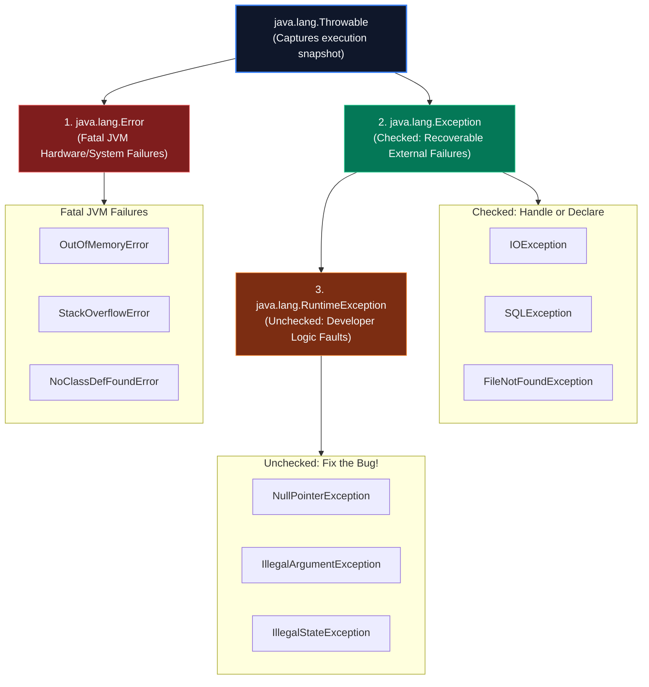

In the early days of C and Unix, error handling was a disaster of primitive return codes. 

Functions returned `-1` on error and set a global integer variable named `errno`. If a programmer forgot to check `if (status == -1)` after opening a file or querying a database, execution marched blindly forward into undefined memory, silently corrupting customer records or crashing the operating system.

When Java was conceived in 1995, James Gosling sought to make silent error propagation physically impossible. Java adopted **Structured Exception Handling**: when an invariant is broken, normal control flow is abruptly aborted, and an object carrying diagnostic state is propelled up the Thread Stack until an explicit handler catches it.

A true "Java God" doesn't just know how to wrap code in `try-catch`. They understand the physical cost of stack trace capture, how the JVM uses bytecode exception tables instead of runtime branches, why `return` in a `finally` block is dangerous, and how to design robust domain exceptions.

---

## The `Throwable` Hierarchy: The Three Kingdoms

In Java, every exception is an Object. At the absolute root sits `java.lang.Throwable`.

The hierarchy immediately branches into three distinct conceptual kingdoms:



### 1. `java.lang.Error`: Catastrophic JVM Crashes
Errors represent fatal system exhaustion. The physical JVM is dying, corrupt, or out of resources. 
- `OutOfMemoryError`: The Heap or Metaspace has zero remaining bytes, and full GC sweeps failed to reclaim space.
- `StackOverflowError`: A recursive loop consumed all 1 MB of the thread's stack space.
- `InternalError`: HotSpot encountered a low-level C++ subsystem failure.

> [!CAUTION]
> **Never Catch `Error` or `Throwable`!**
> Catching `Error` (e.g., `catch (Throwable t)`) in an attempt to keep a server alive is lethal. If an `OutOfMemoryError` or `ThreadDeath` occurred, shared data structures are likely half-written and corrupt. Let the thread terminate cleanly.

### 2. `java.lang.Exception` (Checked Exceptions): Anticipated Realities
Checked exceptions represent external conditions outside your application's direct control: a network cable was unplugged, a hard drive ran out of space, or a remote REST endpoint timed out.
- The Java compiler **strictly enforces** the "Handle or Declare" rule: you must wrap the call in a `try-catch` block or declare `throws` on your method signature.

### 3. `java.lang.RuntimeException` (Unchecked Exceptions): Programmer Blunders
Unchecked exceptions represent bugs in your own programming logic:
- `NullPointerException`: You dereferenced a reference without validating it.
- `IndexOutOfBoundsException`: You miscalculated array offsets.
- `IllegalArgumentException`: A caller violated your method's preconditions.
- The compiler does not force you to declare them because you shouldn't "catch" bad arithmetic—you should fix the code!

---

## Bytecode Internals: The Exception Table

How does the JVM physically execute a `try-catch` block? 

Many developers assume that entering a `try` block adds an expensive runtime overhead to every method call. 

**This is a myth.** In modern JVMs, entering a `try` block costs **zero CPU cycles**! 

The HotSpot compiler does not generate conditional branching instructions for `try`. Instead, it compiles the code linearly and appends an **Exception Table** to the class's bytecode metadata.

Let's disassemble a simple `try-catch` method with `javap -v -c`:

```java
public void readFile() {
    try {
        readFromDisk();
    } catch (IOException e) {
        logError(e);
    }
}
```

The disassembled bytecode reveals:

```text
Code:
   0: aload_0
   1: invokevirtual #2      // Method readFromDisk:()V
   4: goto          16
   7: astore_1              // Exception caught! Stored in slot 1
   8: aload_0
   9: aload_1
  10: invokevirtual #3      // Method logError:(Ljava/io/IOException;)V
  13: goto          16
  16: return

Exception table:
   from    to  target type
      0     4       7   Class java/io/IOException
```

### The Zero-Cost Exception Model:
1. **Happy Path:** When no exception occurs, instructions `0` through `4` execute at native speed, and instruction `4` executes a clean `goto 16` to exit. The exception table is completely ignored!
2. **Unhappy Path:** If instruction `1` throws an exception, the JVM freezes execution, searches the `Exception table` metadata for the current program counter offset (between `0` and `4`), matches `IOException`, and immediately jumps execution to target offset `7` (`astore_1`).

---

## The Hidden Performance Killer: `fillInStackTrace()`

If `try` blocks cost nothing on the happy path, why do senior engineers warn against using exceptions for control flow?

Because **instantiating and throwing an exception is astronomically expensive**.

When you write:
```java
throw new UserNotFoundException("User id 42 not found");
```
The constructor of `Throwable` immediately calls a native JVM routine: **`fillInStackTrace()`**.

To generate the stack trace, the JVM must:
1. Halt execution on the current thread.
2. Walk backwards frame-by-frame through the physical CPU stack registers.
3. Resolve the class names, method names, source file names, and line numbers for every single method call currently in flight.

In an enterprise Spring Boot microservice, a stack trace typically passes through 80 to 150 filter chains, proxies, and reflection invocations. Walking this stack can be **100x to 500x slower** than returning a standard result!

### The Senior Optimization: Disabling Stack Traces
If you are designing a high-throughput reactive engine or financial parser that uses exceptions strictly to signal flow, you can disable stack trace generation using the Java 7+ `Throwable` constructor:

```java
public class FastValidationException extends RuntimeException {

    public FastValidationException(String message) {
        // Constructor parameters: (message, cause, enableSuppression, writableStackTrace)
        super(message, null, false, false); // writableStackTrace = false!
    }
}
```
By passing `writableStackTrace = false`, the JVM completely skips walking the stack. Throwing `FastValidationException` becomes as fast as allocating an ordinary object!

---

## The `finally` Block & The Lethal "Swallowed Exception" Trap

The `finally` block is guaranteed to execute whether an exception was thrown or not, making it the classic location for closing files and releasing locks.

However, writing a `return` statement inside a `finally` block creates a **lethal software defect**:

```java
public boolean processPayment() {
    try {
        throw new PaymentGatewayException("Credit card declined! Fraud detected!");
    } finally {
        // ❌ FATAL ARCHITECTURAL BUG: Never return from finally!
        return true; 
    }
}
```

What does this method return?

**It returns `true`! The `PaymentGatewayException` is completely, silently erased from existence.** 

In JVM bytecode, a `return` instruction inside `finally` discards any pending unhandled exception on the operand stack. The fraud alarm is swallowed, the transaction succeeds, and zero errors appear in your logs!

> [!CAUTION]
> Never place a `return`, `break`, or `continue` statement inside a `finally` block.

---

## Modern Resource Management: `try-with-resources`

Before Java 7, closing resources reliably required ugly, nested `finally` gymnastics:

```java
// ❌ PRE-JAVA 7 UGLY CLEANUP:
InputStream in = null;
try {
    in = new FileInputStream("data.bin");
    // read data...
} finally {
    if (in != null) {
        try { in.close(); } catch (IOException ignored) {}
    }
}
```

Java 7 introduced **`try-with-resources`**, which automates cleanup for any class implementing **`java.lang.AutoCloseable`**:

```java
public void processFile(String path) throws IOException {
    // Declared inside parentheses: Automatically closed at the end of the block!
    try (FileInputStream in = new FileInputStream(path);
         BufferedInputStream buf = new BufferedInputStream(in)) {
         
        buf.read();
    } // buf.close() and in.close() executed automatically in reverse order!
}
```

### The Power of Suppressed Exceptions
What happens if `buf.read()` throws an `IOException("Disk read error")`, and then `buf.close()` *also* throws an `IOException("Close failed")`?

In pre-Java 7 code, the second exception in `finally` would overwrite and erase the original disk read error!

With `try-with-resources`, the JVM preserves the **primary exception** from the `try` block, and attaches the secondary closing failure as a **Suppressed Exception**. You can inspect it programmatically:

```java
try {
    processFile("corrupt.bin");
} catch (IOException e) {
    System.err.println("Primary error: " + e.getMessage());
    for (Throwable suppressed : e.getSuppressed()) {
        System.err.println("Suppressed during close: " + suppressed.getMessage());
    }
}
```

---

## Designing Custom Domain Exceptions

In production enterprise systems, never let low-level database or vendor exceptions bubble directly to your user interface or API consumers. 

Use the **Exception Translation Pattern** to wrap low-level infrastructure failures in clean domain exceptions:

```java
// Custom Domain Exception: Extends RuntimeException!
public class OrderProcessingException extends RuntimeException {
    private final String orderId;

    public OrderProcessingException(String orderId, String message, Throwable cause) {
        super(message, cause); // Always preserve the root cause!
        this.orderId = orderId;
    }

    public String getOrderId() {
        return orderId;
    }
}
```

```java
public void processOrder(String orderId) {
    try {
        paymentClient.chargeCustomer();
    } catch (StripeNetworkException e) {
        // Exception Translation: Preserves root cause while presenting clean domain model!
        throw new OrderProcessingException(orderId, "Payment gateway unreachable", e);
    }
}
```

---

## Summary & Mental Model Checkpoint

1. **Hierarchy**: `Throwable` splits into fatal `Error`, checked `Exception` (handle or declare), and unchecked `RuntimeException` (logic bugs).
2. **Zero-Cost `try`**: The JVM does not branch on `try`; it uses static bytecode exception tables that cost nothing on the happy path.
3. **`fillInStackTrace` Cost**: Generating stack traces walks the entire thread register stack; avoid exceptions for routine control flow.
4. **Never Return in `finally`**: Returning from a `finally` block discards pending exceptions, silently hiding crashes.
5. **`try-with-resources`**: Automatically invokes `.close()` in reverse declaration order and captures suppressed exceptions.
6. **Exception Translation**: Always catch low-level infrastructure exceptions and rethrow rich domain exceptions while chaining the `cause`.

---

## 🎯 Senior Engineer Interview Questions

### How does the JVM's bytecode Exception Table achieve a "zero-cost" try block on the happy path?
> **Answer:** In compiled bytecode, a `try` block generates no additional instructions or conditional branch checks; the code executes linearly just like ordinary instructions. The compiler attaches a separate metadata table to the method called the **Exception Table**, containing four columns: `from` offset, `to` offset, `target` handler offset, and `catch_type`. If an instruction throws an exception, the JVM halts execution and scans the table to see if the current instruction pointer falls within a registered range; if so, it redirects execution to the target handler. If no exception occurs, normal code execution simply jumps over the catch blocks with zero runtime overhead.

### What are Suppressed Exceptions in Java, and how does `try-with-resources` manage them?
> **Answer:** Suppressed exceptions occur when an exception is thrown in the `try` block, and subsequently another exception is thrown while automatically closing a resource via `.close()`. Prior to Java 7, the second exception would overwrite and completely erase the original exception. With `try-with-resources`, the JVM preserves the primary exception thrown by the business logic as the main failure and attaches the secondary closing exceptions to it via `Throwable.addSuppressed()`. Callers can inspect the suppressed failures by invoking `Throwable.getSuppressed()`.

### Why should you avoid using exceptions to manage expected business control flow?
> **Answer:** 
> 1. **Performance Overhead:** Instantiating a `Throwable` invokes the native `fillInStackTrace()` method, which halts the thread and walks the call stack to gather line numbers and class names, consuming massive CPU cycles.
> 2. **JIT Optimization Impact:** Frequent exception throwing disrupts JIT compiler optimization heuristics, hindering method inlining and loop unrolling.
> 3. **Architectural Clarity:** Exceptions should be reserved for exceptional, anomalous conditions. Routine outcomes (such as invalid user passwords or missing cache entries) should be communicated via domain return types (e.g. `Optional<T>` or Result/Either types).

### What is the difference between `java.lang.AutoCloseable` and `java.io.Closeable`?
> **Answer:** `Closeable` was introduced in Java 5 and is restricted to I/O operations; its `close()` method is declared to throw `java.io.IOException` and requires idempotent close behavior. `AutoCloseable` was introduced in Java 7 as a broader, top-level interface for `try-with-resources`; its `close()` method is declared to throw `java.lang.Exception`, allowing non-I/O resources (such as database connection pools, thread contexts, or locks) to participate in automatic resource management without being artificially constrained to `IOException`.
