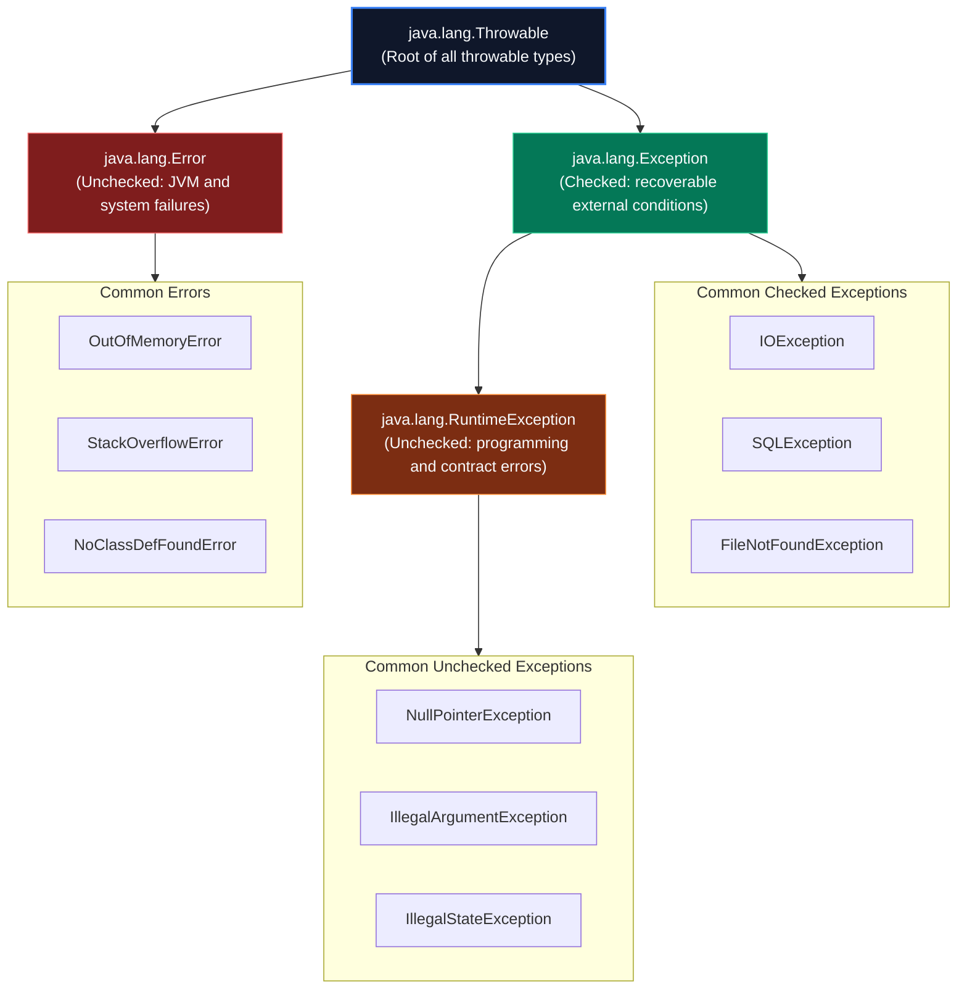

When a method cannot complete its work, it needs a reliable way to inform its caller. Older C APIs relied on integer return codes and a shared `errno` variable, which meant a single missed `if (status < 0)` check let a program continue running with corrupt state. Java chose structured exception handling instead: when an operation fails, normal execution stops immediately and an exception object unwinds the call stack until a matching handler catches it or the thread terminates.

Writing reliable Java code takes more than wrapping lines in `try-catch`. You need to know which exceptions callers should recover from, how `try-catch-finally` behaves when exceptions collide with `return` statements, how `try-with-resources` preserves failure details during cleanup, and what throwing an exception actually costs at runtime.

---

## The `Throwable` Hierarchy

Every exception and error in Java is an object whose class extends `java.lang.Throwable`. Only subclasses of `Throwable` can be passed to `throw` or listed in a `catch` clause. From `Throwable`, the hierarchy splits into three main branches that carry very different meanings.



### `java.lang.Error`

Subclasses of `Error` signal serious runtime or environment problems that ordinary application code cannot reasonably fix:

- `OutOfMemoryError`: the heap or Metaspace is exhausted and garbage collection cannot free enough space.
- `StackOverflowError`: deep or unbounded recursion exhausted the current thread's call stack.
- `NoClassDefFoundError` and `LinkageError`: a class available at compile time is missing or incompatible at runtime.

> [!CAUTION]
> Avoid catching `Error` or `Throwable` in normal business code. If a thread hits `OutOfMemoryError`, shared state may already be partially updated and the JVM may not even have memory to log cleanly. Only top-level boundaries such as thread pool workers or application entry points should catch `Throwable`, and even then their job is usually to record the failure and let the task or process stop safely.

### `java.lang.Exception` (Checked)

Subclasses of `Exception` that do **not** extend `RuntimeException` are checked exceptions. They represent conditions outside the program's internal logic that a caller can anticipate and respond to: a missing configuration file (`FileNotFoundException`), a dropped network connection (`IOException`), or a malformed date string (`ParseException`).

### `java.lang.RuntimeException` (Unchecked)

Subclasses of `RuntimeException` are unchecked exceptions. Standard JDK examples usually point to a bug or a violated contract:

- `NullPointerException`: dereferencing a `null` reference.
- `IllegalArgumentException`: passing an invalid argument, such as a negative page size.
- `IllegalStateException`: calling a method when the object is not in a valid state for it.
- `IndexOutOfBoundsException`: accessing an array or list past its bounds.

The compiler does not force callers to catch these because forcing a `try-catch` around every array access or object dereference would make Java unreadable. When a `NullPointerException` or `IndexOutOfBoundsException` occurs, the fix is almost always to correct the code rather than catch the error.

---

## Checked vs. Unchecked Exceptions

The compiler enforces a strict "handle or declare" rule for checked exceptions. If a method calls something that declares `throws IOException`, your method must either catch `IOException` or declare `throws IOException` in its own signature. Unchecked exceptions (`RuntimeException` and `Error`) carry no such requirement.

```java
// Checked exception: caller must catch it or declare throws IOException
public String readConfig(Path path) throws IOException {
    return Files.readString(path);
}

// Unchecked exception: enforces a precondition without polluting every signature
public void setPort(int port) {
    if (port < 1 || port > 65535) {
        throw new IllegalArgumentException("Port out of range: " + port);
    }
    this.port = port;
}
```

In practice, the Java community has nuanced views on checked exceptions. They work well at low-level API boundaries when a caller can genuinely recover, such as retrying a network call or falling back to a default configuration file. They become cumbersome across deep application layers and inside functional pipelines because standard interfaces like `Function<T, R>` and `Consumer<T>` do not declare checked exceptions. That is why many modern frameworks, including Spring, translate checked infrastructure exceptions like `SQLException` into unchecked hierarchies.

A helpful rule of thumb: use a checked exception when you want the compiler to remind the caller to handle a recoverable condition, and use an unchecked exception for programming errors or unrecoverable failures that will bubble up to a central error handler.

---

## `try-catch-finally` Execution Rules

A `try` block defines a protected region of code. It must be paired with at least one `catch` block, a `finally` block, or both (unless it is a `try-with-resources` statement, which can stand on its own).

### Execution Order

Depending on whether an exception occurs, control flows through `try-catch-finally` in one of three ways:

1. **No exception thrown**: the entire `try` block runs, all `catch` blocks are skipped, and `finally` runs before execution continues after the statement.
2. **Exception thrown and matched**: execution jumps out of `try` at the failing line, enters the **first** `catch` block whose parameter type matches the thrown object, and then runs `finally`.
3. **Exception thrown and not matched**: all `catch` blocks are skipped, `finally` still runs, and then the exception continues unwinding up the call stack to the caller.

### Catch Ordering and Multi-Catch

Because the JVM checks `catch` clauses from top to bottom and enters the first match, more specific exception classes must appear before their superclasses. Putting `IOException` above `FileNotFoundException` is a compile-time error because the second block is unreachable.

Java 7 added multi-catch syntax so you do not have to duplicate identical recovery code across unrelated exception types:

```java
public Config loadConfig(Path path) {
    try {
        String raw = Files.readString(path);
        return parseConfig(raw);
    } catch (FileNotFoundException e) {
        // More specific subclass handled first
        return Config.defaults();
    } catch (IOException | ConfigParseException e) {
        // Multi-catch for unrelated types sharing the same handling
        // Note: 'e' is implicitly final in a multi-catch block
        throw new StartupException("Unable to load configuration from " + path, e);
    } finally {
        auditLoadAttempt(path);
    }
}
```

Two rules apply to multi-catch: the listed types cannot have a parent-child relationship (you cannot write `catch (FileNotFoundException | IOException e)`), and the catch variable `e` is implicitly `final`, so you cannot reassign it inside the block.

### When `finally` Runs, and Why Returning From It Hides Failures

The `finally` block runs even when `try` or `catch` exits early via `return`, `break`, `continue`, or an uncaught exception. The only times `finally` will not run are extreme interruptions: calling `System.exit()`, killing the JVM process (`SIGKILL`), an infinite loop inside `try`, or the JVM shutting down while a daemon thread is still inside `try`.

Because `finally` executes *after* `try` decides to return or throw, placing a `return` (or another `throw`) inside `finally` overrides whatever `try` or `catch` was about to do:

```java
public boolean processPayment() {
    try {
        throw new IllegalStateException("Payment gateway rejected request");
    } finally {
        // Bad: returning from finally discards the pending exception completely
        return true;
    }
}
```

Calling `processPayment()` returns `true`. The `IllegalStateException` disappears without a trace in logs or metrics. The same thing happens with normal return values: if `try` executes `return 1;` and `finally` executes `return 2;`, the method returns `2`.

> [!WARNING]
> Never place `return`, `break`, or `continue` inside a `finally` block. Keep `finally` strictly for cleanup work that does not redirect control flow.

---

## Resource Management with `try-with-resources` and `AutoCloseable`

Before Java 7, reliably closing files, sockets, or JDBC connections required manual `finally` blocks with null checks and nested `try-catch` statements:

```java
// Pre-Java 7 cleanup pattern: verbose and easy to get wrong
InputStream in = null;
try {
    in = new FileInputStream(path);
    process(in);
} finally {
    if (in != null) {
        try {
            in.close();
        } catch (IOException closeEx) {
            // If process(in) already threw, throwing closeEx here would mask it
        }
    }
}
```

That pattern had a subtle flaw: if `process(in)` threw an exception and `in.close()` also threw an exception, the exception from `finally` replaced the original failure. You lost the real root cause.

Java 7 introduced `try-with-resources` to solve both the boilerplate and the lost-exception problem. Any object whose class implements `java.lang.AutoCloseable` can be declared in the `try (...)` header and is closed automatically when the block exits:

```java
public int countBytes(Path path) throws IOException {
    try (InputStream raw = Files.newInputStream(path);
         BufferedInputStream buffered = new BufferedInputStream(raw)) {

        int total = 0;
        while (buffered.read() != -1) {
            total++;
        }
        return total;
    } // buffered.close() runs first, then raw.close()
}
```

Resources are closed in the **reverse order** of declaration, so wrappers flush and release before the underlying stream closes. Since Java 9, you can also pass an already-declared variable into `try (resource)` as long as that variable is `final` or effectively final.

### `AutoCloseable` vs. `Closeable`

`java.io.Closeable` (introduced in Java 5) extends `java.lang.AutoCloseable` (introduced in Java 7). The differences are small but worth knowing when writing custom resources:

- `AutoCloseable.close()` declares `throws Exception`, making it usable for non-I/O resources like JDBC `Connection`, `Statement`, or custom lock guards. Implementations are encouraged to narrow the `throws` clause (or omit it entirely if closing cannot throw a checked exception).
- `Closeable.close()` narrows the signature to `throws IOException` and documents that `close()` must be idempotent, meaning calling it more than once has no additional effect.

```java
public class TimedOperation implements AutoCloseable {
    private final String label;
    private final long startNanos = System.nanoTime();

    public TimedOperation(String label) {
        this.label = label;
    }

    @Override
    public void close() {
        long elapsedMs = (System.nanoTime() - startNanos) / 1_000_000;
        System.out.println(label + " finished in " + elapsedMs + " ms");
    }
}
```

### How `javac` Desugars `try-with-resources` and Tracks Suppressed Exceptions

`try-with-resources` is not special JVM magic; `javac` compiles it into standard `try-catch-finally` bytecode that tracks the primary exception and attaches any closing failures to it via `Throwable.addSuppressed(Throwable)`. Conceptually, a single-resource `try-with-resources` expands to code like this:

```java
// Conceptual desugaring of try (MyResource res = open()) { res.use(); }
MyResource res = open();
Throwable primary = null;
try {
    res.use();
} catch (Throwable t) {
    primary = t;
    throw t;
} finally {
    if (res != null) {
        if (primary != null) {
            try {
                res.close();
            } catch (Throwable closeEx) {
                primary.addSuppressed(closeEx);
            }
        } else {
            res.close();
        }
    }
}
```

If `res.use()` throws an `IOException("Disk read failed")` and `res.close()` then throws `IOException("Close failed")`, the caller receives `"Disk read failed"` as the primary exception, and `"Close failed"` is preserved in `e.getSuppressed()` (and printed automatically under `Suppressed:` in the stack trace):

```java
try {
    countBytes(Path.of("corrupt.bin"));
} catch (IOException e) {
    System.err.println("Primary failure: " + e.getMessage());
    for (Throwable suppressed : e.getSuppressed()) {
        System.err.println("Suppressed during close: " + suppressed.getMessage());
    }
}
```

If `try-with-resources` also has explicit `catch` or `finally` clauses, they run *after* all declared resources have been closed.

---

## Bytecode Internals and the Cost of Stack Traces

A common misconception is that putting code inside a `try` block slows down normal execution. Looking at the compiled bytecode shows why that is not true on the happy path.

Consider this method:

```java
public void readFile() {
    try {
        readFromDisk();
    } catch (IOException e) {
        logError(e);
    }
}
```

Disassembling it with `javap -c -v` produces bytecode like this:

```text
Code:
   0: aload_0
   1: invokevirtual #2      // Method readFromDisk:()V
   4: goto          16
   7: astore_1              // Caught exception stored in local slot 1
   8: aload_0
   9: aload_1
  10: invokevirtual #3      // Method logError:(Ljava/io/IOException;)V
  13: goto          16
  16: return

Exception table:
   from    to  target type
      0     4       7   Class java/io/IOException
```

Notice that there is no branch or check before entering the `try` block. The compiler emits linear instructions and attaches a metadata **Exception Table** mapping bytecode offset ranges (`from`..`to`) to handler offsets (`target`) and exception types. When `readFromDisk()` succeeds, execution runs offsets `0`, `1`, `4`, and `16` without consulting the table. Only when an exception is actually thrown does the JVM look up the current program counter in the Exception Table and unwind frames until it finds a match.

### Why Throwing Exceptions Is Expensive

While *entering* `try` is practically free, **creating and throwing** an exception is expensive. Every `Throwable` constructor calls `fillInStackTrace()`, a native method that walks the active call stack frame by frame to capture the current call chain. In a web application with servlet filters, proxies, and framework layers, that stack can easily be 50 to 150 frames deep.

Because of that cost, you should not use exceptions for ordinary, expected outcomes. For example, do not parse user-supplied numbers in a tight loop by catching `NumberFormatException` on expected non-numeric tokens, and do not throw `UserNotFoundException` for routine cache misses when `Optional<User>` communicates absence cleanly and cheaply.

Two HotSpot and JDK details are worth knowing here:

1. **HotSpot fast-throw optimization**: In HotSpot, if certain built-in exceptions (`NullPointerException`, `ArithmeticException`, `ArrayIndexOutOfBoundsException`, `ClassCastException`) are thrown repeatedly at the same hot call site, the JIT compiler may reuse a preallocated exception instance with an empty stack trace (`-XX:+OmitStackTraceInFastThrow`, enabled by default). If you ever see a bare `NullPointerException` with no stack trace in production logs, look earlier in the log file for the first few occurrences before HotSpot optimized them, or disable the flag temporarily while diagnosing.
2. **Disabling stack traces explicitly**: In rare low-level libraries (such as parsers or reactive control signals) where an exception is used purely for non-local flow control and a stack trace is never useful, `Throwable` provides a protected four-argument constructor added in Java 7:

```java
public class FastAbortException extends RuntimeException {
    public FastAbortException(String message) {
        // (message, cause, enableSuppression, writableStackTrace)
        super(message, null, false, false);
    }
}
```

Passing `writableStackTrace = false` skips `fillInStackTrace()` during construction. Use this sparingly, because an exception without a stack trace is much harder to debug if it escapes further than you expected.

---

## Designing Custom Domain Exceptions

Low-level exceptions such as `SQLException`, `SocketTimeoutException`, or a third-party SDK error expose implementation details that higher layers should not depend on. If a payment service switches from one HTTP client or database vendor to another, callers should not have to rewrite their `catch` blocks.

The standard approach is **exception translation**: catch the low-level failure at the boundary of your repository or gateway and throw a domain exception that preserves the original error as its `cause`.

```java
public class OrderProcessingException extends RuntimeException {
    private final String orderId;
    private final String errorCode;

    public OrderProcessingException(String orderId, String errorCode, String message) {
        super(message);
        this.orderId = orderId;
        this.errorCode = errorCode;
    }

    public OrderProcessingException(
            String orderId,
            String errorCode,
            String message,
            Throwable cause) {
        super(message, cause); // Always chain the root cause
        this.orderId = orderId;
        this.errorCode = errorCode;
    }

    public String getOrderId() {
        return orderId;
    }

    public String getErrorCode() {
        return errorCode;
    }
}
```

At the integration boundary, translate the vendor failure cleanly:

```java
public Receipt chargeOrder(String orderId, PaymentRequest request) {
    try {
        return paymentGateway.charge(request);
    } catch (GatewayTimeoutException e) {
        throw new OrderProcessingException(
                orderId,
                "PAYMENT_TIMEOUT",
                "Payment gateway timed out for order " + orderId,
                e
        );
    }
}
```

A few habits keep custom exceptions genuinely helpful in production:

- **Always preserve the `cause`**: passing `e` to `super(message, e)` keeps the original stack trace intact for troubleshooting.
- **Avoid log-and-rethrow**: logging an exception in every layer before rethrowing it floods logs with duplicate stack traces for a single failure. Either handle and log it at the boundary, or wrap and rethrow it so the top-level handler logs it once.
- **Never swallow exceptions silently**: an empty `catch (Exception e) {}` hides bugs. If ignoring an exception is truly intentional, explain why in a comment and name the variable `ignored`.
- **Keep sensitive data out of messages**: exception messages routinely end up in log aggregators and monitoring tools, so never interpolate passwords, API keys, or credit card numbers into them.

---

## Summary

- `Throwable` splits into fatal `Error`, checked `Exception` (handle or declare), and unchecked `RuntimeException` (contract violations and logic bugs).
- In `try-catch-finally`, `catch` blocks are matched top to bottom (most specific first), and `finally` runs regardless of normal exit or exception. Returning or throwing from `finally` hides any pending exception.
- `try-with-resources` closes `AutoCloseable` resources in reverse declaration order and preserves closing failures as suppressed exceptions via `addSuppressed()`.
- Entering a `try` block adds no branch checks on the normal path thanks to the bytecode Exception Table, but creating and throwing an exception is costly because `fillInStackTrace()` walks the call stack.
- Translate low-level infrastructure failures into custom domain exceptions at module boundaries, always chaining the underlying `cause`.

---

## Interview Questions

### How does the JVM execute a `try-catch` block without checking for exceptions on every instruction?

When `javac` compiles a `try-catch` block, it emits normal sequential bytecode instructions and attaches an Exception Table to the method metadata. Each table entry records a bytecode range (`from` to `to`), the exception type it handles, and the `target` offset of the `catch` block. During normal execution, the JVM never inspects the table. Only when an instruction actually throws an exception does the JVM check the table for the current instruction offset and jump to the matching handler.

### What happens if an exception is thrown inside `try` and another exception is thrown while closing a resource in `try-with-resources`?

With `try-with-resources`, the exception thrown by the `try` block remains the primary exception propagated to the caller. Any exception thrown during automatic `close()` calls is attached to that primary exception via `Throwable.addSuppressed()`. Callers can inspect those secondary failures with `getSuppressed()`, and standard stack trace output prints them beneath the main trace.

### Why is returning a value from a `finally` block considered a bug?

Because `finally` executes after the `try` or `catch` block prepares to exit, a `return` statement inside `finally` overrides the pending exit path. If an unhandled exception was in flight, it is silently discarded and replaced by the returned value. If `try` was returning a value, the `finally` return value replaces it. Both behaviors make defects very difficult to spot during code review and debugging.

### When should you choose a custom unchecked exception instead of a checked exception?

Use a checked exception when you are designing an API where callers are expected to take a specific recovery action, such as retrying a network operation or prompting for a different file path. Use an unchecked exception (`RuntimeException` subclass) when the failure indicates a violated precondition, a programming mistake, or an infrastructure error that intermediate layers cannot meaningfully recover from and that will be handled at a top-level boundary such as an HTTP exception mapper.
