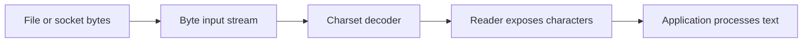
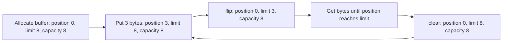

Every program that reads a file, writes a report, or exchanges data with another process crosses an I/O boundary. At that boundary, values in Java become bytes managed by an operating system, a filesystem provider, or a network endpoint. Choosing the right abstraction means understanding what those bytes represent, who owns resources, and whether the calling thread waits for the operation.

This lesson uses Java 11+ syntax. The original NIO APIs arrived in Java 1.4; NIO.2's filesystem APIs arrived in Java 7; and deserialization filters arrived in Java 9.

## The I/O mental model

An I/O API connects a program to a source or destination. Files and sockets are common examples, but streams can also connect to memory, pipes, or other objects. The API does not make the outside world part of the Java heap: it moves or transforms data across a boundary.

For text, the boundary has an extra step. Files and network protocols carry bytes, while Java code usually manipulates Unicode characters. A **charset** defines how characters are encoded into bytes and decoded back. If the two sides choose different charsets, the same bytes can produce different text.

Java's `char` and the `Reader` APIs expose UTF-16 code units, not necessarily one complete Unicode code point per value. A supplementary code point can occupy two `char` values; code that counts or slices user-perceived characters may need code-point-aware operations.



The diagram shows the essential text path: bytes must be decoded using an agreed charset before they are interpreted as characters. For binary data such as an image, do not insert a text decoder.

## The `java.io` stream model

`java.io` separates byte-oriented I/O from character-oriented I/O:

| Abstraction | Typical types | Data being transferred |
|---|---|---|
| Byte input/output | `InputStream`, `OutputStream` | Bytes, including arbitrary binary formats |
| Character input/output | `Reader`, `Writer` | Characters, decoded or encoded with a charset |

An `InputStream` is not the same thing as the `Stream` API in `java.util.stream`. An I/O stream represents a source of bytes; it is usually consumed progressively and may interact with an external resource.

### Copying binary data

The following example copies bytes without interpreting them as text. Buffering reduces the number of small read and write calls; the buffer size is a practical choice, not a guarantee of a particular performance improvement.

```java
import java.io.BufferedInputStream;
import java.io.BufferedOutputStream;
import java.io.FileInputStream;
import java.io.FileOutputStream;
import java.io.IOException;

public class BinaryCopy {
    public static void copy(String source, String destination) throws IOException {
        try (var input = new BufferedInputStream(new FileInputStream(source));
             var output = new BufferedOutputStream(new FileOutputStream(destination))) {
            byte[] buffer = new byte[8 * 1024];
            int count;

            while ((count = input.read(buffer)) != -1) {
                output.write(buffer, 0, count);
            }
        }
    }
}
```

`read` returns the number of bytes placed into the array, or `-1` when the end of the stream is reached. The count matters: the final read may fill only part of the array, so writing the entire array would append stale bytes. Try-with-resources closes both streams even when a read or write throws an exception. Closing the buffered output also flushes its remaining bytes to the underlying output; `flush()` asks the stream to pass buffered data onward, but does not promise that data has been physically committed to durable storage.

The constructor for `FileOutputStream` above truncates an existing destination file. That may be unsuitable for an append workflow or for replacing an important file safely; choose the write options deliberately.

### Reading and writing text

Use a `Reader` or `Writer` when the data is text, and specify the charset at the byte/character boundary:

```java
import java.io.BufferedReader;
import java.io.BufferedWriter;
import java.io.IOException;
import java.nio.charset.StandardCharsets;
import java.nio.file.Files;
import java.nio.file.Path;

public class TextReport {
    public static void copyLines(Path source, Path destination) throws IOException {
        try (BufferedReader reader =
                     Files.newBufferedReader(source, StandardCharsets.UTF_8);
             BufferedWriter writer =
                     Files.newBufferedWriter(destination, StandardCharsets.UTF_8)) {
            String line;
            while ((line = reader.readLine()) != null) {
                writer.write(line);
                writer.newLine();
            }
        }
    }
}
```

`InputStreamReader` and `OutputStreamWriter` are the explicit bridges between bytes and characters; buffered versions can then be layered around them. Do not rely on a platform-default charset for data that must be portable. A line-based copy also normalizes line endings through `newLine()` and does not preserve the exact original bytes.

### Blocking and the decorator pattern

Traditional stream operations are generally **blocking** from the caller's perspective: a read may wait for input, and a write may wait for the destination to accept data. The amount of time depends on the source, destination, provider, and operating system. Buffering can reduce call overhead, but does not make a blocked operation non-blocking.

Many `java.io` classes use a decorator pattern: one object wraps another and adds a capability. For example, `BufferedInputStream` adds buffering around a byte stream, while `DataInputStream` adds methods for reading primitive values from a byte stream. The layers need to agree on the data format. `DataInputStream.readInt()`, for example, expects bytes written in the corresponding `DataOutputStream` format; it does not parse the digits in a text string such as `"42"`.

## NIO: channels, buffers, and selectors

The `java.nio` APIs add a different set of building blocks:

- A **channel** transfers data to or from a source or destination, such as a file or socket.
- A **buffer** holds data being transferred and tracks where the next read or write occurs.
- A **selector** lets one thread monitor readiness events from multiple registered selectable channels.

These are not a replacement rule that makes every `java.nio` operation non-blocking. Channels can operate in blocking mode, and not every channel type can be registered with a selector. In particular, selector-based non-blocking I/O is designed around selectable channels such as socket channels.

### Buffer state: capacity, position, and limit

A buffer's **capacity** is fixed when it is created. Its **position** is the index of the next element to read or write. Its **limit** marks the first element that should not be read or written. The key invariant is:

`0 <= position <= limit <= capacity`

When a channel fills a buffer, the buffer is in write mode from the application's perspective. Call `flip()` before reading those bytes: it sets the limit to the current position and resets the position to zero. After consuming the data, `clear()` prepares the buffer for another channel read by resetting the position to zero and the limit to the capacity. It does **not** erase the old bytes.



The loop represents a reusable buffer lifecycle: fill it, flip it for consumption, then clear it for more input. `clear()` resets metadata only, so data that was not consumed must be preserved another way before clearing.

```java
import java.nio.ByteBuffer;

public class BufferCycle {
    public static void main(String[] args) {
        ByteBuffer buffer = ByteBuffer.allocate(8);
        buffer.put(new byte[] { 10, 20, 30 });

        buffer.flip(); // position = 0, limit = 3
        while (buffer.hasRemaining()) {
            System.out.println(buffer.get());
        }

        buffer.clear(); // position = 0, limit = 8; old contents remain
    }
}
```

Relative `get` and `put` operations advance the position. If the operation would cross the limit, the buffer throws `BufferUnderflowException` or `BufferOverflowException`. A common bug is forgetting `flip()`: the limit still equals capacity, so the consumer may read unused or stale buffer contents.

### Selectors and non-blocking sockets

With blocking sockets, an application often assigns a thread to a connection and lets that thread wait for reads or writes. With a selector, a thread can register multiple non-blocking channels and handle the ones reported ready. This can reduce the need for one waiting thread per connection, but it does not remove application work: the program still needs to track each connection's state, parse message framing, manage backpressure, and finish partial writes.

The high-level event loop looks like this:

1. Put each selectable channel into non-blocking mode and register its interests, such as accept or read.
2. Call `Selector.select()` to wait for readiness, then process the selected keys. A selector can also be woken explicitly, so a return does not replace checking the selected-key set.
3. Process the selected keys and remove each processed key from the selected-key set.
4. Perform non-blocking reads or writes. A read may return no bytes, and a write may accept only part of the buffer.
5. Update the channel's interest set and repeat.

Readiness is not a promise that an entire request can be processed in one call. A robust protocol handler keeps incomplete input in a buffer and keeps unwritten output until the channel can accept more. Selector-based networking is therefore a state-machine design, not just a faster version of `InputStream.read()`.

### When NIO is useful

NIO is useful when the application benefits from explicit buffer management, channel-to-channel transfer, memory-mapped files, or readiness-based multiplexing. Direct byte buffers may let a JVM make a best effort to perform native I/O directly against the buffer, but they use resources outside ordinary heap storage and are not automatically faster for every workload. Start with the simpler API and measure the actual bottleneck before introducing manual buffer management.

## NIO.2: paths and filesystem operations

NIO.2 refers to the filesystem APIs introduced in Java 7, especially `java.nio.file.Path` and `Files`.

- `Path` represents a location in a filesystem. It is not the file's contents and does not guarantee that the location exists or is accessible.
- `Files` provides static operations such as reading, writing, copying, moving, deleting, and traversing files.
- A filesystem provider performs the operation. The default provider normally accesses the host filesystem, while other providers can expose different filesystem implementations.

Construct paths with `Path.of` (Java 11+) or `Paths.get` (Java 7+) rather than hard-coding path separators. `resolve` appends a child path using the current provider's rules:

```java
Path root = Path.of("data");
Path input = root.resolve("orders.txt");
```

`normalize()` removes redundant path elements lexically; it does not inspect the filesystem or prove that a path stays inside a trusted directory after symbolic links are considered. `toRealPath()` resolves an existing path against the filesystem, but requires that the path be resolvable. Treat externally supplied paths carefully: a lexical `startsWith` check alone is not a complete defense against symlink or time-of-check/time-of-use problems.

### Reading and writing files with `Files`

For a small UTF-8 text file, Java 11's `readString` is concise:

```java
Path config = Path.of("config", "application.properties");
String text = Files.readString(config, StandardCharsets.UTF_8);
```

This reads the whole file into memory, so it is inappropriate for an unbounded or very large file. For a larger file, process it incrementally and close the returned resource:

```java
Path log = Path.of("logs", "application.log");
try (var lines = Files.lines(log, StandardCharsets.UTF_8)) {
    lines.filter(line -> line.contains("ERROR"))
         .forEach(System.out::println);
}
```

The `Stream<String>` returned by `Files.lines` holds an open file resource; try-with-resources closes it. For writing, make the behavior explicit:

```java
Path report = Path.of("out", "summary.txt");
Files.createDirectories(report.getParent());
Files.writeString(
        report,
        "Completed\n",
        StandardCharsets.UTF_8,
        java.nio.file.StandardOpenOption.CREATE,
        java.nio.file.StandardOpenOption.TRUNCATE_EXISTING,
        java.nio.file.StandardOpenOption.WRITE);
```

`TRUNCATE_EXISTING` deliberately replaces prior contents. Use `APPEND` when appending is intended, or a temporary file followed by a move when a replacement workflow is needed. An atomic move is only available when the filesystem provider supports it; handle `AtomicMoveNotSupportedException` rather than assuming all filesystems provide the same guarantees.

### Traversal and failure cases

`Files.walk(root)` returns a lazy stream and should also be closed with try-with-resources. It does not follow symbolic links by default; following them requires an explicit option and introduces cycle and boundary considerations. For tree operations that need callbacks, error handling, or precise traversal control, use `Files.walkFileTree`.

Filesystem methods can fail because a path does not exist, permissions changed, a file is locked, a provider lacks an operation, or an I/O error occurred. Handle `IOException` at a boundary where the application can explain or recover from the failure; do not convert every failure into an empty file or empty result. An `exists` check is not a safe substitute for attempting the operation: the file may change between the check and the later read or write.

## Java object serialization

`ObjectOutputStream` and `ObjectInputStream` can persist or transmit Java object graphs. Classes opt in by implementing `Serializable`; referenced serializable objects are traversed as part of the graph, and repeated references are represented so the graph's reference relationships can be restored. A non-serializable referenced object normally causes `NotSerializableException` unless it is excluded or handled with custom serialization logic.

```java
import java.io.IOException;
import java.io.InvalidObjectException;
import java.io.ObjectInputFilter;
import java.io.ObjectInputStream;
import java.io.ObjectOutputStream;
import java.io.Serializable;
import java.nio.file.Files;
import java.nio.file.Path;

public class LocalSnapshot {
    private static final Path FILE = Path.of("person.snapshot");

    public static void save(Person person) throws IOException {
        try (var output = new ObjectOutputStream(Files.newOutputStream(FILE))) {
            output.writeObject(person);
        }
    }

    public static Person load() throws IOException, ClassNotFoundException {
        try (var input = new ObjectInputStream(Files.newInputStream(FILE))) {
            input.setObjectInputFilter(info -> {
                if (info.depth() > 20 || info.references() > 1_000
                        || info.streamBytes() > 1_000_000) {
                    return ObjectInputFilter.Status.REJECTED;
                }

                Class<?> type = info.serialClass();
                if (type == null) {
                    return ObjectInputFilter.Status.UNDECIDED;
                }
                if (type == Person.class) {
                    return ObjectInputFilter.Status.ALLOWED;
                }
                return ObjectInputFilter.Status.REJECTED;
            });

            Object value = input.readObject();
            if (value instanceof Person person) {
                return person;
            }
            throw new InvalidObjectException("Snapshot did not contain a Person");
        }
    }
}

final class Person implements Serializable {
    private static final long serialVersionUID = 1L;

    private final String name;

    Person(String name) {
        this.name = name;
    }
}
```

The filter limits graph depth, reference count, and bytes, and rejects reported classes other than `Person`. A `null` class means this filter has no class decision to make for that event; it still applies the resource limits first. Filters must be designed for the exact object graph expected by the application and tested against valid data.

Serialization is a Java-specific persistence mechanism, not a stable cross-language data format. Class evolution, `serialVersionUID`, custom serialization hooks, and fields marked `transient` all affect what gets restored. Most importantly, **deserializing untrusted data is inherently dangerous**: object construction and deserialization hooks can trigger behavior. Prefer a format with an explicit schema for external data. If legacy serialization must be read, use a strict allowlist and resource limits; a filter is defense in depth, not a reason to trust arbitrary streams.

## Choosing the right abstraction

| Need | Start with |
|---|---|
| Copy arbitrary bytes | `InputStream` / `OutputStream`, or `Files.copy` |
| Read or write text | `Reader` / `Writer` with an explicit charset, or `Files` helpers |
| Work with filesystem paths and metadata | `Path` and `Files` |
| Manage explicit transfer buffers or file channels | `ByteBuffer` and `Channel` |
| Multiplex many non-blocking socket connections | `Selector` and selectable channels |
| Persist data for another language or long-term compatibility | A schema-based data format rather than Java object serialization |

The most important questions are: are these bytes or text, who closes the resource, can this operation wait, and what happens if the input is malformed or incomplete? Answering those questions usually identifies the right API before implementation details get complicated.

## Further reading

- [Java 21 `java.io` package](https://docs.oracle.com/en/java/javase/21/docs/api/java.base/java/io/package-summary.html)
- [Java 21 `java.nio` package and buffer overview](https://docs.oracle.com/en/java/javase/21/docs/api/java.base/java/nio/package-summary.html)
- [Java 21 channels and selectors](https://docs.oracle.com/en/java/javase/21/docs/api/java.base/java/nio/channels/package-summary.html)
- [Java 21 `Path`](https://docs.oracle.com/en/java/javase/21/docs/api/java.base/java/nio/file/Path.html) and [`Files`](https://docs.oracle.com/en/java/javase/21/docs/api/java.base/java/nio/file/Files.html)
- [Java 21 `ObjectInputStream` security warning and filtering](https://docs.oracle.com/en/java/javase/21/docs/api/java.base/java/io/ObjectInputStream.html)
- [JEP 290: Filter Incoming Serialization Data](https://openjdk.org/jeps/290)
