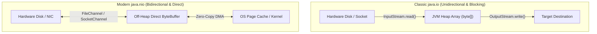
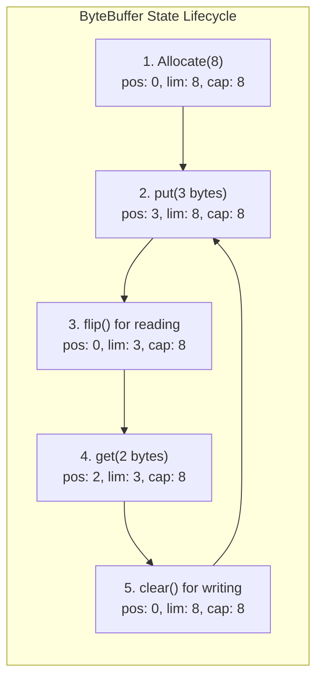
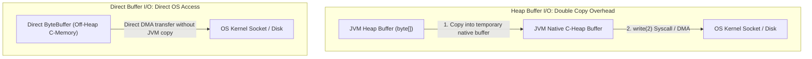
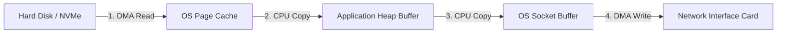
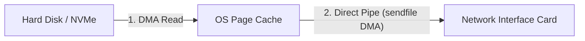

Every time your Java application reads a configuration file from NVMe disk, streams a multi-gigabyte video over HTTP, or writes an event log to an external drive, it crosses an expensive boundary: **the operating system kernel space boundary**.

For years, developers were taught simple stream abstractions like `FileInputStream` and `BufferedReader`. But in high-throughput enterprise systems, naive I/O creates massive CPU context-switching overhead, excessive heap allocations, and garbage collection pauses.

To build distributed brokers (like Apache Kafka), high-speed database engines, or ultra-low-latency financial order routers, you need to understand how Java interacts with the OS kernel: **Channels**, **Direct ByteBuffers**, **Zero-Copy `transferTo()`**, and **Memory-Mapped Files (`mmap`)**.

---

## The Core Mental Model: Streams vs. Channels & Buffers

Traditional `java.io` and modern `java.nio` represent two fundamentally different paradigms for moving bytes between your Java application and the outside world:

| Dimension | Classic `java.io` (Streams) | Modern `java.nio` (Channels & Buffers) |
|---|---|---|
| **Data Flow** | **Unidirectional:** Separate `InputStream` (read) and `OutputStream` (write). | **Bidirectional:** A `Channel` can simultaneously read and write using `ByteBuffer`. |
| **Transfer Unit** | Byte-by-byte or fixed byte arrays. | Structured, reusable off-heap or on-heap `Buffer` blocks. |
| **Blocking Behavior** | **Synchronous & Blocking:** Thread halts until bytes arrive from hardware. | **Non-blocking capable:** Channels integrate with OS `Selector` event loops (`epoll`/`kqueue`). |
| **Kernel Interaction** | Multiple user-space to kernel-space buffer copies. | Capable of direct **Zero-Copy** DMA (Direct Memory Access) transfers. |



---

## Classic `java.io`: Streams and the Decorator Pattern

Traditional `java.io` relies heavily on the **Decorator Pattern**, where classes wrap around each other to layer additional capabilities onto an underlying raw byte stream:

```java
// Layering raw file stream with buffering and data parsing
try (DataInputStream dis = new DataInputStream(
        new BufferedInputStream(
            new FileInputStream("market-data.bin")))) {
    int tradeCount = dis.readInt();
    double lastPrice = dis.readDouble();
}
```

### Why Buffering is Critical for Classic Streams
Without `BufferedInputStream`, invoking `.read()` on a raw `FileInputStream` asks the JVM to make an individual native system call (`read(2)`) to the OS kernel for **every single byte**. 

Making millions of user-to-kernel context switches consumes orders of magnitude more CPU cycles than the actual data transfer! `BufferedInputStream` reads an 8 KB (or custom-sized) chunk into an internal byte array in a single syscall, letting subsequent `.read()` calls execute as fast memory lookups on the heap.

```java
// ✅ ALWAYS wrap raw file streams in a buffer if using classic java.io
try (var input = new BufferedInputStream(new FileInputStream("source.dat"));
     var output = new BufferedOutputStream(new FileOutputStream("dest.dat"))) {
    byte[] chunk = new byte[8192];
    int bytesRead;
    while ((bytesRead = input.read(chunk)) != -1) {
        output.write(chunk, 0, bytesRead);
    }
}
```

---

## Modern NIO: Channels and `ByteBuffer` Architecture

Java 1.4 introduced **New I/O (NIO)**, introducing a hardware-aligned model based on **Channels** (connections to hardware resources) and **Buffers** (memory containers for raw bytes).

### The Invariants of `ByteBuffer`
A `ByteBuffer` is essentially an array of bytes paired with four state tracking pointers:

1. **`capacity`**: The absolute total number of bytes the buffer can hold. Fixed at allocation.
2. **`position`**: The index of the next byte to be read or written.
3. **`limit`**: The boundary index beyond which bytes should not be read or written.
4. **`mark`**: A memorable bookmark index that `position` can revert to when calling `reset()`.

These pointers strictly maintain the following invariant at all times:
`0 <= mark <= position <= limit <= capacity`



### The Three Crucial Buffer Transitions: `flip()`, `clear()`, and `compact()`
One of the most common pitfalls when learning NIO is forgetting how buffer states switch between write mode (populating bytes) and read mode (consuming bytes):

```java
ByteBuffer buffer = ByteBuffer.allocate(1024);

// 1. Channel writes incoming data into the buffer (Buffer is in WRITE mode)
channel.read(buffer); // position moves forward; limit remains 1024

// 2. Switch to READ mode:
// Sets limit = current position, then resets position = 0
buffer.flip(); 

// 3. Application reads bytes out of the buffer
while (buffer.hasRemaining()) {
    byte b = buffer.get();
}

// 4. Prepare for another read from the channel:
// Resets position = 0 and limit = capacity (does NOT zero out old bytes)
buffer.clear();
```

What if you only read part of the buffer and need to wait for more data from the network? Calling `clear()` would discard the unread bytes! Instead, call **`compact()`**:
- It copies all unread bytes between `position` and `limit` to the beginning of the buffer (index `0`).
- It sets `position` immediately after the copied bytes and restores `limit` to `capacity`.
- Future writes safely append without overwriting the unread data!

---

## Direct ByteBuffers vs. Heap ByteBuffers

When allocating a buffer, you must make a critical architectural decision:

```java
// Option A: Standard JVM Heap Buffer
ByteBuffer heapBuffer = ByteBuffer.allocate(4096);

// Option B: Off-Heap Direct Buffer (Allocated in native OS C-heap memory)
ByteBuffer directBuffer = ByteBuffer.allocateDirect(4096);
```



### Why Does the JVM Need a Double Copy for Heap Buffers?
When the operating system's storage controller or Network Interface Card (NIC) performs I/O, it uses **DMA (Direct Memory Access)** to write directly into physical RAM addresses.

However, the JVM Garbage Collector is continuously running in the background. During a GC cycle, the collector might move heap objects around in physical RAM to compact memory. If the OS wrote incoming network packets to a physical memory address that the GC relocated mid-transfer, memory corruption would ensue!

Therefore, whenever you pass a Heap `ByteBuffer` to an I/O channel:
1. The JVM allocates a temporary native memory buffer outside the GC heap.
2. It copies all bytes from your Java heap array into the native buffer.
3. It performs the native I/O operation against the native buffer.
4. It discards the native buffer.

### The Senior Engineer's Trade-Off
- **Direct Buffers (`allocateDirect`)**: Allocated outside the JVM garbage-collected heap using native `malloc()`. The OS interacts with this memory directly via DMA with zero intermediate copies. Ideal for long-lived, high-throughput buffers (e.g., Netty network pipeline buffers, database page caches).
- **Caveat**: Direct buffers are expensive to allocate and deallocate. Never allocate a direct buffer inside a tight loop! Pool them or reuse a single instance per thread.

---

## Zero-Copy File Transfers (`FileChannel.transferTo`)

In traditional file-serving architectures (e.g., a web server sending a 1 GB video from disk to a client socket), data takes a painful, convoluted path:



This traditional approach requires:
- **4 context switches** between user mode and kernel mode.
- **4 data copies** (two DMA transfers and two CPU memory copies across the kernel/user boundary).

### The Linux `sendfile` Optimization
Modern operating systems provide native zero-copy syscalls (like `sendfile(2)` on Linux). In Java, this capability is exposed via **`FileChannel.transferTo()`**:

```java
import java.io.FileInputStream;
import java.io.FileOutputStream;
import java.nio.channels.FileChannel;
import java.nio.channels.SocketChannel;

public class ZeroCopyTransfer {
    public static void streamFileToSocket(FileChannel fileChannel, SocketChannel socketChannel) 
            throws Exception {
        long size = fileChannel.size();
        long position = 0;

        // Directly instructs the OS kernel to pipe bytes from the Page Cache
        // directly to the Network Interface Card via DMA!
        while (position < size) {
            long transferred = fileChannel.transferTo(position, size - position, socketChannel);
            position += transferred;
        }
    }
}
```



Under zero-copy:
- The data **never enters the JVM heap**.
- CPU memory copy overhead drops to zero.
- The CPU simply issues DMA instructions, leaving processor cores 100% free to handle other application logic! This is the fundamental reason Apache Kafka can achieve multi-gigabit throughput on standard commodity hardware.

---

## Memory-Mapped Files (`MappedByteBuffer` / `mmap`)

For ultra-low-latency workloads—such as high-frequency trading ledgers, search engines (Lucene), and write-ahead logs (RocksDB)—even channel reads introduce syscall overhead. 

The ultimate I/O performance technique is **Memory Mapping (`mmap`)**:

```java
import java.io.RandomAccessFile;
import java.nio.MappedByteBuffer;
import java.nio.channels.FileChannel;

public class MemoryMappedJournal {
    public static void main(String[] args) throws Exception {
        try (RandomAccessFile file = new RandomAccessFile("trade-journal.dat", "rw");
             FileChannel channel = file.getChannel()) {

            // Maps 64 Megabytes of the file directly into virtual address space
            MappedByteBuffer mappedBuffer = channel.map(
                    FileChannel.MapMode.READ_WRITE, 
                    0, 
                    64 * 1024 * 1024
            );

            // Writing to the file is now as fast as writing to a raw memory address!
            mappedBuffer.putLong(1001L);        // Trade ID
            mappedBuffer.putDouble(452.85);     // Stock Price
            mappedBuffer.putInt(500);           // Volume

            // Force dirty pages to flush to durable disk storage
            mappedBuffer.force();
        }
    }
}
```

### How `mmap` Works Under the Hood
1. `channel.map()` asks the operating system kernel to map a file's physical storage blocks directly to the virtual memory pages of your Java process.
2. When you invoke `mappedBuffer.putLong()`, your CPU executes a standard native memory write (`MOV` instruction).
3. If the page is not in physical RAM, the CPU triggers a hardware **page fault**. The OS transparently fetches the page from disk into RAM in the background.
4. Dirty pages are written back to disk asynchronously by OS kernel flushing threads (pdflush / flushers), completely bypassing JVM runtime layers!

---

## Modern Filesystem Operations: NIO.2 (`Path` and `Files`)

Java 7 overhauled filesystem management with **NIO.2 (`java.nio.file`)**, deprecating older `java.io.File` idioms.

### Safe Path Construction
Never concatenate directory paths with string slashes (`"dir" + "/" + "file"`). Different operating systems utilize different path delimiters (`/` on Linux/macOS, `\` on Windows). 

Always use `Path.of()` (Java 11+) or `Paths.get()`:

```java
// Cross-platform, handles slashes and separators automatically
Path dataDir = Path.of("var", "log", "app");
Path targetFile = dataDir.resolve("metrics.csv"); // var/log/app/metrics.csv
```

### High-Impact `Files` Operations
The `java.nio.file.Files` class provides modern, static utilities for virtually all common file operations:

```java
Path path = Path.of("orders.json");

// 1. Reading small files into memory (Java 11+)
String json = Files.readString(path, StandardCharsets.UTF_8);

// 2. Writing small files safely with options
Files.writeString(
        path, 
        json, 
        StandardCharsets.UTF_8,
        StandardOpenOption.CREATE,
        StandardOpenOption.TRUNCATE_EXISTING,
        StandardOpenOption.WRITE
);

// 3. Processing massive files lazily without heap exhaustion
// ALWAYS wrap Files.lines in try-with-resources to ensure file descriptor release!
try (var lines = Files.lines(Path.of("massive-access.log"), StandardCharsets.UTF_8)) {
    long errorCount = lines.filter(line -> line.contains("HTTP 500")).count();
    System.out.println("500 errors found: " + errorCount);
}

// 4. Atomic file replacement (Crash-Proof Saving)
Path tempFile = Files.createTempFile("orders-", ".tmp");
Files.writeString(tempFile, json);
Files.move(tempFile, path, StandardCopyOption.ATOMIC_MOVE, StandardCopyOption.REPLACE_EXISTING);
```

---

## The Dark Reality of Java Object Serialization

Java includes native object serialization via `Serializable`, `ObjectOutputStream`, and `ObjectInputStream`. 

In modern software engineering, **Java Object Serialization is considered a severe security anti-pattern**.

### Why Deserialization is Inherently Insecure
When `ObjectInputStream.readObject()` runs, it reconstructs objects by directly creating instances **without invoking their regular constructors**, inspecting magic headers and invoking private `readObject()` hooks.

Attackers exploit this using **Gadget Chains** (such as Apache Commons Collections vulnerabilities):
1. The attacker crafts a serialized binary payload containing nested classes already present on your classpath (like `InvokerTransformer` or `TemplatesImpl`).
2. When your server innocently calls `objectInputStream.readObject()` on untrusted network bytes, the nested classes trigger reflection calls during deserialization.
3. This grants the attacker **Remote Code Execution (RCE)**, completely compromising the host machine! This was the exact root cause behind catastrophic real-world breaches across Fortune 500 corporations.

### Safe Modern Alternatives
1. **Never deserialize untrusted binary data from network sockets.**
2. Use schema-based formats like **Protocol Buffers (protobuf)**, **FlatBuffers**, or standard validated **JSON** (via Jackson with default typing strictly disabled).
3. If legacy systems require `ObjectInputStream`, enforce **JEP 290 Serialization Filters** to reject unapproved classes:

```java
try (var ois = new ObjectInputStream(inputStream)) {
    // Strictly whitelist allowed classes and limit graph depth
    ois.setObjectInputFilter(info -> {
        if (info.depth() > 5 || info.references() > 100 || info.streamBytes() > 50000) {
            return ObjectInputFilter.Status.REJECTED;
        }
        if (info.serialClass() != null && info.serialClass() != TrustedPayload.class) {
            return ObjectInputFilter.Status.REJECTED;
        }
        return ObjectInputFilter.Status.ALLOWED;
    });
    
    Object data = ois.readObject();
}
```

---

## Summary & Mental Model Checkpoint

1. **Streams vs Channels**: Streams are unidirectional and blocking; Channels are bidirectional, buffer-oriented, and can operate in non-blocking event loops.
2. **Buffer Pointers**: Maintain the invariant `0 <= mark <= position <= limit <= capacity`. Call `flip()` before reading; call `clear()` or `compact()` before writing.
3. **Direct Buffers**: Off-heap memory allocated via `allocateDirect` eliminates intermediate JVM heap copies during OS DMA operations, but carries higher allocation costs.
4. **Zero-Copy**: `FileChannel.transferTo()` pipes data directly from the OS Page Cache to the network card via the `sendfile` syscall, bypassing the JVM heap completely.
5. **Memory Mapping**: `FileChannel.map()` maps files to virtual memory addresses via `mmap`, turning file I/O into direct CPU RAM access.
6. **NIO.2 `Files`**: Use `Path.of()` and `Files` for safe, atomic, cross-platform file manipulation. Always wrap `Files.lines()` in a try-with-resources block.
7. **Serialization Risk**: Standard Java binary deserialization is vulnerable to RCE gadget chains; prefer explicit schemas (Protobuf/JSON) or enforce JEP 290 filters.

---

## 🎯 Senior Engineer Interview Questions

### How does `FileChannel.transferTo()` achieve Zero-Copy file transfer, and why does it outperform standard `InputStream.read()` / `OutputStream.write()` loops?
> **Answer:** In a traditional read/write loop, data must be copied 4 times across user and kernel space boundaries: (1) Disk to OS Page Cache via DMA, (2) Page Cache to JVM application heap buffer via CPU copy, (3) JVM heap buffer to OS Socket Buffer via CPU copy, and (4) Socket Buffer to NIC via DMA. This incurs 4 context switches. `FileChannel.transferTo()` utilizes the operating system's native `sendfile(2)` system call. It directs the OS kernel to transfer bytes directly from the OS Page Cache to the network card's buffer via DMA, never copying data into user-space memory or the JVM heap. This reduces context switches to 2 and eliminates CPU copy operations entirely, freeing the CPU to process application logic.

### Why does the JVM allocate a temporary direct native buffer when performing I/O using a heap-backed `ByteBuffer` (`ByteBuffer.allocate()`)?
> **Answer:** Operating system DMA (Direct Memory Access) transfers require physical, fixed memory addresses. Because the JVM Garbage Collector is non-deterministic and relocates objects in memory during compaction phases to prevent fragmentation, passing a raw pointer to a heap-allocated array to an asynchronous OS kernel operation risks memory corruption if the GC moves the array mid-transfer. To prevent this, the JVM allocates an unmovable temporary direct buffer in native C-heap memory, copies the heap bytes into it, executes the OS I/O system call against that fixed native address, and subsequently discards or pools the native buffer.

### What is the difference between `ByteBuffer.clear()` and `ByteBuffer.compact()`, and when must you use `compact()` in a network protocol decoder?
> **Answer:** `ByteBuffer.clear()` resets `position` to 0 and restores `limit` to `capacity`. It does not overwrite old bytes, but it completely abandons any unread data remaining between the old `position` and `limit`. In a network protocol decoder, incoming TCP packets frequently contain partial messages (framing fragmentation). If a buffer holds 100 bytes and you successfully parse a 60-byte message, 40 unparsed bytes remain. Calling `clear()` would discard those 40 bytes. Calling `compact()` shifts the 40 unread bytes to the beginning of the buffer (indices 0 to 39), sets `position` to 40, and sets `limit` to `capacity`, allowing subsequent socket reads to cleanly append new data after the existing incomplete message.

### Why must `Files.lines(Path)` always be invoked inside a try-with-resources block, unlike other stream-returning factory methods?
> **Answer:** Most Stream operations operate on in-memory collections that do not hold operating system resources. `Files.lines(Path)` returns a lazy `Stream<String>` that internally opens and holds an underlying filesystem channel and `BufferedReader`. If the stream pipeline terminates early (e.g. via `findFirst()`, `limit()`, or an unhandled runtime exception), the underlying file handle remains open until the Garbage Collector finalizes the object. Under high load, this causes operating system file descriptor leaks, eventually triggering `IOException: Too many open files`. `Stream<T>` implements `AutoCloseable`, and wrapping `Files.lines()` in try-with-resources guarantees that the underlying file descriptor is immediately closed upon block completion.