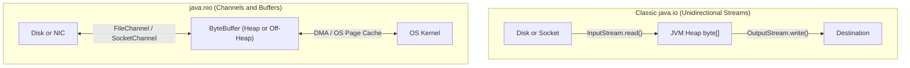
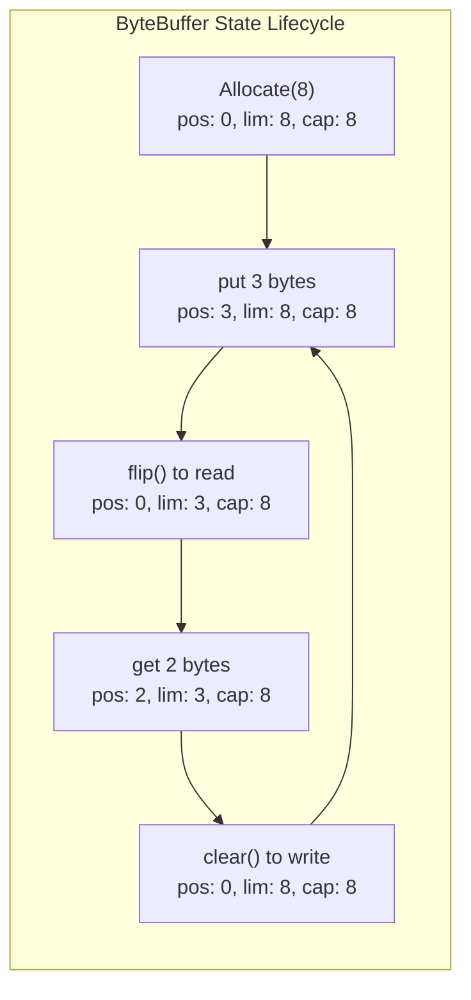
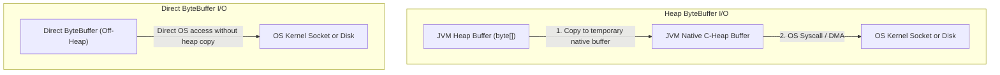
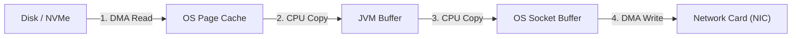
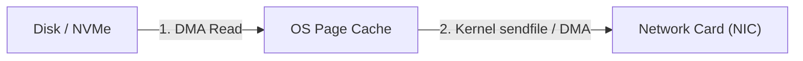

Whenever a Java program reads a config file from disk, parses a CSV upload, or writes bytes to a socket, it has to ask the operating system kernel to do the actual hardware work. That crossing between your JVM process and the OS kernel is where most I/O bugs and performance bottlenecks live: leaked file descriptors, garbled text from mismatched character encodings, accidental out-of-memory errors when loading large files, or thousands of unnecessary system calls.

Java's I/O libraries grew over decades, so you will run into three overlapping layers in real codebases: classic `java.io` streams, `java.nio` channels and buffers (introduced in Java 1.4), and `java.nio.file` (NIO.2, introduced in Java 7). Knowing what each layer is for makes it straightforward to pick the right tool instead of reaching for `FileInputStream` out of habit.

---

## Byte Streams vs. Character Streams

The first split in `java.io` is between **byte streams** and **character streams**. Mixing them up is one of the easiest ways to silently corrupt data.

- **Byte streams (`InputStream` and `OutputStream`)** move raw 8-bit bytes without trying to interpret what those bytes mean. Use them for binary data: images, PDFs, ZIP archives, compiled `.class` files, Protocol Buffers, or raw network payloads.
- **Character streams (`Reader` and `Writer`)** read and write text (`char` values, which in Java are UTF-16 code units). They sit on top of byte sources and apply a `Charset` to decode bytes into characters on input, and encode characters back into bytes on output.

| Aspect | Byte Streams (`InputStream` / `OutputStream`) | Character Streams (`Reader` / `Writer`) |
|---|---|---|
| **Data unit** | Raw 8-bit `byte` | 16-bit `char` (UTF-16 code units) |
| **Encoding awareness** | None; transfers exact bytes unchanged | Decodes/encodes using a `Charset` (e.g., UTF-8) |
| **Common implementations** | `FileInputStream`, `BufferedInputStream`, `ByteArrayInputStream` | `InputStreamReader`, `BufferedReader`, `StringReader` |
| **Use for** | Images, audio, archives, binary protocols, exact byte copies | Logs, CSV, JSON, XML, configuration files, source code |

If you read a PNG image through a `Reader`, the decoder tries to interpret arbitrary binary bytes as UTF-8 characters, replaces invalid byte sequences with the Unicode replacement character (`U+FFFD`), and ruins the image. Conversely, if you try to parse multi-byte UTF-8 text one raw byte at a time with an `InputStream`, any character outside ASCII (like `é`, `₹`, or `日本語`) gets sliced in half.

### Bridging Bytes and Characters Explicitly

`InputStreamReader` and `OutputStreamWriter` are the bridge classes that convert a byte stream into a character stream using a specified `Charset`:

```java
import java.io.BufferedReader;
import java.io.FileInputStream;
import java.io.IOException;
import java.io.InputStreamReader;
import java.nio.charset.StandardCharsets;

public class ExplicitCharsetRead {
    public static void printFirstLine(String filePath) throws IOException {
        try (var reader = new BufferedReader(
                new InputStreamReader(new FileInputStream(filePath), StandardCharsets.UTF_8))) {
            String header = reader.readLine();
            System.out.println("Header: " + header);
        }
    }
}
```

### Why Platform-Default Encoding Causes Production Bugs

Older Java code is full of shortcuts like `new FileReader("customers.csv")` or `new InputStreamReader(inputStream)` with no charset argument. Prior to Java 18, those constructors fell back to the operating system's default charset (`Charset.defaultCharset()`):

- On macOS and most Linux desktops, the default was `UTF-8`.
- On Windows, it was often `windows-1252` (Cp1252) or another locale-specific code page.
- Inside minimal Docker containers where `LANG` or `LC_ALL` was unset, Linux often defaulted to `US-ASCII` (`ANSI_X3.4-1968`).

A service developed on macOS would work fine locally, pass unit tests, and then silently turn `"Café: €12"` into `"Caf?: ?12"` in a Linux container or Windows batch job.

> [!NOTE]
> Java 18 (JEP 400) made `UTF-8` the default charset across all operating systems unless overridden with `-Dfile.encoding=COMPAT`. Even on Java 21+, passing `StandardCharsets.UTF_8` explicitly is still worth the few extra characters: it makes the wire or file format obvious to the next developer and protects you if a library or JVM flag ever changes the default.

### Buffering and the Decorator Pattern

Classic `java.io` is built around the Decorator pattern. You start with a raw source or sink (like `FileInputStream`) and wrap it with decorators that add buffering (`BufferedInputStream`), primitive parsing (`DataInputStream`), or compression (`GZIPInputStream`).

```java
import java.io.BufferedInputStream;
import java.io.BufferedOutputStream;
import java.io.DataInputStream;
import java.io.FileInputStream;
import java.io.FileOutputStream;
import java.io.IOException;

public class BufferedStreamsExample {
    public static void readHeader(String path) throws IOException {
        try (var dis = new DataInputStream(
                new BufferedInputStream(new FileInputStream(path)))) {
            int recordCount = dis.readInt();
            double checksum = dis.readDouble();
            System.out.printf("Records: %d, Checksum: %.4f%n", recordCount, checksum);
        }
    }

    public static void copyWithBuffer(String src, String dst) throws IOException {
        try (var in = new BufferedInputStream(new FileInputStream(src));
             var out = new BufferedOutputStream(new FileOutputStream(dst))) {
            byte[] buffer = new byte[8192];
            int bytesRead;
            while ((bytesRead = in.read(buffer)) != -1) {
                out.write(buffer, 0, bytesRead);
            }
        }
    }
}
```

Buffering matters because calling `read()` on an unbuffered `FileInputStream` triggers a native OS system call (`read(2)` on Unix) for every single byte. Wrapping it in `BufferedInputStream` pulls an 8 KB chunk into memory in one syscall, so subsequent `read()` calls just advance an index in a Java `byte[]`.

Always wrap streams in `try-with-resources`. Closing the outermost decorator flushes buffered output and closes the underlying stream, releasing the OS file descriptor immediately even if an exception is thrown halfway through.

---

## Working with the Filesystem: `java.nio.file` (`Path` and `Files`)

For everyday file and directory work, prefer `java.nio.file` (NIO.2) over the legacy `java.io.File` class. `java.io.File` has awkward APIs that silently return `false` when `delete()` or `mkdir()` fails, leaving you guessing whether the cause was missing permissions, a non-empty directory, or a locked file. NIO.2 methods throw specific exceptions (`NoSuchFileException`, `AccessDeniedException`, `DirectoryNotEmptyException`), support symbolic links, and give you richer filesystem metadata.

### Constructing Paths Safely with `Path.of` and `Paths.get`

Never stitch file paths together with string concatenation like `baseDir + "/" + name`. Use `Path.of(...)` (added in Java 11) or `Paths.get(...)` (Java 7+, which `Path.of` delegates to under the hood; you will see both in production code):

```java
import java.nio.file.Path;
import java.nio.file.Paths;

Path logDir = Path.of("var", "log", "orders");       // Java 11+
Path legacyEquivalent = Paths.get("var", "log", "orders"); // Java 7+

Path todayLog = logDir.resolve("2026-10-29.log");
Path normalized = Path.of("var", "log", "..", "data").normalize(); // var/data
```

When resolving user-supplied filenames (for example, from an HTTP upload or download endpoint), always normalize and verify that the resolved path stays inside your target directory to prevent path traversal attacks (`../../etc/passwd`):

```java
Path baseDir = Path.of("/srv/uploads").toAbsolutePath().normalize();
Path target = baseDir.resolve(userProvidedFileName).normalize();

if (!target.startsWith(baseDir)) {
    throw new SecurityException("Path escapes upload directory: " + userProvidedFileName);
}
```

### Reading and Writing Files with `Files`

The `java.nio.file.Files` utility class covers most file I/O without manual stream boilerplate. The right method depends on file size:

```java
import java.io.BufferedWriter;
import java.io.IOException;
import java.nio.charset.StandardCharsets;
import java.nio.file.Files;
import java.nio.file.Path;
import java.nio.file.StandardCopyOption;
import java.nio.file.StandardOpenOption;
import java.util.stream.Stream;

public class FilesOperationsExample {

    // Small text files: convenient one-liners (Java 11+)
    public static String loadConfig(Path path) throws IOException {
        return Files.readString(path, StandardCharsets.UTF_8);
    }

    public static void appendAuditEntry(Path path, String line) throws IOException {
        Files.writeString(
                path,
                line + System.lineSeparator(),
                StandardCharsets.UTF_8,
                StandardOpenOption.CREATE,
                StandardOpenOption.APPEND
        );
    }

    // Large files: stream lazily so you do not blow up the heap
    public static long countServerErrors(Path logFile) throws IOException {
        try (Stream<String> lines = Files.lines(logFile, StandardCharsets.UTF_8)) {
            return lines.filter(line -> line.contains("HTTP 500")).count();
        }
    }

    // Streaming writes with explicit buffering
    public static void writeCsvReport(Path target, Iterable<String> rows) throws IOException {
        try (BufferedWriter writer = Files.newBufferedWriter(target, StandardCharsets.UTF_8)) {
            writer.write("id,status,amount");
            writer.newLine();
            for (String row : rows) {
                writer.write(row);
                writer.newLine();
            }
        }
    }

    // Crash-safe file replacement: write to a temp file in the SAME directory, then move
    public static void writeAtomically(Path target, String content) throws IOException {
        Path parent = target.toAbsolutePath().getParent();
        Path tempFile = Files.createTempFile(parent, "atomic-", ".tmp");
        try {
            Files.writeString(tempFile, content, StandardCharsets.UTF_8);
            Files.move(
                    tempFile,
                    target,
                    StandardCopyOption.ATOMIC_MOVE,
                    StandardCopyOption.REPLACE_EXISTING
            );
        } catch (IOException e) {
            Files.deleteIfExists(tempFile);
            throw e;
        }
    }
}
```

Two details in that snippet matter in real systems:

1. **Always close `Files.lines()` (and `Files.list()` / `Files.walk()`) in a `try-with-resources` block.** Unlike streams backed by an `ArrayList`, these streams hold an open OS file descriptor. If you short-circuit with `findFirst()` or throw an exception without closing the stream, the descriptor leaks until garbage collection eventually reclaims it. Under load, that leads to `IOException: Too many open files`.
2. **Create atomic temp files in the same directory as the destination.** If you call `Files.createTempFile("atomic-", ".tmp")` without a parent directory, Java puts the file in `/tmp`. On many Linux servers `/tmp` is a separate filesystem mount (`tmpfs`), and `ATOMIC_MOVE` across mount points throws `AtomicMoveNotSupportedException`. Putting the temp file in `target.toAbsolutePath().getParent()` keeps both files on the same filesystem so the rename is a fast metadata swap.

---

## Channels and Buffers (`java.nio`)

Streams work well for sequential reading or writing, and `Files` covers most application needs. When you need lower-level control (random access within a file, reusing fixed memory buffers, non-blocking network I/O, or OS-level optimizations), you drop down to `java.nio` **Channels** and **Buffers**.

| Dimension | Classic `java.io` (Streams) | `java.nio` (Channels & Buffers) |
|---|---|---|
| **Direction** | Unidirectional (`InputStream` or `OutputStream`) | Bidirectional (`FileChannel` and `SocketChannel` can both read and write) |
| **Transfer unit** | Single bytes or `byte[]` chunks | Structured `ByteBuffer` blocks (heap or off-heap) |
| **Blocking mode** | Blocking only | Supports non-blocking mode with `Selector` on network channels |
| **OS optimizations** | Standard read/write syscalls | Supports scatter/gather I/O, `transferTo`/`transferFrom`, and `mmap` |



### How `ByteBuffer` Tracks State

A `ByteBuffer` wraps a contiguous block of bytes along with four integer pointers:

- **`capacity`**: Total size of the buffer in bytes. Fixed when allocated.
- **`position`**: Index of the next byte to read or write. Starts at `0`.
- **`limit`**: Index where reading or writing must stop. In write mode, `limit == capacity`. In read mode, `limit` marks how many valid bytes were written.
- **`mark`**: Optional saved position you can jump back to with `reset()`.

These pointers always obey the invariant: `0 <= mark <= position <= limit <= capacity`.



The single most common NIO bug is forgetting to switch a buffer between write mode and read mode using `flip()`, `clear()`, or `compact()`:

```java
ByteBuffer buffer = ByteBuffer.allocate(1024);

// Write mode: channel reads bytes FROM the file/socket INTO the buffer
int bytesRead = channel.read(buffer);

// Switch to read mode: limit = position, position = 0
buffer.flip();

while (buffer.hasRemaining()) {
    byte b = buffer.get();
    // process byte
}

// Reset for the next write: position = 0, limit = capacity (old bytes are not zeroed)
buffer.clear();
```

If you only consume *part* of the bytes in the buffer (very common when decoding a partial network message), calling `clear()` throws away the remaining unread bytes. Call `compact()` instead: it copies all unread bytes between `position` and `limit` down to index `0`, sets `position` right after them, and restores `limit` to `capacity`, so the next `channel.read(buffer)` appends right where the partial data left off.

### Heap vs. Direct ByteBuffers

`ByteBuffer` can live in two different places:

```java
// Backed by a normal byte[] on the JVM heap
ByteBuffer heapBuffer = ByteBuffer.allocate(4096);

// Allocated in native off-heap memory outside the GC heap
ByteBuffer directBuffer = ByteBuffer.allocateDirect(4096);
```



Why does a heap buffer require an extra copy during native I/O? Because OS DMA (Direct Memory Access) hardware reads and writes fixed physical memory addresses, whereas the JVM garbage collector can relocate heap objects during compaction. If HotSpot passed a direct pointer to a heap `byte[]` into an OS syscall and a GC cycle moved that array mid-transfer, memory would be corrupted. To keep the heap safe, HotSpot copies heap buffer bytes into a temporary native buffer (often cached per thread) before invoking the OS I/O call.

A **direct buffer** (`allocateDirect`) lives in native memory outside GC compaction, so the OS can read or write it without that intermediate copy. The catch is that allocating and freeing direct buffers is noticeably slower than allocating short-lived heap arrays, and native memory is capped separately (`-XX:MaxDirectMemorySize`). Use heap buffers for ordinary short-lived work; reserve direct buffers for long-lived, pooled buffers in high-throughput I/O code (like Netty pipelines or database engines).

---

## Zero-Copy Transfers and Memory-Mapped Files

When you move large files at high throughput (serving media files, replicating commit logs, or building search indexes), the standard read-into-buffer-then-write-out loop pays for unnecessary copies across the user/kernel boundary.

### Zero-Copy with `FileChannel.transferTo()`

In a normal file-to-socket loop, data takes four hops:

1. Disk to OS Page Cache (DMA)
2. OS Page Cache to JVM user-space buffer (CPU copy)
3. JVM user-space buffer to OS Socket Buffer (CPU copy)
4. OS Socket Buffer to Network Interface Card (DMA)



`FileChannel.transferTo()` asks the operating system to short-circuit steps 2 and 3 using a native syscall such as `sendfile(2)` on Linux. The kernel pipes bytes straight from the OS Page Cache to the network stack without copying them into the JVM heap at all.



```java
import java.io.IOException;
import java.nio.channels.FileChannel;
import java.nio.channels.SocketChannel;

public class ZeroCopyTransfer {
    public static void streamFileToSocket(FileChannel fileChannel, SocketChannel socketChannel)
            throws IOException {
        long size = fileChannel.size();
        long position = 0;

        while (position < size) {
            long transferred = fileChannel.transferTo(position, size - position, socketChannel);
            if (transferred == 0) {
                // On a non-blocking socket, the send buffer may be temporarily full
                break;
            }
            position += transferred;
        }
    }
}
```

Always call `transferTo()` in a loop. On Linux, `sendfile(2)` caps a single transfer at just under 2 GiB, and socket send buffers may only accept a portion of the requested range at a time. Also keep in mind an important real-world caveat: if your JVM terminates TLS in user space (such as standard `SSLEngine` or HTTPS in an application server), the application has to encrypt the bytes before sending them, which prevents plain `sendfile` zero-copy unless the OS supports kernel TLS (kTLS). Where zero-copy shines is plain internal replication or unencrypted broker-to-consumer traffic, as in Apache Kafka.

### Memory-Mapped Files (`MappedByteBuffer`)

For workloads that need random access across large local files (such as write-ahead logs, embedded key-value stores, or Lucene search indexes), `FileChannel.map()` asks the OS to map a slice of a file directly into the process's virtual address space (`mmap` on Unix):

```java
import java.io.IOException;
import java.nio.MappedByteBuffer;
import java.nio.channels.FileChannel;
import java.nio.file.Path;
import java.nio.file.StandardOpenOption;

public class MemoryMappedJournal {
    public static void main(String[] args) throws IOException {
        Path journalPath = Path.of("trade-journal.dat");
        long mapSize = 64L * 1024 * 1024; // 64 MiB

        try (FileChannel channel = FileChannel.open(
                journalPath,
                StandardOpenOption.CREATE,
                StandardOpenOption.READ,
                StandardOpenOption.WRITE)) {

            MappedByteBuffer mapped = channel.map(FileChannel.MapMode.READ_WRITE, 0, mapSize);

            mapped.putLong(1001L);    // Trade ID
            mapped.putDouble(452.85); // Price
            mapped.putInt(500);       // Quantity

            // Flush dirty pages to durable storage
            mapped.force();
        }
    }
}
```

Once mapped, reads and writes look like ordinary memory operations. When your code touches a page that is not yet in physical RAM, the OS handles the page fault and loads that page from disk into the OS page cache.

Memory mapping comes with two practical limitations in classic NIO:

1. A single `MappedByteBuffer` is indexed by a signed 32-bit `int`, so it can map at most `Integer.MAX_VALUE` bytes (~2 GiB) per mapping.
2. There is no public `unmap()` method on `MappedByteBuffer`. The mapping stays active until the buffer is garbage collected, which on Windows prevents deleting or truncating the file until GC runs.

In Java 22+, the Foreign Function & Memory API (`FileChannel.map` returning a `MemorySegment` tied to an `Arena`) solves both problems by supporting 64-bit offsets and deterministic unmapping when the `Arena` closes.

---

## Serialization and Deserialization

Java includes a built-in binary serialization mechanism in `java.io`: a class implements the marker interface `Serializable`, and `ObjectOutputStream` / `ObjectInputStream` convert an entire object graph to and from a byte stream.

```java
import java.io.Serial;
import java.io.Serializable;

public class SessionState implements Serializable {
    @Serial
    private static final long serialVersionUID = 1L;

    private final String userId;
    private final long expiresAtEpochSeconds;
    private transient String cachedAuthToken; // Excluded from serialized bytes

    public SessionState(String userId, long expiresAtEpochSeconds, String cachedAuthToken) {
        this.userId = userId;
        this.expiresAtEpochSeconds = expiresAtEpochSeconds;
        this.cachedAuthToken = cachedAuthToken;
    }
}
```

Two core mechanics trip developers up quickly:

- **`serialVersionUID`**: Every `Serializable` class has a version identifier. If you omit it, the JVM computes a hash from the class name, interfaces, fields, and methods. Adding a single helper method or field later changes that computed hash, and reading previously saved bytes fails with `InvalidClassException`. Declaring `private static final long serialVersionUID = 1L;` (with `@Serial` on Java 14+) gives you explicit control over compatibility.
- **`transient`**: Fields marked `transient` are skipped during serialization and come back as their default values (`null`, `0`, `false`) on deserialization. Use `transient` for secrets, caches, or non-serializable handles like database connections and `Thread`s.

### Why Native Java Serialization Is Avoided in Modern Systems

Even with `serialVersionUID` and `transient`, built-in Java serialization is broadly discouraged for network protocols and persistent storage:

1. **Severe security risk (deserialization RCE)**: `ObjectInputStream.readObject()` instantiates classes directly from metadata in the incoming byte stream without running normal constructors, and invokes private hooks like `readObject()` on whatever classes appear in the stream. Attackers chain together benign classes already sitting on your classpath ("gadget chains", famously seen in older Apache Commons Collections and Spring versions) so that calling `readObject()` on untrusted bytes executes arbitrary OS commands before your application code ever inspects the returned object.
2. **Brittle coupling**: Serialized bytes encode private field names, types, and class hierarchies. Refactoring a class name or package breaks wire compatibility with older clients or persisted blobs.
3. **Java-only**: No other language can cleanly read Java's binary serialization format.

> [!CAUTION]
> Never call `ObjectInputStream.readObject()` on untrusted bytes from a network socket, HTTP cookie, message queue, or user upload.

### Safer Alternatives and JEP 290 Filters

For new services, use an explicit, language-neutral data format:

- **JSON** (via Jackson or Gson, with polymorphic default typing disabled) for HTTP APIs and human-readable storage.
- **Protocol Buffers (Protobuf)**, **Avro**, or **MessagePack** for compact, schema-versioned binary communication between services.

If you maintain a legacy system that still requires `ObjectInputStream` (such as RMI or older JMS/cache setups), restrict what classes can be deserialized using **JEP 290 `ObjectInputFilter`** (Java 9+):

```java
import java.io.IOException;
import java.io.InputStream;
import java.io.ObjectInputFilter;
import java.io.ObjectInputStream;

public class FilteredDeserializer {
    public static SessionState readSafely(InputStream raw)
            throws IOException, ClassNotFoundException {
        try (var ois = new ObjectInputStream(raw)) {
            ois.setObjectInputFilter(info -> {
                if (info.depth() > 4 || info.references() > 50 || info.streamBytes() > 16_384) {
                    return ObjectInputFilter.Status.REJECTED;
                }
                Class<?> target = info.serialClass();
                if (target != null && target != SessionState.class && target != String.class) {
                    return ObjectInputFilter.Status.REJECTED;
                }
                return ObjectInputFilter.Status.ALLOWED;
            });

            return (SessionState) ois.readObject();
        }
    }
}
```

An allowlist filter rejects unexpected gadget classes *before* their `readObject()` hooks run, and depth/byte limits guard against billion-laughs-style resource exhaustion payloads. Note also that Java `record` types (Java 16+) serialize and deserialize through their canonical constructor rather than bypassing it, which eliminates several classic serialization invariant bugs, though you should still avoid Java binary serialization on untrusted streams.

---

## Key Takeaways

- Use `InputStream`/`OutputStream` for raw binary data and `Reader`/`Writer` (with explicit `StandardCharsets.UTF_8`) for text. Never rely on implicit platform encodings.
- Prefer `Path.of()` and `java.nio.file.Files` for filesystem tasks, always close `Files.lines()` and `Files.walk()` in `try-with-resources`, and put atomic temp files in the same directory as the destination.
- `ByteBuffer` maintains `0 <= mark <= position <= limit <= capacity`. Call `flip()` before reading, `clear()` when finished, and `compact()` when unread bytes remain.
- Direct buffers (`allocateDirect`) avoid temporary native copies during OS DMA transfers but cost more to allocate, so pool or reuse them.
- `FileChannel.transferTo()` enables OS zero-copy (`sendfile`) for plain file-to-socket streaming, and `FileChannel.map()` enables memory-mapped random access.
- Avoid `ObjectInputStream` on untrusted data; use JSON or Protobuf for new designs, or enforce strict JEP 290 allowlist filters on legacy systems.

---

## Interview Questions

### What is the difference between `InputStream` and `Reader`, and what goes wrong if you omit the `Charset` when reading text?
`InputStream` reads raw 8-bit bytes without interpretation, which is what you want for binary formats like images or archives. `Reader` decodes those bytes into 16-bit Java `char` values using a `Charset`. If you omit the charset on older runtimes (or when `-Dfile.encoding=COMPAT` is set), Java falls back to the host OS default encoding, which varies across Windows, macOS, and minimal Linux containers. Any non-ASCII text encoded in UTF-8 gets misdecoded into garbled characters or `?` placeholders. Explicitly specifying `StandardCharsets.UTF_8` prevents environment-dependent corruption.

### Why does the JVM copy a heap `ByteBuffer` into a temporary native buffer during I/O?
OS kernel I/O and DMA hardware expect a fixed memory address for the duration of a transfer. Because the JVM garbage collector can move heap objects around during compaction, giving the OS a raw pointer into the Java heap risks writing incoming data over the wrong object. HotSpot avoids this by copying bytes from a heap `ByteBuffer` into an unmovable temporary native buffer, running the OS syscall against that native buffer, and copying back on reads. Direct buffers (`ByteBuffer.allocateDirect`) already live outside the GC heap, eliminating that extra copy.

### When should you use `ByteBuffer.compact()` instead of `ByteBuffer.clear()`?
`clear()` resets `position` to `0` and `limit` to `capacity`, abandoning any unread bytes left in the buffer. That is fine once you have consumed everything, but in a streaming parser or network protocol decoder a read often delivers a complete message plus the first few bytes of the next one. Calling `compact()` shifts those unread trailing bytes down to index `0`, sets `position` immediately after them, and restores `limit` to `capacity` so the next `channel.read()` appends the rest of the partial message cleanly.

### Why must `Files.lines(Path)` be wrapped in a `try-with-resources` block, and why is `ObjectInputStream.readObject()` dangerous on untrusted input?
`Files.lines(Path)` returns a lazy `Stream<String>` backed by an open OS file channel. Unlike an in-memory collection stream, terminating the pipeline early (or throwing an exception) leaves the file descriptor open until GC eventually cleans it up, which under load causes `Too many open files` failures. Wrapping it in `try-with-resources` closes the descriptor immediately. As for `ObjectInputStream.readObject()`, it instantiates arbitrary classes named in the incoming byte stream and executes their deserialization hooks before returning control to your code. Attackers craft gadget chains from classes already on the classpath to trigger remote code execution, which is why modern services use JSON or Protobuf instead, or enforce a strict JEP 290 `ObjectInputFilter` allowlist.
