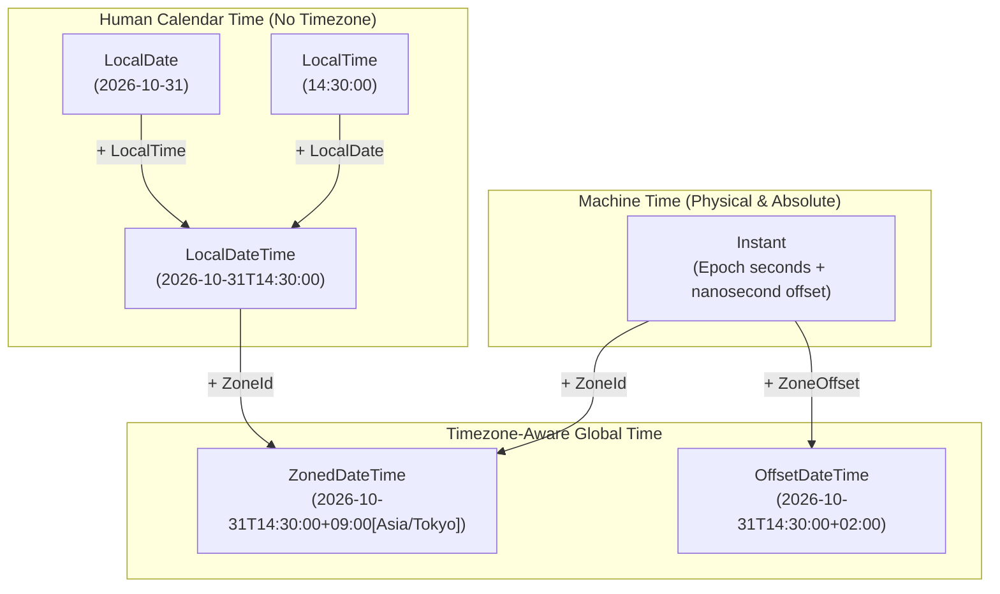
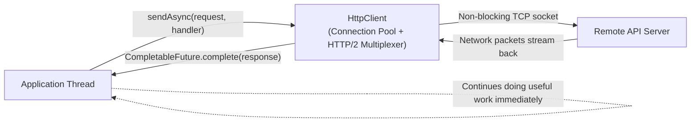

If you learned Java more than a few years ago or maintain long-running enterprise codebases, you will run across legacy APIs that cause immense grief: `java.util.Date`, `Calendar`, `SimpleDateFormat`, `HttpURLConnection`, and sprawling null checks. 

Over the past decade, the JDK architects undertook an ambitious campaign to modernize the core platform. They replaced unsafe mutable date abstractions with the immutable **JSR-310 (`java.time`)** engine, replaced fragile networking tools with the non-blocking **Java 11 `HttpClient`**, introduced unmodifiable collection factories (`List.of()`, `Map.of()`), and gave us expressive String utilities and `Optional<T>`.

Understanding *why* these APIs were built the way they are—and how they operate down to memory allocations and thread safety—is what separates a developer who merely copies code from a senior engineer who designs resilient, production-grade distributed systems.

---

## The Historical Tragedy of `java.util.Date` and `Calendar`

To appreciate modern Java time handling, we have to look at the architectural failures of the past. When Java 1.0 launched in 1996, it included `java.util.Date`. A year later, Java 1.1 bolted on `java.util.Calendar` and `java.text.SimpleDateFormat`.

These classes caused three major classes of bugs in production software:

### Shared Mutability and Silent Data Corruption
`java.util.Date` was designed as a mutable container around a millisecond epoch value:

```java
// ❌ Legacy mutability danger
public class UserAccount {
    private Date creationDate;

    public UserAccount(Date creationDate) {
        this.creationDate = creationDate; // Flaw: stores direct reference
    }

    public Date getCreationDate() {
        return this.creationDate; // Flaw: returns mutable reference
    }
}
```

Any caller receiving `account.getCreationDate()` could invoke `.setTime(0)` on that reference, instantly rewriting the creation timestamp across all threads sharing the account object without throwing any error!

### The `SimpleDateFormat` Concurrency Trap
`SimpleDateFormat` holds an internal `Calendar` field where it maintains parsing state (transient parsed numbers, timezone offsets, etc.) across invocations:

```java
// ❌ PRODUCTION OUTAGE TRAP: Shared SimpleDateFormat across worker threads
private static final SimpleDateFormat FORMATTER = new SimpleDateFormat("yyyy-MM-dd");

public String formatDate(Date date) {
    return FORMATTER.format(date); // Race condition! Formatted dates will be corrupted
}
```

When two threads concurrently call `format()` or `parse()` on a shared instance, their states interleave, leading to silently corrupted dates (such as a 2026 date becoming 1970 or 3042) or random `NumberFormatException` runtime crashes under heavy production traffic.

### Confusing Offsets and Zero-Indexed Months
In `java.util.Date`, years were offset from `1900` (so `2026` was represented as `126`), months were zero-indexed (`0 = January`, `11 = December`), but days of the month were 1-indexed. This mismatch caused millions of subtle off-by-one calendar bugs worldwide.

---

## The Modern `java.time` API (JSR-310)

Java 8 introduced `java.time`, spearheaded by Joda-Time author Stephen Colebourne. 

Every single class in the `java.time` package follows two foundational architectural principles:
1. **Strict Immutability:** All classes are `final` with `private final` fields. Any arithmetic operation (`plusDays()`, `minusMinutes()`) returns a brand-new instance, leaving the original object completely untouched.
2. **Thread Safety by Design:** Because objects cannot be modified after instantiation, instances can be safely shared across thousands of concurrent threads without synchronization, locks, or defensive copying.

### The Two Dimensions of Time: Machine Time vs Human Time

Time has two distinct realities in computing:
- **Machine Time:** A continuous, linear progression of physical ticks along the universal timeline, completely independent of human borders, timezones, leap seconds, or political treaties.
- **Human Time:** A socio-political construct broken into years, months, days, wall-clock hours, and geographic daylight-saving rules.



### Machine Time: `Instant`
`Instant` represents a specific point on the machine timeline, measured as nanoseconds from the Unix Epoch (`1970-01-01T00:00:00Z`).

Internally, `Instant` holds two fields:
```java
// OpenJDK Instant internal representation
private final long seconds; // Seconds since epoch
private final int nanos;    // Nanoseconds within the second (0 to 999,999,999)
```

In microservices and database tables, always store timestamps as `Instant` (or UTC epoch milliseconds):

```java
// Capturing current machine time
Instant start = Instant.now();

// Instant is immutable; math returns a new object
Instant thirtyMinutesLater = start.plus(30, ChronoUnit.MINUTES);

// Direct epoch conversions
long epochMillis = start.toEpochMilli();
Instant restored = Instant.ofEpochMilli(epochMillis);
```

### Human Calendar Time: `LocalDate`, `LocalTime`, and `LocalDateTime`
Use local classes when the timezone is irrelevant or unknown:
- A user's birthdate (`LocalDate.of(1995, Month.OCTOBER, 31)`)—it is October 31 regardless of whether the user travels between Tokyo and New York.
- A recurring alarm clock set for 07:00 AM (`LocalTime.of(7, 0)`).
- A retail store's scheduled inventory check at `LocalDateTime.of(2026, 11, 15, 23, 0)`.

```java
// Clean, readable calendar arithmetic
LocalDate today = LocalDate.now();
LocalDate nextBillingCycle = today.plusMonths(1).withDayOfMonth(1);

// Months are finally a clean 1-based enum or integer!
LocalDate release = LocalDate.of(2026, 6, 29);
Month month = release.getMonth(); // Month.JUNE
int monthNumber = release.getMonthValue(); // 6
```

### Timezone-Aware Time: `ZonedDateTime` vs `OffsetDateTime`
When human schedules cross physical timezones or daylight saving boundaries, you must attach geographic context:

1. **`OffsetDateTime`**: Combines `LocalDateTime` with a fixed numerical offset (e.g., `+05:30` or `-04:00`). Ideal for serialized REST JSON payloads and RFC 3339 compliance.
2. **`ZonedDateTime`**: Combines `LocalDateTime` with a full geographical `ZoneId` (e.g., `ZoneId.of("America/New_York")` or `ZoneId.of("Europe/London")`). It contains all historical and future Daylight Saving Time (DST) transition rules tracked by the IANA Time Zone Database.

```java
ZoneId tokyo = ZoneId.of("Asia/Tokyo");
ZonedDateTime tokyoTime = ZonedDateTime.now(tokyo);

// Converting between timezones preserving the exact instant in time:
ZoneId london = ZoneId.of("Europe/London");
ZonedDateTime londonTime = tokyoTime.withZoneSameInstant(london);

System.out.println("Tokyo: " + tokyoTime);
System.out.println("London (same instant): " + londonTime);
```

### Handling Daylight Saving Time Anomalies
When clocks spring forward (skipping an hour) or fall back (repeating an hour), naive arithmetic creates invalid dates. `ZonedDateTime` handles this automatically using `ZoneRules`:

```java
ZoneId newYork = ZoneId.of("America/New_York");
// In 2026, Daylight Saving begins March 8 at 2:00 AM (jumping directly to 3:00 AM)
LocalDate dstDay = LocalDate.of(2026, 3, 8);
LocalTime skippedTime = LocalTime.of(2, 30); // This wall-clock time does not exist!

ZonedDateTime adjusted = ZonedDateTime.of(dstDay, skippedTime, newYork);
// JSR-310 automatically rolls forward to 03:30 EDT!
System.out.println(adjusted); // 2026-03-08T03:30-04:00[America/New_York]
```

### `Period` vs `Duration`
Java clearly distinguishes between calendar intervals and physical elapsed time:
- **`Duration`**: Measures machine time in seconds and nanoseconds (ideal for measuring execution benchmarks, task timeouts, and network round trips).
- **`Period`**: Measures human calendar time in Years, Months, and Days (ideal for calculating subscription age, warranty duration, or mortgage terms).

```java
// Measuring execution elapsed time
Instant startTime = Instant.now();
// ... run computational algorithm ...
Instant endTime = Instant.now();
Duration elapsed = Duration.between(startTime, endTime);
System.out.println("Processing took: " + elapsed.toMillis() + " ms");

// Measuring calendar age
LocalDate birthday = LocalDate.of(1995, 10, 31);
LocalDate current = LocalDate.of(2026, 10, 31);
Period age = Period.between(birthday, current);
System.out.println("Age: " + age.getYears() + " years, " + age.getMonths() + " months");
```

### Thread-Safe Formatting: `DateTimeFormatter`
Unlike legacy `SimpleDateFormat`, `DateTimeFormatter` is completely immutable and thread-safe. You can instantiate it once as a `public static final` constant and safely share it across your entire application:

```java
public class OrderDateFormatter {
    // Thread-safe, compile-time constant
    public static final DateTimeFormatter ISO_FORMATTER = 
        DateTimeFormatter.ofPattern("yyyy-MM-dd HH:mm:ss")
                         .withZone(ZoneId.of("UTC"));

    public static String format(Instant instant) {
        return ISO_FORMATTER.format(instant);
    }

    public static Instant parse(String rawText) {
        return Instant.from(ISO_FORMATTER.parse(rawText));
    }
}
```

### Interoperability with Legacy Databases
When connecting to legacy JDBC drivers or external libraries that expect `java.util.Date`:

```java
// Convert Legacy Date -> Modern Instant
Date legacyDate = new Date();
Instant instant = legacyDate.toInstant();

// Convert Modern Instant -> Legacy Date
Instant modernNow = Instant.now();
Date convertedBack = Date.from(modernNow);
```

---

## Modern String Utilities in Java 11 Through Java 21

Modern Java versions brought dozens of small, high-impact utilities directly into `java.lang.String`, eliminating common Apache Commons or Guava dependencies:

```java
// 1. .isBlank() vs .isEmpty()
String emptyStr = "";
String blankStr = "   \t\n   ";
System.out.println(emptyStr.isEmpty());  // true
System.out.println(blankStr.isEmpty());  // false (characters exist)
System.out.println(blankStr.isBlank());  // true (contains only whitespace)

// 2. .strip(), .stripLeading(), .stripTrailing()
// Unlike trim(), strip() is Unicode-aware and strips all Unicode whitespace
String rawInput = " \u2005 Hello World! \n ";
System.out.println(rawInput.strip()); // "Hello World!"

// 3. .repeat(n)
String banner = "=".repeat(40);
System.out.println(banner); // Prints "========================================"

// 4. .lines() (returns a lazy Stream<String>)
String csvContent = "user_id,status,score\n101,ACTIVE,94\n102,SUSPENDED,42";
csvContent.lines()
          .filter(line -> !line.startsWith("user_id"))
          .forEach(line -> System.out.println("Row: " + line));
```

### Java 15+ Text Blocks
Text blocks eliminate noisy string concatenations and escaped quotes when dealing with JSON, SQL queries, or HTML templates:

```java
String query = """
    SELECT u.id, u.username, u.email
    FROM users u
    WHERE u.status = 'ACTIVE'
      AND u.created_at >= ?
    ORDER BY u.created_at DESC
    LIMIT 50
    """;
```

---

## Modern Immutable Collection Factories

Before Java 9, creating an unmodifiable collection required verbose boilerplates:

```java
// ❌ Legacy verbosity
List<String> list = new ArrayList<>();
list.add("ALPHA");
list.add("BETA");
List<String> unmodifiable = Collections.unmodifiableList(list);
```

Java 9 introduced streamlined, highly optimized collection factories:

```java
// ✅ Modern, concise, immutable collections
List<String> roles = List.of("ADMIN", "DEVELOPER", "GUEST");
Set<Integer> ports = Set.of(80, 443, 8080);
Map<String, String> config = Map.of(
    "env", "production",
    "region", "us-east-1"
);

// For maps with more than 10 entries:
Map<String, Integer> scores = Map.ofEntries(
    Map.entry("Alice", 95),
    Map.entry("Bob", 88),
    Map.entry("Charlie", 92)
);
```

### Under the Hood: Why Modern Factories Outperform `Collections.unmodifiableList`
1. **True Immutability:** `Collections.unmodifiableList(originalList)` was only an unmodifiable *view*. If another thread held a reference to `originalList`, modifying `originalList` mutated the view! `List.of()` produces a standalone, strictly immutable instance.
2. **Compact Memory Footprint:** Standard `ArrayList` allocates an internal `Object[]` buffer that grows exponentially, wasting unused slots. `List.of()` implements specialized lightweight internal classes (`List12`, `ListN`) sized to the exact element count with zero excess memory overhead.
3. **Null Rejection:** Modern factories reject `null` immediately, throwing `NullPointerException`. They protect you against null pollution early in your pipeline.
4. **Randomized Iteration Order:** In `Set.of()` and `Map.of()`, iteration order is deliberately randomized across JVM runs to prevent developers from accidentally depending on insertion order.

---

## The Java 11 `HttpClient`

For decades, writing HTTP requests with standard Java meant wrestling with `HttpURLConnection`:
- Synchronous and blocking only.
- Painful connection management.
- Zero support for HTTP/2 multiplexing or WebSockets.
- Required writing manual buffer loops around raw `InputStream` handles.

Java 11 replaced this legacy framework with `java.net.http.HttpClient`.



### Key Architectural Highlights
- **Thread Safety:** `HttpClient` is completely thread-safe. Instantiate it **once** as a shared singleton or Spring bean and reuse it across your application.
- **HTTP/2 Multiplexing:** Multiple requests to the same origin share a single underlying TCP connection using bidirectional multiplexed streams.
- **Non-blocking Reactive Pipeline:** Built entirely on Java 9 Flow APIs (`Flow.Publisher` and `Flow.Subscriber`). Request and response bodies can be streamed asynchronously without buffering gigabytes into memory.

### Synchronous (Blocking) Requests
For simple background tasks or CLI tools where blocking the calling thread is acceptable:

```java
import java.net.URI;
import java.net.http.HttpClient;
import java.net.http.HttpRequest;
import java.net.http.HttpResponse;
import java.time.Duration;

public class SyncHttpExample {
    // Shared reusable client
    private static final HttpClient HTTP_CLIENT = HttpClient.newBuilder()
            .version(HttpClient.Version.HTTP_2)
            .connectTimeout(Duration.ofSeconds(5))
            .build();

    public static void main(String[] args) throws Exception {
        HttpRequest request = HttpRequest.newBuilder()
                .uri(URI.create("https://api.github.com/zen"))
                .header("Accept", "text/plain")
                .timeout(Duration.ofSeconds(10))
                .GET()
                .build();

        HttpResponse<String> response = HTTP_CLIENT.send(
                request, 
                HttpResponse.BodyHandlers.ofString()
        );

        System.out.println("HTTP Status: " + response.statusCode());
        System.out.println("Protocol Version: " + response.version());
        System.out.println("Response: " + response.body());
    }
}
```

### High-Throughput Asynchronous (Non-Blocking) Requests
In modern microservices handling thousands of requests per second, blocking a worker thread while waiting for a remote HTTP response wastes CPU threads. 

Using `client.sendAsync()`, the calling thread registers callback transformations and returns immediately:

```java
import java.net.URI;
import java.net.http.HttpClient;
import java.net.http.HttpRequest;
import java.net.http.HttpResponse;
import java.util.concurrent.CompletableFuture;

public class AsyncHttpExample {
    private static final HttpClient CLIENT = HttpClient.newHttpClient();

    public static CompletableFuture<String> fetchUserStatus(String userId) {
        HttpRequest request = HttpRequest.newBuilder()
                .uri(URI.create("https://api.example.com/users/" + userId))
                .header("Accept", "application/json")
                .GET()
                .build();

        // sendAsync returns immediately with a CompletableFuture
        return CLIENT.sendAsync(request, HttpResponse.BodyHandlers.ofString())
                .thenApply(response -> {
                    if (response.statusCode() == 200) {
                        return response.body();
                    }
                    throw new RuntimeException("HTTP Error: " + response.statusCode());
                })
                .exceptionally(throwable -> {
                    System.err.println("Fallback triggered: " + throwable.getMessage());
                    return "{\"status\": \"OFFLINE_CACHE\"}";
                });
    }
}
```

### Streaming Payloads with `BodyPublishers` and `BodyHandlers`
Instead of buffering an entire multi-gigabyte file into memory before transmission, `HttpClient` streams bytes on demand:

```java
// Streaming a file directly from disk to an HTTP POST without heap exhaustion:
Path payloadFile = Path.of("/data/large-export.json");

HttpRequest postRequest = HttpRequest.newBuilder()
        .uri(URI.create("https://ingest.example.com/upload"))
        .header("Content-Type", "application/json")
        .POST(HttpRequest.BodyPublishers.ofFile(payloadFile)) // Streams chunks from disk
        .build();

// Downloading a huge file straight to disk without loading it into a byte[] buffer:
Path destination = Path.of("/data/downloaded-firmware.bin");
HttpResponse<Path> downloadResponse = CLIENT.send(
        HttpRequest.newBuilder(URI.create("https://cdn.example.com/firmware.bin")).build(),
        HttpResponse.BodyHandlers.ofFile(destination) // Streams incoming packets to disk
);
```

---

## Defensive Engineering with `Optional<T>`

In 1965, computer scientist Tony Hoare invented the `null` reference, calling it his "Billion Dollar Mistake" due to the catastrophic vulnerabilities and crashes it produced across software history.

Java 8 introduced `java.util.Optional<T>` as a monadic container representing either the presence of a non-null reference or the explicit absence of a value.

### The Correct Mental Model for `Optional`
An `Optional` is an explicit **method return contract**. It warns callers: *"This operation might not produce a result under valid business conditions. You are forced to handle the empty case."*

```java
public class UserRepository {
    // Expressive return type: Caller is explicitly informed that user might not exist
    public Optional<User> findById(String id) {
        User user = database.query("SELECT * FROM users WHERE id = ?", id);
        return Optional.ofNullable(user);
    }
}
```

### Idiomatic Functional Composition
Avoid imperative checking (`if (opt.isPresent()) opt.get()`). Instead, compose logic fluently:

```java
Optional<User> userOpt = userRepository.findById("user-42");

// 1. Safe default value fallback
User activeUser = userOpt.orElse(User.GUEST);

// 2. Lazy evaluation for expensive fallbacks (compute only if absent!)
User computedUser = userOpt.orElseGet(() -> expensiveRemoteUserLookup("user-42"));

// 3. Fail fast with domain-specific exceptions
User verifiedUser = userOpt.orElseThrow(() -> new UserNotFoundException("User 42 does not exist"));

// 4. Transforming and filtering inner values safely
String upperEmail = userOpt
        .filter(User::isActive)
        .map(User::getEmail)
        .map(String::trim)
        .orElse("no-email-configured@company.com");
```

### Critical `Optional` Anti-Patterns in High-Performance Systems
While `Optional` provides safety, misusing it creates memory churn and architectural nightmares:

1. **Never use `Optional` as a class field**:
   `Optional` does not implement `java.io.Serializable`. Furthermore, wrapping fields in `Optional` wastes 16 to 24 bytes of heap memory per instance for the wrapper reference plus object header overhead. Use plain nullable fields with null checks internally.
2. **Never pass `Optional` as a method argument**:
   Passing `Optional<String>` forces callers to write `findUser(Optional.of("bob"))`, or worse, `findUser(null)`, which reintroduces `NullPointerException`! Use method overloading instead.
3. **Never wrap Collections in an `Optional`**:
   Never return `Optional<List<Order>>`. Return an empty collection (`Collections.emptyList()` or `List.of()`). An empty collection already represents zero elements cleanly without allocating a wrapper object.

---

## Summary & Mental Model Checkpoint

1. **JSR-310 Immutability**: All classes in `java.time` are immutable and inherently thread-safe.
2. **Machine vs. Human Time**: Store timestamps as UTC `Instant` on the machine timeline; use `ZonedDateTime` or `OffsetDateTime` only when presenting to humans or evaluating DST rules.
3. **Thread-Safe Formatting**: Use `DateTimeFormatter`; never share legacy `SimpleDateFormat` across threads.
4. **Modern String Methods**: Prefer `.isBlank()`, `.strip()`, `.repeat()`, and text blocks (`"""`) for cleaner, safer string operations.
5. **Modern Collections**: Use `List.of()`, `Set.of()`, and `Map.of()` for unmodifiable, memory-optimized collections that reject nulls.
6. **Java 11 `HttpClient`**: Reuse a single instance across the application; leverage `sendAsync()` for high-throughput non-blocking I/O.
7. **`Optional` Scope**: Use `Optional` exclusively as a method return type to indicate possible absence; avoid using it as fields, method parameters, or wrapped collections.

---

## 🎯 Senior Engineer Interview Questions

### Why does sharing a legacy `SimpleDateFormat` instance across multiple threads cause silent data corruption, and how does `DateTimeFormatter` eliminate this problem?
> **Answer:** `SimpleDateFormat` is fundamentally stateful and mutable. Internally, it inherits a `Calendar` instance whose fields (`calendar.setTime()`, internal timezone caches, and calendar math structures) are updated directly during calls to `format()` and `parse()`. When multiple threads invoke these methods concurrently, their execution steps interleave on the shared `Calendar` state, causing the formatter to output completely incorrect years/months or throw non-deterministic `NumberFormatException` runtime errors. In contrast, `DateTimeFormatter` is completely immutable: it has no mutable fields, stores its patterns and zone rules in `final` fields, and constructs brand-new transient internal parsing contexts on the stack for each thread invocation, guaranteeing 100% thread safety without locks.

### In distributed microservices, why should database entities store timestamps as `Instant` rather than `LocalDateTime` or `ZonedDateTime`?
> **Answer:** `LocalDateTime` completely lacks timezone information; storing it in a database loses the geographical frame of reference, making it impossible to reconstruct the exact global chronological order of events when servers or database replicas span multiple regions. `ZonedDateTime` includes daylight saving and geographic zone rules, which are subject to political changes (governments altering DST dates) and can introduce ambiguities during DST fallback intervals (where the same wall-clock time occurs twice). `Instant` represents an absolute, immutable point on the physical timeline measured in seconds and nanoseconds from the Unix Epoch (`1970-01-01T00:00:00Z`). Storing UTC `Instant` guarantees uniform sorting, unambiguous timestamps, and simplifies calculations across globally distributed microservices.

### How does Java 9's `List.of()` differ architecturally from `Collections.unmodifiableList(new ArrayList<>(...))`?
> **Answer:** `Collections.unmodifiableList(...)` creates a lightweight decorator wrapper around an existing underlying collection. If code retains a reference to that underlying collection, modifications to the original list mutate the contents visible through the unmodifiable wrapper, violating true immutability. Additionally, `ArrayList` carries internal unused capacity in its backing array. Conversely, `List.of()` produces a truly immutable, sealed instance that cannot be mutated by any reference. It uses specialized compact implementations (such as `List12` for 1-2 elements and `ListN` for more) that allocate an array sized to the exact element count, eliminating unused memory. Furthermore, `List.of()` strictly disallows `null` values, preventing latent null pointer bugs.

### What happens under the hood when you invoke `HttpClient.sendAsync()` in Java 11, and how does it prevent thread pool starvation compared to `send()`?
> **Answer:** When invoking the synchronous `HttpClient.send()`, the calling application thread is placed into a blocked state (waiting on socket I/O), holding all thread stack memory and resources while the remote server processes the request and transmits packets across the network. Under heavy traffic, this leads to thread pool starvation where all worker threads are stuck blocked on I/O. `HttpClient.sendAsync()` leverages the NIO channel selector architecture and Java 9 Reactive Streams (`Flow.Publisher` / `Subscriber`). The method registers an interest in socket read/write events with an internal OS event loop (epoll on Linux or kqueue on macOS) and returns an uncompleted `CompletableFuture` immediately, releasing the application thread back to its pool. When response packets arrive from the network interface card, the OS notifies the selector loop, which feeds byte buffers into the `BodyHandler` subscriber and completes the future on a shared ForkJoin or configured executor pool.