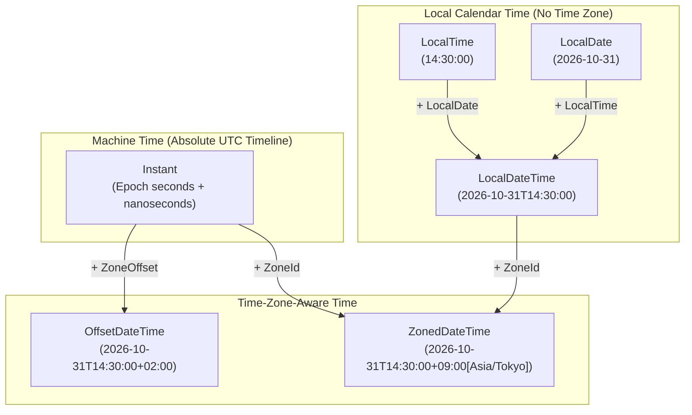
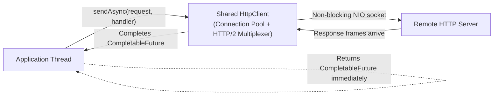

For a long time, everyday tasks in Java required reaching for third-party libraries just to avoid sharp edges in the JDK. Date handling relied on mutable `java.util.Date` and thread-unsafe `SimpleDateFormat`. Making HTTP calls meant wrestling with blocking `HttpURLConnection` boilerplate. Even splitting lines or formatting multi-line SQL queries required clumsy escapes or Apache Commons helpers.

Modern Java (Java 8 through Java 21) replaced those pain points directly in the standard library: `java.time` for dates and durations, Unicode-aware `String` methods and text blocks for text processing, compact unmodifiable collection factories, and `java.net.http.HttpClient` for HTTP/1.1 and HTTP/2 networking.

---

## Why `java.time` Replaced `Date` and `SimpleDateFormat`

Understanding what was broken in Java 1.0's `Date` and `Calendar` makes the design of `java.time` immediately clear:

- **Mutable values**: `java.util.Date` exposes `setTime(long)`. If a domain object returns its internal `Date` without defensive copying, any caller can mutate that timestamp in place.
- **Thread-unsafe formatting**: `SimpleDateFormat` mutates an internal `Calendar` instance while formatting and parsing. Sharing a `static final SimpleDateFormat` across web request threads causes silent data corruption (wrong years or months) and intermittent `NumberFormatException` failures under load.
- **Inconsistent numbering**: `Date` counted years from `1900` and months from `0` (January = `0`), while days of the month started at `1`.

Java 8 introduced `java.time` (JSR-310) to fix all three issues. Every value type in `java.time` is immutable and thread-safe: arithmetic methods like `plusDays(1)` always return a new instance, and `DateTimeFormatter` can be shared safely as a `static final` constant across all threads.

---

## The `java.time` API

The first step to using `java.time` well is separating **machine time** (an exact point on the global UTC timeline) from **human calendar time** (dates and wall-clock times that depend on calendars and time zones).



### `Instant`: Machine Timestamps

`Instant` represents an exact point on the UTC timeline measured in seconds and nanoseconds from the Unix epoch (`1970-01-01T00:00:00Z`). Use `Instant` for database `created_at` columns, audit logs, token expiration timestamps, and event ordering across distributed services.

```java
import java.time.Instant;
import java.time.temporal.ChronoUnit;

Instant now = Instant.now();
Instant expiresAt = now.plus(15, ChronoUnit.MINUTES);

long epochMillis = now.toEpochMilli();
Instant restored = Instant.ofEpochMilli(epochMillis);
```

### `LocalDate`, `LocalTime`, and `LocalDateTime`

The `Local*` classes have **no time zone or UTC offset**. Use them when a time zone does not apply, such as a birthday (`LocalDate`), a daily store opening time (`LocalTime`), or a scheduled local calendar event before attaching a zone (`LocalDateTime`):

```java
import java.time.LocalDate;
import java.time.LocalDateTime;
import java.time.LocalTime;
import java.time.Month;

LocalDate invoiceDate = LocalDate.of(2026, Month.JUNE, 29);
LocalDate dueDate = invoiceDate.plusDays(30);

LocalTime cutoff = LocalTime.of(17, 30);
LocalDateTime localAppointment = LocalDateTime.of(invoiceDate, cutoff);
```

Avoid storing `LocalDateTime` for past events like "when did the user place this order?". Without a zone or offset, `2026-06-29T09:00:00` means different physical moments depending on which server or region wrote it.

### `ZonedDateTime` and `OffsetDateTime`

When you need global context, choose between two zone-aware types:

- **`OffsetDateTime`** pairs a `LocalDateTime` with a fixed numerical offset such as `+05:30` or `-04:00`. It maps cleanly to ISO-8601 / RFC 3339 JSON timestamps and SQL `TIMESTAMP WITH TIME ZONE` columns.
- **`ZonedDateTime`** pairs a `LocalDateTime` with an IANA `ZoneId` such as `America/New_York` or `Europe/London`. It knows historical and future Daylight Saving Time (DST) transition rules via `ZoneRules`.

```java
import java.time.ZoneId;
import java.time.ZonedDateTime;

ZoneId tokyo = ZoneId.of("Asia/Tokyo");
ZoneId london = ZoneId.of("Europe/London");

ZonedDateTime meetingInTokyo = ZonedDateTime.of(2026, 10, 15, 18, 0, 0, 0, tokyo);
// Same physical instant, expressed in London's wall-clock time
ZonedDateTime meetingInLondon = meetingInTokyo.withZoneSameInstant(london);
```

### Daylight Saving Time (DST) Pitfalls

DST introduces two subtle wall-clock anomalies that `ZonedDateTime` handles explicitly:

1. **Spring-forward gap**: clocks jump forward by an hour, so certain wall-clock times never exist.
2. **Fall-back overlap**: clocks move back an hour, so the same wall-clock time happens twice (once in Daylight Time and once in Standard Time).

```java
ZoneId newYork = ZoneId.of("America/New_York");

// 1. Gap: On 2026-03-08, clocks jump from 02:00 EST straight to 03:00 EDT
ZonedDateTime gapAdjusted = ZonedDateTime.of(
        LocalDate.of(2026, 3, 8),
        LocalTime.of(2, 30),
        newYork
);
// Moves forward across the gap -> 2026-03-08T03:30-04:00[America/New_York]

// 2. Overlap: On 2026-11-01, 01:30 occurs twice (-04:00 EDT, then -05:00 EST)
ZonedDateTime firstPass = ZonedDateTime.of(
        LocalDate.of(2026, 11, 1),
        LocalTime.of(1, 30),
        newYork
); // Defaults to the earlier offset (-04:00)
ZonedDateTime secondPass = firstPass.withLaterOffsetAtOverlap(); // -05:00
```

A third DST pitfall shows up when adding time across a transition day. Adding `Period.ofDays(1)` keeps the same wall-clock hour (23 physical hours on a spring-forward day), while adding `Duration.ofHours(24)` adds 24 exact physical hours (shifting the wall-clock hour forward by one):

```java
ZonedDateTime beforeDst = ZonedDateTime.of(2026, 3, 7, 9, 0, 0, 0, newYork);

ZonedDateTime sameWallClockNextDay = beforeDst.plus(Period.ofDays(1));   // 2026-03-08T09:00-04:00
ZonedDateTime twentyFourHoursLater = beforeDst.plus(Duration.ofHours(24)); // 2026-03-08T10:00-04:00
```

### `Duration` vs. `Period`

`java.time` separates exact elapsed time from calendar intervals:

- **`Duration`** measures machine time in seconds and nanoseconds. Use it with `Instant`, `LocalTime`, `LocalDateTime`, or `ZonedDateTime` for timeouts, latencies, and SLA windows. (Calling `Duration.between()` on two `LocalDate` values throws `UnsupportedTemporalTypeException` because `LocalDate` has no seconds field.)
- **`Period`** measures calendar time in years, months, and days. Use it with `LocalDate` for billing cycles, subscription renewals, and ages.

```java
import java.time.Duration;
import java.time.LocalDate;
import java.time.Period;

Instant start = Instant.now();
// ... perform work ...
Duration elapsed = Duration.between(start, Instant.now());
long elapsedMs = elapsed.toMillis();

Period tenure = Period.between(LocalDate.of(2022, 4, 1), LocalDate.of(2026, 6, 29));
// 4 years, 2 months, 28 days
```

### `DateTimeFormatter`, `Clock`, and Legacy Interop

`DateTimeFormatter` is immutable and safe to store in a `static final` field. When formatting an `Instant` with a custom pattern, attach a zone (such as `ZoneOffset.UTC`), because an `Instant` has no built-in calendar fields without a zone:

```java
import java.time.Clock;
import java.time.Instant;
import java.time.ZoneOffset;
import java.time.format.DateTimeFormatter;
import java.util.Date;

public class TimestampUtil {
    private static final DateTimeFormatter UTC_FORMAT =
            DateTimeFormatter.ofPattern("yyyy-MM-dd HH:mm:ss").withZone(ZoneOffset.UTC);

    private final Clock clock;

    public TimestampUtil(Clock clock) {
        this.clock = clock; // Pass Clock.systemUTC() in production, Clock.fixed(...) in tests
    }

    public String formatNow() {
        return UTC_FORMAT.format(Instant.now(clock));
    }

    public static Instant fromLegacyDate(Date legacy) {
        return legacy.toInstant();
    }

    public static Date toLegacyDate(Instant instant) {
        return Date.from(instant);
    }
}
```

Injecting a `java.time.Clock` into services that depend on "now" makes time-sensitive logic (like token expiry or billing cutoffs) deterministic to unit test without sleeping or mocking static methods.

---

## Modern `String` Methods, Formatting, and Text Blocks (Java 11+)

Starting in Java 11, the JDK added practical text methods that previously required external utilities, followed by text blocks and `.formatted()` in Java 15.

### Whitespace, Lines, and Repetition (Java 11–12)

```java
// isBlank() checks for empty or all-whitespace strings (Unicode-aware)
"   \t\n".isEmpty(); // false
"   \t\n".isBlank(); // true

// strip() removes all Unicode whitespace; legacy trim() only removes chars <= '\u0020'
String padded = "\u2005  Hello Java  \u2005";
padded.trim();          // Still has leading/trailing \u2005 (four-per-em space)!
padded.strip();         // "Hello Java"
padded.stripLeading();  // "Hello Java  \u2005"
padded.stripTrailing(); // "\u2005  Hello Java"

// repeat(n) builds repeated sequences efficiently
String separator = "-".repeat(40);

// lines() splits on \n, \r\n, or \r and returns a lazy Stream<String>
String csv = "id,status\r\n101,ACTIVE\n102,PAUSED";
long activeRows = csv.lines()
        .skip(1)
        .filter(line -> line.endsWith(",ACTIVE"))
        .count();

// transform() (Java 12) lets you chain custom string transformations fluently
String slug = "  Java 21 Core APIs  "
        .transform(String::strip)
        .transform(String::toLowerCase)
        .transform(s -> s.replaceAll("\\s+", "-")); // "java-21-core-apis"
```

### Text Blocks and `formatted()` (Java 15+)

Text blocks (`"""`) let you write multi-line JSON, SQL, or HTML cleanly without escaped quotes or `+ "\n" +` chains. The compiler automatically strips incidental leading indentation based on the position of the closing `"""` delimiter:

```java
String sql = """
        SELECT u.id, u.email, u.status
        FROM users u
        WHERE u.status = 'ACTIVE'
          AND u.tenant_id = ?
        ORDER BY u.created_at DESC
        LIMIT 50
        """;
```

Java 15 also added `String.formatted(Object... args)` as an instance-method counterpart to `String.format(...)`, which pairs cleanly with text blocks. Two text-block escape sequences are also handy: `\` at the end of a line joins lines without inserting a newline, and `\s` inserts a literal space while preventing the compiler from stripping trailing whitespace on that line.

```java
import java.util.Locale;

String payload = """
        {
          "orderId": "%s",
          "itemCount": %d
        }
        """.formatted("ORD-42", 3);

// For machine-readable decimal formatting (JSON, CSV, logs), pass Locale.ROOT
// so European JVM locales do not format 19.95 as "19,95".
String decimal = String.format(Locale.ROOT, "%.2f", 19.95);
```

> [!TIP]
> `String.formatted(...)` uses the JVM's default `Locale`. Whenever you format floating-point numbers for wire formats like JSON or CSV, use `String.format(Locale.ROOT, ...)` so the decimal separator is always `.` regardless of the host server's locale.

---

## Unmodifiable Collection Factories (Java 9+)

Java 9 introduced concise static factories for small, read-only collections: `List.of()`, `Set.of()`, `Map.of()`, and `Map.ofEntries()`.

```java
import java.util.List;
import java.util.Map;
import java.util.Set;

List<String> roles = List.of("ADMIN", "EDITOR", "VIEWER");
Set<Integer> allowedPorts = Set.of(80, 443, 8080);

Map<String, String> headers = Map.of(
        "Accept", "application/json",
        "X-Client", "billing-service"
);

// Use Map.ofEntries when you have more than 10 key-value pairs
Map<String, Integer> statusWeights = Map.ofEntries(
        Map.entry("PENDING", 1),
        Map.entry("PROCESSING", 2),
        Map.entry("SHIPPED", 3)
);
```

These factories differ from `Collections.unmodifiableList(existingList)` in three important ways:

1. **No mutable backing collection**: `Collections.unmodifiableList(list)` is only a read-only view; mutating `list` still mutates the view. `List.of()` creates a standalone unmodifiable instance.
2. **Null elements and keys are rejected**: passing `null` throws `NullPointerException` immediately, catching missing values early.
3. **Compact memory layout**: `List.of` and `Map.of` use specialized internal classes sized to the exact element count with no spare array capacity. Note also that `Set.of` and `Map.of` deliberately randomize iteration order across JVM runs so code does not accidentally depend on insertion order.

---

## The Java 11 `HttpClient` API

Before Java 11, making HTTP requests with the standard library meant using `HttpURLConnection`, which only supported blocking HTTP/1.1 calls, had awkward header and stream handling, and offered no built-in support for HTTP/2 or WebSockets.

`java.net.http.HttpClient` (standardized in Java 11) provides a clean, immutable-builder API with HTTP/2 multiplexing, automatic fallback to HTTP/1.1, synchronous and asynchronous execution, and streaming request/response bodies built on `java.util.concurrent.Flow`.



### Configuring and Reusing `HttpClient`

An `HttpClient` instance is thread-safe and manages its own internal selector thread and connection pool. Create it once per configuration (for example, as a Spring bean or `static final` field) and reuse it across requests instead of building a new client on every call. Starting in Java 21, `HttpClient` also implements `AutoCloseable`, which makes tearing down short-lived clients in tests or CLI tools straightforward.

Two configuration details catch developers off guard when first using `HttpClient`:

- **Two different timeouts**: `HttpClient.Builder.connectTimeout(Duration)` caps how long TCP/TLS connection establishment may take, while `HttpRequest.Builder.timeout(Duration)` caps how long the client waits for the response before throwing `HttpTimeoutException`. Always set both in production code.
- **Redirects are off by default**: `HttpClient` defaults to `Redirect.NEVER`. Set `.followRedirects(HttpClient.Redirect.NORMAL)` if you want `301`/`302` redirects followed (while blocking HTTPS-to-HTTP downgrades).

### Synchronous Requests (`send`)

`client.send()` blocks the calling thread until the response arrives. It is simple and readable for CLI tools, batch jobs, and Java 21 virtual threads:

```java
import java.io.IOException;
import java.net.URI;
import java.net.http.HttpClient;
import java.net.http.HttpRequest;
import java.net.http.HttpResponse;
import java.time.Duration;

public class BillingClient {
    private static final HttpClient CLIENT = HttpClient.newBuilder()
            .version(HttpClient.Version.HTTP_2) // Uses HTTP/2, falls back to HTTP/1.1 automatically
            .connectTimeout(Duration.ofSeconds(5))
            .followRedirects(HttpClient.Redirect.NORMAL)
            .build();

    public String createInvoice(String jsonBody) throws IOException, InterruptedException {
        HttpRequest request = HttpRequest.newBuilder()
                .uri(URI.create("https://api.example.com/v1/invoices"))
                .timeout(Duration.ofSeconds(10))
                .header("Content-Type", "application/json")
                .header("Accept", "application/json")
                .POST(HttpRequest.BodyPublishers.ofString(jsonBody))
                .build();

        HttpResponse<String> response = CLIENT.send(
                request,
                HttpResponse.BodyHandlers.ofString()
        );

        if (response.statusCode() < 200 || response.statusCode() >= 300) {
            throw new IOException("Invoice API failed with status " + response.statusCode());
        }
        return response.body();
    }
}
```

### Asynchronous Requests (`sendAsync`)

When you want to fan out multiple HTTP calls concurrently without tying up platform threads while waiting on network I/O, use `sendAsync()`. It returns a `CompletableFuture<HttpResponse<T>>` immediately:

```java
import java.net.URI;
import java.net.http.HttpClient;
import java.net.http.HttpRequest;
import java.net.http.HttpResponse;
import java.time.Duration;
import java.util.concurrent.CompletableFuture;

public class ProfileAggregator {
    private final HttpClient client;

    public ProfileAggregator(HttpClient client) {
        this.client = client;
    }

    public CompletableFuture<String> fetchUserSummary(String userId) {
        CompletableFuture<String> profileFuture = getJson("https://api.example.com/users/" + userId);
        CompletableFuture<String> ordersFuture = getJson("https://api.example.com/orders?user=" + userId);

        // Both HTTP requests run in parallel; combine once both finish
        return profileFuture.thenCombine(ordersFuture, (profile, orders) ->
                "{\"profile\":" + profile + ",\"orders\":" + orders + "}"
        );
    }

    private CompletableFuture<String> getJson(String url) {
        HttpRequest request = HttpRequest.newBuilder()
                .uri(URI.create(url))
                .timeout(Duration.ofSeconds(5))
                .header("Accept", "application/json")
                .GET()
                .build();

        return client.sendAsync(request, HttpResponse.BodyHandlers.ofString())
                .thenApply(res -> {
                    if (res.statusCode() == 200) {
                        return res.body();
                    }
                    throw new IllegalStateException("Unexpected HTTP status: " + res.statusCode());
                });
    }
}
```

### Streaming Large Bodies with `BodyPublishers` and `BodyHandlers`

For large uploads or downloads, avoid buffering the entire payload into a `String` or `byte[]` on the heap. `BodyPublishers.ofFile` and `BodyHandlers.ofFile` stream chunks directly between disk and the socket:

```java
import java.nio.file.Path;

Path uploadFile = Path.of("/data/export.json");
HttpRequest uploadRequest = HttpRequest.newBuilder()
        .uri(URI.create("https://ingest.example.com/uploads"))
        .header("Content-Type", "application/json")
        .timeout(Duration.ofMinutes(2))
        .POST(HttpRequest.BodyPublishers.ofFile(uploadFile))
        .build();

Path downloadTarget = Path.of("/data/report.bin");
HttpRequest downloadRequest = HttpRequest.newBuilder()
        .uri(URI.create("https://cdn.example.com/report.bin"))
        .timeout(Duration.ofMinutes(2))
        .GET()
        .build();

HttpResponse<Path> saved = client.send(
        downloadRequest,
        HttpResponse.BodyHandlers.ofFile(downloadTarget)
);
```

---

## Summary

- Use `java.time` for all new date and time code: `Instant` for UTC machine timestamps, `LocalDate`/`LocalDateTime` for zone-less calendar values, `ZonedDateTime` when IANA DST rules matter, `Duration` for exact elapsed time, `Period` for calendar intervals, and `DateTimeFormatter` for thread-safe formatting.
- Watch for DST gaps, overlaps, and the difference between `Period.ofDays(1)` and `Duration.ofHours(24)` across DST transitions.
- Use Java 11+ `String` utilities (`isBlank`, `strip`, `lines`, `repeat`, `transform`) and Java 15+ text blocks with `.formatted()` (remembering `Locale.ROOT` for machine-readable numbers).
- Prefer `List.of()`, `Set.of()`, and `Map.of()` for compact, null-rejecting unmodifiable collections.
- Reuse a shared `java.net.http.HttpClient`, configure both `connectTimeout` and per-request `timeout`, and pick `send()`, `sendAsync()`, or file-streaming body handlers to fit your workload.

---

## Interview Questions

### Why is `SimpleDateFormat` unsafe to share across threads, and how does `DateTimeFormatter` avoid the problem?

`SimpleDateFormat` holds a mutable `Calendar` field internally and modifies its fields during `format()` and `parse()`. Concurrent calls on a shared instance interleave their updates to that shared `Calendar`, producing corrupted dates or random `NumberFormatException` errors. `DateTimeFormatter` is completely immutable: its configuration is stored in `final` fields and each `format()` or `parse()` call creates a fresh local context on the thread's stack, making it safe to share globally without locks.

### What is the difference between `Duration` and `Period`, and how do they behave across a Daylight Saving Time transition?

`Duration` measures exact physical time in seconds and nanoseconds, while `Period` measures calendar time in years, months, and days. On a spring-forward DST day (which has only 23 physical hours), adding `Period.ofDays(1)` to `09:00` produces `09:00` the next day (preserving wall-clock time), whereas adding `Duration.ofHours(24)` produces `10:00` the next day (advancing 24 exact hours).

### How does `String.strip()` differ from `String.trim()`?

`trim()` predates modern Unicode support and only removes characters whose code point is less than or equal to `\u0020` (ASCII space and control characters). `strip()`, `stripLeading()`, and `stripTrailing()` (added in Java 11) use `Character.isWhitespace(int)`, so they properly remove Unicode whitespace characters such as the ideographic space (`\u3000`) and em space (`\u2005`).

### Why should you reuse a single `HttpClient` instance instead of creating one per HTTP request?

Each `HttpClient` creates its own connection pool, HTTP/2 session state, and internal selector thread. Creating a new client on every request throws away keep-alive TCP connections and HTTP/2 multiplexing, forces repeated TLS handshakes, and leaks threads and file descriptors until garbage collection (or explicit `close()` in Java 21+). Because `HttpClient` is thread-safe, sharing one configured instance across requests gives far better throughput and resource efficiency.
