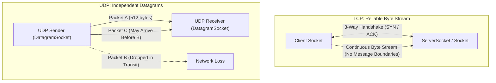
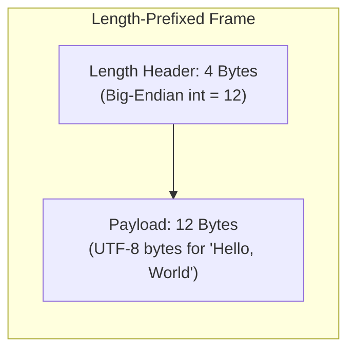
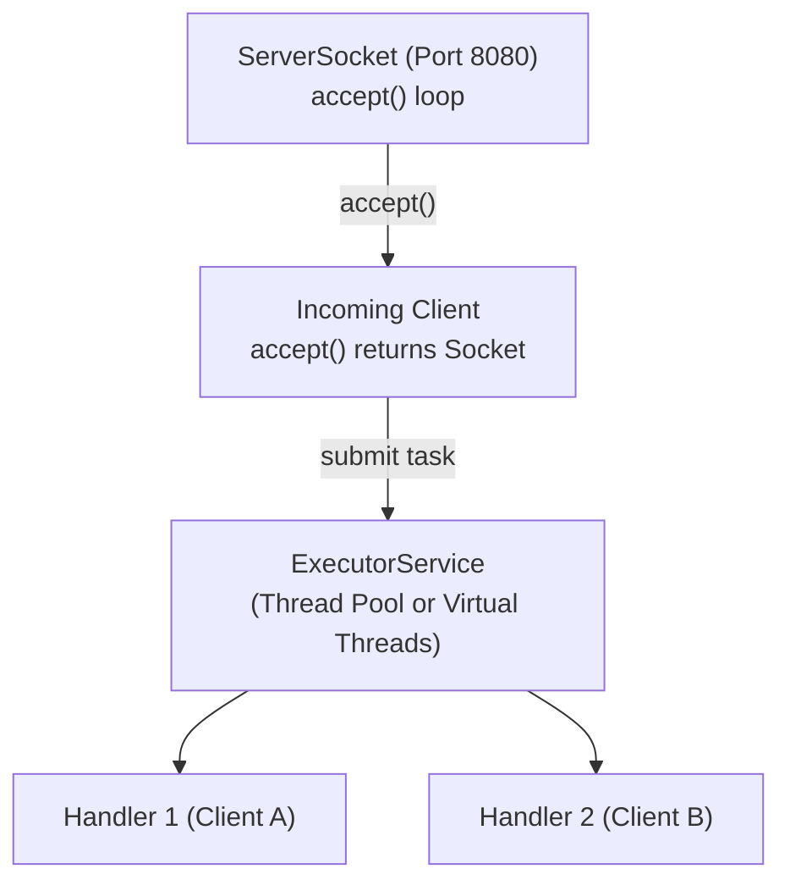

Every HTTP call, JDBC database query, and Kafka produce request eventually boils down to bytes moving across a **socket**. At the operating system level, a socket is an endpoint managed by the OS networking stack and represented to your process as a file descriptor. In Java's `java.net` package, `ServerSocket`, `Socket`, and `DatagramSocket` give you direct access to those OS sockets.

Opening a socket takes two lines of code, which makes network programming look deceptively easy in small demos. Production networks are far messier: packets get dropped or split across reads, peers vanish without closing the connection, firewalls silently drop idle flows, and misconfigured servers hang threads indefinitely. Understanding how TCP and UDP behave beneath Java's APIs is what separates a toy echo demo from code that stays upright under real traffic.

---

## TCP vs. UDP

The IP transport layer offers two main protocols, and Java gives each its own socket classes:

| Dimension | TCP (`ServerSocket`, `Socket`) | UDP (`DatagramSocket`, `DatagramPacket`) |
|---|---|---|
| **Connection model** | Connection-oriented; starts with a 3-way handshake (`SYN`, `SYN-ACK`, `ACK`) | Connectionless; sends independent datagrams with no handshake |
| **Reliability & ordering** | Guaranteed in-order byte delivery; lost packets are retransmitted and duplicates discarded | Best-effort; packets can be dropped, duplicated, or arrive out of order |
| **Message boundaries** | None; exposes a continuous byte stream | Preserved; each `send()` corresponds to one discrete datagram |
| **Flow & congestion control** | Built in via sliding window and congestion algorithms | None at the transport layer |
| **Typical use cases** | HTTP/REST APIs, database protocols, file transfers, RPC | DNS lookups, StatsD metrics, live audio/video, multiplayer game ticks |



---

## Why TCP Requires Message Framing

One of the most common mistakes with `Socket` is assuming that one `write()` on the sender produces one matching `read()` on the receiver:

```java
// Broken assumption: the receiver is NOT guaranteed to read "Hello" and then "World"
out.write("Hello".getBytes(StandardCharsets.UTF_8));
out.write("World".getBytes(StandardCharsets.UTF_8));
```

TCP has no concept of messages. It is a continuous pipe of bytes, similar to a file stream:

- The OS networking stack may coalesce multiple small writes into a single TCP segment (for example, under Nagle's algorithm), so the receiver's first `read()` returns `"HelloWorld"`.
- A single 10 KB write may be split across multiple network segments (an Ethernet MTU is typically 1,500 bytes, leaving around 1,460 bytes for TCP payload), so the receiver's first `read()` may return only the first 1,460 bytes.

Because TCP does not preserve boundaries, any application protocol running over TCP must define its own **framing**:

1. **Delimiter-based framing**: End each message with a marker such as `\r\n` (used in HTTP/1.1 headers and SMTP). Simple for text protocols, as long as the delimiter cannot appear unescaped inside a payload.
2. **Fixed-length framing**: Every record is exactly `N` bytes wide. Easy to parse, but wastes bandwidth if payloads vary widely in size.
3. **Length-prefixed framing**: Prepend each payload with a fixed-size integer header (usually 4 bytes) giving the exact byte length of the payload that follows. This is the standard approach for binary protocols like Kafka, gRPC/HTTP/2 frames, and custom RPC codecs.



### Implementing Length-Prefixed Framing in Java

```java
import java.io.DataInputStream;
import java.io.DataOutputStream;
import java.io.IOException;
import java.nio.charset.StandardCharsets;

public class LengthPrefixedCodec {
    private static final int MAX_FRAME_SIZE = 10 * 1024 * 1024; // 10 MiB guard

    public static void sendFrame(DataOutputStream out, String message) throws IOException {
        byte[] payload = message.getBytes(StandardCharsets.UTF_8);
        out.writeInt(payload.length);
        out.write(payload);
        out.flush();
    }

    public static String readFrame(DataInputStream in) throws IOException {
        // readInt() blocks until all 4 header bytes arrive (or throws EOFException)
        int length = in.readInt();

        // Reject corrupted or malicious headers before allocating a huge byte[]
        if (length < 0 || length > MAX_FRAME_SIZE) {
            throw new IOException("Invalid frame length: " + length);
        }

        byte[] payload = new byte[length];
        in.readFully(payload); // Loops until all 'length' bytes are read
        return new String(payload, StandardCharsets.UTF_8);
    }
}
```

> [!IMPORTANT]
> Do not use `InputStream.read(byte[])` when you expect a fixed number of bytes. `read(byte[])` is allowed to return as soon as *any* non-zero number of bytes arrives from the network. `DataInputStream.readFully(byte[])` loops internally until the entire array is filled or the stream hits end-of-file (`EOFException`).

Notice the `MAX_FRAME_SIZE` check too. Without it, a single malformed or hostile 4-byte header claiming a 2 GB payload would make the server immediately allocate `new byte[2_000_000_000]` and crash with `OutOfMemoryError`.

---

## Building a TCP Server (`ServerSocket`) and Client (`Socket`)

On the server side, `ServerSocket` binds to a local port and listens for incoming TCP connections. Each call to `accept()` blocks until a client completes the 3-way handshake, then returns a dedicated `Socket` representing that specific client connection while the `ServerSocket` continues listening for new clients.



### Multi-Client TCP Server

Pay close attention to the order of `new ServerSocket()`, `setReuseAddress(true)`, and `bind(...)` below. Calling `new ServerSocket(PORT)` binds immediately in the constructor, which makes a subsequent `setReuseAddress(true)` call too late to take effect. Create an unbound `ServerSocket`, set `SO_REUSEADDR`, and then call `bind(...)`:

```java
import java.io.BufferedInputStream;
import java.io.BufferedOutputStream;
import java.io.DataInputStream;
import java.io.DataOutputStream;
import java.io.EOFException;
import java.io.IOException;
import java.net.InetSocketAddress;
import java.net.ServerSocket;
import java.net.Socket;
import java.net.SocketTimeoutException;
import java.util.concurrent.ExecutorService;
import java.util.concurrent.Executors;

public class EchoServer {
    private static final int PORT = 8080;
    private static final int BACKLOG = 128;
    private static final int READ_TIMEOUT_MS = 15_000;

    public static void main(String[] args) {
        try (ServerSocket serverSocket = new ServerSocket();
             ExecutorService executor = Executors.newVirtualThreadPerTaskExecutor()) {

            // Must be configured BEFORE bind()
            serverSocket.setReuseAddress(true);
            serverSocket.bind(new InetSocketAddress(PORT), BACKLOG);
            System.out.println("Listening on port " + PORT);

            while (!Thread.currentThread().isInterrupted()) {
                Socket clientSocket = serverSocket.accept();
                clientSocket.setSoTimeout(READ_TIMEOUT_MS);
                clientSocket.setTcpNoDelay(true);

                executor.submit(() -> handleClient(clientSocket));
            }
        } catch (IOException e) {
            System.err.println("Server stopped due to I/O error: " + e.getMessage());
        }
    }

    private static void handleClient(Socket socket) {
        try (socket;
             var in = new DataInputStream(new BufferedInputStream(socket.getInputStream()));
             var out = new DataOutputStream(new BufferedOutputStream(socket.getOutputStream()))) {

            while (true) {
                String message = LengthPrefixedCodec.readFrame(in);
                LengthPrefixedCodec.sendFrame(out, "ACK: " + message);
            }
        } catch (EOFException e) {
            // Client closed the connection cleanly
        } catch (SocketTimeoutException e) {
            System.out.println("Idle client timed out: " + socket.getRemoteSocketAddress());
        } catch (IOException e) {
            System.out.println("Connection error from " + socket.getRemoteSocketAddress()
                    + ": " + e.getMessage());
        }
    }
}
```

### Connecting with a TCP Client (`Socket`)

On the client side, avoid `new Socket(host, port)` in production code because it uses the OS default TCP connect timeout (often 60 to 120 seconds when a remote host silently drops `SYN` packets). Create an unbound `Socket`, pass an explicit connect timeout to `connect(...)`, and set a read timeout with `setSoTimeout(...)`:

```java
import java.io.BufferedInputStream;
import java.io.BufferedOutputStream;
import java.io.DataInputStream;
import java.io.DataOutputStream;
import java.io.IOException;
import java.net.InetSocketAddress;
import java.net.Socket;

public class EchoClient {
    public static String sendAndReceive(String host, int port, String message) throws IOException {
        try (Socket socket = new Socket()) {
            socket.connect(new InetSocketAddress(host, port), 3_000); // 3s connect timeout
            socket.setSoTimeout(5_000);                               // 5s read timeout
            socket.setTcpNoDelay(true);

            var out = new DataOutputStream(new BufferedOutputStream(socket.getOutputStream()));
            var in = new DataInputStream(new BufferedInputStream(socket.getInputStream()));

            LengthPrefixedCodec.sendFrame(out, message);
            return LengthPrefixedCodec.readFrame(in);
        }
    }
}
```

Wrapping the raw socket streams in `BufferedInputStream` and `BufferedOutputStream` avoids issuing separate OS syscalls for the 4-byte length prefix and the payload bytes; calling `out.flush()` inside `sendFrame` sends both together cleanly.

---

## Blocking I/O Network Calls and Socket Tuning

Classic `java.net` sockets operate in **blocking mode**. Knowing which calls can block, and for how long, prevents hung services:

- **`ServerSocket.accept()`** blocks until a client connects (or until the `ServerSocket`'s own `setSoTimeout` expires).
- **`Socket.connect(endpoint, timeout)`** blocks until the 3-way handshake completes, is refused, or times out.
- **`InputStream.read()`** blocks until at least one byte arrives from the remote peer, the peer closes the connection (returning `-1`), or `SO_TIMEOUT` expires (`SocketTimeoutException`).
- **`OutputStream.write()`** usually returns quickly because the OS copies bytes into the kernel send buffer. However, if the remote peer stops reading and the kernel send buffer fills up, `write()` blocks too until buffer space frees up or the connection breaks.
- **`DatagramSocket.receive()`** blocks until a UDP datagram arrives or `SO_TIMEOUT` expires.

### Socket Options Worth Knowing

- **`SO_TIMEOUT` (`socket.setSoTimeout(ms)`)**: Caps how long `read()` or `receive()` waits before throwing `SocketTimeoutException`. Without a timeout, a client that loses power or sits behind a restarted NAT firewall can leave a server thread blocked forever.
- **`TCP_NODELAY` (`socket.setTcpNoDelay(true)`)**: Disables Nagle's algorithm. By default, Nagle's algorithm holds back small outgoing writes until either a full segment (~1,460 bytes) is ready or the previous segment is acknowledged. When paired with TCP Delayed ACK on the receiver (which waits 40 ms to 200 ms hoping to piggyback an ACK on a reply), small multi-write requests stall until the timer fires. Turning `TCP_NODELAY` on avoids those 40-200 ms latency spikes in request-response services.
- **`SO_REUSEADDR` (`serverSocket.setReuseAddress(true)`)**: After a TCP connection closes actively, the OS keeps its socket entry in `TIME_WAIT` for `2 * MSL` (typically 60 seconds on Linux) to let late packets expire and ensure the final `ACK` arrived. Restarting a server while sockets sit in `TIME_WAIT` fails with `BindException: Address already in use` unless `SO_REUSEADDR` was enabled before `bind()`.
- **`SO_KEEPALIVE` (`socket.setKeepAlive(true)`)**: Asks the OS kernel to send periodic keepalive probes on idle TCP connections so dead peers are eventually detected. Default OS idle intervals are long (2 hours on Linux unless tuned via sysctl or `ExtendedSocketOptions.TCP_KEEPIDLE` on Java 11+), so application-level heartbeats and `SO_TIMEOUT` are still necessary for fast failure detection.

---

## UDP Socket Programming (`DatagramSocket` and `DatagramPacket`)

UDP skips connections and streams altogether. Both sides use `DatagramSocket`, and every message is packed into a `DatagramPacket` along with its destination or source IP and port.

### Sending a UDP Datagram

```java
import java.io.IOException;
import java.net.DatagramPacket;
import java.net.DatagramSocket;
import java.net.InetAddress;
import java.nio.charset.StandardCharsets;

public class UdpMetricsSender {
    public static void sendMetric(String host, int port, String metric) throws IOException {
        try (DatagramSocket socket = new DatagramSocket()) {
            byte[] data = metric.getBytes(StandardCharsets.UTF_8);
            InetAddress address = InetAddress.getByName(host);

            DatagramPacket packet = new DatagramPacket(data, data.length, address, port);
            socket.send(packet); // Hands the datagram to the OS; does not wait for a reply
        }
    }
}
```

### Receiving UDP Datagrams Safely

```java
import java.io.IOException;
import java.net.DatagramPacket;
import java.net.DatagramSocket;
import java.nio.charset.StandardCharsets;

public class UdpMetricsReceiver {
    public static void listen(int port) throws IOException {
        try (DatagramSocket socket = new DatagramSocket(port)) {
            byte[] buffer = new byte[1024];
            DatagramPacket packet = new DatagramPacket(buffer, buffer.length);

            while (!Thread.currentThread().isInterrupted()) {
                // Reset length before reusing the same DatagramPacket!
                packet.setLength(buffer.length);
                socket.receive(packet);

                // Decode ONLY the bytes actually received, not the full 1024-byte array
                String payload = new String(
                        packet.getData(),
                        packet.getOffset(),
                        packet.getLength(),
                        StandardCharsets.UTF_8
                );

                System.out.printf("From %s:%d -> %s%n",
                        packet.getAddress().getHostAddress(),
                        packet.getPort(),
                        payload);
            }
        }
    }
}
```

Two UDP quirks catch people off guard:

1. **Reusing a `DatagramPacket` shrinks its length**: After `socket.receive(packet)` reads a 20-byte datagram, `packet.getLength()` becomes `20`. If you reuse the same `DatagramPacket` on the next loop iteration without calling `packet.setLength(buffer.length)`, subsequent receives are capped at 20 bytes.
2. **Silent truncation**: If an incoming datagram is larger than your receive buffer, the OS silently truncates the excess bytes without throwing an exception. Keep UDP payloads comfortably below the path MTU (around 1,200 to 1,400 bytes is common for internet-facing UDP protocols like DNS or QUIC) to avoid IP fragmentation and unexpected truncation.

---

## Scaling Beyond One Platform Thread per Connection

In classic blocking Java networking, handling concurrent clients meant assigning one platform thread (`java.lang.Thread`) to each open `Socket`. Each platform thread maps 1-to-1 to an OS kernel thread and reserves roughly 1 MB of stack memory by default. That works fine for a few hundred connections, and even a few thousand with tuning, but breaks down quickly if you hold tens of thousands of mostly idle sockets open: memory disappears into thread stacks and the OS scheduler burns CPU context-switching between threads.

Java offers two ways past that wall:

### Non-Blocking NIO and `Selector`

Introduced in Java 1.4, `ServerSocketChannel` and `SocketChannel` can be switched into non-blocking mode (`configureBlocking(false)`) and registered with a `java.nio.channels.Selector`. Under the hood, the `Selector` delegates to the OS event notification API (`epoll` on Linux, `kqueue` on macOS/BSD, `WEPoll`/IOCP on Windows).

```java
// Simplified non-blocking Selector loop outline
try (Selector selector = Selector.open();
     ServerSocketChannel server = ServerSocketChannel.open()) {

    server.bind(new InetSocketAddress(8080));
    server.configureBlocking(false);
    server.register(selector, SelectionKey.OP_ACCEPT);

    while (true) {
        selector.select(); // Blocks until at least one channel is ready
        var keys = selector.selectedKeys().iterator();
        while (keys.hasNext()) {
            SelectionKey key = keys.next();
            keys.remove();

            if (key.isAcceptable()) {
                SocketChannel client = server.accept();
                client.configureBlocking(false);
                client.register(selector, SelectionKey.OP_READ);
            } else if (key.isReadable()) {
                // Read available bytes into a ByteBuffer without blocking
            }
        }
    }
}
```

One event-loop thread can multiplex tens of thousands of sockets because it only wakes up when a channel actually has bytes ready to read or accept. The trade-off is complexity: you have to manage partial reads, partial writes (`OP_WRITE`), buffer lifetimes, and per-connection state machines yourself. In production, teams rarely hand-roll raw `Selector` loops and instead use libraries like **Netty**, which wrap NIO selectors, buffer pooling, and protocol codecs cleanly.

### Java 21 Virtual Threads

Java 21 finalized **Virtual Threads** (JEP 444), which dramatically changes the cost of blocking `Socket` code. Virtual threads are scheduled by the JVM onto a small pool of OS carrier threads and store their stack frames in resizable chunks on the heap rather than reserving a 1 MB native stack per thread.

When a virtual thread hits a blocking `socket.getInputStream().read()` or `serverSocket.accept()`, the JVM intercepts the wait, unmounts the virtual thread from its OS carrier thread, and lets that carrier run other virtual threads until the OS notifies the JVM that bytes have arrived on the socket. You write ordinary, readable blocking code (`Executors.newVirtualThreadPerTaskExecutor()`), yet a single JVM can handle tens or hundreds of thousands of concurrent open sockets.

Keep two practical caveats in mind with virtual threads:

- **They do not remove downstream limits.** If 50,000 concurrent socket handlers all query a PostgreSQL pool with 20 connections, you still need backpressure or semaphores to bound concurrent work.
- **Avoid holding `synchronized` monitors across blocking socket I/O on Java 21.** In Java 21, blocking inside a `synchronized` block pins the virtual thread to its OS carrier thread; use `ReentrantLock` for locks held around I/O (Java 24's JEP 491 removed most `synchronized` pinning, but keeping locks short and avoiding I/O inside locks is still sound practice).

---

## Key Takeaways

- TCP (`ServerSocket`/`Socket`) provides a reliable, ordered byte stream with no message boundaries; always define an explicit framing protocol such as length-prefixed framing and read payloads with `DataInputStream.readFully()`.
- On `ServerSocket`, create an unbound socket, call `setReuseAddress(true)`, and then call `bind(...)` so restarts are not blocked by `TIME_WAIT`.
- Always configure connect timeouts and `SO_TIMEOUT` read timeouts on blocking sockets, and enable `TCP_NODELAY` for latency-sensitive request-response traffic.
- UDP (`DatagramSocket`/`DatagramPacket`) preserves packet boundaries without delivery or ordering guarantees; slice received buffers with `getOffset()` and `getLength()`, and reset `packet.setLength(...)` when reusing a packet in a loop.
- For high concurrency, non-blocking NIO `Selector`s (typically via Netty) and Java 21 Virtual Threads both solve the 1-OS-thread-per-socket bottleneck, with Virtual Threads letting you keep simple blocking `Socket` code.

---

## Interview Questions

### Why can a single `OutputStream.write()` on a TCP socket result in multiple `InputStream.read()` calls, or merged data, on the receiver?
TCP is a stream-oriented transport protocol, not a message-oriented one. The OS kernel is free to coalesce multiple small writes into a single segment (for example under Nagle's algorithm) or split a large write across multiple MTU-sized segments. To reconstruct discrete application messages, both sides must agree on a framing strategy such as newline delimiters, fixed-size records, or a 4-byte length prefix read with `DataInputStream.readFully()` plus a maximum frame size check.

### What happens if you call `serverSocket.setReuseAddress(true)` after `new ServerSocket(8080)`?
It has no effect on binding. The `new ServerSocket(8080)` constructor binds the socket to port 8080 immediately before returning, so if old connections on port 8080 are still in `TIME_WAIT`, the constructor throws `BindException: Address already in use` before `setReuseAddress(true)` is ever reached. You must create an unbound `new ServerSocket()`, call `setReuseAddress(true)`, and then call `bind(new InetSocketAddress(8080), backlog)`.

### Why does leaving `TCP_NODELAY` disabled sometimes add 40 ms to 200 ms of latency to small RPC calls?
With `TCP_NODELAY` set to `false`, Nagle's algorithm buffers small outgoing writes whenever an earlier packet is still unacknowledged. Meanwhile, the receiving OS commonly uses TCP Delayed ACK, which waits 40 ms to 200 ms before sending a standalone ACK in case the application sends a reply it can piggyback on. If a client writes a request in two small `write()` calls, Nagle holds the second chunk waiting for the ACK of the first, while the server waits for the second chunk before replying. Both sides stall until the Delayed ACK timer expires. Setting `socket.setTcpNoDelay(true)` sends writes immediately and breaks that deadlock.

### How do Java 21 Virtual Threads compare with NIO `Selector` event loops for scaling TCP servers?
An NIO `Selector` multiplexes thousands of non-blocking `SocketChannel`s on a small number of OS threads using `epoll`/`kqueue`, giving low overhead and fine-grained control over buffers at the cost of callback or state-machine complexity (which frameworks like Netty abstract away). Java 21 Virtual Threads let you use ordinary blocking `Socket` code while achieving similar socket concurrency: when a virtual thread blocks on `read()` or `accept()`, the JVM unmounts it from its OS carrier thread until the socket becomes ready. Virtual threads make application code much easier to read, debug, and profile, while Netty/NIO remains valuable for ultra-low-allocation proxies and custom zero-copy pipelines.
