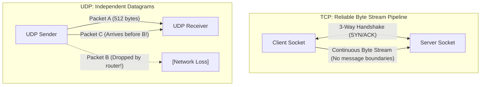
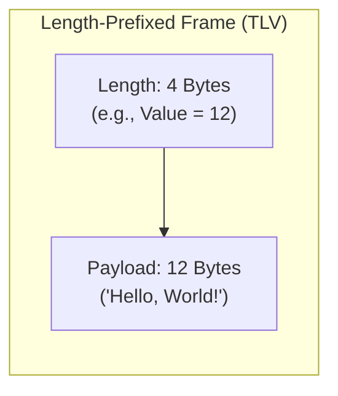
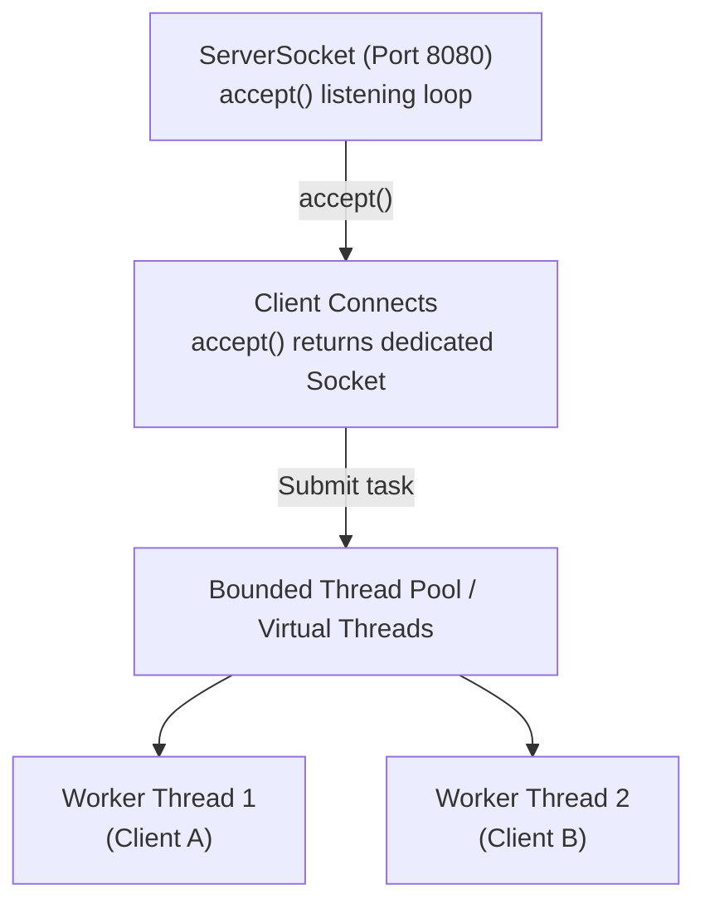

When you click a link in a browser, query a database via JDBC, or send a message to a Kafka broker, your software communicates across a network using **Sockets**.

At the operating system level, a socket is an integer handle representing a bidirectional communications endpoint managed by the OS networking stack. In Java, `Socket`, `ServerSocket`, and `DatagramSocket` expose this native functionality.

While opening a socket is simple, building resilient networked systems is notoriously challenging. Networks are unpredictable: packets drop, routers fail, network cables get severed, and peers crash silently. To write production-grade network code, you must understand the underlying transport layer: **how TCP framing works**, **essential socket tuning options**, and **how to manage timeouts without leaking OS file descriptors**.

---

## The Network Hierarchy: TCP vs. UDP

The transport layer of the Internet protocol suite provides two primary communication contracts:

| Dimension | TCP (`Socket`, `ServerSocket`) | UDP (`DatagramSocket`) |
|---|---|---|
| **Connection State** | **Connection-Oriented:** Requires explicit 3-way handshake (`SYN` -> `SYN-ACK` -> `ACK`). | **Connectionless:** Fire-and-forget datagram packets with zero handshake. |
| **Reliability** | **Guaranteed:** Lost packets are automatically retransmitted; duplicates discarded. | **Unreliable:** Packets may be dropped, duplicated, or arrive out of order. |
| **Data Boundary** | **Continuous Byte Stream:** No message boundaries whatsoever. | **Discrete Datagrams:** Each packet maintains strict boundaries. |
| **Flow Control** | **Sliding Window:** Adapts transmission rate to receiver's capacity and network congestion. | **None:** Sender pushes packets as fast as the network interface allows. |
| **Ideal For** | Financial transactions, REST APIs, database connections, file downloads. | Live video streaming, multiplayer game state sync, DNS lookups, IoT telemetry. |



---

## The Fundamental TCP Fallacy: "Sticky Packets" and Framing

One of the most frequent junior developer bugs is assuming that **one write equals one read**:

```java
// ❌ NAIVE ASSUMPTION: The receiver will read "Hello" then "World"
socket.getOutputStream().write("Hello".getBytes());
socket.getOutputStream().write("World".getBytes());
```

In TCP, **there is no concept of a "message" or "packet" at the application level**. TCP is a continuous pipe of bytes. 

Under the hood:
- The OS may delay small writes and bundle them into a single TCP segment to save bandwidth (Nagle's Algorithm). The receiver might call `.read()` and get `"HelloWorld"` all at once.
- Conversely, a large 10 KB write may be fragmented across multiple IP MTU packets (typically 1500 bytes). The receiver's `.read()` might return only 1460 bytes on the first call!

To transmit structured data over TCP, your application **must define a framing protocol**.

### The Three Standard Framing Strategies
1. **Delimiter-Based Framing:** Terminating messages with a unique sentinel delimiter (e.g., newline `\n` in HTTP/1.1 headers or SMTP). *Risk: The delimiter must be escaped if it appears inside the payload.*
2. **Fixed-Length Framing:** Every message is exactly `N` bytes (e.g., standard 64-byte telemetry records). *Disadvantage: Wastes bandwidth with padding for small messages.*
3. **Length-Prefixed Framing (TLV - Type-Length-Value):** Prepending every payload with a fixed-size integer indicating the byte length of the following payload. **This is the industry standard for binary protocols (Kafka, Protobuf, gRPC).**



### Implementing a Length-Prefixed Protocol in Java

Here is how a senior engineer writes a production-ready length-prefixed frame reader:

```java
import java.io.DataInputStream;
import java.io.DataOutputStream;
import java.io.IOException;
import java.net.Socket;
import java.nio.charset.StandardCharsets;

public class LengthPrefixedCodec {
    private static final int MAX_FRAME_SIZE = 10 * 1024 * 1024; // 10 MB sanity limit

    public static void sendFrame(DataOutputStream out, String message) throws IOException {
        byte[] payload = message.getBytes(StandardCharsets.UTF_8);
        
        // 1. Write the 4-byte length header
        out.writeInt(payload.length);
        // 2. Write the exact payload bytes
        out.write(payload);
        out.flush();
    }

    public static String readFrame(DataInputStream in) throws IOException {
        // 1. Read the 4-byte integer header (readInt blocks until all 4 bytes arrive)
        int length = in.readInt();

        // 2. Defensive check against malicious or corrupted payload sizes
        if (length < 0 || length > MAX_FRAME_SIZE) {
            throw new IOException("Illegal frame length received: " + length);
        }

        // 3. Read the EXACT payload size into a buffer
        byte[] payload = new byte[length];
        in.readFully(payload); // Crucial: readFully loops until all 'length' bytes arrive!

        return new String(payload, StandardCharsets.UTF_8);
    }
}
```

> [!IMPORTANT]
> **Never use `InputStream.read(byte[])` to read a fixed payload!**
> `InputStream.read(byte[])` is permitted to return fewer bytes than the array capacity if only a partial packet has arrived from the network. Always use **`DataInputStream.readFully()`**, which guarantees it will block in a loop until the entire requested byte array is completely populated.

---

## Production TCP Server Architecture

When writing a server with `ServerSocket`, you must handle concurrent clients without locking up the server or crashing the host operating system.



### Complete Multi-Threaded Echo Server

```java
import java.io.DataInputStream;
import java.io.DataOutputStream;
import java.io.IOException;
import java.net.ServerSocket;
import java.net.Socket;
import java.util.concurrent.ExecutorService;
import java.util.concurrent.Executors;

public class ResilientEchoServer {
    private static final int PORT = 8080;
    private static final int SO_TIMEOUT_MS = 15_000; // 15s idle timeout

    public static void main(String[] args) {
        // Use a bounded thread pool or Java 21 Virtual Threads
        try (ServerSocket serverSocket = new ServerSocket(PORT, 100);
             ExecutorService pool = Executors.newVirtualThreadPerTaskExecutor()) {

            // Allow immediate rebinding after server restart
            serverSocket.setReuseAddress(true);
            System.out.println("Server listening on port " + PORT);

            while (!Thread.currentThread().isInterrupted()) {
                // accept() blocks until an incoming client completes the 3-way handshake
                Socket clientSocket = serverSocket.accept();
                
                // Configure socket timeouts immediately
                clientSocket.setSoTimeout(SO_TIMEOUT_MS);
                clientSocket.setTcpNoDelay(true); // Disable Nagle's algorithm

                // Delegate connection handling to the thread pool
                pool.submit(() -> handleClient(clientSocket));
            }
        } catch (IOException e) {
            System.err.println("Server encountered fatal error: " + e.getMessage());
        }
    }

    private static void handleClient(Socket socket) {
        // try-with-resources guarantees the socket closes when communication ends
        try (socket;
             DataInputStream in = new DataInputStream(socket.getInputStream());
             DataOutputStream out = new DataOutputStream(socket.getOutputStream())) {

            System.out.println("Client connected: " + socket.getRemoteSocketAddress());

            while (true) {
                String message = LengthPrefixedCodec.readFrame(in);
                System.out.println("Received: " + message);

                String echoResponse = "ACK: " + message;
                LengthPrefixedCodec.sendFrame(out, echoResponse);
            }
        } catch (IOException e) {
            // Expected on client disconnection or timeout
            System.out.println("Connection ended for " + socket.getRemoteSocketAddress() 
                    + " (" + e.getMessage() + ")");
        }
    }
}
```

---

## Critical Socket Tuning Options

When building high-performance or low-latency network applications, tuning socket options via `socket.setOption()` or dedicated getters/setters is essential:

### `TCP_NODELAY` (Nagle's Algorithm)
By default, the operating system enables **Nagle's Algorithm**. Nagle's algorithm buffers small outgoing packets in memory until either a full TCP frame (MSS ~1460 bytes) accumulates or the previous packet has been acknowledged (ACK) by the remote peer.
- **The Problem:** In request-response protocols, Nagle's algorithm interacts terribly with **Delayed ACK**, introducing arbitrary 40ms to 200ms latency spikes!
- **The Fix:** `socket.setTcpNoDelay(true)`. This disables Nagle's algorithm, instructing the OS to transmit packets immediately. Crucial for financial exchanges, gaming, and real-time APIs.

### `SO_REUSEADDR`
When a server process terminates, TCP keeps the port in a **`TIME_WAIT`** state for 1 to 4 minutes to ensure lingering packets in flight dissipate. If you attempt to restart the server immediately, the OS throws:
`java.net.BindException: Address already in use`
- **The Fix:** Call `serverSocket.setReuseAddress(true)` **before** binding to the port. This allows the new server process to bind immediately, eliminating downtime during deployments.

### `SO_TIMEOUT`
By default, `socket.getInputStream().read()` blocks indefinitely. If a remote client connects and goes silent (or a NAT firewall silently drops the connection without sending a `FIN`), the server thread remains stuck waiting forever, causing thread pool exhaustion.
- **The Fix:** `socket.setSoTimeout(30_000)` throws a `SocketTimeoutException` if no data arrives within 30 seconds.

### `SO_KEEPALIVE`
Instructs the OS to send periodic probe packets when a connection has been idle for a prolonged period (typically 2 hours by default on Linux). If the peer does not reply, the OS drops the connection and surfaces an `IOException`.

---

## UDP Socket Programming: Datagrams in Action

Unlike TCP, **UDP has no handshake, no connection, and no acknowledgments**. You create a `DatagramSocket` and fling packets encapsulated in a `DatagramPacket`:

```java
import java.net.DatagramPacket;
import java.net.DatagramSocket;
import java.net.InetAddress;
import java.nio.charset.StandardCharsets;

public class UdpMetricsSender {
    public static void main(String[] args) throws Exception {
        try (DatagramSocket socket = new DatagramSocket()) {
            String metric = "cpu.load:78.5|g";
            byte[] bytes = metric.getBytes(StandardCharsets.UTF_8);

            InetAddress serverIp = InetAddress.getByName("localhost");
            int serverPort = 8125; // Standard StatsD port

            // Package the bytes with the target IP and Port
            DatagramPacket packet = new DatagramPacket(bytes, bytes.length, serverIp, serverPort);

            // Fire and forget: returns immediately without waiting for any server response!
            socket.send(packet);
            System.out.println("Metric packet dispatched via UDP!");
        }
    }
}
```

### The Receive Gotcha
When receiving UDP packets, the backing array must be sized to accommodate the largest expected packet:

```java
byte[] receiveBuffer = new byte[1024];
DatagramPacket packet = new DatagramPacket(receiveBuffer, receiveBuffer.length);

socket.receive(packet); // Blocks until a datagram arrives

// ⚠️ WARNING: Never use new String(receiveBuffer)! 
// Only decode the specific slice of bytes populated by this datagram:
String payload = new String(
    packet.getData(), 
    packet.getOffset(), 
    packet.getLength(), 
    StandardCharsets.UTF_8
);
```

> [!CAUTION]
> If a sender transmits a UDP packet larger than your `receiveBuffer`, the operating system silently truncates the excess bytes without throwing an exception!

---

## Scaling to 100,000 Concurrent Connections

In classic Java, each connected socket required its own dedicated OS thread (`java.lang.Thread`). Because an OS thread claims ~1 MB of memory for its native execution stack, running 10,000 concurrent connections consumed 10 Gigabytes of RAM just for thread stacks, bringing the JVM to its knees!

Historically, handling high concurrency required complex non-blocking NIO `Selector` event loops (as seen in Netty). 

In **Java 21**, the game changed completely with **Project Loom (Virtual Threads)**:

```java
// Java 21: Handle 100,000 concurrent blocking connections with near-zero memory footprint!
try (var pool = Executors.newVirtualThreadPerTaskExecutor()) {
    while (true) {
        Socket client = serverSocket.accept();
        pool.submit(() -> handleClient(client));
    }
}
```

Virtual threads are managed by the JVM runtime rather than the OS kernel. They consume only hundreds of bytes of heap memory. When a virtual thread executes a blocking socket call (`socket.getInputStream().read()`), the JVM automatically unmounts the virtual thread from its underlying OS carrier thread, allowing a handful of CPU cores to service hundreds of thousands of concurrent network connections without selector event loop complexity!

---

## Summary & Mental Model Checkpoint

1. **Byte Stream Fallacy**: TCP has zero concept of message boundaries; packets merge or fragment dynamically. Always enforce an explicit framing protocol (such as Length-Prefixed framing).
2. **`DataInputStream.readFully`**: Never use `.read(byte[])` to read a fixed payload; use `.readFully()` to guarantee the complete message is consumed.
3. **`TCP_NODELAY`**: Disable Nagle's algorithm to eliminate 40-200ms latency spikes in interactive request-response protocols.
4. **`SO_REUSEADDR`**: Always enable `setReuseAddress(true)` before binding a `ServerSocket` to allow immediate server restarts during the `TIME_WAIT` phase.
5. **`SO_TIMEOUT`**: Always configure read timeouts on sockets to prevent dead connections from leaking server threads indefinitely.
6. **UDP Boundaries**: UDP maintains message boundaries per packet, but provides zero delivery or ordering guarantees. Always slice `packet.getData()` using `getOffset()` and `getLength()`.
7. **Virtual Threads (Java 21)**: Eliminate the classic 1-thread-per-connection bottleneck, allowing simple blocking socket code to scale to hundreds of thousands of concurrent clients.

---

## 🎯 Senior Engineer Interview Questions

### What causes the "sticky packet" (TCP packet concatenation/fragmentation) problem, and how do you resolve it in a binary protocol?
> **Answer:** TCP is a stream-oriented protocol operating at Layer 4 of the OSI model. It guarantees ordered, reliable byte delivery, but it does not preserve application-layer message boundaries. Multiple small writes may be coalesced by the operating system kernel into a single TCP packet to optimize network utilization (via Nagle's algorithm and TCP sliding windows), or a single large write may be sliced across multiple MTU frames. To resolve this, application protocols must implement explicit framing. The most robust technique is **Length-Prefixed Framing (TLV)**, where each message begins with a fixed-width header (such as a 4-byte big-endian integer) declaring the exact byte length of the upcoming payload. The receiver reads the 4-byte header first, allocates a buffer of that exact size, and calls `DataInputStream.readFully()` to block until all declared payload bytes have arrived.

### Why does combining Nagle's Algorithm (`TCP_NODELAY = false`) with Delayed ACK cause severe latency spikes in request-response services?
> **Answer:** Nagle's algorithm attempts to prevent network congestion by buffering small outgoing packets until an entire Maximum Segment Size (MSS) packet is accumulated or until an acknowledgment (ACK) is received for the preceding packet. On the other side, the receiving operating system employs Delayed ACK, which holds off sending an immediate acknowledgment packet for 40ms to 200ms in hopes of piggybacking the ACK onto an outgoing application response. When a client sends a small request in multiple small writes, Nagle holds back the second write waiting for the ACK of the first, while the server waits for the second write before sending a response. Both sides stall until the Delayed ACK timer expires (typically 40-200ms), introducing massive, non-deterministic latency. Setting `socket.setTcpNoDelay(true)` immediately disables Nagle's algorithm and forces the OS to transmit packets without waiting.

### What is the TCP `TIME_WAIT` state, why does it exist, and how does `SO_REUSEADDR` address it?
> **Answer:** When an active TCP endpoint initiates a clean connection termination by sending a `FIN` packet, after receiving the final `ACK` it transitions into the `TIME_WAIT` state, which lasts for `2 * MSL` (Maximum Segment Lifetime, typically 1 to 2 minutes). This state serves two vital purposes: (1) ensuring the final `ACK` is reliably received by the peer (retransmitting if the final ACK was lost), and (2) allowing all delayed or duplicated packets from that connection to dissipate across the internet so they cannot be mistakenly accepted by a new connection reusing the same 4-tuple (source IP, source port, destination IP, destination port). If a server process is restarted while sockets remain in `TIME_WAIT`, binding to the port fails with `BindException: Address already in use`. Setting `serverSocket.setReuseAddress(true)` informs the OS kernel to permit binding to the port even if existing connections are lingering in the `TIME_WAIT` state.

### How does Java 21's Virtual Threads change the architectural trade-off between classic blocking Sockets (`java.net.Socket`) and non-blocking NIO Selectors (`java.nio.channels.SocketChannel`)?
> **Answer:** Historically, non-blocking NIO Selectors (used in frameworks like Netty) were required to scale past a few thousand connections because classic blocking `Socket` required one OS thread per connection. OS threads are heavy (allocating ~1 MB of native stack memory each) and incur expensive kernel context switching overhead when tens of thousands of threads compete for CPU cores. Java 21 Virtual Threads decouple Java threads from OS kernel threads. A virtual thread consumes only a few hundred bytes of heap memory. When a virtual thread performs a blocking socket read or write, the JVM intercepts the call, parks the virtual thread on the heap, and reassigns the underlying OS carrier thread to run other tasks. When data arrives at the network socket, the JVM unparks the virtual thread and resumes execution on an available carrier thread. This gives developers the massive scalability of non-blocking I/O (handling 100,000+ concurrent connections) while writing simple, readable, synchronous blocking code.