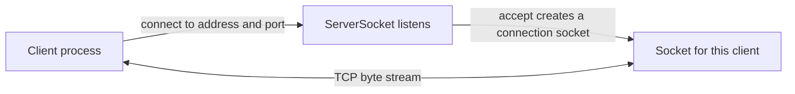

A socket is one endpoint of a network conversation. A client socket connects to a server endpoint; a server socket listens for connection requests and accepts them. The programming challenge is not merely opening a socket. It is agreeing on a protocol, moving bytes correctly, handling slow or failed peers, and releasing resources regardless of how the conversation ends.

This lesson uses Java 21 APIs and Java 11+ syntax. The classic `Socket` and `ServerSocket` APIs are blocking. Non-blocking multiplexing uses NIO channels and selectors, covered in [I/O and NIO.2](./io-and-nio2).

## Address, port, and socket roles

An IP address identifies a network interface or host within an addressing scheme. A port identifies a transport endpoint on that host. A server commonly binds a listening socket to a local address and port; a client connects to that destination. A connection is not identified by the server port alone: for TCP, the local and remote addresses and ports distinguish an established connection.



The listener and the accepted connection socket serve different jobs. The server continues listening with its `ServerSocket`; the socket returned by `accept()` carries the conversation with one client.

## TCP is a byte stream, not a message protocol

TCP provides a reliable, ordered stream of bytes between connected endpoints. It does **not** preserve application write boundaries. If one program writes `"HELLO"` once, the receiver is not promised one corresponding read containing exactly five bytes. A read may return fewer bytes than requested, and multiple writes may arrive together.

Applications therefore define **framing**: a rule that tells the receiver where one message ends and the next begins. Common choices are:

- A delimiter, such as a newline, with escaping rules if the delimiter can occur in data.
- A fixed-size record, when all records have the same size.
- A length prefix, followed by exactly that number of bytes.

The echo example below uses one UTF-8 line per request and response. The line delimiter is part of the application protocol; `readLine()` is not a TCP feature.

## A blocking TCP server

`ServerSocket.accept()` waits for a connection unless a timeout is configured. Each accepted `Socket` has input and output streams; using try-with-resources ensures the connection closes after the request is handled.

```java
import java.io.BufferedReader;
import java.io.IOException;
import java.io.InputStreamReader;
import java.io.PrintWriter;
import java.net.InetAddress;
import java.net.ServerSocket;
import java.net.Socket;
import java.nio.charset.StandardCharsets;

public class EchoServer {
    public static void main(String[] args) throws IOException {
        InetAddress loopback = InetAddress.getLoopbackAddress();
        try (ServerSocket server = new ServerSocket(5050, 50, loopback)) {
            System.out.println("Listening on " + server.getLocalSocketAddress());

            while (true) {
                try (Socket client = server.accept();
                     var reader = new BufferedReader(new InputStreamReader(
                             client.getInputStream(), StandardCharsets.UTF_8));
                     var writer = new PrintWriter(
                             client.getOutputStream(), true, StandardCharsets.UTF_8)) {
                    client.setSoTimeout(10_000);
                    String line = reader.readLine();
                    if (line != null) {
                        writer.println("echo: " + line);
                    }
                } catch (IOException connectionFailure) {
                    System.err.println("Client connection failed: "
                            + connectionFailure.getMessage());
                }
            }
        }
    }
}
```

The server binds to the loopback interface, so this teaching example accepts connections from the same machine rather than exposing a listener to the network. The backlog is a requested queue length for pending connection indications; its exact behavior is platform-dependent and it is not a limit on active clients.

This server handles accepted clients sequentially. While it reads one client's line, it cannot handle another. A production service needs a deliberate concurrency and capacity strategy, such as a bounded executor or a selector-based design. Creating an unbounded thread for every client can exhaust memory or operating-system resources under load.

The timeout is set on the accepted socket before reading. In classic `Socket` APIs, `SO_TIMEOUT` bounds a blocking read; it does not impose an overall deadline on the whole request or affect writes. A peer that sends one byte just before each timeout can keep a simple per-read timeout alive for a long time. Production protocols often need both an idle timeout and an overall request deadline.

## A blocking TCP client

The client uses a connect timeout and a read timeout. Timeouts turn some indefinite waits into explicit failure paths, but they do not prove that the remote operation did not happen: a write may have reached the server even if the response was lost.

```java
import java.io.BufferedReader;
import java.io.IOException;
import java.io.InputStreamReader;
import java.io.PrintWriter;
import java.net.InetAddress;
import java.net.InetSocketAddress;
import java.net.Socket;
import java.nio.charset.StandardCharsets;
import java.util.concurrent.TimeUnit;

public class EchoClient {
    public static void main(String[] args) throws IOException {
        InetSocketAddress server = new InetSocketAddress(
                InetAddress.getLoopbackAddress(), 5050);

        try (Socket socket = new Socket()) {
            socket.connect(server, (int) TimeUnit.SECONDS.toMillis(3));
            socket.setSoTimeout((int) TimeUnit.SECONDS.toMillis(5));

            try (var writer = new PrintWriter(
                         socket.getOutputStream(), true, StandardCharsets.UTF_8);
                 var reader = new BufferedReader(new InputStreamReader(
                         socket.getInputStream(), StandardCharsets.UTF_8))) {
                writer.println("Java sockets");
                String response = reader.readLine();
                if (response == null) {
                    throw new IOException("Server closed before sending a response");
                }
                System.out.println(response);
            }
        }
    }
}
```

Run the server first, then run the client. The client prints:

```text
echo: Java sockets
```

`PrintWriter` does not throw `IOException` from its printing methods; it records an error flag instead. Auto-flush with `println` flushes the writer, but code that relies on writes succeeding should check `checkError()` or use an output abstraction whose write methods report I/O errors directly. In this small example, connection loss is surfaced by the subsequent read or close behavior, but a production protocol should handle write failures deliberately.

Do not treat a successful `connect()` as proof that a later read or write will succeed. A remote host can close the connection, a network path can fail, the peer can stop responding, and a response can be malformed or incomplete.

## Connection lifecycle and shutdown

A typical TCP exchange moves through these steps:

1. The server binds a `ServerSocket` to a local endpoint.
2. The client connects to the server's address and port.
3. The server's `accept()` returns a separate connected `Socket`.
4. Both sides exchange protocol bytes through the connected socket's streams.
5. One or both sides close the socket; try-with-resources is the usual ownership boundary.

Closing a socket closes its associated input and output streams. TCP is full-duplex: each direction can be shut down independently with `shutdownOutput()` or `shutdownInput()`. Shutting down output indicates that no more bytes will be sent in that direction, while still allowing the other direction to be read. Use this half-close deliberately as part of a protocol; it is not interchangeable with closing the entire socket.

### EOF, timeout, and framing failures

- For a stream read, EOF indicates that the peer has closed its output side or the connection has otherwise ended. `readLine()` returns `null` at end of stream; it does not return the last incomplete line as a complete record.
- A `SocketTimeoutException` indicates that a blocking read or accept exceeded its configured timeout. The socket is not automatically closed just because a read timed out.
- `IOException` can also mean reset connections, unreachable endpoints, or other transport failures.
- A syntactically valid connection can still send an invalid or oversized application message. Validate lengths and contents before allocating large buffers or processing a request.

Never let an untrusted client choose an unbounded frame size. For a length-prefixed protocol, check the declared length against a protocol maximum before allocating or reading that payload.

## TCP and UDP: different contracts

| Property | TCP (`Socket`) | UDP (`DatagramSocket`) |
|---|---|---|
| Communication model | Connected byte stream | Independent datagrams |
| Delivery and order | Reliable, ordered stream while the connection works | Delivery, ordering, and uniqueness are not guaranteed |
| Message boundaries | Must be defined by the application | Each datagram is a message boundary |
| Typical use | Request/response protocols, sessions, streaming data | Datagrams where the application can tolerate or handle loss/reordering |
| Trade-off | Connection state and stream framing | Application must handle loss, duplicates, ordering, and packet-size constraints |

UDP does not become reliable merely because Java's `send()` call returned. A datagram may be lost, duplicated, delayed, or arrive out of order. IP fragmentation and network path limits also make oversized datagrams risky; design a conservative application payload limit or use a protocol that handles fragmentation intentionally.

```java
import java.io.IOException;
import java.net.DatagramPacket;
import java.net.DatagramSocket;
import java.net.InetAddress;
import java.nio.charset.StandardCharsets;

public class UdpOnce {
    public static void main(String[] args) throws IOException {
        byte[] request = "ping".getBytes(StandardCharsets.UTF_8);
        InetAddress loopback = InetAddress.getLoopbackAddress();

        try (DatagramSocket socket = new DatagramSocket()) {
            socket.setSoTimeout(2_000);
            DatagramPacket outgoing = new DatagramPacket(
                    request, request.length, loopback, 5051);
            socket.send(outgoing);

            byte[] storage = new byte[512];
            DatagramPacket incoming = new DatagramPacket(storage, storage.length);
            socket.receive(incoming);

            String reply = new String(
                    incoming.getData(),
                    incoming.getOffset(),
                    incoming.getLength(),
                    StandardCharsets.UTF_8);
            System.out.println(reply);
        }
    }
}
```

`receive()` fills the supplied packet buffer; decode only the packet's actual offset and length, not the entire backing array. If an incoming datagram is larger than the receive buffer, its excess bytes are discarded. The sender and receiver must agree on payload encoding and size. This example requires a UDP responder on port `5051`; without one, the configured timeout causes a `SocketTimeoutException`.

## Concurrency, security, and operational concerns

Classic `Socket` and `ServerSocket` operations block. The simplest server uses one thread per connection, which can be appropriate for a small teaching server but needs bounds and lifecycle management in a service. `ExecutorService` can limit concurrent tasks; NIO selectors can multiplex readiness for many channels. Virtual threads (Java 21) can make a thread-per-request style more practical for blocking I/O, but they do not eliminate limits on sockets, memory, downstream capacity, or protocol work.

Network input is untrusted. In real systems:

- Bind to an explicit interface; do not expose a listener accidentally.
- Authenticate and authorize peers at the application or transport-security layer.
- Use TLS (for example, `SSLSocket` or a higher-level HTTPS client) when confidentiality and peer authentication are required.
- Bound message sizes, concurrent connections, idle time, and total request time.
- Avoid logging credentials, tokens, or complete sensitive request payloads.
- Do not retry non-idempotent operations blindly after timeouts; the server may have completed the operation even though the response did not arrive.

For HTTP APIs, use `java.net.http.HttpClient` or a framework client rather than inventing HTTP framing on raw sockets. Raw sockets are most appropriate when learning transport behavior or implementing a protocol that specifically requires them.

## Further reading

- [Java 21 `Socket`](https://docs.oracle.com/en/java/javase/21/docs/api/java.base/java/net/Socket.html) and [`ServerSocket`](https://docs.oracle.com/en/java/javase/21/docs/api/java.base/java/net/ServerSocket.html)
- [Java 21 `DatagramSocket`](https://docs.oracle.com/en/java/javase/21/docs/api/java.base/java/net/DatagramSocket.html) and [`DatagramPacket`](https://docs.oracle.com/en/java/javase/21/docs/api/java.base/java/net/DatagramPacket.html)
- [Java 21 `SocketTimeoutException`](https://docs.oracle.com/en/java/javase/21/docs/api/java.base/java/net/SocketTimeoutException.html)
