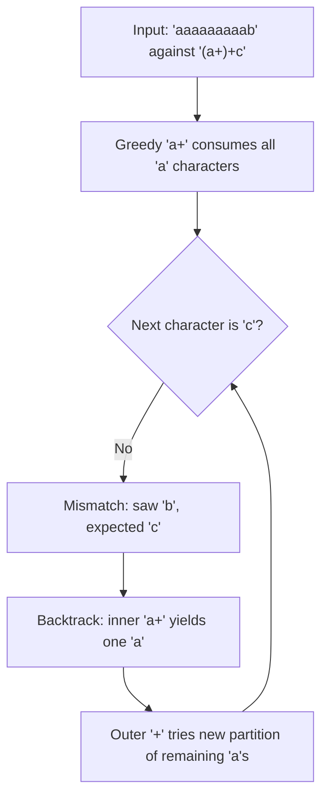

A regular expression looks harmless during code review: one compact line to validate an email address, split a header, or parse a structured log entry. Under the wrong input, though, a poorly written regex can pin a CPU core at 100% for minutes or hours.

This is not just theoretical. In July 2019, a single Web Application Firewall rule at Cloudflare containing an unconstrained nested repetition (`.*.*=.*`) triggered runaway backtracking across their edge servers and caused a 27-minute global outage. Java's standard `java.util.regex` engine uses the same family of backtracking algorithm, so any service that runs unreviewed regexes over untrusted HTTP input faces the same failure mode.

Understanding how `Pattern` and `Matcher` work internally makes it straightforward to write patterns that are fast, readable, and resistant to Regular Expression Denial of Service (ReDoS).

---

## The `java.util.regex` Architecture (`Pattern` and `Matcher`)

Java splits regular expression handling into two classes with very different lifecycles and thread-safety rules:

- **`java.util.regex.Pattern`**: The compiled, immutable representation of a regular expression. Calling `Pattern.compile(regex)` parses the pattern syntax, validates groups and character classes, and builds an internal linked graph of `Pattern.Node` objects. Because `Pattern` is immutable after compilation, one instance is completely thread-safe and should be shared across threads.
- **`java.util.regex.Matcher`**: The stateful cursor that runs a compiled `Pattern` against a specific `CharSequence` (`String`, `StringBuilder`, `CharBuffer`, etc.). It tracks the current scan index, match boundaries, and captured group positions. `Matcher` is mutable and **not** thread-safe; create a fresh one per call (or call `reset(newInput)` on a local instance inside a single-threaded loop).

### `matches()` vs. `find()` vs. `lookingAt()`

One frequent source of subtle bugs in `Matcher` is picking the wrong matching method:

- `matcher.matches()` tries to match the **entire** input string from start to end (implicitly anchored, even if you did not write start/end anchors).
- `matcher.find()` scans forward for the **next substring** anywhere in the input that matches the pattern. You can call it in a `while (matcher.find())` loop to extract multiple occurrences.
- `matcher.lookingAt()` checks whether the **prefix** starting at index `0` matches, without requiring the match to reach the end of the string.

```java
import java.util.regex.Matcher;
import java.util.regex.Pattern;

public class MatcherModesDemo {
    private static final Pattern ORDER_ID = Pattern.compile("ORD-[0-9]{6}");

    public static void main(String[] args) {
        String text = "Invoice for ORD-482910 (replaces ORD-110023)";

        System.out.println(ORDER_ID.matcher(text).matches());    // false (whole string does not match)
        System.out.println(ORDER_ID.matcher(text).lookingAt());  // false (does not start with ORD-)

        Matcher m = ORDER_ID.matcher(text);
        while (m.find()) {
            System.out.println("Found: " + m.group());           // ORD-482910, then ORD-110023
        }
    }
}
```

---

## Nondeterministic Finite Automata (NFA) Internals

Regex engines fall into two main architectural camps:

1. **DFA / Thompson NFA engines** (such as Google's `RE2` and its pure-Java port `re2j`): Instead of exploring one guess at a time, the engine tracks the set of all active states in parallel as it advances through the input one character at a time. Matching runs in linear time `O(N)` with respect to input length `N`, making catastrophic backtracking impossible. The trade-off is that these engines cannot support arbitrary backreferences like `\1` or some complex lookarounds.
2. **Backtracking NFA engines** (such as Java's `java.util.regex`, PCRE, Python's `re`, and JavaScript's `RegExp`): The engine walks the pattern graph depth-first. Whenever a quantifier (`*`, `+`) or alternation (`a|b`) offers more than one way to proceed, it picks one branch and pushes a checkpoint onto a backtrack stack. If matching fails later in the input, the engine pops the last checkpoint, rewinds the input cursor, and tries the next branch.

Java chose a backtracking NFA because it supports features developers frequently expect: capturing groups, backreferences (`\1`), lookaheads, lookbehinds, and possessive quantifiers. The downside is that an ambiguous pattern can force the engine to explore an exponential number of failing paths.



---

## Catastrophic Backtracking and ReDoS

Backtracking is cheap on unambiguous patterns. It turns into **catastrophic backtracking** when a pattern contains nested or overlapping quantifiers that can divide the same stretch of characters in many equivalent ways, and then fails to match near the end of the string.

Take this compact pattern:

```java
Pattern vulnerable = Pattern.compile("(x+x+)+y");
```

Suppose the input is `"xxxxxxxy"`. The match succeeds almost immediately because `y` is right where the engine expects it.

Now change the final character so the string almost matches, then fails:

```text
xxxxxxxxxxxxxxxxxxxxxxxxxxxxxx!
```

1. The first `x+` consumes almost all the `x` characters, leaving one for the second `x+`.
2. The engine reaches `!`, fails to match `y`, and backtracks.
3. The first `x+` gives back one `x` so the second `x+` takes two. Still hits `!`.
4. After exhausting every split inside the inner group, the outer `()+` tries splitting the `x`s into two repetitions, then three, then four, testing every combination of how `N` identical `x` characters can be partitioned across the inner and outer quantifiers.

Before Java can return `false`, it tests roughly `2^N` combinations. Adding just one extra `x` doubles the runtime:

| Input Length (`N` `x`s + `!`) | Approximate Backtracking Paths | Rough Runtime Order of Magnitude |
|---|---|---|
| 10 | ~1,024 | Under 1 millisecond |
| 20 | ~1,048,576 | Few milliseconds |
| 30 | ~1,073,741,824 | Several seconds |
| 40 | ~1,099,511,627,776 | Tens of minutes to hours |
| 50 | ~1.12 × 10^15 | Years (effectively hangs the thread) |

In a web service, an attacker does not need a botnet to exploit this. A handful of 50-byte HTTP requests hitting an unguarded validation regex can peg every worker thread at 100% CPU, starve health checks, and knock the service offline. That attack class is **ReDoS (Regular Expression Denial of Service)**.

Common patterns that trigger exponential or polynomial backtracking include:

- Nested quantifiers over overlapping sets: `(a+)+`, `(a*)*`, `([a-zA-Z]+)*`
- Overlapping alternations inside a quantifier: `(a|aa)+`, `(\w|\d)+`
- Adjacent unbounded wildcards in unanchored patterns: `.*.*=.*`, `\s+.*\s+`

---

## Greedy, Reluctant, and Possessive Quantifiers

Every quantifier in Java comes in three modes that control how aggressively it consumes characters and whether it participates in backtracking:

| Mode | Syntax | Behavior | Backtracks? |
|---|---|---|---|
| **Greedy** (default) | `*`, `+`, `?`, `{n,m}` | Consumes as many characters as possible, then gives characters back one at a time if downstream tokens fail | Yes |
| **Reluctant (Lazy)** | `*?`, `+?`, `??`, `{n,m}?` | Consumes as few characters as possible, then expands one character at a time if downstream tokens fail | Yes |
| **Possessive** | `*+`, `++`, `?+`, `{n,m}+` | Consumes as many characters as possible and immediately discards all backtrack points | No |

### Seeing Greedy vs. Reluctant on Real Text

Suppose you want to extract individual quoted tokens from `"alpha" and "beta"`:

```java
String line = "\"alpha\" and \"beta\"";

// Greedy: ".*" swallows everything from the first quote to the LAST quote
Matcher greedy = Pattern.compile("\".*\"").matcher(line);
greedy.find();
System.out.println(greedy.group());     // "alpha" and "beta"

// Reluctant: ".*?" stops at the first closing quote
Matcher reluctant = Pattern.compile("\".*?\"").matcher(line);
reluctant.find();
System.out.println(reluctant.group());  // "alpha"

// Even faster and clearer: negated character class with possessive quantifier
Matcher negated = Pattern.compile("\"[^\"]*+\"").matcher(line);
negated.find();
System.out.println(negated.group());    // "alpha"
```

Notice the third version: `"[^"]*+"` (matching a quote, then zero or more non-quote characters possessively, then a closing quote). It cannot run past a closing quote and never backtracks on unclosed quotes.

### Eliminating Backtracking with Possessive Quantifiers and Atomic Groups

A possessive quantifier locks in what it matched. If the next token fails, the engine fails fast instead of trying alternative splits:

```java
// Vulnerable: hangs on 30+ 'a' characters followed by '!'
Pattern vulnerable = Pattern.compile("^(a+)+b$");

// Fast fail: possessive 'a++' consumes all 'a's and refuses to yield them back
Pattern possessive = Pattern.compile("^(a++)+b$");

// Equivalent using an atomic group (?>...) around a sub-expression
Pattern atomic = Pattern.compile("^(?>(a+))+b$");
```

An **atomic group** `(?>...)` applies the same no-backtracking guarantee to an entire sub-expression (such as an alternation or multi-token sequence) rather than just a single quantifier.

> [!WARNING]
> Possessive quantifiers and atomic groups can change *which strings match*, not just performance. For example, `.*+foo` will **never** match `"barfoo"` because `.*+` consumes `"barfoo"` completely and refuses to give `"foo"` back. Only make a quantifier possessive when the following token cannot match the same characters (like `[0-9]++\.` or `"[^"]*+"`).

---

## Defending Production Services Against ReDoS

Preventing regex outages in production takes a combination of safer patterns and runtime guardrails:

1. **Rewrite ambiguous repetitions first.** Prefer mutually exclusive character classes (`[^,\n]++`) over `.` with nested quantifiers, and anchor validation regexes (`^` at the start, end anchor at the end) when matching entire strings.
2. **Bound input length before invoking `Matcher`.** If a username cannot exceed 64 characters or an email header cannot exceed 254 characters, check `input.length() > MAX_LENGTH` *before* running the regex. Even a polynomial `O(N^2)` pattern is harmless on a 64-character string, whereas a 100 KB payload can hurt.
3. **Add a timeout guard when running complex patterns on untrusted input.** Java's `Matcher` has no built-in timeout, but because `Matcher` reads characters via `CharSequence.charAt(int)`, you can wrap the input in a lightweight watchdog `CharSequence`. Checking `System.nanoTime()` on every single character adds overhead on hot paths, so check every 1,024 `charAt` calls instead:

```java
import java.time.Duration;
import java.util.regex.Pattern;

public class BoundedRegexMatcher {

    public static boolean matchesWithTimeout(Pattern pattern, CharSequence input, Duration timeout) {
        long deadlineNanos = System.nanoTime() + timeout.toNanos();
        CharSequence guarded = new InterruptibleCharSequence(input, deadlineNanos);
        try {
            return pattern.matcher(guarded).matches();
        } catch (RegexTimeoutException e) {
            return false;
        }
    }

    private static final class InterruptibleCharSequence implements CharSequence {
        private static final int CHECK_INTERVAL_MASK = 1023; // Check clock every 1024 accesses

        private final CharSequence delegate;
        private final long deadlineNanos;
        private int accessCount;

        InterruptibleCharSequence(CharSequence delegate, long deadlineNanos) {
            this.delegate = delegate;
            this.deadlineNanos = deadlineNanos;
        }

        @Override
        public char charAt(int index) {
            if ((++accessCount & CHECK_INTERVAL_MASK) == 0) {
                if (System.nanoTime() > deadlineNanos || Thread.currentThread().isInterrupted()) {
                    throw new RegexTimeoutException("Regex matching exceeded deadline");
                }
            }
            return delegate.charAt(index);
        }

        @Override
        public int length() {
            return delegate.length();
        }

        @Override
        public CharSequence subSequence(int start, int end) {
            return new InterruptibleCharSequence(delegate.subSequence(start, end), deadlineNanos);
        }

        @Override
        public String toString() {
            return delegate.toString();
        }
    }

    public static final class RegexTimeoutException extends RuntimeException {
        public RegexTimeoutException(String message) {
            super(message);
        }
    }
}
```

4. **Use a linear-time engine (`re2j`) for user-supplied patterns.** If your application lets end users or tenants enter their own custom regexes (for log filtering, routing rules, or custom validations), do not compile them with `java.util.regex.Pattern`. Use Google's `com.google.re2j` library instead, which guarantees linear-time execution regardless of the pattern structure.

---

## Regex Compilation Caching

Compiling a `Pattern` is far more expensive than running a `Matcher`. That matters because several convenience methods on `java.lang.String` silently compile a brand-new `Pattern` on every single call:

- `str.matches(regex)` executes `Pattern.compile(regex).matcher(str).matches()`.
- `str.replaceAll(regex, replacement)` and `str.replaceFirst(regex, replacement)` compile `regex` every time.
- `str.split(regex)` compiles `regex` every time *unless* `regex` is a single non-regex-metacharacter (like `","`) or an escaped metacharacter (like `"\\."`), where OpenJDK has a built-in fast path.

Calling `input.matches(...)` inside a request handler or tight loop wastes CPU rebuilding the exact same `Pattern.Node` tree and creates steady garbage-collection churn.

### Pre-Compiling Static Patterns

For any regex known at compile time, store it in a `private static final Pattern` field so it is compiled once when the class loads:

```java
import java.util.regex.Pattern;

public class UsernameValidator {
    private static final Pattern USERNAME_PATTERN =
            Pattern.compile("^[a-zA-Z0-9_-]{3,24}$");

    public boolean isValid(String username) {
        if (username == null || username.length() < 3 || username.length() > 24) {
            return false;
        }
        return USERNAME_PATTERN.matcher(username).matches();
    }
}
```

### Caching Dynamic Patterns Safely

Sometimes patterns come from configuration files or database rules at runtime, so you cannot hardcode `static final` fields. Caching them avoids recompiling on every request, **as long as the cache is bounded**. Using an unbounded `ConcurrentHashMap<String, Pattern>` risks a memory leak if callers generate thousands of distinct pattern strings. Use a size-bounded cache such as Caffeine (or a synchronized LRU `LinkedHashMap` for tiny utility apps):

```java
import java.util.Collections;
import java.util.LinkedHashMap;
import java.util.Map;
import java.util.regex.Pattern;

public class BoundedPatternCache {
    private static final int MAX_ENTRIES = 256;

    private final Map<String, Pattern> cache = Collections.synchronizedMap(
            new LinkedHashMap<>(64, 0.75f, true) {
                @Override
                protected boolean removeEldestEntry(Map.Entry<String, Pattern> eldest) {
                    return size() > MAX_ENTRIES;
                }
            }
    );

    public Pattern getOrCompile(String regex) {
        // In high-concurrency services, prefer Caffeine.newBuilder().maximumSize(256).build()
        // to avoid coarse-grained map synchronization.
        return cache.computeIfAbsent(regex, Pattern::compile);
    }
}
```

---

## Readable Regexes with Text Blocks (`"""`) and `Pattern.COMMENTS`

Complex regular expressions written as single-line Java strings are hard to read and harder to review:

```java
// Hard to read and easy to break during edits
private static final Pattern SEMVER_COMPACT = Pattern.compile(
        "^(0|[1-9]\\d*)\\.(0|[1-9]\\d*)\\.(0|[1-9]\\d*)" +
        "(?:-([0-9A-Za-z-]+(?:\\.[0-9A-Za-z-]+)*))?" +
        "(?:\\+([0-9A-Za-z-]+(?:\\.[0-9A-Za-z-]+)*))?$"
);
```

Java 15 finalized **Text Blocks (`"""`)**. Combined with `Pattern.COMMENTS` (also toggled inline with `(?x)`) and **named capture groups** (`(?<name>...)`), you can format a regex across multiple indented lines with `#` comments explaining each piece:

```java
import java.util.Optional;
import java.util.regex.Matcher;
import java.util.regex.Pattern;

public class SemVerParser {

    private static final Pattern SEMVER_PATTERN = Pattern.compile("""
            ^
            (?<major>0|[1-9]\\d*)                           # Major version (no leading zeros)
            \\.(?<minor>0|[1-9]\\d*)                        # Minor version
            \\.(?<patch>0|[1-9]\\d*)                        # Patch version
            (?:-(?<prerelease>[0-9A-Za-z-]+(?:\\.[0-9A-Za-z-]+)*))?   # Optional -alpha.1
            (?:\\+(?<build>[0-9A-Za-z-]+(?:\\.[0-9A-Za-z-]+)*))?      # Optional +20261029
            $
            """, Pattern.COMMENTS);

    public record SemVer(int major, int minor, int patch, String prerelease, String build) {}

    public static Optional<SemVer> parse(String raw) {
        if (raw == null || raw.length() > 128) {
            return Optional.empty();
        }
        Matcher matcher = SEMVER_PATTERN.matcher(raw);
        if (!matcher.matches()) {
            return Optional.empty();
        }
        return Optional.of(new SemVer(
                Integer.parseInt(matcher.group("major")),
                Integer.parseInt(matcher.group("minor")),
                Integer.parseInt(matcher.group("patch")),
                matcher.group("prerelease"),
                matcher.group("build")
        ));
    }
}
```

Two practical details to keep in mind when using Text Blocks with `Pattern.COMMENTS`:

1. **Backslashes still require escaping (`\\d`, `\\.`).** Text Blocks eliminate quote escaping (`\"`) and `+` line concatenation, but Java still processes standard string escape sequences inside them.
2. **Literal whitespace and `#` are ignored in `Pattern.COMMENTS` mode.** If you actually need to match a space character or a `#` sign inside a commented pattern, write `\s`, `[ ]`, `\ `, or `\#`.

Named capture groups (`matcher.group("major")`) also protect you from fragile numeric group indexes (`matcher.group(1)`): adding a new group earlier in the pattern no longer shifts every downstream index silently.

---

## Key Takeaways

- `Pattern` is immutable and thread-safe; compile it once and reuse it. `Matcher` is stateful and not thread-safe; keep it local to a call.
- Java's `java.util.regex` uses a backtracking NFA engine, which supports backreferences and lookarounds but can hit `O(2^N)` runtime on nested or overlapping quantifiers.
- Greedy (`+`) and reluctant (`+?`) quantifiers both backtrack; possessive quantifiers (`++`) and atomic groups (`(?>...)`) discard backtrack points and fail fast, though they can change matching semantics if a later token needs a character back.
- Defend production services by avoiding overlapping repetitions, checking input length before matching, adding a `CharSequence` deadline guard for risky patterns, and using `re2j` if end users supply arbitrary regexes.
- Avoid `String.matches()` and `String.replaceAll()` on hot paths; cache static patterns in `static final` constants and dynamic patterns in a bounded cache.
- Use Java 15+ Text Blocks (`"""`), `Pattern.COMMENTS`, and named capture groups (`(?<name>...)`) to make non-trivial regexes readable and maintainable.

---

## Interview Questions

### Why does Java use a backtracking NFA engine instead of a linear-time DFA engine, and what trade-off does that introduce?
A DFA (or Thompson NFA like `RE2`) tracks all active states in parallel and guarantees `O(N)` runtime regardless of input, so it is immune to ReDoS. However, classic DFAs cannot express features like backreferences (`\1`) or arbitrary lookarounds. Java chose a backtracking NFA so developers get the full PCRE-style feature set, at the cost of worst-case exponential runtime `O(2^N)` when a pattern contains ambiguous nested or overlapping quantifiers.

### How do possessive quantifiers prevent catastrophic backtracking, and what caveat do you need to watch for?
A possessive quantifier (`*+`, `++`, `{n,m}+`) consumes as many characters as possible and immediately discards its backtrack checkpoints. If the next token fails to match, the engine aborts instead of trying every possible split of the consumed characters. The caveat is that possessive quantifiers can change *which strings match*: if a downstream token needs to match a character that the possessive quantifier already ate (such as `.*+end` against `"the_end"`), the match will fail where a greedy quantifier (`.*end`) would have backtracked and succeeded.

### Why should you avoid `String.matches()` in hot request paths, and how should you handle dynamic regexes?
Every call to `String.matches(regex)` invokes `Pattern.compile(regex)`, parsing the expression and allocating a brand-new `Pattern` graph that is thrown away immediately after matching. Under high traffic, that burns CPU and adds allocation pressure on the young generation. Pre-compile static regexes into `private static final Pattern` fields. For runtime-configured dynamic regexes, store compiled `Pattern` instances in a size-bounded cache (such as Caffeine) so memory stays capped.

### How do lookahead and lookbehind assertions behave in Java, and why can lookbehinds get expensive?
Lookaheads (`(?=...)`, `(?!...)`) and lookbehinds (`(?<=...)`, `(?<!...)`) are zero-width assertions: they check whether a pattern matches ahead of or behind the current cursor without consuming characters. Lookaheads simply inspect characters forward from the current index. Java's lookbehinds must have a finite maximum length and work by stepping backward up to that bound and running a forward match up to the current position. Putting a wide or complex lookbehind inside a repeating loop can cause quadratic `O(N^2)` scanning over the same characters.
