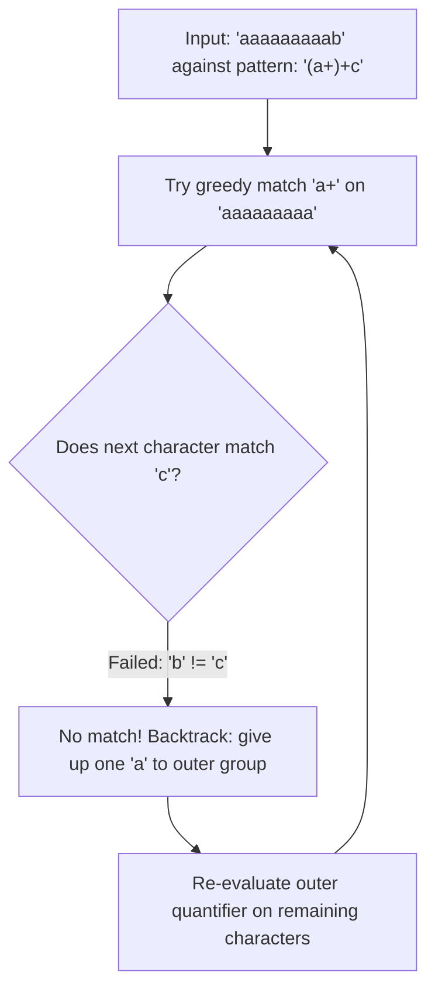

Regular expressions are among the most deceptively dangerous constructs in modern enterprise software. To a junior developer, a regular expression looks like a compact, elegant one-liner to validate an email address, parse a JWT header, or sanitize customer input. 

To an experienced Staff Engineer or Site Reliability Engineer (SRE), an unanchored or improperly quantified regex represents a ticking Denial of Service bomb. In July 2019, Cloudflare suffered a catastrophic 27-minute worldwide outage that took down a significant percentage of the global internet. The root cause was not a cyber attack or a data center fire; it was a single regular expression containing an unconstrained repetition (`.*.*=.*`) deployed inside their WAF (Web Application Firewall) that caused CPU usage across their global edge servers to spike to 100%.

In this deep dive, we explore how Java's `java.util.regex` engine executes under the hood, why Nondeterministic Finite Automata (NFA) are vulnerable to exponential Catastrophic Backtracking, how to leverage Possessive Quantifiers and Atomic Groups, and how to protect Java services against Regular Expression Denial of Service (ReDoS) attacks.

---

### Anatomy of java.util.regex: Pattern and Matcher

Java provides regular expression capabilities via the `java.util.regex` package, structured around two primary classes:

1. **`java.util.regex.Pattern`**: The compiled, immutable in-memory representation of a regular expression. Compiling a pattern translates the human-readable regex string into a tree of internal `Node` objects representing an execution graph. Compiling a `Pattern` is computationally expensive because it parses syntax, validates capture groups, and optimizes state transitions.
2. **`java.util.regex.Matcher`**: The stateful execution engine that scans a target `CharSequence` (such as a `String` or `StringBuilder`) against the compiled `Pattern` graph. `Matcher` maintains operational state: current search offsets, match bounds, and capture group indices.

```java
// Antipattern: Recompiling Pattern on every request
public boolean validateUsername(String input) {
    // String.matches() secretly calls Pattern.compile(regex).matcher(input).matches()
    // Allocates new Pattern nodes and state structures on every single invocation!
    return input.matches("^[a-zA-Z0-9_-]{3,16}$"); 
}

// Enterprise Best Practice: Pre-compile into a static final singleton
public class UserValidationService {
    private static final Pattern USERNAME_PATTERN = 
        Pattern.compile("^[a-zA-Z0-9_-]{3,16}$");

    public boolean validateUsername(String input) {
        if (input == null) return false;
        return USERNAME_PATTERN.matcher(input).matches();
    }
}
```

> [!IMPORTANT]
> `Pattern` instances are thread-safe and should always be stored in `static final` constants. `Matcher` instances are stateful, mutable, and **not** thread-safe; always instantiate `Matcher` locally within the executing method stack.

---

### Under the Hood: The Nondeterministic Finite Automaton (NFA)

Regex engines generally fall into two architectural categories:

1. **Deterministic Finite Automata (DFA)**: The engine transitions strictly to a single deterministic state for each input character. DFAs run in linear time `O(N)` with respect to the input length, but they do not support advanced regex features like backreferences (`\1`) or capture groups. Engines like Google's `RE2` use DFAs.
2. **Nondeterministic Finite Automata (NFA)**: The engine explores possible matches along a directed graph. When encountering multiple possible branches (e.g., quantifiers like `*` or alternations like `a|b`), the engine tentatively chooses one path. If that path eventually fails down the line, the engine **backtracks** up the execution tree to the previous fork and tries the next alternative. Java's `java.util.regex` is a classic backtracking NFA engine.



---

### The Catastrophic Backtracking Trap

The Achilles' heel of an NFA engine is **nested quantifiers with overlapping domains**. 

Consider the classic vulnerable pattern:

```java
Pattern pattern = Pattern.compile("(x+x+)+y");
```

Both inner sub-expressions `x+` and `x+` match the identical character `x`, wrapped within an outer quantifier `()+`. 

When given an input that matches—such as `xxxxxxxy`—the engine evaluates rapidly because it immediately terminates upon finding `y`.

However, consider what happens when given an adversarial input that nearly matches but fails at the very end:

```
xxxxxxxxxxxxxxxxxxxxxxxxxxxxxx!
```

1. The first `x+` consumes as many `x`s as possible.
2. The second `x+` consumes the remaining `x`s.
3. The engine reaches `!`, looking for `y`. It fails.
4. The engine backtracks: the second `x+` gives back one `x`. Still fails.
5. The first `x+` gives back one `x`, allowing the second `x+` to consume different combinations.
6. The outer quantifier `()+` now groups the `x`s into alternative bucket allocations.

For an input string of length `N`, the number of possible combinatorial paths the NFA must explore before confirming failure is `2^N` (exponential complexity).

| Input Length (N) | Evaluations / Steps | Time Taken on Modern CPU |
| :--- | :--- | :--- |
| 10 characters | ~1,024 steps | < 0.1 milliseconds |
| 20 characters | ~1,048,576 steps | ~2 milliseconds |
| 30 characters | ~1,073,741,824 steps | ~3.2 seconds |
| 40 characters | ~1,099,511,627,776 steps | ~55 minutes |
| 50 characters | ~1,125,899,906,842,624 steps | **~35 years (100% CPU lockup)** |

A single HTTP request with 45 characters sent to an unanchored vulnerable endpoint can peg a JVM carrier thread at 100% CPU indefinitely. If multiple concurrent requests arrive, all CPU cores become saturated, health checks fail, and the entire Kubernetes pod cluster enters a crash-loop. This is a **ReDoS (Regular Expression Denial of Service)** attack.

---

### Quantifier Mechanics: Greedy, Reluctant, and Possessive

Understanding quantifier behavior is the key to preventing backtracking disasters:

```
Greedy:     a*          Consumes everything, yields back on failure
Reluctant:  a*?         Consumes as little as possible, expands on failure
Possessive: a*+         Consumes everything, NEVER yields back
```

#### Greedy Quantifiers (`*`, `+`, `{n,m}`)
The default mode. A greedy quantifier matches as many characters as possible. If the remainder of the pattern fails to match, the greedy quantifier gives up characters one by one (backtracking) to allow downstream nodes to try to match.

#### Reluctant or Lazy Quantifiers (`*?`, `+?`, `{n,m}?`)
Matches as few characters as possible. It starts by consuming zero characters, tests the rest of the pattern, and only consumes characters if the rest of the pattern fails. Still backtracks heavily.

#### Possessive Quantifiers (`*+`, `++`, `{n,m}+`)
A possessive quantifier consumes as many characters as possible, but **it will never yield a character back**. It locks its consumed characters into a single irrevocable block. Once a possessive group completes, its backtrack points are discarded.

If a downstream character fails to match, the engine aborts immediately rather than exploring alternative permutations.

```java
// Vulnerable to ReDoS: Takes ~10 seconds for 30 'a' characters
Pattern vulnerable = Pattern.compile("^(a+)+$");

// Immune to ReDoS: Possessive quantifier '++' fails in 0.001 milliseconds!
Pattern immune = Pattern.compile("^(a++)++$");
```

#### Atomic Groups `(?>...)`
An atomic group is the structural equivalent of a possessive quantifier applied to a sub-expression. Once the sub-expression within `(?>pattern)` matches, all internal backtracking points are eliminated:

```java
// Using an atomic group to eliminate backtracking
Pattern safePattern = Pattern.compile("^(?>(a+))+b$");
```

---

### Production ReDoS Defense Architecture

How do you protect high-volume production services from ReDoS attacks when processing untrusted user input?

#### Always Anchor Expressions
Unanchored expressions force the engine to repeat its search starting at index 0, then index 1, then index 2, multiplying the search space:

```java
// Dangerous: Unanchored, searches every substring offset
Pattern DANGEROUS = Pattern.compile("[0-9]+");

// Safe: Explicitly anchored to start and end
Pattern SAFE = Pattern.compile("^[0-9]+$");
```

#### Avoid Overlapping Repetitions
Never combine nested quantifiers where the inner and outer expressions can match the same tokens:
- **Catastrophic**: `(a|a)+`, `(a*)*`, `([a-z]+)+`, `(.*a)+`
- **Safe**: `[a-z]+`, `a+b+`

#### Enforce Regex Evaluation Timeouts
By default, Java's `Matcher` has no timeout mechanism; it will spin a CPU core until completion. To protect against malicious inputs, wrap the input `CharSequence` in a custom watchdog that interrupts execution if the matcher exceeds an SLA threshold:

```java
public class TimeoutRegexEvaluator {

    public static boolean matchesWithTimeout(
        Pattern pattern, 
        CharSequence input, 
        Duration timeout
    ) {
        CharSequence interruptibleSequence = new TimeoutCharSequence(input, timeout);
        try {
            return pattern.matcher(interruptibleSequence).matches();
        } catch (RegexTimeoutException ex) {
            log.error("Regex evaluation aborted: potential ReDoS detected for input length {}", input.length());
            return false;
        }
    }

    private static class TimeoutCharSequence implements CharSequence {
        private final CharSequence delegate;
        private final long deadlineNano;

        public TimeoutCharSequence(CharSequence delegate, Duration timeout) {
            this.delegate = delegate;
            this.deadlineNano = System.nanoTime() + timeout.toNanos();
        }

        @Override
        public char charAt(int index) {
            if (System.nanoTime() > deadlineNano) {
                throw new RegexTimeoutException("Regex evaluation exceeded allocated time slice");
            }
            return delegate.charAt(index);
        }

        @Override
        public int length() { return delegate.length(); }

        @Override
        public CharSequence subSequence(int start, int end) {
            return new TimeoutCharSequence(delegate.subSequence(start, end), 
                Duration.ofNanos(deadlineNano - System.nanoTime()));
        }

        @Override
        public String toString() { return delegate.toString(); }
    }

    public static class RegexTimeoutException extends RuntimeException {
        public RegexTimeoutException(String msg) { super(msg); }
    }
}
```

Because Java's `Matcher` continually calls `charAt()` during state transitions, checking the timer inside `charAt()` guarantees that runaway backtracking is severed within milliseconds.

---

### Modern Java Ergonomics: Text Blocks and Named Groups

Before Java 15, complex regular expressions were an unreadable soup of escaped backslashes:

```java
// Pre-Java 15: Double-escaped backslashes and concatenation nightmare
String regex = "^(\\d{4})-(0[1-9]|1[0-2])-([0-2][0-9]|3[01])T" +
               "([01][0-9]|2[0-3]):([0-5][0-9]):([0-5][0-9])" +
               "(?:\\.(\\d{1,9}))?(Z|[+-][01][0-9]:[0-5][0-9])$";
```

With **Text Blocks (`"""`)** and **Named Capture Groups (`(?<name>...)`)**, regular expressions become maintainable, self-documenting code:

```java
public class IsoTimestampParser {

    private static final Pattern ISO_8601_PATTERN = Pattern.compile("""
        (?x)                               # Enable free-spacing & comments mode
        ^(?<year>\\d{4})                   # 4-digit Year
        -(?<month>0[1-9]|1[0-2])           # 2-digit Month (01-12)
        -(?<day>[0-2][0-9]|3[01])          # 2-digit Day (01-31)
        T
        (?<hour>[01][0-9]|2[0-3])          # Hours (00-23)
        :(?<minute>[0-5][0-9])             # Minutes (00-59)
        :(?<second>[0-5][0-9])             # Seconds (00-59)
        (?:\\.(?<fraction>\\d{1,3}))?      # Optional Milliseconds
        (?<zone>Z|[+-][01][0-9]:[0-5][0-9])$
        """);

    public record ParsedTimestamp(int year, int month, int day, int hour, int minute, int second) {}

    public static Optional<ParsedTimestamp> parse(String raw) {
        Matcher matcher = ISO_8601_PATTERN.matcher(raw);
        if (!matcher.matches()) {
            return Optional.empty();
        }

        return Optional.of(new ParsedTimestamp(
            Integer.parseInt(matcher.group("year")),
            Integer.parseInt(matcher.group("month")),
            Integer.parseInt(matcher.group("day")),
            Integer.parseInt(matcher.group("hour")),
            Integer.parseInt(matcher.group("minute")),
            Integer.parseInt(matcher.group("second"))
        ));
    }
}
```

Notice the `(?x)` flag (Free-Spacing Mode): it instructs the Java regex engine to ignore whitespace and `#` comments within the pattern, turning opaque regular expressions into cleanly documented parsing rules.

---

## Senior Engineer Interview Crucible

### Explain the difference between NFA and DFA regular expression engines and why Java chose NFA.
**Answer:** A Deterministic Finite Automaton (DFA) maintains a single state at any point in the input stream. For each input character, there is exactly one deterministic transition to the next state. DFAs guarantee linear time complexity `O(N)` where `N` is the input length, making them immune to catastrophic backtracking and ReDoS attacks. 

A Nondeterministic Finite Automaton (NFA) allows multiple concurrent transition possibilities for a single input character. An NFA engine explores one path, saving decision points on a stack. If the path fails, the engine backtracks to the previous decision point and tries another branch. Java chose an NFA engine because only NFAs support advanced feature sets that developers demand: backreferences (e.g., matching opening and closing HTML tags `/<([a-z]+)>.*<\/\1>/`), non-capturing groups, lookahead/lookbehind assertions, and possessive quantifiers. The trade-off is vulnerability to exponential worst-case time complexity `O(2^N)`.

### What is catastrophic backtracking, and how do possessive quantifiers eliminate it?
**Answer:** Catastrophic backtracking occurs when an NFA engine evaluates an expression containing nested or adjacent ambiguous quantifiers (e.g., `(a+)+` or `.*.*=.*`) against an input string that fails near the end. When the match fails, the engine systematically tests every possible mathematical partition of characters between the greedy quantifiers. For an input of length `N`, the permutations scale exponentially (`O(2^N)` or `O(N!)`), consuming 100% CPU for seconds, minutes, or centuries.

Possessive quantifiers (syntax: `*+`, `++`, `?+`, `{n,m}+`) eliminate backtracking by discarding all saved backtrack points as soon as the quantifier finishes consuming input. Unlike greedy quantifiers, which yield characters back one by one when downstream matching fails, a possessive quantifier holds its consumed characters permanently. If a downstream token fails, the entire possessive branch aborts immediately in linear time without testing alternative segmentations.

### Why is `String.matches()` considered an antipattern in high-throughput enterprise Java services?
**Answer:** Inspecting the OpenJDK implementation of `String.matches(String regex)` reveals that it executes:
```java
public boolean matches(String regex) {
    return Pattern.compile(regex).matcher(this).matches();
}
```
Every single call to `String.matches()` parses the regex string, builds a new Abstract Syntax Tree of internal `Pattern$Node` objects, allocates match state structures, and discards them immediately after execution. In a microservice processing thousands of transactions per second, this creates extreme garbage collection pressure in Young Generation Eden space and wastes massive CPU cycles repeatedly compiling identical patterns. 

The production standard is to compile the regular expression once into a `private static final Pattern` constant, reusing the immutable `Pattern` across all threads and allocating only lightweight, transient `Matcher` instances on demand.

### How does Java's lookahead and lookbehind assertion mechanism impact performance and memory?
**Answer:** Lookaround assertions—Positive Lookahead `(?=...)`, Negative Lookahead `(?!...)`, Positive Lookbehind `(?<=...)`, and Negative Lookbehind `(?<!...)`—are non-consuming zero-width assertions. They verify whether a condition matches ahead or behind the current character index without advancing the matcher's cursor.

While lookaheads are computationally inexpensive (they simply read forward along the input), **lookbehinds** carry significant overhead in Java. The JVM's NFA engine requires that all lookbehinds have an **obvious maximum length** (finite character bound). To evaluate a lookbehind, the engine must back up in the input stream and simulate a forward match up to the current position. If placed inside a repeating loop, this causes quadratic `O(N^2)` scanning behavior as the engine repeatedly re-evaluates characters it already traversed.
