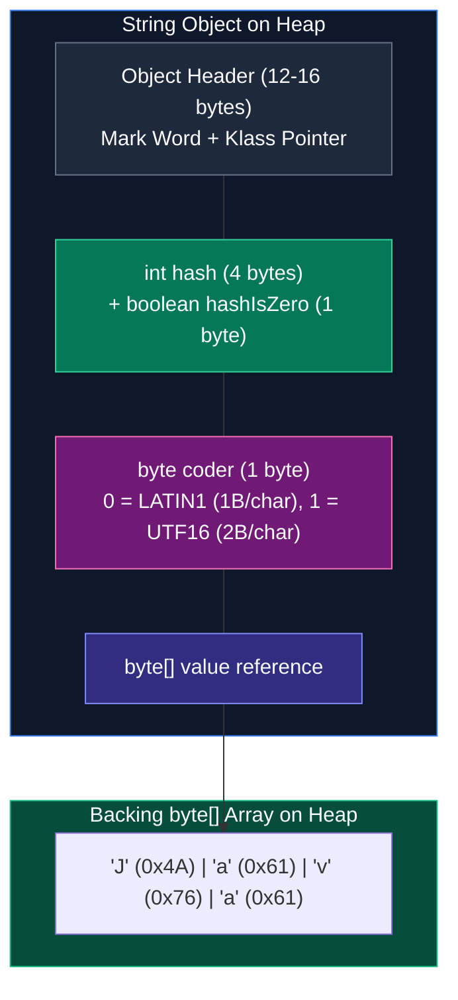
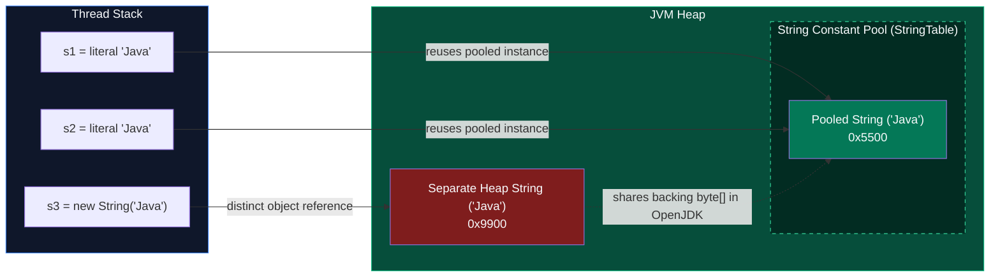

Take a heap dump from almost any busy Java service (an order API, a batch processor, or a search gateway), and `java.lang.String` along with its backing byte arrays will usually sit at the top of the memory histogram, often accounting for 25% to 40% of live heap usage. JSON payloads, SQL queries, HTTP headers, identifiers, and log lines are all strings.

Because text shows up everywhere, Java's string design is packed with deliberate engineering trade-offs: immutability, Compact Strings, the String Constant Pool, runtime concatenation via `invokedynamic`, and mutable builders like `StringBuilder`. Understanding how those pieces fit together helps you avoid subtle identity bugs and unnecessary garbage collection pressure.

---

## Why `String` Is Immutable

In Java, once a `String` object is created, its sequence of characters can never change. The `String` class is `final` (so subclasses cannot add mutability), its backing array is `private final` and never exposed directly, and every method that looks like a modification (`substring`, `replace`, `toLowerCase`, `concat`) returns a new `String` rather than editing the existing one.

Immutability is not an aesthetic preference. Four concrete engineering requirements depend on it:

1. **Safe sharing in the String Constant Pool**: Multiple unrelated parts of a program can point to the exact same `"COMPLETED"` instance in memory. If `String` were mutable, one method uppercasing or trimming its reference would silently change the value held by every other variable pointing to that pooled object.
2. **Reliable, cached hash codes**: `String` is the most common key type in `HashMap` and `HashSet`. Computing a hash across a long string walks every character, so `String` computes its hash once and caches it in a private `int hash` field (since Java 13, it also tracks a `boolean hashIsZero` flag so strings whose hash legitimately equals `0` are not recomputed either). Because the characters never change, the cached hash stays valid forever and a key can never drift into the wrong hash bucket.
3. **Security at trust boundaries**: File paths, hostnames, JDBC URLs, and class names passed to `Class.forName()` are all strings. Imagine validating that a path starts with `"/app/public/"` and then passing that same reference to the OS file API. If `String` were mutable, another thread could overwrite the characters to `"/etc/passwd"` in the window between the check and the open call (a classic time-of-check to time-of-use race).
4. **Thread safety without locking**: An immutable object can be freely passed across threads and cached in shared structures without `synchronized` blocks or defensive copying.

> [!NOTE]
> Immutability has one security trade-off: sensitive values like passwords or API tokens stored in a `String` remain in heap memory until the garbage collector reclaims and overwrites that space. That is why security APIs such as `java.io.Console.readPassword()` return a `char[]` or `byte[]`, which you can explicitly overwrite with zeros as soon as you finish using it.

---

## Memory Layout and Compact Strings (Java 9+)

Before Java 9, every `String` was backed by a UTF-16 `char[]` array, which used 2 bytes for every character. For English text, JSON keys, SQL keywords, and UUIDs, the upper byte of every `char` was zero, wasting half the memory allocated for strings.

Java 9 introduced **Compact Strings** (JEP 254), enabled by default in HotSpot (`-XX:+CompactStrings`). The backing `char[]` was replaced by a `byte[]` plus a 1-byte `coder` field:

- `coder = 0` (`LATIN1`): every character fits in ISO-8859-1, stored at **1 byte per character**.
- `coder = 1` (`UTF16`): at least one character requires two bytes (such as Cyrillic, CJK, or emoji), so the entire string is stored as UTF-16 at **2 bytes per character**.



For Latin-1 workloads, Compact Strings cuts the backing array footprint in half and improves CPU cache density without any source-code changes.

---

## The String Constant Pool and Interning

Because string literals like `"GET"`, `"UTF-8"`, and `"ACTIVE"` appear repeatedly across classes, the JVM deduplicates them in the **String Constant Pool** (implemented in HotSpot as a native hash table called `StringTable`). Prior to Java 7, the pool lived in PermGen, where excessive interning could trigger `OutOfMemoryError: PermGen space`. Since Java 7, pooled strings live in the main Java heap and can be garbage-collected when no longer referenced.



### Literals, Constant Folding, and `new String(...)`

- **String literals** (`String a = "Java";`) are resolved from the String Constant Pool automatically.
- **Compile-time constant expressions** (`String b = "Ja" + "va";`) are folded by `javac` into the single literal `"Java"` before runtime, so `a == b` is `true`.
- **Runtime concatenation** (`String c = prefix + "va";` where `prefix` is a non-final variable) creates a new `String` on the heap, outside the pool.
- **Explicit `new String("Java")`** forces allocation of a distinct `String` object on the heap even though `"Java"` is already in the pool. There is almost never a good reason to write `new String("...")`.

### `==` vs. `.equals()`

Because string literals share references, testing equality with `==` can appear to work in small unit tests and then fail in production when a string arrives from a database or JSON parser:

```java
String literal1 = "Java";
String literal2 = "Java";
String dynamic = new StringBuilder("Ja").append("va").toString();

System.out.println(literal1 == literal2);      // true (same pooled object)
System.out.println(literal1 == dynamic);       // false (different objects on heap)
System.out.println(literal1.equals(dynamic));  // true (same character sequence)
```

Always compare string contents with `.equals()` (or `Objects.equals(a, b)` when either reference may be `null`). Putting a known literal on the left side avoids a `NullPointerException`:

```java
if ("COMPLETED".equals(orderStatus)) {
    // Safe even when orderStatus is null
}
```

### Manual `intern()` and Its Caveats

Calling `str.intern()` checks the JVM's `StringTable`. If an equal string is already pooled, `intern()` returns the pooled reference; otherwise, it adds `str` to the table and returns it:

```java
String fromJson = new String(rawBytes, StandardCharsets.UTF_8);
String pooled = fromJson.intern();
```

`intern()` can save memory in narrow cases where a parser creates millions of duplicate strings from a small, bounded vocabulary (such as ISO country codes or currency codes). However, calling `intern()` broadly carries real costs:

- **High-cardinality strings waste memory and CPU**: interning unique values like UUIDs, timestamps, or request IDs fills `StringTable` with entries that are never reused.
- **Lookup overhead**: every `intern()` call pays for a native hash table lookup and potential synchronization or table resizing work (HotSpot made `StringTable` dynamically resizable in Java 11, which removed the old fixed-bucket catastrophe from Java 8, but lookups are still far more expensive than a local Java `Map` cache).
- **Safer alternatives**: for bounded vocabularies, an `enum` or an application-level cache (such as a `ConcurrentHashMap` or Caffeine cache) is usually easier to reason about and bound in size.

### G1GC String Deduplication

If profiling shows that duplicate strings consume a large share of your heap, modern JVMs offer **String Deduplication** instead of manual `intern()` calls:

```bash
java -XX:+UseG1GC -XX:+UseStringDeduplication -jar app.jar
```

During garbage collection, the collector examines surviving `String` objects that have lived through a few GC cycles. When two `String` instances have identical contents, the collector repoints both to a single shared backing `byte[]` and frees the duplicate array. Note that this merges the internal `byte[]`, *not* the `String` object references themselves, so `s1 == s2` remains `false` while heap usage drops transparently.

---

## String Concatenation: Loops vs. `invokedynamic` (Java 9+)

Appending to a `String` with `+` inside a loop is one of the most common performance bugs in Java:

```java
// Bad: O(n^2) character copying and n intermediate String allocations
String csv = "";
for (int i = 0; i < 50_000; i++) {
    csv = csv + i + ",";
}
```

Because `String` is immutable, every iteration allocates a new string, copies all previously accumulated characters into it, appends the new token, and leaves the old string as garbage. Across `n` iterations, the number of characters copied grows roughly as `1 + 2 + ... + n = n * (n + 1) / 2`, which is `O(n^2)` time. For 50,000 items, that turns a millisecond task into seconds of CPU time and gigabytes of short-lived garbage.

### Single-Expression Concatenation and `StringConcatFactory`

Outside of loops, using `+` in a single expression is completely fine:

```java
String logLine = "Order " + orderId + " failed with status " + statusCode;
```

In Java 8 and earlier, `javac` translated that line into a `new StringBuilder().append(...).toString()` sequence in bytecode.

Starting in **Java 9** (JEP 280), `javac` instead emits a single `invokedynamic` instruction targeting `java.lang.invoke.StringConcatFactory.makeConcatWithConstants(...)`. At runtime, the JVM generates a specialized strategy for that call site that:

1. Computes the exact total length and target `coder` (`LATIN1` or `UTF16`) from the arguments upfront.
2. Allocates a single `byte[]` of that exact size.
3. Copies each piece directly into the array and constructs the `String` without intermediate `StringBuilder` buffer resizes.

Keep in mind what `invokedynamic` does *not* change: it only optimizes a single concatenation expression. It does **not** hoist a `StringBuilder` out of a loop. Whenever you build text incrementally across loop iterations, use `StringBuilder` (or `StringJoiner` / `Collectors.joining()`).

---

## `StringBuilder` vs. `StringBuffer`

`StringBuilder` is a mutable character sequence backed by a resizable `byte[]` buffer (using the same Compact Strings `LATIN1` / `UTF16` representation since Java 9). Calling `append()` writes into the existing buffer in place, turning loop concatenation back into `O(n)` linear time:

```java
// Good: O(n) linear time with a pre-sized mutable buffer
StringBuilder sb = new StringBuilder(50_000 * 6);
for (int i = 0; i < 50_000; i++) {
    if (i > 0) {
        sb.append(',');
    }
    sb.append(i);
}
String csv = sb.toString();
```

### Buffer Growth and Pre-Sizing

`new StringBuilder()` starts with an initial capacity of **16 characters**. When an `append()` exceeds the current capacity, `AbstractStringBuilder` allocates a larger `byte[]`, typically growing to `(oldCapacity * 2) + 2` (or the minimum required length if larger), and copies the existing bytes via `Arrays.copyOf`. Also, if you start appending ASCII characters (`LATIN1`) and later append a Unicode emoji or CJK character, `StringBuilder` inflates its entire internal buffer to `UTF16` (doubling its byte length).

If you know the approximate final size (for example, building a 4 KB JSON document or SQL statement), pass an initial capacity such as `new StringBuilder(4096)` to avoid repeated reallocations.

### Comparing `StringBuilder` and `StringBuffer`

| Aspect | `StringBuilder` (Java 5+) | `StringBuffer` (Java 1.0) |
| :--- | :--- | :--- |
| **Synchronization** | None (not thread-safe) | Every public method is `synchronized` |
| **Overhead** | No lock acquisition | Monitor overhead on every method call (plus `toStringCache` maintenance) |
| **Typical usage** | Local string construction (default choice) | Legacy APIs that require a `StringBuffer` parameter |

Even in multi-threaded code, `StringBuffer` is rarely the right tool. Synchronizing individual `append()` calls does not make a sequence of calls atomic: if two threads interleave `buf.append("user=")` and `buf.append(id)`, the output still scrambles unless you hold an external lock across the entire sequence. In almost every real codebase, each thread should build its own string with a local `StringBuilder` and hand off the resulting immutable `String`.

For delimited output, `String.join(",", items)` or `java.util.StringJoiner` (Java 8+) is often cleaner than managing separator logic manually inside a `StringBuilder` loop:

```java
String joined = String.join(", ", List.of("PENDING", "SHIPPED", "DELIVERED"));
```

---

## Summary

- `String` is immutable to make String Constant Pool sharing safe, allow permanent `hashCode()` caching, protect security-sensitive values from concurrent mutation, and guarantee thread safety without locks.
- Since Java 9, Compact Strings backs `String` with a `byte[]` and a `coder` flag (`LATIN1` or `UTF16`), cutting memory usage roughly in half for Latin-1 text.
- The String Constant Pool (`StringTable`) lives in the heap and caches string literals; always compare string values with `.equals()`, never `==`.
- Reserve `intern()` for measured, low-cardinality duplication cases; consider `-XX:+UseStringDeduplication` on G1GC when heap dumps show widespread duplicate strings.
- Single-expression `+` concatenation uses `invokedynamic` (`StringConcatFactory`) in Java 9+, but building strings across a loop still requires `StringBuilder` (pre-sized when possible).
- Prefer `StringBuilder` over `StringBuffer` unless interfacing with a legacy signature that explicitly requires `StringBuffer`.

---

## Interview Questions

### Why did Java make `String` immutable?

Immutability makes four core features possible: safe sharing of literals in the String Constant Pool without aliasing bugs, permanent caching of `hashCode()` so strings work reliably and quickly as `HashMap` keys, protection of security-critical parameters (such as file paths, URLs, and class names) against modification after validation, and effortless thread safety without synchronization.

### How does Java 9's Compact Strings reduce heap usage without breaking Unicode support?

Before Java 9, `String` stored characters in a `char[]` array at 2 bytes per character. Java 9 replaced `char[]` with a `byte[]` and a 1-byte `coder` field. If every character fits in Latin-1 (`0x00` to `0xFF`), `coder` is `0` (`LATIN1`) and each character takes 1 byte. If any character falls outside Latin-1, `coder` is `1` (`UTF16`) and the string uses 2 bytes per character. All public `String` APIs behave identically to callers while saving up to half the backing array memory for ASCII-heavy workloads.

### Why is `+` safe in a single expression in Java 9+, yet still slow inside a loop?

For a single expression like `a + ":" + b`, `javac` in Java 9+ emits an `invokedynamic` call to `StringConcatFactory`, which calculates the final length upfront and allocates one backing array in a single pass. Inside a loop (`s = s + item`), each iteration executes a separate concatenation that must copy the entire string accumulated so far into a new array, resulting in `O(n^2)` copying work and `n` discarded `String` instances.

### Why is `StringBuilder` preferred over `StringBuffer` even in concurrent applications?

`StringBuffer` synchronizes every individual method call, adding locking overhead for local string construction where no other thread can even see the object. Worse, method-level synchronization rarely provides useful thread safety when a buffer *is* shared, because multi-step operations like appending a prefix followed by a value can still interleave between threads. Building text per thread with a local `StringBuilder` and sharing the resulting immutable `String` is both faster and safer.
