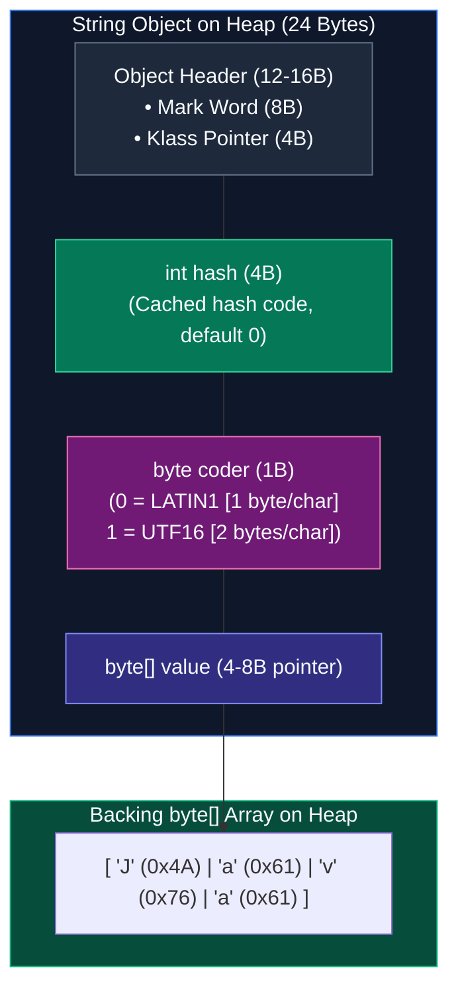
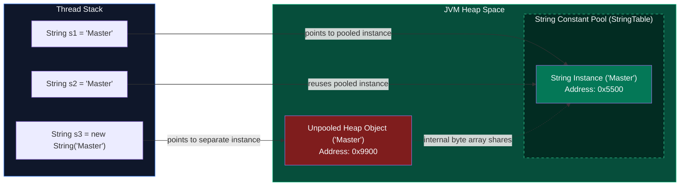

Open a memory profiler (like JProfiler or VisualVM) on any live enterprise Java backend—whether it is an e-commerce checkout service or a high-speed banking API—and look at the heap dump.

Almost without exception, **between 25% and 40% of the entire JVM Heap is consumed by a single type: `java.lang.String`.**

Strings store database query strings, JSON payloads, HTTP headers, user identifiers, and log messages. Because text is everywhere, how Java handles text in memory is the difference between an application that cruises along smoothly and one that suffers from perpetual Garbage Collection pauses.

To handle this massive memory demand, the JVM architects engineered specialized memory regions, hardware-level compact storage, and compiler optimizations specifically for Strings.

Let's explore the mechanics of the String Constant Pool, uncover why concatenating strings in a loop degrades to quadratic time complexity, and examine how modern JVMs optimize text under the hood.

---

## The Anatomy of a String in Memory

In Java, `String` is not a primitive array of characters. It is an immutable reference object. 

Prior to Java 9, every `String` was backed by a UTF-16 `char[]` array (2 bytes per character). Because enterprise telemetry showed that over 90% of strings contained only Latin-1 ASCII characters, Java 9 introduced **Compact Strings** (JEP 254), halving the heap footprint of strings globally.



### The Hash Code Caching Optimization
Calculating the hash code of a 500-character string takes hundreds of CPU instructions. 
Because `String` is immutable, **its hash code can never change**. 

When you call `str.hashCode()` for the first time, Java computes the hash, stores it in the private `int hash` field, and caches it forever. Every subsequent call simply reads the cached integer in a single CPU cycle, making Strings the fastest, most reliable keys for `HashMap`s.

---

## The String Constant Pool (SCP)

Because strings appear thousands of times across classes, allocating separate objects for identical text literals would exhaust memory.

Java solves this with the **String Constant Pool (SCP)**: a specialized native hash table called `StringTable` maintained by the JVM inside the standard Heap (relocated from PermGen in Java 7).



### Literal Creation vs. `new String()`
- **Literal (`String s = "Master"`):** The JVM queries `StringTable`. If `"Master"` is present, it returns the existing pointer. If not, it creates a new pooled instance and registers it.
- **Explicit Constructor (`new String("Master")`):** Bypasses the pool check! It forces the allocation of a brand-new, redundant `String` object on the general Heap. Never use `new String()` unless you have a specific, documented reason to prevent pooling.

---

## The Identity Disaster: `==` vs. `.equals()`

Because the String Pool caches literals, comparing literals using `==` accidentally works during simple tests, lulling beginners into a catastrophic false sense of security:

```java
String literal1 = "Java";
String literal2 = "Java";
System.out.println(literal1 == literal2); // TRUE (Accidental pooling coincidence!)

String dynamic1 = new StringBuilder("Ja").append("va").toString();
String dynamic2 = new StringBuilder("Ja").append("va").toString();

System.out.println(dynamic1 == dynamic2);      // FALSE! Different Heap memory addresses!
System.out.println(dynamic1.equals(dynamic2)); // TRUE! Characters are identical.
```

- **`==` compares memory pointers:** Do both variables point to the exact same physical byte address in RAM?
- **`.equals()` compares character values:** Does the underlying byte array contain the identical sequence of characters?

**Rule of Thumb:** Always compare strings with `.equals()` or `.equalsIgnoreCase()`. To prevent `NullPointerException`s when comparing against a constant, place the known literal on the left:
```java
// ✅ SAFE: Never throws NullPointerException even if 'status' is null!
if ("COMPLETED".equals(status)) { ... }
```

---

## Manual Interning vs. G1GC String Deduplication

You can force a dynamic heap string into the pool manually using `.intern()`:

```java
String input = readFromNetwork(); // Heap object
String pooled = input.intern();   // Looks up or adds to StringTable
```

### Why Senior Engineers Avoid `.intern()` in Modern Java
1. **Contention:** The JVM's `StringTable` is protected by internal locks. In a system with hundreds of threads actively calling `.intern()`, lock contention degrades CPU throughput.
2. **Bucket Collisions:** If you intern millions of unique strings without tuning `-XX:StringTableSize`, the table's linked buckets degrade to slow `O(n)` search chains.

### The Modern Alternative: G1GC String Deduplication
Instead of manual interning, modern production services enable **G1 Garbage Collector String Deduplication**:

```bash
-XX:+UseG1GC -XX:+UseStringDeduplication
```

During minor garbage collection passes, the G1 collector inspects live String objects on the Heap. If it detects two distinct String objects containing identical `byte[]` arrays, it repoints both String objects to the **same underlying byte array** and frees the duplicate array, transparently reclaiming 15% to 25% of heap memory with zero code modifications!

---

## The Loop Concatenation Disaster: Why `+` Fails

Consider this seemingly harmless loop to build a comma-separated log line:

```java
// ❌ PRODUCTION DISASTER: O(n²) Quadratic Time & Gigabytes of Garbage!
String result = "";
for (int i = 0; i < 50_000; i++) {
    result = result + i + ",";
}
```

What actually happens under the hood?

Because `String` is immutable, the JVM cannot modify `result` in place. On **every single iteration**, the JVM must:
1. Allocate memory for a brand-new `String` object.
2. Copy all previous characters into the new object.
3. Append the new integer and comma.
4. Abandon the previous `result` string on the Heap as garbage.

This results in **`O(n²)` quadratic performance**. Appending 50,000 items allocates **over 50,000 temporary discarded strings**, pausing the application for seconds while Garbage Collection thrashes CPU cores!

---

## The High-Performance Solution: `StringBuilder`

`StringBuilder` represents a **mutable buffer of text**. 

Under the hood, it manages an expandable `byte[]` array. Appending characters modifies the existing array in place without creating intermediate objects:

```java
// ✅ BLAZING FAST: O(n) Linear Time & Zero Intermediate Garbage!
StringBuilder sb = new StringBuilder(100_000); // Pre-size buffer!
for (int i = 0; i < 50_000; i++) {
    sb.append(i).append(",");
}
String result = sb.toString(); // Creates exactly ONE string at the end!
```

### The Capacity Growth Formula: Pre-Sizing Matters
When you instantiate `new StringBuilder()` without arguments, its default initial capacity is only **16 characters**.

When the buffer fills up, `StringBuilder` must resize its internal array using the growth formula:

```text
newCapacity = (oldCapacity * 2) + 2
```

Resizing requires allocating a larger array on the Heap and invoking `System.arraycopy` to move the existing bytes over. If you know you are building an 8 KB JSON payload, always **pre-size the builder**: `new StringBuilder(8192)`. This eliminates buffer reallocations entirely.

### `StringBuilder` vs. `StringBuffer`
| Feature | `StringBuilder` (Java 5+) | `StringBuffer` (Java 1.0) |
| :--- | :--- | :--- |
| **Thread Safety** | Non-synchronized (Not thread-safe) | Every method is `synchronized` |
| **Performance** | Maximum CPU speed, zero lock overhead | Slow due to monitor acquisition |
| **Recommended Use** | Local method text building (99.9% of code) | Concurrent shared buffers |

---

## Modern Java: `invokedynamic` & `StringConcatFactory` (Java 9+)

What happens when you concatenate strings using the `+` operator in ordinary code outside of loops?

```java
String fullName = firstName + " " + lastName;
```

In older Java versions, the compiler automatically converted this into:
```java
new StringBuilder().append(firstName).append(" ").append(lastName).toString();
```

In **Java 9+**, the compiler was upgraded to emit the **`invokedynamic`** opcode pointing to **`StringConcatFactory`** (JEP 280). 

Instead of hardcoding a `StringBuilder` into bytecode, the JVM dynamically crafts an optimal concatenation strategy at runtime. It pre-calculates the exact required byte length, allocates a single byte array of the precise target size, and copies the characters in a single vectorized pass!

---

## Summary & Mental Model Checkpoint

1. **Immutable Invariant**: Strings cannot be altered after instantiation; operations return newly allocated instances.
2. **Compact Strings**: Java 9+ uses 1 byte per character for Latin-1 and 2 bytes for UTF-16, halving heap footprint.
3. **String Constant Pool**: Native `StringTable` caches string literals on the Heap, deduplicating shared text.
4. **Always Use `.equals()`**: `==` checks heap pointer identity; `.equals()` checks character content.
5. **Never `+` in Loops**: String concatenation in a loop generates quadratic `O(n²)` memory churn; always use `StringBuilder`.
6. **Pre-Size `StringBuilder`**: Pass expected capacity to `new StringBuilder(size)` to prevent dynamic array reallocations.

---

## 🎯 Senior Engineer Interview Questions

### How does Java 9's Compact Strings feature optimize memory without breaking UTF-16 character support?
> **Answer:** Prior to Java 9, `java.lang.String` was internally backed by a `char[]` array, allocating 2 bytes for every character regardless of encoding. Java 9 replaced this with a `byte[]` array and an internal 1-byte flag called `coder`. If all characters in the string fit within the ISO-8859-1 (Latin-1) range, the `coder` is set to `0` (LATIN1) and characters are stored using 1 byte each. If a non-Latin-1 character (such as Chinese, Cyrillic, or an Emoji) is detected, the `coder` is set to `1` (UTF16) and characters are stored using 2 bytes each, preserving complete global compatibility while reducing memory consumption by up to 50% for standard ASCII text.

### What is the performance difference between `String.intern()` and G1GC String Deduplication?
> **Answer:** `String.intern()` is a synchronous, manual call that looks up or registers a string in the JVM's native `StringTable`. It introduces thread lock contention on the global table and can cause latency if the table size is inadequately tuned. In contrast, G1GC String Deduplication (`-XX:+UseStringDeduplication`) runs asynchronously during background garbage collection passes. It transparently inspects live String objects on the heap and deduplicates their backing `byte[]` arrays without locking or manual code changes, delivering memory optimization without thread contention.

### Why does string concatenation using the `+` operator in a loop result in quadratic time performance?
> **Answer:** Because `String` objects are immutable. On each iteration of a loop, concatenating with `+` creates a new buffer, copies all existing characters from the current accumulated string, appends the new character, and allocates a new `String` object. Over `n` iterations, the total number of characters copied follows the arithmetic progression `1 + 2 + ... + n = n(n+1)/2`, resulting in `O(n²)` character copying operations and allocating `n` intermediate garbage objects on the Heap.

### How does `StringConcatFactory` in Java 9+ improve string concatenation over legacy `StringBuilder` bytecode?
> **Answer:** Prior to Java 9, the compiler converted `+` expressions into a series of `StringBuilder.append()` bytecode calls. In Java 9+, the compiler emits an `invokedynamic` call to `StringConcatFactory.makeConcatWithConstants()`. At runtime, the JVM uses MethodHandles to inspect the argument types, calculate the exact total byte length required for the resulting string, allocate a single backing byte array of that precise size, and copy all characters directly, avoiding the intermediate buffer resizes and object allocations inherent to legacy `StringBuilder` translation.
