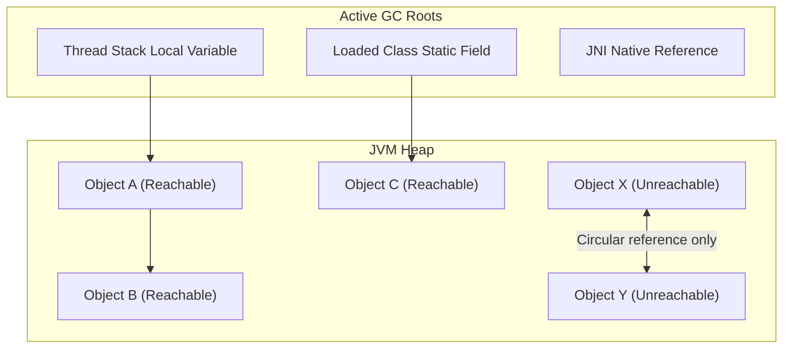
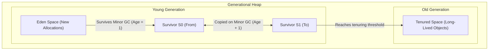

In languages with manual memory management like C and C++, you allocate heap memory explicitly and release it when you are done. Releasing memory too late causes leaks; releasing it too early causes dangling pointers and use-after-free bugs. Java moves that bookkeeping into the runtime through automatic garbage collection (GC).

When you write `new Order(...)`, the JVM allocates memory on the heap. You never call `free()`. Instead, the garbage collector periodically identifies objects the application can no longer reach and reclaims their space. Automatic collection eliminates an entire category of pointer bugs, though it introduces its own engineering concerns: pause times, allocation pressure, and memory leaks caused by unintended object references.

Understanding how the JVM decides what is alive, how it organizes the heap, and why certain legacy APIs like `System.gc()` and `finalize()` cause trouble makes diagnosing production memory issues much easier.

## Reachability and the Object Lifecycle

Older runtimes often used reference counting, where every object stores a count of how many pointers refer to it. When the count hits zero, the object is freed. Reference counting struggles with cycles: if object `A` holds a reference to `B` and `B` holds a reference to `A`, neither count ever drops to zero even if no code can reach either object.

HotSpot and other modern JVMs use tracing garbage collection instead. Rather than tracking counts on every pointer assignment, the collector starts from a known set of live entry points called **GC roots** and follows object references outward to build a graph of everything currently reachable. Any object not reached by that traversal is eligible for collection, including islands of circular references.



### What Counts as a GC Root

While exact root sets vary slightly across JVM implementations, the primary roots in HotSpot are:

- **Local variables and parameters** in active stack frames of running threads.
- **Active `Thread` instances** themselves.
- **Static fields** of loaded classes (in modern HotSpot, the `Class` objects holding those static fields are anchored by their `ClassLoader`).
- **JNI local and global references** created by native C or C++ code.
- **Monitor objects** currently locked by `synchronized` blocks.

### Tracing an Object's Lifecycle in Code

An object becomes eligible for garbage collection the moment no path exists from any GC root to that object. You do not need to set local variables to `null` at the end of a method; leaving scope removes the stack frame automatically.

```java
public class ReachabilityExample {

    static class Node {
        final String name;
        Node next;

        Node(String name) {
            this.name = name;
        }
    }

    public static void main(String[] args) {
        buildAndDiscardCycle();
        // Both "alpha" and "beta" are now unreachable despite pointing to each other.
    }

    private static void buildAndDiscardCycle() {
        Node a = new Node("alpha");
        Node b = new Node("beta");

        a.next = b;
        b.next = a;

        // While inside this method, local variables `a` and `b` are GC roots.
        // Once this method returns, its stack frame pops and the roots vanish.
        // The cycle (a <-> b) is isolated and eligible for GC.
    }
}
```

Eligibility does not mean immediate reclamation. The JVM reclaims unreachable objects when a GC cycle runs and decides that region of memory needs cleaning. Until then, dead objects simply sit in memory waiting to be overwritten or swept away.

### Reference Strengths in `java.lang.ref`

Standard variables create **strong references**: as long as a strong reference chain leads from a GC root to an object, the collector will not reclaim it. The `java.lang.ref` package adds three weaker tiers for specialized caching and cleanup work:

- **`SoftReference<T>`**: Kept alive as long as heap memory is plentiful, and cleared before the JVM throws an `OutOfMemoryError`. Sometimes used for memory-sensitive caches, though bounded caches like Caffeine are usually more predictable.
- **`WeakReference<T>`**: Does not prevent collection. If an object is only weakly reachable, it is reclaimed on the next collection of its generation. `WeakHashMap` uses weak references for its keys so entries disappear once nothing else references the key.
- **`PhantomReference<T>`**: Its `get()` method always returns `null`. Combined with a `ReferenceQueue`, it notifies the application after an object has been marked for reclamation. `java.lang.ref.Cleaner` is built on phantom references.

## The Generational Heap: Minor vs. Major Collections

Profiling real Java workloads reveals a consistent allocation pattern known as the **Weak Generational Hypothesis**: most objects die very quickly (temporary strings, iterator instances, request DTOs, boxed numbers), while objects that survive a few collections tend to stay alive for a long time (connection pools, configuration objects, application singletons).

HotSpot's generational collectors take advantage of this skew by splitting the heap into two logical generations: the **Young Generation** and the **Old (Tenured) Generation**.



### Young Generation and Minor GC

Almost all new objects are allocated in **Eden**. HotSpot gives each thread a small private slice of Eden called a **TLAB (Thread-Local Allocation Buffer)** so threads can allocate objects by simply advancing a pointer without grabbing a global lock.

When Eden fills up, the JVM triggers a **Minor GC**:

1. Live objects in Eden and the active Survivor space (`From`) are traced from GC roots (plus any Old-to-Young references tracked in a card table or remembered set, so the collector does not have to scan the entire Old Generation).
2. Surviving objects are copied into the empty Survivor space (`To`), and their age counter increments by one.
3. Eden and the previous `From` space are cleared in bulk, and the two Survivor spaces swap roles.

Because most objects in Eden are already dead, a copying collector does very little work: its cost is proportional to the number of *surviving* objects, not the total size of Eden. Copying also packs live objects tightly together, leaving zero fragmentation in the Young Generation.

### Old Generation, Major GC, and Full GC

Once an object survives enough Minor GCs to cross the tenuring threshold (controlled in HotSpot by `-XX:MaxTenuringThreshold`, up to 15), or if Survivor space overflows during a collection, the object is **promoted** to the Old Generation. Large objects (such as big byte arrays) may also be allocated directly in Old Generation or in dedicated humongous regions.

Because Old Generation holds long-lived data, copying half the space away would waste too much RAM. Instead, Old Generation collections typically use variations of **Mark-Sweep** (marking live objects and returning dead gaps to free lists) and **Mark-Compact** (sliding live objects together to eliminate fragmentation and updating references to their new addresses).

Terminology around Old Generation collections can get fuzzy in practice, so it helps to keep the distinctions straight:

- **Minor GC** collects only the Young Generation. It runs frequently and is usually brief.
- **Major GC** collects the Old Generation. Because the Old Generation is larger and mostly full of live objects, scanning and compacting it takes more work.
- **Full GC** collects the entire heap (Young and Old) and often triggers class unloading in Metaspace.

In **G1 GC** (the default HotSpot collector since Java 9), the heap is divided into roughly 2,048 equal-sized regions (1 MB to 32 MB each) rather than fixed contiguous zones. Regions are dynamically assigned as Eden, Survivor, Old, or Humongous. G1 runs frequent **Young-Only** collections, then runs **Mixed** collections that reclaim Young regions alongside whichever Old regions contain the highest proportion of dead objects ("garbage first"). A full Stop-the-World compaction in G1 is a fallback that only happens if concurrent marking falls behind allocation rates.

### Reading a Real GC Log

Since Java 9, HotSpot uses Unified GC Logging via `-Xlog:gc*`. Running a service with `-Xlog:gc:stdout:time,level,tags` prints concise pause lines that distinguish Minor (Young) from Mixed or Full collections:

```text
[2026-10-29T10:12:01.142+0000][info][gc] GC(14) Pause Young (Normal) (G1 Evacuation Pause) 512M->64M(1024M) 4.218ms
[2026-10-29T10:12:18.804+0000][info][gc] GC(15) Pause Young (Concurrent Start) (G1 Humongous Allocation) 620M->190M(1024M) 6.912ms
[2026-10-29T10:12:18.811+0000][info][gc] GC(16) Concurrent Mark Cycle
[2026-10-29T10:12:19.005+0000][info][gc] GC(17) Pause Young (Mixed) (G1 Evacuation Pause) 480M->145M(1024M) 8.430ms
[2026-10-29T10:15:44.912+0000][info][gc] GC(42) Pause Full (G1 Compaction Pause) 998M->810M(1024M) 612.504ms
```

Notice the story those five lines tell:

- `GC(14)` is a routine Minor GC: heap usage dropped from 512 MB to 64 MB in 4.2 ms.
- `GC(15)` and `GC(16)` show G1 kicking off background concurrent marking after a humongous allocation.
- `GC(17)` is a Mixed GC reclaiming both Young and Old regions in 8.4 ms.
- `GC(42)` is a warning sign: a 612 ms Full GC compaction where heap occupancy only dropped from 998 MB to 810 MB, hinting that the heap is either undersized or leaking memory.

## Stop-the-World Events and Safepoints

Many GC phases cannot safely trace or move objects while application threads are mutating references underneath them. To get a consistent snapshot of the object graph, the JVM pauses all application threads in a **Stop-the-World (STW)** event.

HotSpot cannot freeze a thread at an arbitrary CPU instruction, because registers might hold partially computed pointers or unmapped object references. Instead, the JIT compiler inserts lightweight **safepoint polls** into generated machine code at method returns, back-edges of non-counted loops, and certain call sites.

When the JVM requests an STW pause:

1. The runtime activates the global safepoint state.
2. Application threads running Java code hit their next safepoint poll, save their state, and park. (Threads currently blocked in native code or I/O are already safepoint-safe; they will pause if they try to re-enter Java code.)
3. Once every thread has parked ("time to safepoint"), the GC performs its STW work.
4. Threads resume.

Short STW pauses of a few milliseconds rarely bother typical web applications. Multi-second pauses, however, spike tail latency, cause downstream RPC timeouts, and can make container orchestrators mark a healthy process as unresponsive.

### Choosing a HotSpot Collector

HotSpot ships several collectors tuned for different pause-time and throughput trade-offs:

| Collector | JVM Flag | Best Fit | Pause Characteristics |
|---|---|---|---|
| **Serial GC** | `-XX:+UseSerialGC` | Single-core containers, small CLI tools | Single-threaded STW pauses |
| **Parallel GC** | `-XX:+UseParallelGC` | Batch jobs prioritizing CPU throughput | Multi-threaded STW pauses; longer pauses accepted |
| **G1 GC** (Default) | `-XX:+UseG1GC` | General-purpose backend services | Region-based; targets configurable pause goal (`-XX:MaxGCPauseMillis=200`) |
| **ZGC** | `-XX:+UseZGC` | Latency-sensitive services and large heaps | Concurrent marking and relocation; designed for sub-millisecond pauses |

Generational ZGC was introduced in Java 21 (`-XX:+UseZGC -XX:+ZGenerational`, becoming the default ZGC mode in Java 23). It performs almost all marking and object relocation concurrently using load barriers and pointer metadata, keeping STW pauses brief (often well under 1 ms) even on multi-gigabyte heaps, at the cost of some extra CPU overhead and memory headroom compared to Parallel or G1.

## Memory Leaks in a Garbage-Collected Language

Garbage collection prevents dangling pointers, not memory leaks. In Java, a memory leak happens when objects you no longer need remain reachable from a GC root. Because they are still reachable, the collector cannot reclaim them, so Old Generation grows until Full GCs run back-to-back and the JVM throws `OutOfMemoryError: Java heap space`.

Common culprits in production services include unbounded static collections, unremoved `ThreadLocal` values on pooled worker threads, listeners registered with long-lived publishers and never unregistered, and non-static inner classes retaining an implicit reference to their enclosing instance.

```java
import java.util.HashMap;
import java.util.Map;

// Leak: entries stay reachable from the static map forever
public class LeakySessionStore {
    private static final Map<String, byte[]> SESSIONS = new HashMap<>();

    public void storeSession(String sessionId, byte[] payload) {
        SESSIONS.put(sessionId, payload);
    }
}
```

A similar leak occurs with `ThreadLocal` in servlet containers like Tomcat or Jetty, where worker threads are reused across requests:

```java
public class RequestContext {
    private static final ThreadLocal<String> CURRENT_TENANT = new ThreadLocal<>();

    public static void executeWithTenant(String tenantId, Runnable task) {
        CURRENT_TENANT.set(tenantId);
        try {
            task.run();
        } finally {
            // Always clean up so pooled threads do not retain old request state
            CURRENT_TENANT.remove();
        }
    }
}
```

## Understanding `System.gc()` and Why to Avoid It

`System.gc()` (a shorthand for `Runtime.getRuntime().gc()`) tells the JVM that the application thinks this would be a good time to run garbage collection.

Two facts about `System.gc()` catch developers off guard:

1. **The specification treats it as a hint, not a command.** The JVM is allowed to ignore it.
2. **When HotSpot honors it, it triggers a Full Stop-the-World GC by default.** That means calling `System.gc()` inside a request handler or scheduled loop can freeze every thread in your application, evacuate objects prematurely into Old Generation, and wreck adaptive ergonomics that G1 or ZGC rely on to hit pause targets.

```java
// Bad: calling System.gc() in application code disrupts GC ergonomics
public void processBatch(List<byte[]> payloads) {
    for (byte[] payload : payloads) {
        handle(payload);
        // Forces a full STW collection on every iteration under default HotSpot flags
        System.gc();
    }
}
```

In production deployments, operators often pass one of two HotSpot flags to guard against third-party libraries calling `System.gc()`:

```bash
# Option 1: Make explicit System.gc() run concurrently (with G1 or ZGC) instead of a Full STW pause
java -XX:+ExplicitGCInvokesConcurrent -jar service.jar

# Option 2: Ignore System.gc() calls completely
java -XX:+DisableExplicitGC -jar service.jar
```

> [!WARNING]
> Be cautious with `-XX:+DisableExplicitGC` if your application heavily allocates off-heap direct buffers (`ByteBuffer.allocateDirect`). The JDK's internal `Bits.reserveMemory` calls `System.gc()` as a last resort to trigger `Cleaner` release of unreachable direct buffers before throwing `OutOfMemoryError: Direct buffer memory`. In many production services, `-XX:+ExplicitGCInvokesConcurrent` is a safer compromise than disabling explicit GC outright.

The rare legitimate uses of `System.gc()` are outside normal application logic: controlled JMH benchmarks (handled by the harness between iterations) or diagnostic scripts taking a clean heap dump.

## Understanding `finalize()` and Modern Replacements

In early Java, `Object.finalize()` was intended as a hook for cleaning up non-memory resources (file descriptors, sockets, native pointers) right before the collector reclaimed an object. In practice, it turned out to be flawed at every level. `finalize()` was deprecated in Java 9 and **deprecated for removal in Java 18 (JEP 421)**.

Why `finalize()` fails in real systems:

- **No timing guarantee:** The JVM makes no promise about when `finalize()` runs, or even whether it runs before the process exits. Open file handles can exhaust OS limits long before a GC cycle fires.
- **Extra GC overhead:** Every object overriding `finalize()` is registered on a finalization queue at construction time. When it becomes unreachable, it cannot be freed immediately; it must stay alive for finalization and wait for at least one more GC cycle, often promoting short-lived objects into Old Generation.
- **Single-thread bottleneck and swallowed exceptions:** HotSpot executes finalizers on a single background `Finalizer` thread. One slow or blocked finalizer stalls cleanup for the whole JVM, and any uncaught exception thrown inside `finalize()` is silently ignored.
- **Object resurrection:** A buggy or malicious `finalize()` method can store `this` into a static field, bringing a dead object back to life mid-collection in a half-cleaned state.

```java
// Bad: legacy finalizer (deprecated for removal in Java 18 / JEP 421)
public class LegacyNativeBuffer {
    private long nativeAddress;

    @Override
    protected void finalize() throws Throwable {
        try {
            if (nativeAddress != 0) {
                freeNativeMemory(nativeAddress);
                nativeAddress = 0;
            }
        } finally {
            super.finalize();
        }
    }

    private static native void freeNativeMemory(long address);
}
```

### Prefer `AutoCloseable` and `try-with-resources`

For resources with deterministic lifecycles (files, database connections, network sockets, locks), implement `AutoCloseable` and manage them with `try-with-resources`. Cleanup happens immediately when the block exits, even when an exception is thrown.

```java
import java.io.BufferedReader;
import java.io.IOException;
import java.nio.file.Files;
import java.nio.file.Path;

public class DeterministicCleanup {
    public static String readFirstLine(Path path) throws IOException {
        try (BufferedReader reader = Files.newBufferedReader(path)) {
            return reader.readLine();
        } // reader.close() is guaranteed to run here
    }
}
```

### Use `java.lang.ref.Cleaner` Only as a Safety Net

If you wrap native memory or OS handles and want a fallback in case a caller forgets to call `close()`, combine `AutoCloseable` with `java.lang.ref.Cleaner` (introduced in Java 9). Unlike `finalize()`, the cleanup action runs only *after* the wrapper object is phantom-reachable, so resurrection is impossible.

```java
import java.lang.ref.Cleaner;

public class NativeResource implements AutoCloseable {
    private static final Cleaner CLEANER = Cleaner.create();

    // Must be a static nested class so it holds NO implicit reference to NativeResource.
    // A non-static inner class or capturing lambda would prevent the wrapper from ever being GC'd.
    private static class ReleaseAction implements Runnable {
        private long nativeHandle;

        ReleaseAction(long nativeHandle) {
            this.nativeHandle = nativeHandle;
        }

        @Override
        public void run() {
            if (nativeHandle != 0) {
                System.out.println("Releasing native handle: " + nativeHandle);
                nativeHandle = 0;
            }
        }
    }

    private final Cleaner.Cleanable cleanable;

    public NativeResource(long nativeHandle) {
        this.cleanable = CLEANER.register(this, new ReleaseAction(nativeHandle));
    }

    @Override
    public void close() {
        // Runs ReleaseAction immediately and deregisters it so it executes at most once
        cleanable.clean();
    }
}
```

Pay close attention to the `static` modifier on `ReleaseAction`. If the cleanup `Runnable` captures `this` (either by being a non-static inner class or via a lambda referencing fields of `NativeResource`), the cleaner keeps the outer object strongly reachable and the cleanup action will never fire on its own.

## Summary

- **Tracing from GC roots** determines liveness, so unreachable circular references are collected cleanly.
- **Generational collection** splits short-lived objects (Eden and Survivors, cleared by fast Minor GCs) from long-lived objects (Old Generation, reclaimed by Major/Mixed or Full GCs).
- **Stop-the-World pauses** halt application threads at JIT safepoints so the collector can safely inspect or move references. G1 targets balanced pause times; Generational ZGC moves almost all work off the pause path.
- **Java memory leaks** come from keeping unneeded objects reachable from roots like static collections or uncleaned `ThreadLocal` variables.
- **Avoid `System.gc()` and `finalize()`**: let the collector manage its own schedule, and use `try-with-resources` (with `Cleaner` only as a native-resource safety net) for cleanup.

## Practical Questions

### Why does Java still have memory leaks if garbage collection is automatic?

The collector only frees objects that are unreachable from GC roots. If application code accidentally keeps a reference to an object it no longer needs (for example, inserting sessions into a static `HashMap` without eviction, or failing to call `remove()` on a `ThreadLocal` in a thread pool), the collector sees a valid path from a root and must keep the object alive. Over time, those retained objects fill the Old Generation and cause `OutOfMemoryError`.

### What is the practical difference between a Minor GC, a Major GC, and a Full GC?

A Minor GC collects only the Young Generation (Eden and Survivor spaces). Because most young objects are already dead, Minor GC copies only a small set of survivors and finishes quickly. A Major GC collects the Old Generation, which is larger and mostly live. A Full GC collects the entire heap (Young and Old) and often unloads unused classes from Metaspace, usually incurring the longest Stop-the-World pause.

### Why is `System.gc()` discouraged in production code, and what happens if you disable it with `-XX:+DisableExplicitGC`?

`System.gc()` is only a hint in the specification, and under default HotSpot settings it forces an expensive Full Stop-the-World GC that disrupts G1 or ZGC pause-time heuristics. Passing `-XX:+DisableExplicitGC` ignores those calls, which protects against badly behaved libraries, though it comes with a caveat: the JDK's direct `ByteBuffer` allocator relies on `System.gc()` as a fallback when off-heap memory runs tight. In many workloads, `-XX:+ExplicitGCInvokesConcurrent` is a safer option because it turns explicit requests into concurrent collections instead of a full STW stop.

### Why was `finalize()` deprecated for removal in Java 18, and what is the common bug when migrating to `Cleaner`?

`finalize()` offers no execution-time guarantees, forces objects to survive extra GC cycles, runs on a single thread where one slow finalizer can back up the entire JVM, silently drops exceptions, and allows dead objects to resurrect themselves by assigning `this` to a static field. When migrating to `java.lang.ref.Cleaner`, the most common bug is passing a non-static inner class or a lambda that captures `this`: if the cleanup action holds a strong reference to the object being tracked, the object never becomes phantom-reachable and the cleaner never triggers automatically.
