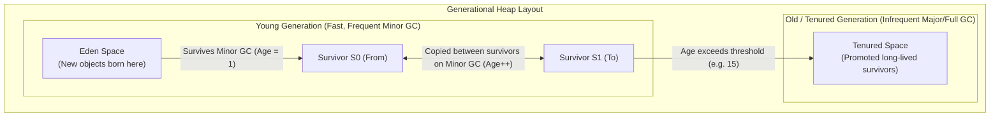
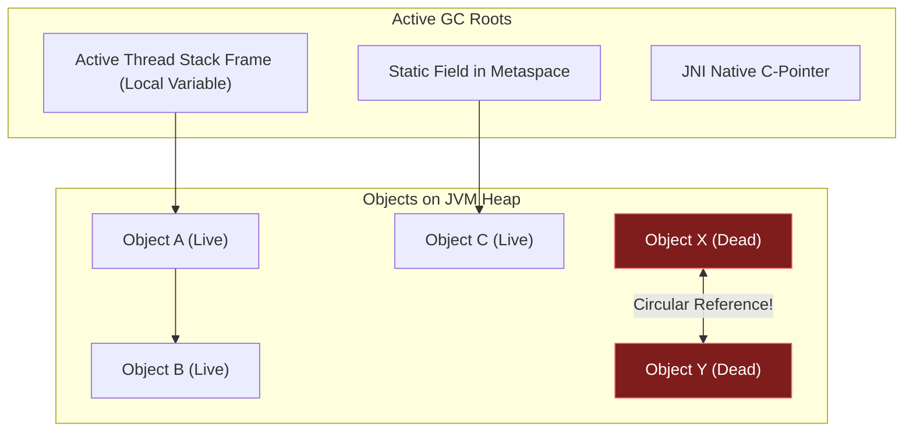
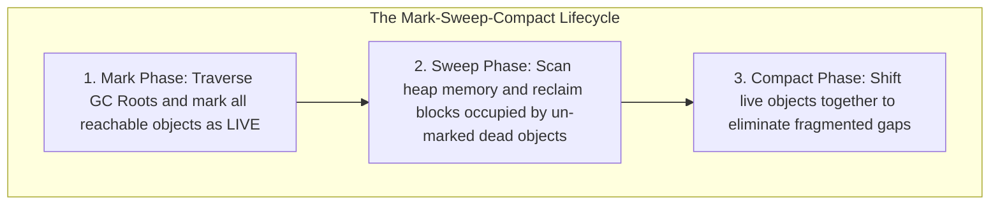
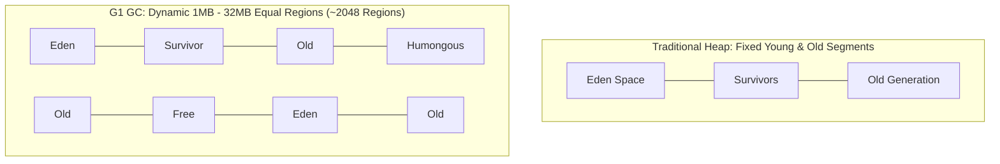

In languages like C and C++, memory management is manual: every `malloc()` requires a matching `free()`. Forget to free memory, and your process leaks gigabytes until it crashes; free memory too early, and you trigger terrifying dangling pointer bugs or security vulnerabilities.

Java changed the software industry by introducing **Automatic Garbage Collection (GC)**.

The JVM continuously tracks allocated heap objects, identifies which ones are no longer reachable, and silently reclaims their memory in the background. But automatic memory management is **not** a magic silver bullet. Unchecked allocations cause latency-spiking **Stop-the-World (STW)** pauses, memory leaks still plague enterprise architectures through accidental reference retention, and picking the wrong GC algorithm can throttle CPU throughput.

To engineer high-performance, low-latency microservices, you must understand how garbage collection works down to the byte level: **The Weak Generational Hypothesis**, **GC Root reachability trees**, and **modern production collectors (G1 and ZGC)**.

---

## The Weak Generational Hypothesis

Why doesn't the JVM treat the entire Heap as one uniform block of memory?

Decades of empirical software telemetry across thousands of production enterprise systems revealed a universal physical law known as the **Weak Generational Hypothesis**:

1. **The vast majority of objects die almost immediately after allocation** (typically over 95% die within milliseconds of birth). Examples include temporary loop variables, JSON DTOs, HTTP request contexts, and String concatenations.
2. **Objects that survive multiple collection cycles tend to live for a very long time.** Examples include connection pools, Spring singleton beans, caches, and configuration trees.



### The Generational Memory Layout
To exploit this hypothesis, the JVM divides the Heap into two primary physical zones:

- **Young Generation**:
  - **Eden Space**: Where almost all new objects are allocated. Because new objects are born here at high rates, allocation is optimized using **TLABs (Thread Local Allocation Buffers)** via a fast bump-the-pointer pointer bump!
  - **Survivor Spaces (S0 / S1)**: Two identical buffers. At any given moment, one serves as the active "From" space and the other as the empty "To" space.
- **Old (Tenured) Generation**: Holds objects that survived multiple Minor GC cycles and crossed the **Tenuring Threshold** (typically `-XX:MaxTenuringThreshold=15`).

---

## Object Reachability: The GC Root Tracing Algorithm

Older runtimes used **Reference Counting** (each object kept an integer counter incremented on new references). Reference counting has a fatal flaw: **Circular References**. If Object A points to Object B, and Object B points back to Object A, their counters never drop to zero, leaking memory even if the rest of the application completely abandoned them!

Java solves this by using **Tracing Reachability from GC Roots**:



The Garbage Collector builds a directed graph starting strictly from **GC Roots**. Any object that cannot be reached by traversing pointers from at least one GC Root is considered **Dead** and eligible for reclamation—even if dead objects point to each other!

### What Qualifies as a GC Root?
1. **Local Variables on Thread Stacks**: Parameters and local variables inside active method stack frames.
2. **Static Fields**: Class-level variables stored in loaded classes inside Metaspace.
3. **JNI References**: Native C/C++ pointers created during Java Native Interface execution.
4. **Active Thread Instances**: Any running `java.lang.Thread` is intrinsically a GC root.
5. **Synchronized Monitor Objects**: Objects currently held by a `synchronized` block or lock.

---

## The Three Core GC Algorithms

Different collectors combine three fundamental algorithms to manage memory:



### Mark-Copy (Copying Collector)
- **How it works:** Memory is divided into two spaces. During collection, live objects are copied to the second space, leaving behind dead objects. The first space is completely cleared in one sweep.
- **Pros:** Blazing fast allocation via pointer bumping; zero memory fragmentation.
- **Cons:** Wastes 50% of available memory buffers.
- **Where it is used:** Eden and Survivor spaces during **Minor GC** (where 95% of objects are dead, so copying the few live survivors takes almost zero time!).

### Mark-Sweep
- **How it works:** Traverses the live graph (Mark), then sweeps dead memory blocks into a free-memory list without moving live objects.
- **Pros:** Fast sweep; does not relocate objects in RAM.
- **Cons:** Causes severe **memory fragmentation**. Free memory is broken into tiny swiss-cheese gaps, making it impossible to allocate a large array later!

### Mark-Compact
- **How it works:** Marks live objects, then physically slides all live objects to the beginning of the heap segment, creating a single contiguous block of free memory.
- **Pros:** Eliminates memory fragmentation entirely.
- **Cons:** Higher CPU overhead because object pointers across the entire application must be updated to reflect new physical RAM addresses.
- **Where it is used:** **Old Generation** during Major / Full GC passes.

---

## Stop-the-World (STW) Pauses & JVM Safepoints

During certain garbage collection phases, the JVM must ensure that the object reference graph does not change while it traces or relocates objects. 

To accomplish this, the JVM brings all application threads to a complete halt: a **Stop-the-World (STW) pause**.

### How Safepoints Work
The JVM cannot abruptly pause a thread mid-instruction without risking CPU register corruption. 

Instead, the JIT compiler injects invisible **Safepoint Polls** into compiled machine code (typically at method returns, loop branches, and allocation points). When a GC pause is scheduled:
1. The JVM sets a global safepoint guard page flag.
2. As application threads reach their next safepoint poll, they detect the flag, save their registers, and pause.
3. Once **all threads have reached a safepoint**, the GC executes its pause phase.
4. Threads resume once the phase completes.

> [!WARNING]
> Long STW pauses (e.g. 500ms to 5 seconds) freeze API responses, drop WebSocket connections, and cause Kubernetes health-check liveness probes to fail, triggering catastrophic pod restart loops!

---

## Modern Production Garbage Collectors Compared

The JDK provides four primary garbage collectors tailored for different operational workloads:

| Collector | JVM Flag | Target Workload | Pause Time Characteristics |
|---|---|---|---|
| **Serial GC** | `-XX:+UseSerialGC` | Single-core microcontainers, CLI tools (< 100 MB heap). | Single-threaded; long STW pauses. |
| **Parallel GC** | `-XX:+UseParallelGC` | Offline batch processing, big data calculations. | Maximizes raw CPU throughput; STW pauses acceptable. |
| **G1 GC** (Default) | `-XX:+UseG1GC` | High-throughput web services & enterprise APIs. | Region-based; **predictable pause targets** (`-XX:MaxGCPauseMillis=200`). |
| **ZGC** | `-XX:+UseZGC` | Ultra-low latency microservices, financial trading, massive heaps (up to 16 TB). | **Sub-millisecond pauses (< 1ms)** regardless of heap size! |



### G1 GC (Garbage-First Collector) - The Modern Default
Default since Java 9. Instead of dividing the heap into massive contiguous generational blocks, G1 partitions the heap into ~**2,048 equal regions** (ranging from 1 MB to 32 MB).
- Regions dynamically assign themselves as Eden, Survivor, Old, or Humongous (for objects larger than 50% of region size).
- **Garbage-First Strategy:** G1 continuously monitors which regions contain the most dead objects. When collecting, it prioritizes reclaiming regions with the most garbage first (hence "Garbage-First"), delivering high reclamation with minimal pause times.
- Tunable target pause: `-XX:MaxGCPauseMillis=200`.

### ZGC (Z Garbage Collector) - Ultra-Low Latency
Introduced in Java 15 and upgraded to **Generational ZGC in Java 21** (`-XX:+UseZGC -XX:+ZGenerational`).
- Performs almost all heavy GC phases (marking, relocation, reference processing) **concurrently while application threads are actively running**!
- Guarantees **pause times under 1 millisecond**, whether your heap is 1 Gigabyte or 16 Terabytes!
- Uses **Colored Pointers** (encoding metadata in reference address bits) and **Load Barriers** (JIT-injected checks when dereferencing pointers).

---

## Memory Leaks in Java: Accidental Reference Retention

While Java eliminates dangling pointers, **memory leaks are alive and well in Java**.

A Java memory leak occurs when an object that is no longer needed by business logic remains tethered to an active GC Root:

```java
// ❌ PRODUCTION MEMORY LEAK: Static Map Accumulation
public class AuditService {
    // GC Root! Static references never die as long as the application runs!
    private static final Map<String, UserSession> SESSION_CACHE = new HashMap<>();

    public void login(String token, UserSession session) {
        SESSION_CACHE.put(token, session); // Added, but NEVER removed on logout!
    }
}
```

### Common Sources of Memory Leaks in Production
1. **Unbounded Static Collections:** Static Lists or Maps acting as impromptu caches without eviction policies.
2. **Uncleaned `ThreadLocal` Variables:** In thread-pooled environments (like Tomcat or Spring Boot), worker threads are reused for thousands of requests. Forgetting to call `threadLocal.remove()` causes request data to accumulate permanently on the worker thread.
3. **Forgotten Listeners and Callbacks:** Registering event listeners with long-lived singleton publishers without unregistering them on teardown.
4. **Non-Static Inner Classes:** Inner classes hold an implicit synthetic `this$0` pointer to their outer class, preventing the outer instance from being garbage collected.

---

## Reference Strengths in `java.lang.ref`

Java provides four levels of reference reachability:

1. **Strong Reference (`Object obj = new Object()`):** Standard Java reference. As long as a strong reference chain exists, the object is **never** collected.
2. **Soft Reference (`SoftReference<T>`):** Retained until memory pressure becomes critical. The JVM clears soft references strictly before throwing an `OutOfMemoryError`.
3. **Weak Reference (`WeakReference<T>`):** Does not prevent garbage collection. Reclaimed during the very next GC cycle if no strong references exist. Ideal for canonicalizing metadata (e.g. `WeakHashMap`).
4. **Phantom Reference (`PhantomReference<T>`):** Used with `ReferenceQueue` for post-mortem resource cleanup. Replaces broken `finalize()`.

---

## The Death of `finalize()` (JEP 421)

For decades, `Object.finalize()` was taught as a way to clean up resources before an object was reclaimed.

**`finalize()` is an architectural disaster and has been deprecated for removal**:
- **Non-deterministic:** There is zero guarantee when (or if) `finalize()` will ever run before the JVM shuts down.
- **Performance killer:** Objects with finalizers must survive at least one extra GC cycle, bloating the Old Generation.
- **Object Resurrection:** A malicious or buggy finalizer can assign `this` to a static field, resurrecting a dead object mid-collection!

```java
// ✅ Modern, safe resource cleanup: java.lang.ref.Cleaner (Java 9+)
import java.lang.ref.Cleaner;

public class NativeResourceWrapper implements AutoCloseable {
    private static final Cleaner CLEANER = Cleaner.create();

    private static class CleanAction implements Runnable {
        private final long nativeHandle;
        CleanAction(long handle) { this.nativeHandle = handle; }

        @Override
        public void run() {
            // Safe native C memory release; NEVER references outer object!
            System.out.println("Freeing native C memory handle: " + nativeHandle);
        }
    }

    private final Cleaner.Cleanable cleanable;

    public NativeResourceWrapper(long handle) {
        this.cleanable = CLEANER.register(this, new CleanAction(handle));
    }

    @Override
    public void close() {
        cleanable.clean(); // Deterministic close
    }
}
```

---

## Summary & Mental Model Checkpoint

1. **Weak Generational Hypothesis**: 95%+ of objects die young; survivors live for a long time. This dictates Young vs Old gen separation.
2. **GC Roots**: Tracing begins from thread stack variables, static fields, and JNI handles. Circular references do not prevent collection.
3. **Mark-Copy vs Mark-Compact**: Young Gen uses fast Mark-Copy (survivors copied to S0/S1); Old Gen uses Mark-Compact to defragment memory.
4. **G1 GC**: Region-based default collector; prioritizes regions with the most garbage to meet pause time goals (`-XX:MaxGCPauseMillis`).
5. **Generational ZGC (Java 21)**: Sub-millisecond pause times (< 1ms) for massive heaps by running marking and compaction concurrently.
6. **Accidental Retention**: Java memory leaks happen when unneeded objects stay linked to live GC Roots (e.g., static maps, uncleaned `ThreadLocal`s).
7. **Never Use `finalize()`**: Deprecated for removal. Use `try-with-resources` (`AutoCloseable`) and `java.lang.ref.Cleaner`.

---

## 🎯 Senior Engineer Interview Questions

### What is the Weak Generational Hypothesis, and how does the JVM physically exploit it to optimize throughput and memory allocation?
> **Answer:** The Weak Generational Hypothesis observes two empirical rules: (1) the vast majority of allocated objects die shortly after instantiation, and (2) objects that survive multiple garbage collection passes tend to remain live for a prolonged duration. The JVM exploits this by physically partitioning the Heap into distinct regions: a Young Generation (comprising Eden and two Survivor spaces, S0 and S1) and an Old (Tenured) Generation. New objects are allocated into Eden using fast bump-the-pointer thread-local allocation buffers (TLABs). When Eden fills, a Minor GC executes. Because most objects are already dead, the collector uses an efficient Mark-Copy algorithm that only visits and copies the few live survivors into a Survivor space, reclaiming 95%+ of Eden in milliseconds. Objects that survive multiple Minor GC rounds cross the tenuring threshold and are promoted to the Old Generation, where collections (Major/Full GC) occur far less frequently.

### Why does Java use Tracing Reachability from GC Roots instead of Reference Counting, and what constitutes a GC Root?
> **Answer:** Reference Counting increments an integer counter whenever a reference to an object is created and decrements it when a reference is dropped. This mechanism fails completely when circular references occur: if Object A references Object B and Object B references Object A, both retain a reference count of at least 1 even if all other application references to them have been discarded, creating permanent memory leaks. Tracing Reachability solves this by constructing a directed reachability graph starting strictly from active **GC Roots**. If an object is not reachable via a chain of references starting from a root, it is classified as dead and collected, automatically resolving circular islands of isolation. Valid GC Roots include: (1) Local variables and parameter references on active thread stack frames, (2) Static fields of loaded classes in Metaspace, (3) JNI global and local native C-pointers, (4) Active `Thread` instances, and (5) JVM internal monitor synchronization locks.

### How does ZGC achieve sub-millisecond Stop-the-World pause times (< 1ms) even on multi-terabyte heaps, whereas traditional collectors experience pauses proportional to heap size?
> **Answer:** Traditional collectors (like Parallel GC or older CMS phases) perform heavy tasks like object marking, memory compaction, and reference pointer updating while application threads are stopped in a Stop-the-World pause. Consequently, their pause duration scales linearly with the number of live objects and heap size. ZGC (and Generational ZGC in Java 21) decouples pause time from heap size by performing virtually all heavy work—including concurrent marking, concurrent thread-stack scanning, concurrent relocation, and concurrent pointer remapping—asynchronously while application threads run concurrently. ZGC achieves this using two foundational architectural primitives: **Colored Pointers** (storing GC metadata flags like Mark0/Mark1 and Remapped directly in the upper bits of 64-bit reference pointers) and **Load Barriers** (JIT-injected instructions executed whenever an application thread dereferences an object pointer). If a thread accesses an object that has not yet been relocated by the GC, the load barrier intercepts the access, relocates the object immediately on the fly, updates the pointer in place, and returns the valid reference without stalling the application.

### Why is `Object.finalize()` deprecated for removal in modern Java (JEP 421), and what are the specific dangers of relying on it?
> **Answer:** `Object.finalize()` has severe architectural flaws that compromise security, performance, and operational predictability: (1) **Unpredictable Execution:** The JVM specification provides zero guarantees regarding when, or even if, a finalizer will ever execute before application shutdown, making it useless for releasing critical resources like database connections or file descriptors. (2) **GC Performance Degradation:** Objects declaring a non-trivial `finalize()` method must be registered with the JVM's `Finalizer` thread upon creation. When they become unreachable, they cannot be reclaimed immediately; they are placed on a finalization queue and promoted to the Old Generation, requiring at least one additional Full GC cycle before their memory can be cleared. (3) **Object Resurrection Vulnerability:** A finalizer method can reassign `this` to an active static reference, resurrecting a dead object mid-collection and leaving the runtime in an unpredictable state. (4) **Thread Starvation:** All finalizers are processed by a single low-priority JVM background thread; an uncaught exception or slow I/O inside a single finalizer stalls finalization for the entire system, leading to rapid `OutOfMemoryError`. Modern Java mandates deterministic cleanup using `AutoCloseable` with `try-with-resources`, or `java.lang.ref.Cleaner` as a non-resurrecting fallback.