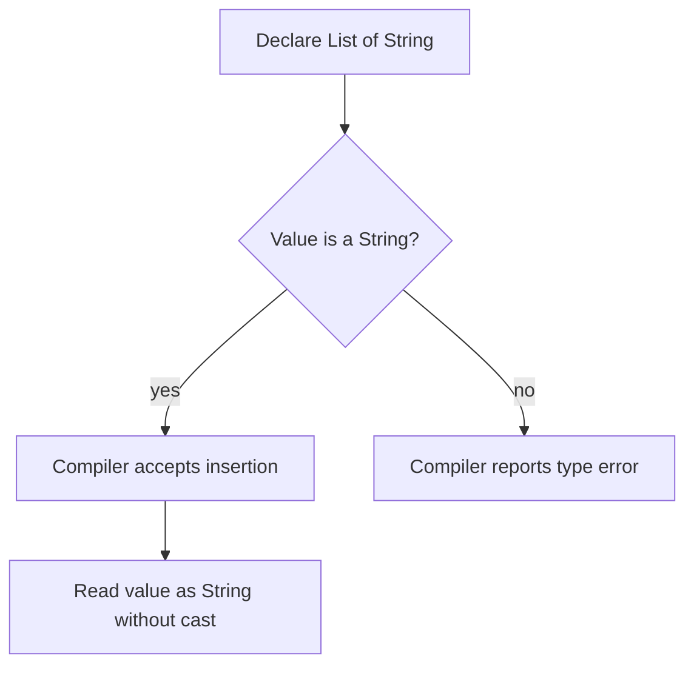
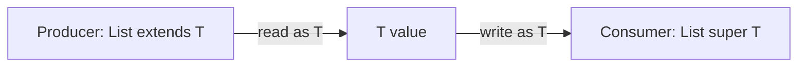

Before generics, a collection such as `List` could hold values of many unrelated types. Code had to cast values back when reading them, and a mistaken cast failed at runtime. Generics let a class, interface, or method declare type parameters so the compiler can check how values flow through the API.

This lesson uses Java 21. Generics were added in Java 5 and are implemented using type erasure; Java does not create a separate runtime class for every type argument such as `List<String>` and `List<Integer>`.

## A parameterized type carries a compile-time contract

The type argument between angle brackets tells the compiler what the list is intended to contain:

```java
import java.util.ArrayList;
import java.util.List;

List<String> names = new ArrayList<>();
names.add("Ada");
// names.add(42); // Compile-time error: 42 is not a String

String first = names.get(0); // No cast required
```

The compiler rejects an invalid insertion before the program runs. This is stronger than using a raw `List` and relying on a cast: the constraint is checked at the point where incompatible data enters the collection.

The type argument is part of the static type. `List<String>` is not a subtype of `List<Object>` even though `String` is a subtype of `Object`. If it were, code holding a `List<Object>` reference could insert an arbitrary object into a list that another part of the program assumes contains only strings. Java's generic types are invariant for this reason.



The diagram traces the main benefit: invalid values are rejected during compilation, before a runtime cast is needed.

## Generic classes and interfaces

A class declares type parameters after its name. Each instance then uses a concrete type argument:

```java
public final class Box<T> {
    private T value;

    public void set(T value) {
        this.value = value;
    }

    public T get() {
        return value;
    }
}
```

`T` is a type variable: it stands for a type selected by a caller. The compiler checks that `Box<String>` only receives and returns strings through this API:

```java
Box<String> greeting = new Box<>();
greeting.set("Hello");
String text = greeting.get();
```

A type parameter can have a meaningful name such as `ELEMENT`, but conventional single-letter names are common: `T` for a general type, `E` for an element, `K` and `V` for map keys and values, and `R` for a result. Choose names that make multi-parameter APIs clear.

The same idea applies to interfaces and records:

```java
interface Converter<SOURCE, TARGET> {
    TARGET convert(SOURCE source);
}

record Pair<LEFT, RIGHT>(LEFT left, RIGHT right) {}
```

Type arguments are reference types. A primitive cannot be used directly as `Box<int>`; use its wrapper such as `Box<Integer>`. Boxing and unboxing can happen at the boundary, with their normal costs and possible `NullPointerException` behavior when unboxing `null`.

## Generic methods and type inference

A method can declare its own type parameters independently of its enclosing class. The type parameters appear before the return type:

```java
import java.util.List;

static <T> T first(List<T> values) {
    if (values.isEmpty()) {
        throw new IllegalArgumentException("values must not be empty");
    }
    return values.get(0);
}
```

The compiler usually infers `T` from the argument and the target context:

```java
String name = first(List.of("Ada", "Grace"));
Integer number = first(List.of(10, 20));
```

Explicit type witnesses are possible when inference needs help: `MyClass.<String>first(values)`. Inference is a compile-time process, not runtime inspection of the object's contents.

## Bounds: express the operations an algorithm needs

An unconstrained type variable can be used as a value of `Object`, but the compiler cannot assume it has a particular method. A bound states the capabilities required by an algorithm:

```java
static <T extends Comparable<? super T>> T maximum(List<? extends T> values) {
    if (values.isEmpty()) {
        throw new IllegalArgumentException("values must not be empty");
    }

    T best = values.get(0);
    for (T candidate : values) {
        if (candidate.compareTo(best) > 0) {
            best = candidate;
        }
    }
    return best;
}
```

`T extends Comparable<? super T>` means that values of type `T` can be compared to `T` or one of its supertypes. This bound gives the method permission to call `compareTo`; it does not promise that the comparison is sensible or consistent with `equals`. Those are behavioral contracts the implementing type must honor.

Multiple bounds use `&`, with a class bound (if present) first:

```java
static <T extends Number & Comparable<? super T>> T larger(T left, T right) {
    return left.compareTo(right) >= 0 ? left : right;
}
```

A bound can restrict what types are accepted, but it does not make an invalid implementation correct. Prefer the narrowest bound that matches the real operations the method performs.

## Wildcards and variance

Because `List<String>` is not a `List<Object>`, APIs use wildcards to describe relationships between unknown type arguments.

- `? extends T` means an unknown type that is `T` or a subtype of `T`.
- `? super T` means an unknown type that is `T` or a supertype of `T`.
- `?` means a type argument is unknown; it is shorthand for `? extends Object` in many type uses.

The wildcard is useful when callers should supply different related parameterizations:

```java
static double total(List<? extends Number> numbers) {
    double sum = 0;
    for (Number number : numbers) {
        sum += number.doubleValue();
    }
    return sum;
}
```

This method can accept `List<Integer>`, `List<Double>`, and other lists whose element type extends `Number`. It cannot safely add a new `Number` to the list: the actual element type might be `Integer`, `Double`, or a custom subtype, and the compiler cannot know which. Reading yields a value usable as `Number`.

For a destination that consumes `T` values, use a lower-bounded wildcard:

```java
static <T> void copy(List<? extends T> source, List<? super T> destination) {
    for (T value : source) {
        destination.add(value);
    }
}
```

The source produces values that can be read as `T`; the destination accepts `T` values. This is the **PECS** guideline: *Producer Extends, Consumer Super*. It is a useful default for API design, not a rule to apply blindly; a type used as both producer and consumer often needs an exact type parameter.



The wildcard captures an unknown concrete type, while the named `T` relates the source value to what the destination accepts.

## Type erasure: the runtime does not retain most type arguments

Generic types are checked by the compiler, then erased when the compiler emits bytecode:

- An unbounded type variable is generally erased to `Object`.
- A bounded type variable is generally erased to its leftmost bound.
- The compiler inserts casts where needed and may generate bridge methods to preserve overriding behavior after erasure.

The source-level `List<String>` and `List<Integer>` both use the same runtime `List` class. Consequently:

```java
List<String> words = new ArrayList<>();
List<Integer> counts = new ArrayList<>();

System.out.println(words.getClass() == counts.getClass()); // true
```

This is a runtime class comparison, not a recommendation to compare `Class` objects in application logic. Type erasure explains several restrictions:

```java
// Not legal: T is not a runtime class token.
// T value = new T();

// Not legal: the JVM cannot distinguish these overloads after erasure.
// void process(List<String> values) {}
// void process(List<Integer> values) {}
```

Likewise, most parameterized types cannot be tested with `instanceof List<String>` because that type argument is not reifiable at runtime. The runtime can test `instanceof List<?>`; code must then validate individual elements before treating them as a more specific type.

When runtime type information is needed, pass an explicit `Class<T>` token or use an appropriately designed type token abstraction. A `Class<List<String>>` cannot be obtained directly because `List<String>` is not a reifiable class literal.

## Raw types and heap pollution

A raw type omits generic arguments, as in `List` rather than `List<String>`. Raw types exist primarily for compatibility with code written before generics. Using them bypasses much of compile-time checking and commonly produces unchecked warnings:

```java
List<String> names = new ArrayList<>();
List raw = names;
raw.add(42); // Unchecked warning: heap pollution is possible

String name = names.get(0); // ClassCastException at runtime
```

**Heap pollution** occurs when a variable of a parameterized type refers to an object that does not satisfy the type's parameterized contract. Raw types, unchecked casts, and some uses of non-reifiable varargs can create it. Treat unchecked warnings as evidence to inspect, not noise to suppress globally.

The `@SafeVarargs` annotation is only for methods or constructors whose implementation actually preserves the array's type-safety guarantees. It is not a generic warning suppressor; the compiler restricts where it can be applied, and callers rely on the author having verified the implementation.

## Practical rules

- Put generic type information at API boundaries instead of returning `Object` and asking every caller to cast.
- Avoid raw types. Prefer `List<?>` when the element type is unknown and the code only needs operations that are safe for every element type.
- Use a type parameter when two or more positions must have the same type; use a wildcard when a particular type argument is intentionally unknown.
- Use bounds to express actual capabilities, not to make signatures look sophisticated.
- Do not assume generic type arguments are available for runtime checks, reflection, or overload selection; erasure limits those operations.
- Prefer immutable or well-encapsulated APIs when unchecked conversions are unavoidable at a legacy boundary.

## Further reading

- [The Java Language Specification, Chapter 4: Types, Values, and Variables](https://docs.oracle.com/javase/specs/jls/se21/html/jls-4.html), especially type variables, parameterized types, and erasure
- [The Java Language Specification, Chapter 5: Conversions and Contexts](https://docs.oracle.com/javase/specs/jls/se21/html/jls-5.html)
- [Oracle Java Tutorials: Generics](https://docs.oracle.com/javase/tutorial/java/generics/)
