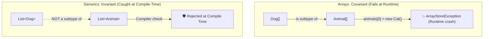
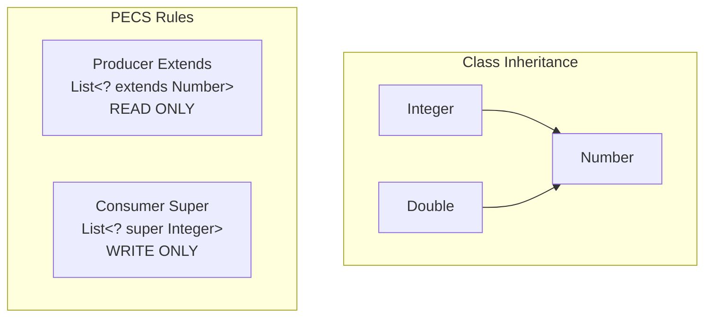

Before Java 5 introduced generics in 2004, working with collections in Java was an exercise in faith and frequent runtime panic. Every collection held raw `Object` references. You had to manually cast every object retrieved from a list, hoping that some rogue method hadn't quietly slipped a `Double` into a list intended for `String`s.

When the cast failed in production, the JVM threw the infamous `ClassCastException`.

Java Generics solved this by giving developers **compile-time type safety**. But unlike C++ templates or C# reified generics, Java was constrained by a critical design requirement: **backwards compatibility with millions of lines of legacy Java 1.4 bytecode**.

To achieve this without breaking the ecosystem, Java architects introduced **Type Erasure**. Understanding how the compiler checks types at build time and strips them away at runtime—along with **variance (`extends` vs `super`)**, **bridge methods**, and **Super Type Tokens**—is essential to mastering Java API design.

---

## Why Java Generics Exist: Invariance vs. Covariance

To understand why generics behave the way they do, we must examine Java arrays.

In Java, **arrays are covariant**. If `Dog` extends `Animal`, then `Dog[]` is considered a subtype of `Animal[]`. On paper this sounds convenient, but in practice it introduced a severe architectural flaw:

```java
// ❌ The Array Covariance Disaster: Fails at RUNTIME
Dog[] dogs = new Dog[2];
Animal[] animals = dogs; // Legal because arrays are covariant!

// The compiler allows this because Cat IS-A Animal...
// But at runtime, the underlying array is Dog[], throwing ArrayStoreException!
animals[0] = new Cat(); // CRASH: java.lang.ArrayStoreException
```

Because arrays retain their component type at runtime (**reified**), the JVM must inspect every single array write with a runtime type check, adding CPU overhead and deferring catastrophic crashes to runtime.

Generics took the opposite architectural path: **Generics are strictly invariant**. 

Even though `Integer` extends `Number`, a `List<Integer>` is **NOT** a `List<Number>`:

```java
// ❌ Compile-time error: Generics are invariant!
List<Integer> intList = new ArrayList<>();
// List<Number> numList = intList; // Incompatible types!
```

If the compiler allowed `numList = intList`, you could execute `numList.add(3.14)` (adding a Double to an Integer list), corrupting the list! Invariance catches this bug at compile time, before code ever reaches a production server.



---

## Type Erasure: What Happens at Bytecode Level

The most critical mental model to internalize about Java Generics is **Type Erasure**:

> **Java Generics are an illusion maintained entirely by `javac` (the compiler). At runtime inside the JVM, type arguments do not exist.**

When `javac` compiles generic code into `.class` bytecode:
1. It replaces all generic type parameters with their leftmost bound (or `java.lang.Object` if unbounded).
2. It inserts explicit bytecode `checkcast` instructions wherever generic objects are retrieved.
3. It generates synthetic **bridge methods** to preserve polymorphic method overriding.

### Source Code vs. Compiled Bytecode

Consider this simple generic class:

```java
// What you write in Java:
public class Box<T> {
    private T value;

    public void set(T value) { this.value = value; }
    public T get() { return value; }
}

// Caller:
Box<String> box = new Box<>();
box.set("Hello, Generics!");
String message = box.get();
```

Here is what `javac` actually writes to bytecode (decompiled):

```java
// What the JVM actually executes:
public class Box {
    private Object value; // Erased to Object!

    public void set(Object value) { this.value = value; }
    public Object get() { return value; }
}

// Caller:
Box box = new Box();
box.set("Hello, Generics!");
String message = (String) box.get(); // Compiler injected checkcast!
```

Because of type erasure, all instances of `Box` share the exact same runtime `Class` object:

```java
List<String> stringList = new ArrayList<>();
List<Integer> intList = new ArrayList<>();

// Both evaluate to the exact same runtime class token:
System.out.println(stringList.getClass() == intList.getClass()); // true!
System.out.println(stringList.getClass()); // class java.util.ArrayList
```

---

## The Restrictions Imposed by Type Erasure

Because type arguments are erased at compile time, several intuitive operations are strictly illegal in Java:

```java
public class GenericPitfalls<T> {

    public void illegalOperations() {
        // ❌ 1. Cannot instantiate a type parameter directly:
        // T obj = new T(); // Error: T is erased to Object; JVM doesn't know constructor!

        // ❌ 2. Cannot create a generic array:
        // T[] array = new T[10]; // Error: Cannot create a generic array of T

        // ❌ 3. Cannot check instanceof against a parameterized type:
        // if (obj instanceof List<String>) // Error: Cannot check erased type at runtime!
        if (obj instanceof List<?>) { } // ✅ Legal: Unbounded wildcard is reifiable

        // ❌ 4. Static members cannot reference the class type parameter:
        // private static T instance; // Error: Static fields belong to the class, not instance!
    }
}
```

### The Bridge Method Mystery
When a class extends or implements a parameterized class or interface and narrows the type parameter, type erasure introduces a signature mismatch.

```java
public class Node<T> {
    public void setData(T data) { ... }
}

public class MyStringNode extends Node<String> {
    @Override
    public void setData(String data) { ... }
}
```

After erasure, the parent class has `setData(Object)`, while the child class has `setData(String)`. In bytecode, these are completely different method signatures! Dynamic method dispatch would fail to override the parent method.

To solve this, the compiler secretly generates a synthetic **Bridge Method** in `MyStringNode`:

```java
// Generated secretly by javac to satisfy the JVM vtable:
public void setData(Object data) {
    this.setData((String) data); // Casts to String and delegates to your method!
}
```

---

## Wildcards and Variance: The PECS Principle

Because generic types are invariant, how do you write a method that accepts a list of integers, doubles, or floats and sums them? 

If you write `sum(List<Number> list)`, callers cannot pass `List<Integer>`. To solve this, Java introduced **Wildcards (`?`)**.



The golden rule for wildcards was coined by Joshua Bloch: **PECS (Producer Extends, Consumer Super)**:

### Producer Extends (`? extends T`)
If your generic container **produces** values for your code to read, use `? extends T`.
- You can safely **read** items out as type `T`.
- You **cannot write** anything into it (except `null`), because the compiler cannot determine the actual underlying concrete type!

```java
// ✅ Producer: Reads numbers out of the collection
public static double sumOfList(List<? extends Number> list) {
    double total = 0.0;
    for (Number n : list) {
        total += n.doubleValue(); // Safe read: Guaranteed to be at least a Number
    }
    // list.add(10); // ❌ COMPILE ERROR! Cannot add to a producer wildcard
    return total;
}
```

### Consumer Super (`? super T`)
If your generic container **consumes** values that your code writes into it, use `? super T`.
- You can safely **write** instances of `T` (or subtypes of `T`) into it.
- When reading from it, items can only be retrieved as `Object`, because the collection could be a `List<Object>`.

```java
// ✅ Consumer: Writes integers into the destination collection
public static void addIntegers(List<? super Integer> list) {
    list.add(1);  // Safe write: List accepts Integer or any of its supertypes
    list.add(2);
    list.add(3);

    // Object item = list.get(0); // Only readable as Object!
}
```

### The Ultimate Demonstration: `Collections.copy`
Observe how the standard library combines both sides of PECS:

```java
// Source PRODUCES elements (? extends T)
// Destination CONSUMES elements (? super T)
public static <T> void copy(List<? super T> dest, List<? extends T> src) {
    for (int i = 0; i < src.size(); i++) {
        dest.set(i, src.get(i));
    }
}
```

---

## Heap Pollution and `@SafeVarargs`

**Heap pollution** occurs when a variable of a parameterized type refers to an object that does not conform to that parameterized type contract, usually caused by raw types or generic varargs:

```java
// ❌ Heap Pollution Trap
List<String> strings = new ArrayList<>();
List raw = strings; // Raw type bypasses compiler check!
raw.add(42);        // Pollutes the heap with an Integer!

// Compiler generated checkcast expects a String, throws ClassCastException!
String value = strings.get(0); // CRASH at runtime: Integer cannot be cast to String
```

### Generic Varargs Danger
When you write a varargs parameter (`T... items`), the JVM secretly constructs an array (`T[]`). But earlier we learned that **generic arrays are dangerous because arrays are covariant while generics are invariant**.

```java
// ⚠️ Compiler emits "Possible heap pollution from parameterized vararg type"
@SafeVarargs // Promises the compiler that this method will NOT pollute the array!
public static <T> List<T> asList(T... elements) {
    List<T> list = new ArrayList<>(elements.length);
    for (T element : elements) {
        list.add(element);
    }
    return list;
}
```

> [!WARNING]
> Only apply `@SafeVarargs` if:
> 1. The method does **not store** anything into the varargs array.
> 2. The method does **not leak** or return the varargs array reference to outer code.

---

## Super Type Tokens: Defeating Type Erasure

Have you ever wondered how libraries like Jackson or Gson can deserialize complex generic types from JSON into `List<User>` without losing the generic type argument?

```java
// How does Jackson know the inner type is User if generics are erased?!
List<User> users = mapper.readValue(json, new TypeReference<List<User>>() {});
```

This brilliant technique is known as **Neal Gafter's Super Type Token** (or Gafter's Gadget).

### How It Works Under the Hood
While the JVM erases generic type parameters on *instances*, it preserves generic metadata on **class signatures and subclass definitions** in the class file's bytecode `Signature` attribute!

By creating an **anonymous inner class** subclassing a generic base class (`new TypeReference<List<User>>() {}` has `{}` brackets at the end), we create a new anonymous class. We can then inspect the subclass's generic superclass via reflection:

```java
import java.lang.reflect.ParameterizedType;
import java.lang.reflect.Type;

public abstract class TypeReference<T> {
    private final Type type;

    protected TypeReference() {
        // Obtains the generic superclass (e.g., TypeReference<List<User>>)
        Type superclass = getClass().getGenericSuperclass();
        if (superclass instanceof ParameterizedType parameterized) {
            // Retrieves the actual generic type argument: List<User>!
            this.type = parameterized.getActualTypeArguments()[0];
        } else {
            throw new IllegalArgumentException("TypeReference must be constructed as an anonymous subclass!");
        }
    }

    public Type getType() {
        return this.type;
    }
}
```

By leveraging the JVM's classfile `Signature` metadata, Super Type Tokens provide a bridge across the type erasure boundary.

---

## Summary & Mental Model Checkpoint

1. **Arrays vs Generics**: Arrays are covariant and reified (fail at runtime); Generics are invariant and erased (fail safely at compile time).
2. **Type Erasure**: Generics exist strictly for the compiler; the JVM bytecode uses raw types with injected `checkcast` instructions.
3. **Synthetic Bridge Methods**: Generated by `javac` to maintain polymorphic overriding when subclasses narrow parameterized methods.
4. **PECS Invariant**: Producer `extends` (read-only), Consumer `super` (write-only).
5. **Heap Pollution**: Occurs when raw types or unsafe varargs inject mismatched objects into parameterized collections.
6. **`@SafeVarargs`**: Contract certifying that a method will neither write into nor leak its internal generic varargs array.
7. **Super Type Tokens**: Anonymous inner class trick (`new TypeReference<T>() {}`) that accesses preserved bytecode `Signature` metadata to inspect generic types at runtime.

---

## 🎯 Senior Engineer Interview Questions

### Why did Java choose Type Erasure instead of reified generics (like C#), and what are the architectural trade-offs of this decision?
> **Answer:** Java 5 prioritized backwards compatibility above all else. In 2004, billions of lines of legacy Java 1.0–1.4 code were running in production across global enterprises. If Java had adopted reified generics (creating distinct runtime classes for `List<String>` and `List<Integer>` as C# did), legacy non-generic JAR libraries would have been incompatible with modern generic collections, fragmenting the Java ecosystem. Type erasure allowed existing compiled bytecode to seamlessly interoperate with generic APIs. The trade-off was loss of runtime type information, making generic array allocation (`new T[]`) and direct type checks (`instanceof T`) impossible, and requiring synthetic bridge methods to maintain polymorphic dispatch.

### Explain the PECS principle. Why does `List<? extends Number>` prevent adding a new `Integer` to the list, even though `Integer` is a `Number`?
> **Answer:** PECS stands for "Producer Extends, Consumer Super". In `List<? extends Number>`, the `?` wildcard represents an *unknown subtype* of `Number`. At runtime, the actual concrete collection passed to this reference could be a `List<Double>`, a `List<Float>`, or a `List<BigDecimal>`. If the compiler allowed inserting an `Integer` into `List<? extends Number>`, it would risk inserting an `Integer` into what is actually a `List<Double>`, violating type safety. Because the compiler cannot verify the concrete subtype at compile time, it forbids adding any element (except `null`). Conversely, reading elements is safe because any element produced by the list is guaranteed to inherit from `Number`.

### What is a synthetic bridge method in Java bytecode, and why is it necessary for generics?
> **Answer:** When a class implements a generic interface or extends a generic class while specifying a concrete type argument (e.g. `class IntegerComparator implements Comparator<Integer>`), type erasure replaces the generic method in the interface with `int compare(Object, Object)`. However, the implementing class defines `int compare(Integer, Integer)`. At the JVM bytecode level, method overriding requires exact matching parameter descriptor types. To maintain polymorphic dispatch and satisfy the interface contract, `javac` generates a synthetic (compiler-generated) bridge method: `public int compare(Object a, Object b)` with the `ACC_BRIDGE` and `ACC_SYNTHETIC` flags. This bridge method casts the incoming `Object` arguments to `Integer` and delegates execution to the developer's specialized `compare(Integer, Integer)` method.

### How do Super Type Tokens (such as Jackson's `TypeReference` or Guava's `TypeToken`) circumvent Type Erasure to deserialize generic types at runtime?
> **Answer:** While the JVM erases generic type information on object instances, the Java Virtual Machine Specification mandates that generic signatures of classes, interfaces, and methods be preserved in the compiled `.class` file's `Signature` metadata attribute. When an application instantiates an anonymous inner class with empty braces—such as `new TypeReference<List<User>>() {}`—it defines a brand-new concrete subclass extending `TypeReference`. At runtime, `TypeReference`'s constructor calls `getClass().getGenericSuperclass()`. Because the subclass definition is preserved in the constant pool metadata, the JVM returns a `ParameterizedType` from which the actual type argument (`List<User>`) can be extracted via reflection, completely bypassing runtime instance erasure.