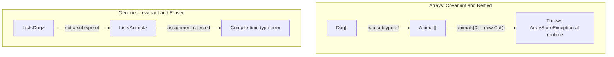
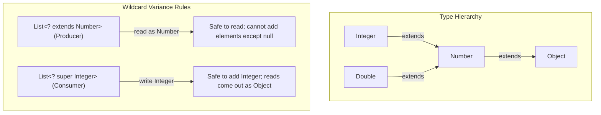

Before Java 5 added generics in 2004, every collection stored raw `Object` references. When you pulled an element out of a `List`, you had to cast it by hand and hope nothing had slipped the wrong type into that list earlier in the call stack. If someone accidentally put an `Integer` into a list meant for `String` values, the code still compiled cleanly. You only found out at runtime when a `ClassCastException` blew up in production.

Generics move those checks to compile time. What makes Java's implementation unusual compared to C++ templates or C# generics is a hard constraint from 2004: backwards compatibility. Millions of lines of compiled Java 1.4 bytecode already existed, and old libraries had to keep working alongside new generic code without recompilation. To satisfy that constraint, Java chose **type erasure**. Knowing how erasure works, how bounds and wildcards control type compatibility, and where erasure's limits show up will save you from the most confusing compiler errors in the language.

---

## Why Generics Are Invariant (Unlike Arrays)

A good way to understand Java generics is to contrast them with Java arrays.

Arrays in Java are **covariant**. If `Dog` extends `Animal`, then `Dog[]` is a subtype of `Animal[]`. Arrays are also **reified**, meaning an array remembers its actual element type at runtime. That combination lets invalid code compile and fail only when executed:

```java
Dog[] dogs = new Dog[2];
Animal[] animals = dogs; // Allowed because arrays are covariant

// Compiles because Cat is an Animal,
// but throws ArrayStoreException at runtime because the array is really a Dog[].
animals[0] = new Cat();
```

Because an `Animal[]` reference might point to a `Dog[]`, the JVM has to check the actual runtime type on every reference-array write.

Generics took the opposite rule: **parameterized types are invariant**. Even though `Integer` extends `Number`, `List<Integer>` is not a subtype of `List<Number>`, and `List<Number>` is not a subtype of `List<Integer>`.

```java
List<Integer> integers = new ArrayList<>();
// Compile-time error: incompatible types
// List<Number> numbers = integers;
```

If that assignment were legal, you could call `numbers.add(3.14)` and silently insert a `Double` into a `List<Integer>`. Invariance closes that hole at compile time.



---

## Generic Classes and Methods

A **generic class** declares one or more type parameters in angle brackets right after the class name. By convention, single uppercase letters are used: `T` for type, `E` for element, `K` and `V` for key and value, `R` for return type.

```java
public class Pair<K, V> {
    private final K key;
    private final V value;

    public Pair(K key, V value) {
        this.key = key;
        this.value = value;
    }

    public K key() {
        return key;
    }

    public V value() {
        return value;
    }
}
```

When instantiating a generic class, Java 7+ lets you use the diamond operator (`<>`) so you do not have to repeat the type arguments on the right-hand side:

```java
Pair<String, Integer> status = new Pair<>("HTTP_OK", 200);
String label = status.key();   // No cast needed
int code = status.value();     // Unboxed safely from Integer
```

You can also declare **generic methods** inside either a generic or a plain non-generic class. The method declares its own type parameters right before the return type, and the compiler usually infers them from the arguments or target assignment type:

```java
import java.util.List;

public final class CollectionsUtil {

    public static <T> T firstOrDefault(List<T> items, T fallback) {
        return items.isEmpty() ? fallback : items.get(0);
    }

    public static void main(String[] args) {
        List<String> names = List.of("Alice", "Bob");

        // Type parameter T is inferred as String
        String first = firstOrDefault(names, "Unknown");

        // Explicit type witness (rarely needed, useful when inference is ambiguous)
        String explicit = CollectionsUtil.<String>firstOrDefault(List.of(), "Fallback");
    }
}
```

One detail that trips people up: if a generic class has a type parameter `T` and an instance method also declares `<T>` before its return type, the method's `<T>` **shadows** the class's `T`. Only declare `<T>` on a method when the method needs a type parameter independent of the enclosing class (which is always the case for `static` methods, since static members cannot reference the class's instance type parameters).

---

## Bounded Type Parameters

An unbounded type parameter like `<T>` gives the compiler almost no information about what `T` can do; inside the class or method, you can only call methods defined on `java.lang.Object`.

To call specific methods on a type parameter, you add an **upper bound** with `extends`. (Java uses `extends` here for both classes and interfaces.)

```java
public static <T extends Number> double average(List<T> values) {
    if (values.isEmpty()) {
        return 0.0;
    }
    double sum = 0.0;
    for (T value : values) {
        sum += value.doubleValue(); // Safe because T is guaranteed to extend Number
    }
    return sum / values.size();
}
```

### Recursive Bounds with `Comparable`

A very common pattern in standard libraries is finding the minimum or maximum element in a collection. To compare two `T` values, `T` must be comparable to itself:

```java
import java.util.List;

public final class Stats {

    public static <T extends Comparable<T>> T max(List<T> items) {
        if (items.isEmpty()) {
            throw new IllegalArgumentException("List must not be empty");
        }
        T best = items.get(0);
        for (int i = 1; i < items.size(); i++) {
            T candidate = items.get(i);
            if (candidate.compareTo(best) > 0) {
                best = candidate;
            }
        }
        return best;
    }
}
```

In public library APIs, you will often see an even more flexible version: `<T extends Comparable<? super T>>`. Why? Suppose `ScheduledTask` extends `Task`, and `Task` implements `Comparable<Task>` rather than `Comparable<ScheduledTask>`. With `<T extends Comparable<T>>`, `Stats.max(scheduledTasks)` fails to compile because `ScheduledTask` implements `Comparable<Task>`, not `Comparable<ScheduledTask>`. Changing the bound to `<T extends Comparable<? super T>>` accepts any type that can compare itself against its own type or any supertype.

### Multiple Bounds

A type parameter can have multiple bounds separated by `&`. At most one bound can be a class, and if a class is present, it must appear first:

```java
import java.io.Serializable;

public static <T extends Number & Comparable<T> & Serializable> T clampPositive(T value) {
    return value.doubleValue() < 0 ? null : value;
}
```

The order of bounds also matters to bytecode generation: during type erasure, the compiler erases `T` to its **leftmost bound** (`Number` in the example above) and inserts casts whenever members from the secondary bounds are called.

---

## Type Erasure: What the JVM Actually Executes

When `javac` compiles generic source code into `.class` files, it enforces all generic type checks and then strips out the type arguments. Specifically, the compiler does three things:

1. Replaces every type parameter with its leftmost bound (or `java.lang.Object` if unbounded).
2. Inserts explicit `checkcast` bytecode instructions where generic values are read back as a concrete type.
3. Generates synthetic **bridge methods** when needed to preserve polymorphism across erased signatures.

Compare a small generic container before and after compilation:

```java
// Source code
public class Box<T> {
    private T value;

    public void set(T value) { this.value = value; }
    public T get() { return value; }
}

// Caller
Box<String> box = new Box<>();
box.set("hello");
String text = box.get();
```

In compiled bytecode, that becomes equivalent to:

```java
// After type erasure (conceptual decompilation)
public class Box {
    private Object value;

    public void set(Object value) { this.value = value; }
    public Object get() { return value; }
}

// Caller
Box box = new Box();
box.set("hello");
String text = (String) box.get(); // Compiler-inserted checkcast
```

If `Box` had been declared as `Box<T extends Number>`, `value`, `set`, and `get` would all erase to `Number` instead of `Object`.

Because type arguments are erased, parameterized instances of the same generic class share a single `Class` object at runtime:

```java
List<String> strings = new ArrayList<>();
List<Integer> ints = new ArrayList<>();

System.out.println(strings.getClass() == ints.getClass()); // true
System.out.println(strings.getClass().getName());          // java.util.ArrayList
```

### Practical Restrictions Caused by Type Erasure

Most of the seemingly arbitrary compiler rules around generics follow directly from the fact that `T` does not exist at runtime:

```java
public class ErasureLimits<T> {

    // 1. Static fields and methods cannot use the enclosing class's type parameter
    // private static T shared; // Compile error: one class is shared by all parameterizations

    public void examples(Object obj) {
        // 2. Cannot instantiate T directly (JVM does not know which constructor to call)
        // T item = new T(); // Compile error

        // 3. Cannot create an array of a type parameter or parameterized type
        // T[] items = new T[10];           // Compile error
        // List<String>[] lists = new List<String>[10]; // Compile error

        // 4. Cannot use instanceof with a parameterized type
        // if (obj instanceof List<String>) {} // Compile error
        if (obj instanceof List<?>) {          // Legal: unbounded wildcard is reifiable
            List<?> list = (List<?>) obj;
        }
    }

    // 5. Generic classes cannot extend Throwable, and you cannot catch a type parameter T
}
```

When you genuinely need to create instances of `T` inside generic code, pass a factory (`Supplier<T>`) or a `Class<T>` token explicitly. And instead of generic arrays, prefer `List<T>` (or, inside low-level data structures like `ArrayList`, an internal `Object[]` carefully encapsulated behind typed methods).

### Synthetic Bridge Methods

Erasure creates a subtle problem whenever a subclass specifies a concrete type argument for a generic superclass or interface:

```java
public class Node<T> {
    public void setData(T data) {
        // ...
    }
}

public class StringNode extends Node<String> {
    @Override
    public void setData(String data) {
        // ...
    }
}
```

After erasure, `Node` has `setData(Object)`, while `StringNode` defines `setData(String)`. At the JVM bytecode level, those are two unrelated method signatures, so `StringNode.setData(String)` would not actually override `Node.setData(Object)`.

To keep virtual dispatch working, `javac` quietly generates a **bridge method** inside `StringNode` marked with the `ACC_BRIDGE` and `ACC_SYNTHETIC` bytecode flags:

```java
// Generated by javac inside StringNode:
public void setData(Object data) {
    this.setData((String) data);
}
```

You can inspect these yourself with `javap -p -v StringNode.class`. If someone bypasses generics with a raw `Node` reference pointing to a `StringNode` and calls `node.setData(42)`, the bridge method is what throws the `ClassCastException`.

---

## Wildcards and Variance (PECS)

Invariance protects you from corrupting collections, but it also makes APIs rigid. A method taking `List<Number>` will not accept a `List<Integer>` or a `List<Double>`. **Wildcards (`?`)** let you opt into safe variance at the call site.

Java has three forms of wildcards:

1. **Unbounded wildcard (`?`)**: represents an unknown type.
2. **Upper-bounded wildcard (`? extends T`)**: represents `T` or any unknown subtype of `T`.
3. **Lower-bounded wildcard (`? super T`)**: represents `T` or any unknown supertype of `T`.

### Unbounded Wildcards (`?`)

Use `List<?>` when your method only depends on `Object` methods or on `List` operations that do not care about the element type (such as `size()`, `isEmpty()`, or `clear()`):

```java
public static void printAll(List<?> items) {
    for (Object item : items) {
        System.out.println(item);
    }
    // items.add("hello"); // Compile error: element type is unknown
    items.add(null);       // Only null is allowed
}
```

Do not confuse `List<?>` with the raw type `List` or with `List<Object>`. You can pass a `List<String>` to `List<?>`, whereas `List<Object>` rejects `List<String>`. Unlike raw `List`, `List<?>` prevents you from accidentally inserting arbitrary elements into the caller's list.

### Producer Extends (`? extends T`) and Consumer Super (`? super T`)

Joshua Bloch summarized when to pick `extends` versus `super` with the mnemonic **PECS: Producer Extends, Consumer Super**.

- If a parameter **produces** `T` values that your method reads, declare it with `? extends T`.
- If a parameter **consumes** `T` values that your method writes into it, declare it with `? super T`.
- If a parameter both produces and consumes `T` values, do not use a wildcard; use an exact type `T`.



Here is how both sides look in practice:

```java
import java.util.List;

public class WildcardExamples {

    // Producer: reads Number values from the list
    public static double sum(List<? extends Number> numbers) {
        double total = 0.0;
        for (Number n : numbers) {
            total += n.doubleValue();
        }
        // numbers.add(10); // Compile error: list might actually be a List<Double>
        return total;
    }

    // Consumer: writes Integer values into the list
    public static void appendRange(List<? super Integer> target, int count) {
        for (int i = 1; i <= count; i++) {
            target.add(i); // Safe: target is List<Integer>, List<Number>, or List<Object>
        }
        // Integer first = target.get(0); // Compile error: only guaranteed to be Object
    }
}
```

Look closely at why `numbers.add(10)` is forbidden on `List<? extends Number>`. The caller might have passed a `List<Double>`. Even though `10` is a `Number`, putting an `Integer` into a `List<Double>` would break type safety. Because the compiler cannot know which subtype of `Number` the list holds, it blocks all writes except `null`.

The JDK's `Collections.copy` shows both halves of PECS in a single signature:

```java
// src produces T elements (? extends T); dest consumes T elements (? super T)
public static <T> void copy(List<? super T> dest, List<? extends T> src) {
    for (int i = 0; i < src.size(); i++) {
        dest.set(i, src.get(i));
    }
}
```

With that signature, you can copy a `List<Integer>` into a `List<Number>` or a `List<Object>` without copying into an intermediate list first.

> [!TIP]
> Avoid putting wildcards in method **return types** (for example, returning `List<? extends Number>`). Wildcards in return types force every caller to deal with wildcard types in their own local variables instead of getting a clean `List<Number>` or `List<Integer>`.

---

## Heap Pollution and `@SafeVarargs`

**Heap pollution** happens when a variable of a parameterized type ends up pointing to an object that does not match that type. The most common cause is mixing generic code with raw types:

```java
List<String> strings = new ArrayList<>();
List raw = strings;   // Unchecked assignment drops compile-time protection
raw.add(42);          // Heap is now polluted: an Integer sits inside List<String>

// Compiles fine, then fails here when the compiler-inserted checkcast runs
String value = strings.get(0); // Throws ClassCastException
```

### Why Generic Varargs Trigger Warnings

Varargs parameters (`T... items`) are syntactic sugar for an array (`T[]`). Because arrays cannot be created for a non-reifiable type `T`, the compiler creates an `Object[]` (or an array of the erased bound) behind the scenes and emits an unchecked warning: `Possible heap pollution from parameterized vararg type`.

Here is how an unsafe varargs method can actually corrupt the heap without any explicit cast in the caller:

```java
static void unsafeVarargs(List<String>... stringLists) {
    Object[] array = stringLists;        // Legal because arrays are covariant
    array[0] = List.of(42);              // Stores List<Integer> into List<String>[]
    String s = stringLists[0].get(0);    // Throws ClassCastException
}
```

If your varargs method only **reads** from the array and never stores into it or exposes the array reference outside the method, it cannot cause heap pollution. In that case, you can annotate the method with `@SafeVarargs` to suppress the warning at both the declaration and every call site:

```java
import java.util.ArrayList;
import java.util.List;

public final class Lists {

    @SafeVarargs
    public static <T> List<T> mutableListOf(T... elements) {
        List<T> result = new ArrayList<>(elements.length);
        for (T element : elements) {
            result.add(element);
        }
        return result;
    }
}
```

Java only permits `@SafeVarargs` on methods that cannot be overridden: `static` methods, `final` instance methods, `private` instance methods (since Java 9), and constructors. That restriction stops a subclass from overriding a `@SafeVarargs` method with an unsafe implementation.

---

## Super Type Tokens: Recovering Generic Types at Runtime

If generics are erased at runtime, how do libraries like Jackson (`TypeReference`), Gson (`TypeToken`), and Spring (`ParameterizedTypeReference`) deserialize JSON directly into a `List<User>`?

```java
List<User> users = objectMapper.readValue(json, new TypeReference<List<User>>() {});
```

The trick, popularized by Neal Gafter as a **Super Type Token**, relies on an important nuance of the JVM Specification. While generic type arguments are erased from *object instances* (an `ArrayList` instance does not know it holds `User`), the compiler still records generic type metadata in a `.class` file's `Signature` attribute for class declarations, superclasses, fields, and method signatures.

Notice the empty `{}` at the end of `new TypeReference<List<User>>() {}`. Those braces define an anonymous subclass whose concrete superclass is `TypeReference<List<User>>`. Because that superclass relationship is baked into the anonymous class's `.class` metadata, reflection can read it at runtime:

```java
import java.lang.reflect.ParameterizedType;
import java.lang.reflect.Type;

public abstract class TypeReference<T> {
    private final Type type;

    protected TypeReference() {
        Type superclass = getClass().getGenericSuperclass();
        if (superclass instanceof ParameterizedType parameterized) {
            this.type = parameterized.getActualTypeArguments()[0];
        } else {
            throw new IllegalArgumentException(
                "TypeReference must be instantiated as an anonymous subclass with a type argument"
            );
        }
    }

    public Type getType() {
        return type;
    }
}
```

Keep one caveat in mind: Super Type Tokens only work when the concrete type argument is known at the call site where the anonymous subclass is written. If you write `new TypeReference<List<T>>() {}` inside another generic method where `T` is still an unresolved type variable, reflection will recover `List<T>` with a `TypeVariable`, not the runtime class of `T`.

---

## Key Takeaways

- Arrays are covariant and reified (errors appear at runtime as `ArrayStoreException`); generics are invariant and erased (errors are caught at compile time).
- Generic classes and methods declare type parameters in `<...>`, and bounded type parameters (`<T extends Comparable<? super T>>`, multiple bounds with `&`) restrict what types are accepted and determine what the parameter erases to.
- Type erasure replaces type parameters with their leftmost bound (or `Object`), inserts `checkcast` bytecode on reads, and adds synthetic bridge methods so subclasses keep overriding erased parent methods.
- Use `?` for unknown types, `? extends T` when a structure produces `T` values (PECS), and `? super T` when it consumes `T` values.
- Never mix raw types with generics, and only apply `@SafeVarargs` when a method neither writes into nor leaks its varargs array.
- Super Type Tokens work by capturing a parameterized superclass inside an anonymous subclass's bytecode `Signature` attribute.

---

## Interview Questions

### Why did Java implement generics using type erasure instead of reified generics like C#?
Backwards compatibility was the main driver. When Java 5 shipped in 2004, a huge ecosystem of Java 1.4 JARs was already in production. Reified generics would have required distinct runtime representations for `List<String>` and `List<Integer>`, breaking binary compatibility with non-generic libraries or forcing parallel legacy and generic collection hierarchies. Type erasure allowed existing bytecode to interoperate with generic APIs without recompilation. The cost of that choice is losing type arguments at runtime, which prevents operations like `new T()`, `new T[]`, and `instanceof List<String>`, and requires synthetic bridge methods.

### Why can you not add an `Integer` to a `List<? extends Number>` even though `Integer` is a `Number`?
`List<? extends Number>` does not mean "a list that can hold any kind of `Number`." It means "a list of some specific, unknown subtype of `Number`." At runtime, the reference might point to a `List<Double>` or a `List<BigDecimal>`. If the compiler allowed `list.add(Integer.valueOf(1))`, you could silently corrupt a `List<Double>` with an `Integer`. Reading elements is safe because whatever subtype the list contains, every element is guaranteed to be a `Number`. Writing anything other than `null` is rejected.

### What is a synthetic bridge method, and when does `javac` generate one?
When a class extends a generic superclass or implements a generic interface with a concrete type argument, such as `class IntegerComparator implements Comparator<Integer>`, type erasure leaves the interface method with the descriptor `compare(Object, Object)`, while the subclass declares `compare(Integer, Integer)`. At the bytecode level, those signatures do not match, so overriding would break. To preserve polymorphic dispatch, `javac` generates a synthetic bridge method (`ACC_BRIDGE` and `ACC_SYNTHETIC`) with the erased signature `compare(Object, Object)` that casts its arguments to `Integer` and delegates to `compare(Integer, Integer)`.

### How do Super Type Tokens like Jackson's `TypeReference` bypass type erasure, and when do they fail?
Erasure removes type arguments from object instances, not from `.class` file metadata. The JVM preserves generic declarations for classes, superclasses, fields, and methods in the bytecode `Signature` attribute. Writing `new TypeReference<List<User>>() {}` defines an anonymous subclass whose superclass is fixed to `TypeReference<List<User>>`. Inside the constructor, `getClass().getGenericSuperclass()` returns a `ParameterizedType` whose actual type argument is `List<User>`. The pattern fails if you try to construct it with an unresolved type variable (such as `new TypeReference<T>() {}` inside a generic helper), because the recorded metadata will simply contain the type variable `T` rather than a concrete class.
