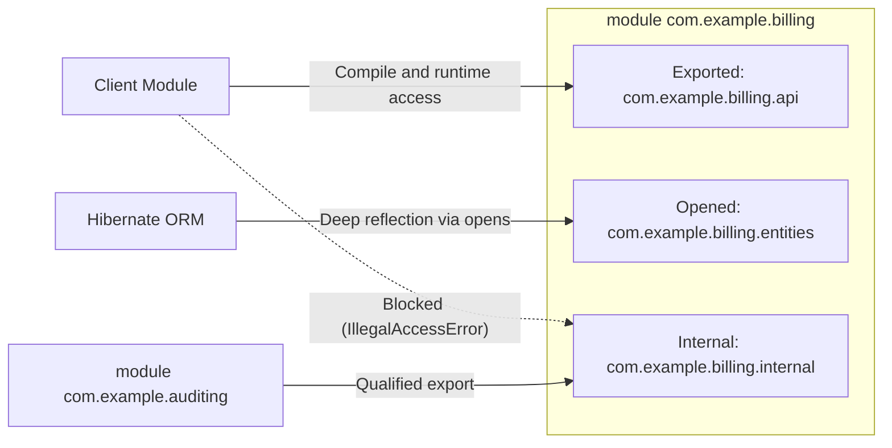
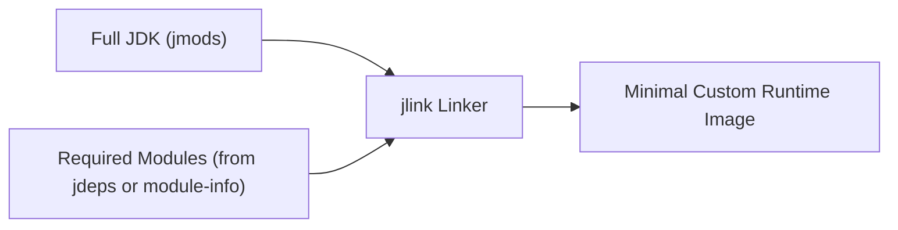

For Java's first twenty years, dependency resolution relied on a flat classpath. You handed the JVM a list of directories and JAR files via `-classpath`, and the class loader scanned them linearly until it found the first `.class` file matching a requested name.

That flat model created two long-running problems. First, the JVM could not detect missing or duplicate dependencies ahead of time; two JARs shipping different versions of the same class silently shadowed each other until a `NoSuchMethodError` appeared at runtime. Second, Java had no encapsulation boundary above the package level. Any class marked `public` so another package inside the same library could call it was also public to every consumer on earth. Libraries routinely depended on internal JDK classes like `sun.misc.Unsafe` or reflected into private fields of `java.base`, making it nearly impossible for OpenJDK maintainers to refactor core libraries safely.

Java 9 introduced the **Java Platform Module System (JPMS)** under **Project Jigsaw**. It broke the monolithic JDK (`rt.jar`) into a graph of explicitly defined modules (such as `java.base`, `java.sql`, and `java.net.http`) and gave application developers the same mechanism to declare dependencies, hide internal packages, and assemble minimal custom runtimes with `jlink`.

## Project Jigsaw and `module-info.java`

A Java module is a named group of packages paired with a compiled descriptor at the root of its source tree: `src/main/java/module-info.java`. When `javac` compiles it into `module-info.class`, both the compiler and the JVM read that descriptor to verify the module dependency graph before executing a single line of application code.

```java
module com.example.billing {
    // Direct compile-time and runtime dependencies
    requires java.sql;
    requires com.example.security;

    // Transitive dependency: callers of billing automatically read common.dto
    requires transitive com.example.common.dto;

    // Optional compile-time dependency (not required to be present at runtime)
    requires static org.jspecify;

    // Public API packages visible to any module that requires billing
    exports com.example.billing.api;
    exports com.example.billing.model;

    // Qualified export: visible only to the named friend module
    exports com.example.billing.internal to com.example.auditing;

    // Runtime deep-reflection access for ORM and JSON libraries
    opens com.example.billing.entities to org.hibernate.orm.core, com.fasterxml.jackson.databind;

    // ServiceLoader integration
    uses com.example.billing.spi.PaymentGateway;
    provides com.example.billing.spi.PaymentGateway
        with com.example.billing.provider.StripePaymentGateway;
}
```

Every module implicitly requires `java.base` (which contains `java.lang`, `java.util`, `java.io`, and other core packages), so you never need to list it explicitly.



## Module Directives Explained

Each directive in `module-info.java` serves a specific boundary between compile-time accessibility, runtime visibility, and reflective access.

### `requires`, `requires transitive`, and `requires static`

- **`requires <module>`** declares a dependency on another module. Your module can compile against and use public types from packages that `<module>` exports, but downstream consumers of your module do not automatically read `<module>`.
- **`requires transitive <module>`** establishes **implied readability**. If your exported API method returns or accepts a type from `com.example.common.dto`, mark that dependency `transitive`. Otherwise, every downstream module calling your API would have to add `requires com.example.common.dto` to its own `module-info.java` just to compile.
- **`requires static <module>`** declares a compile-time-only dependency that is optional at runtime. This fits annotation libraries (such as nullability annotations) or optional integrations that your code guards with runtime checks.

### `exports` and Qualified Exports

- **`exports <package>`** makes `public` types in `<package>` (and their `public` and `protected` members) accessible at compile time and runtime to any module that reads yours. Any package *not* listed in an `exports` clause stays hidden from external modules even if its classes are declared `public`.
- **`exports <package> to <moduleA>, <moduleB>`** is a **qualified export**. It exposes the package only to the explicitly named modules. This is useful inside a multi-module project when a shared internal helper must be called by a sibling module without becoming part of your supported public API.

### `opens`, Qualified `opens`, and `open module`

Exporting a package does **not** allow deep reflection into its `private` or package-private members. JPMS separates compile-time API visibility (`exports`) from runtime reflective introspection (`opens`):

- **`opens <package>`** allows other modules to use reflection (including `setAccessible(true)`) on all types and members in `<package>` at runtime, without making the package accessible at compile time.
- **`opens <package> to <moduleA>, <moduleB>`** restricts that reflective access to specific frameworks such as Jackson, Hibernate, or Spring.
- **`open module <name> { ... }`** opens every package in the module for runtime reflection. Teams often start with `open module` while migrating an existing codebase to JPMS, then narrow it down to targeted `opens` statements later.

### `uses` and `provides ... with ...`

JPMS builds `java.util.ServiceLoader` directly into the module descriptor. A module declares `uses <ServiceInterface>` to look up implementations via `ServiceLoader.load(...)`, and provider modules register implementations with `provides <ServiceInterface> with <ImplClass>`. The module system verifies at startup that provider classes exist and implement the service interface, avoiding stale `META-INF/services` entries.

## Strong Encapsulation vs. Reflection Infiltration

Before Java 9, any library on the classpath could call `field.setAccessible(true)` to read or mutate private fields inside your classes or inside the JDK itself. Under JPMS, that access check crosses module boundaries and is enforced strictly by the JVM.

If external code attempts deep reflection on a package that is not opened to it:

```java
// External module attempting to access a private field in a closed package
Field balanceField = Account.class.getDeclaredField("secretBalance");
balanceField.setAccessible(true);
```

The JVM rejects the call with `java.lang.reflect.InaccessibleObjectException`:

```text
java.lang.reflect.InaccessibleObjectException: Unable to make field private
java.math.BigDecimal com.example.billing.Account.secretBalance accessible:
module com.example.billing does not "opens com.example.billing" to unnamed module @5b37e0d2
```

During the Java 9–15 transition window, the JVM defaulted to `--illegal-access=permit`, which allowed reflective access into JDK internals with a warning. Java 16 (JEP 396) changed the default to `deny`, and Java 17 (JEP 403) locked down JDK internals completely so `--illegal-access=permit` no longer works.

When an older third-party library genuinely requires access to a closed package and you cannot update the library or its `module-info.java`, you must grant narrow permission on the command line:

```bash
# Grant deep reflection into one package for classpath (unnamed module) code
java --add-opens java.base/java.time=ALL-UNNAMED \
     --add-opens com.example.billing/com.example.billing.entities=com.fasterxml.jackson.databind \
     -jar app.jar
```

There is a parallel flag, `--add-exports <source-module>/<package>=<target-module>`, for compile-time or public-API access to an unexported package. Both flags make reflective holes explicit and auditable in startup scripts rather than silently permitted everywhere.

## Split Packages and the Unnamed Module

JPMS enforces a strict rule on package ownership: **a package can belong to at most one named module in a module layer**.

On the traditional classpath, two different JARs could both put classes inside `com.example.util`, and the class loader merged them implicitly. Under JPMS, if two modules on the module path contain the same package (even with completely different class names), the JVM fails fast at startup:

```text
Error occurred during initialization of boot layer
java.lang.LayerInstantiationException: Package com.example.util in both module
    com.example.core and module com.example.common
```

Disallowing split packages lets the JVM map each package directly to its owning module in `O(1)` time without scanning multiple JARs, and preserves Java's assumption that package-private members are only visible within one cohesive module boundary.

To resolve a split package during migration:

1. **Rename one of the packages** (the clean long-term fix, such as `com.example.core.util` and `com.example.common.util`).
2. **Merge the two JARs** into one module if they are tightly coupled parts of the same library.
3. **Use `--patch-module`** as a temporary escape hatch (commonly used in unit tests when test code shares a package with production code):
   ```bash
   java --patch-module com.example.core=extra-classes.jar ...
   ```

### Explicit, Automatic, and Unnamed Modules

Most real codebases depend on third-party libraries that have not all added a `module-info.java`. JPMS supports incremental migration through three kinds of modules:

| Property | Explicit Module | Automatic Module | Unnamed Module |
|---|---|---|---|
| **Where it lives** | `--module-path` | `--module-path` | `-cp` / `-classpath` |
| **Descriptor** | Compiled `module-info.class` | Synthesized by JVM from JAR | None |
| **Module name** | Declared in `module-info.java` | `Automatic-Module-Name` manifest entry, or derived from JAR filename | Unnamed |
| **Exports / Opens** | Only what is declared | Exports and opens all packages | Exports and opens all packages |
| **What it can read** | Only modules listed in `requires` | All named modules **and** the unnamed module | All named modules **and** itself |

A detail that surprises many developers during migration: **an explicit named module cannot `requires` the unnamed module**. That means your modularized code cannot directly depend on jars left on `-classpath` (unless you pass `--add-reads <your-module>=ALL-UNNAMED`).

Instead, **automatic modules** serve as the migration bridge:

- **Top-down migration:** Move your application JAR and its dependencies onto `--module-path`. Libraries without `module-info.class` become automatic modules. Your explicit `module-info.java` can `requires` those automatic modules, and automatic modules can in turn read any remaining libraries still sitting on the classpath.
- **Bottom-up migration:** Library authors can start by adding `Automatic-Module-Name: com.example.mylib` to `META-INF/MANIFEST.MF` long before writing a full `module-info.java`. That guarantees a stable module name regardless of how the JAR file is renamed (e.g., `mylib-2.4.1.jar`).

## Creating Minimal Custom Runtimes with `jlink`

A full JDK distribution weighs roughly 300–400 MB on disk because it bundles every platform module (`java.desktop`, `java.compiler`, `jdk.jshell`, Swing, CORBA-era tools, and native libraries). Most headless backend services only touch a handful of modules like `java.base`, `java.logging`, `java.sql`, `java.net.http`, and `java.management`.

Because the JDK itself is modular, the **`jlink`** tool can inspect a module graph and assemble a self-contained runtime image containing only the JVM binaries and JDK modules your application actually uses.



### Finding Required JDK Modules with `jdeps`

Even if your application is packaged as a non-modular Spring Boot or fat JAR running on the classpath, you can still use `jdeps` and `jlink` to build a slim custom JRE tailored to your app's exact JDK dependencies. (In fact, this is the most common production pattern, because `jlink` cannot directly bundle automatic modules, only explicit modules and JDK platform modules.)

```bash
# Inspect a fat JAR (or unpacked lib directory) to print the exact comma-separated JDK modules needed
jdeps --ignore-missing-deps \
      --multi-release 21 \
      --print-module-deps \
      --class-path "target/lib/*" \
      target/app.jar
```

That command typically outputs a short list such as:

```text
java.base,java.logging,java.management,java.naming,java.net.http,java.sql,jdk.unsupported
```

> [!NOTE]
> `jdeps` performs static bytecode analysis. If your app dynamically loads crypto providers or locales at runtime (for example, HTTPS connections using TLS), you may need to add `jdk.crypto.ec` or `jdk.localedata` manually to the `--add-modules` list and verify in staging.

### Building the Custom Runtime in a Multi-Stage Dockerfile

```dockerfile
# Stage 1: Build the app and assemble a minimal Java 21 runtime
FROM eclipse-temurin:21-jdk-alpine AS builder

WORKDIR /build
COPY . .

RUN ./mvnw clean package -DskipTests

# Discover required JDK modules
RUN jdeps --ignore-missing-deps \
          --multi-release 21 \
          --print-module-deps \
          --class-path "target/dependency/*" \
          target/app.jar > modules.txt

# Link a minimal JRE (use --compress=zip-6 on Java 21+; earlier versions used --compress=2)
RUN $JAVA_HOME/bin/jlink \
    --add-modules $(cat modules.txt),jdk.crypto.ec \
    --strip-debug \
    --no-man-pages \
    --no-header-files \
    --compress=zip-6 \
    --output /custom-runtime

# Stage 2: Copy only the custom runtime and application JAR into a matching Alpine base
FROM alpine:3.20

COPY --from=builder /custom-runtime /opt/java
COPY --from=builder /build/target/app.jar /opt/app/app.jar

ENV PATH="/opt/java/bin:$PATH"

ENTRYPOINT ["java", "-jar", "/opt/app/app.jar"]
```

Notice that both stages use Alpine Linux. Because `jlink` copies native shared libraries from the builder's JDK, the builder stage and the runtime stage must share the same C standard library (`musl` on Alpine, or `glibc` on Debian/Ubuntu/Distroless). Mixing an Alpine builder with a Debian runtime (or vice versa) causes the linked `java` binary to fail at container startup.

For a typical microservice, a `jlink` runtime image often lands around 40–70 MB instead of 200+ MB for a generic JRE, reducing image pull times and removing unused JDK tooling from the production container.

## Summary

- **Project Jigsaw (`module-info.java`)** replaces the flat classpath's hidden dependencies with an explicit, verified module graph.
- **`requires` / `requires transitive`** control readability; **`exports` / qualified `exports`** control compile-time API visibility; **`opens`** grants runtime deep-reflection access.
- **Strong encapsulation** blocks `setAccessible(true)` on closed packages with `InaccessibleObjectException`, requiring `opens` in `module-info.java` or explicit `--add-opens` flags at runtime.
- **Split packages** are forbidden across named modules; **automatic modules** (especially with `Automatic-Module-Name`) bridge explicit modules and legacy classpath JARs during migration.
- **`jdeps` + `jlink`** let you build minimal, tailored JRE images even for non-modular classpath applications.

## Interview Questions

### What problems was Project Jigsaw built to solve?

Project Jigsaw addressed two structural problems in pre-Java 9 runtimes: classpath fragility and lack of encapsulation above the package level. On a flat classpath, missing dependencies only fail when a code path executes, and duplicate JARs shadow each other silently. At the same time, marking a class `public` so another package in the same library could use it exposed it to every downstream caller, including internal JDK packages like `sun.misc.*`. JPMS introduced reliable startup dependency verification, module-level encapsulation, and a modularized JDK capable of producing custom slim runtimes via `jlink`.

### What is the difference between `requires` and `requires transitive`?

`requires M` lets the current module read exported packages from `M`, but keeps that dependency private to the current module. `requires transitive M` propagates readability so any module that requires the current module automatically reads `M` as well. You should use `requires transitive` whenever types from `M` appear in your module's exported public method signatures, fields, or superclasses; otherwise callers cannot compile against those signatures without manually adding `requires M`.

### How does `opens` differ from `exports`, and why do frameworks like Hibernate or Jackson need `opens`?

`exports com.example.pkg` makes `public` types in that package accessible at compile time and runtime, but it does **not** permit deep reflection (`setAccessible(true)`) on `private` fields or constructors. `opens com.example.pkg` does the opposite: it does not grant compile-time access, but it allows full runtime reflective access to all members, including private ones. Frameworks like Hibernate, Jackson, and Spring instantiate objects and populate private fields reflectively, so using qualified `opens com.example.entities to org.hibernate.orm.core;` lets them work without exposing the package as a compile-time API or disabling encapsulation globally.

### Why can't an explicit named module read the unnamed module, and how do teams migrate incrementally?

JPMS prevents explicit modules from depending on the unnamed module (`-classpath`) so that modularized libraries cannot accidentally rely on the chaotic, unverified flat classpath. To migrate incrementally, teams use **automatic modules**: placing a legacy JAR (ideally with an `Automatic-Module-Name` entry in `MANIFEST.MF`) onto `--module-path` turns it into a named automatic module. Explicit modules can `requires` automatic modules, and automatic modules are allowed to read both named modules and the unnamed classpath module, acting as the bridge until all dependencies are modularized.
