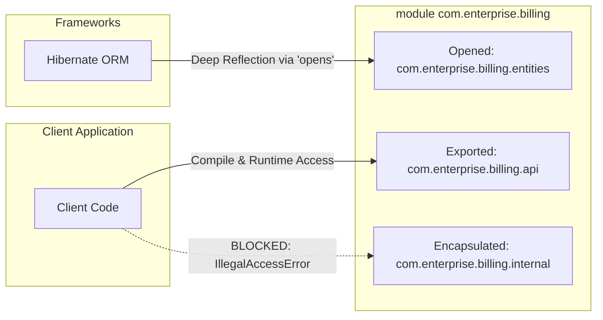
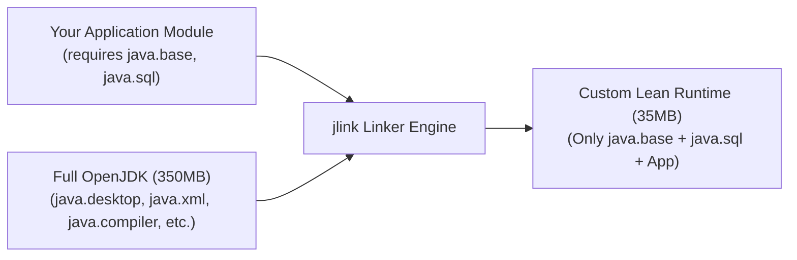

For the first two decades of Java's existence, the JVM's dependency resolution mechanism was notoriously crude: the **Flat Classpath**. 

You dumped dozens of JAR files into a folder, set `-classpath`, and the JVM searched for classes in whatever arbitrary order the operating system returned them. If two JARs contained classes with identical package and class names, the JVM silently loaded whichever file it encountered first, leading to mysterious runtime `NoSuchMethodError` crashes. Worse, Java had no concept of access boundaries between packages: if a class was marked `public`, it was exposed to the entire world. Frameworks and libraries routinely reflected into internal JVM implementation classes (such as `sun.misc.Unsafe`), preventing the OpenJDK team from refactoring core libraries without breaking the global Java ecosystem.

Introduced in Java 9 under **Project Jigsaw**, the **Java Platform Module System (JPMS)** fundamentally transformed the JDK from a monolithic runtime into an interconnected graph of reusable, strongly encapsulated modules. 

In this deep dive, we explore how `module-info.java` controls dependency graphs, how Strong Encapsulation restricts invasive reflection, how to diagnose split package disasters, and how to build hyper-lean, 35MB custom runtime images using `jlink`.

---

### The Architecture of module-info.java

A Java module is a named, self-describing collection of code and data. At the root of its source tree (directly under `src/main/java`), every module declares a metadata descriptor file: `module-info.java`.

```java
module com.enterprise.billing {
    // 1. Direct dependencies
    requires java.sql;
    requires com.enterprise.security;

    // 2. Transitive dependency (Implied Readability)
    requires transitive com.enterprise.common.dto;

    // 3. Publicly exposed API packages
    exports com.enterprise.billing.api;
    exports com.enterprise.billing.model;

    // 4. Qualified exports (restricted to specific modules)
    exports com.enterprise.billing.internal to com.enterprise.auditing;

    // 5. Reflection access for frameworks (Spring, Jackson, Hibernate)
    opens com.enterprise.billing.entities to org.hibernate.orm.core, com.fasterxml.jackson.databind;

    // 6. Service Provider Interface (SPI) mechanics
    uses com.enterprise.billing.spi.PaymentGatewayProvider;
    provides com.enterprise.billing.spi.PaymentGatewayProvider 
        with com.enterprise.billing.provider.StripePaymentGateway;
}
```



---

### Module Directives Deep Dive

Let's dissect each directive and its underlying architectural guarantees:

#### requires vs requires transitive
- `requires <module>`: Declares a compile-time and runtime dependency. The current module can read public types exported by the specified module.
- `requires transitive <module>`: Establishes **Implied Readability**. Any downstream module that depends on the current module automatically gains readability of the transitively required module. This is essential for API gateway libraries that accept or return objects defined in a common DTO module; clients don't have to manually declare `requires com.enterprise.common.dto` themselves.

#### exports vs qualified exports
- `exports <package>`: Exposes all `public` and `protected` classes in that package to any module that requires this one. Packages not listed in an `exports` clause are **strictly encapsulated**—they cannot be accessed by external code, even if their classes are marked `public`!
- `exports <package> to <module1>, <module2>`: **Qualified Export**. Restricts access to a trusted list of friend modules. Ideal for internal utilities that must be shared between microservices built by the same organization without exposing them publicly.

#### opens vs open module
Under JPMS, `exports` grants compile-time access and runtime public method invocation, but it **strictly forbids deep reflection** (`field.setAccessible(true)`). 
- `opens <package> to <framework>`: Grants runtime reflective access to non-public fields and constructors exclusively to specified frameworks (such as Jackson or Hibernate) while keeping the package closed to standard compile-time access.
- `open module <name>`: Shorthand that opens all packages within the module to runtime reflection across all libraries. Useful during early migration phases.

---

### Strong Encapsulation and the Death of Illegal Reflection

Prior to Java 9, calling `field.setAccessible(true)` allowed developers to mutate private fields, modify JVM internals, and read private cryptographic keys.

JPMS enforced **Strong Encapsulation**. If an external module attempts to reflect into a package that is not explicitly declared as `open` or `opens`:

```java
// Foreign code trying to inspect un-opened package
Field privateField = Account.class.getDeclaredField("secretBalance");
privateField.setAccessible(true); // BOOM!
```

The JVM throws a fatal exception:

```
java.lang.reflect.IncompatibleObjectException: Unable to make field private 
java.math.BigDecimal com.enterprise.billing.Account.secretBalance accessible: 
module com.enterprise.billing does not "opens com.enterprise.billing" to unnamed module @0x5b37e0d2
```

In modern Java versions (Java 17+), the old command-line workaround `--illegal-access=permit` has been completely removed. To grant reflection in production without modifying source code, operators must explicitly pass targeted JVM flags:

```bash
java --add-opens com.enterprise.billing/com.enterprise.billing.entities=com.fasterxml.jackson.databind \
     -jar app.jar
```

---

### The Split Package Disaster

One of the strictest rules in the Java Platform Module System is the **Single Responsibility of Packages**: 

> **A package name can belong to exactly one module in the entire module graph.**

In legacy Classpath setups, Library A could contain classes in `com.google.common.base`, and Library B could also place classes into `com.google.common.base`. The Classpath merged them into a single chaotic namespace.

In JPMS, if two modules contain the identical package name—even if they contain completely different class files—the JVM aborts bootup:

```
Error occurred during initialization of boot layer
java.lang.LayerInstantiationException: Package com.enterprise.util in both module 
    com.enterprise.core and module com.enterprise.common
```

#### How to Resolve Split Packages:
1. **Refactor Namespaces:** The clean solution. Rename the package in one of the libraries (e.g., `com.enterprise.core.util` vs `com.enterprise.common.util`).
2. **Module Merging:** If the libraries are tightly coupled, merge them into a single unified module.
3. **Patching (Migration Hack):** Use `--patch-module <target-module>=<override-jar>` to inject classes from one JAR into another module at boot time.

---

### The Three Worlds: Unnamed, Automatic, and Explicit Modules

Migrating large enterprise systems to JPMS cannot happen overnight. The JDK accommodates gradual adoption through three module classifications:

```
1. Explicit Modules:    Contains module-info.class on the Modulepath.
2. Automatic Modules:   Legacy JAR on the Modulepath (JVM auto-generates module name from JAR filename).
3. The Unnamed Module:  All JARs and classes on the legacy Classpath (-cp / -classpath).
```

| Trait | Explicit Module | Automatic Module | Unnamed Module |
| :--- | :--- | :--- | :--- |
| **Location** | Modulepath (`--module-path`) | Modulepath (`--module-path`) | Classpath (`-cp`) |
| **Descriptor** | `module-info.class` | Synthesized by JVM | None |
| **Encapsulation** | Strict | Exports all packages, opens all packages | Completely open |
| **Can read** | Declared in `requires` | All other modules | All other modules |

This enables a phased migration: your application can run on `--module-path` as an explicit module while consuming older legacy libraries placed on the classpath through the Unnamed Module bridge.

---

### Creating 35MB Minimal Runtimes with jlink

In modern containerized cloud deployments, running a full 350MB+ JDK or 200MB generic JRE inside a Docker image wastes bandwidth, increases cold-start image pull latency in Kubernetes, and expands the container attack surface with unused utilities (like `java.desktop` or `java.compiler`).

Because every module explicitly declares its dependency tree, the JDK includes a linker tool called **`jlink`**. `jlink` traverses your application's module graph, extracts only the exact JVM native binaries and platform modules your application actually uses, and bundles them into a custom, self-contained runtime directory:



#### Production jlink Docker Pipeline

```dockerfile
# Stage 1: Build & Custom Runtime Assembly
FROM eclipse-temurin:21-jdk-alpine AS builder

WORKDIR /build
COPY . .

# Step A: Compile application with maven
RUN ./mvnw clean package -DskipTests

# Step B: Determine exact platform dependencies using jdeps
RUN jdeps --ignore-missing-deps --multi-release 21 --print-module-deps \
    --class-path "target/dependency/*" target/app.jar > modules.txt

# Step C: Assemble custom minimal runtime (stripping debug info and man pages)
RUN $JAVA_HOME/bin/jlink \
    --add-modules $(cat modules.txt) \
    --strip-debug \
    --no-man-pages \
    --no-header-files \
    --compress=2 \
    --output /custom-runtime

# Stage 2: Distroless Minimal Deployment Image
FROM alpine:3.19

# Copy ONLY the custom JVM runtime and compiled application
COPY --from=builder /custom-runtime /opt/java
COPY --from=builder /build/target/app.jar /opt/app/app.jar

ENV PATH="/opt/java/bin:$PATH"

ENTRYPOINT ["java", "-jar", "/opt/app/app.jar"]
```

The resulting Docker image shrinks from over **400MB** down to **~45MB**, dramatically accelerating Kubernetes Pod scaling operations during traffic spikes.

---

## Senior Engineer Interview Crucible

### What problem was Project Jigsaw designed to solve, and why did it take nearly a decade to release?
**Answer:** The primary motivation was dismantling the **Monolithic JDK** and eliminating **Classpath Hell**. Prior to Java 9, even a "Hello World" application loaded `rt.jar` (a massive 65MB monolithic archive containing everything from CORBA to Swing). Because Java lacked module-level access control, internal JDK classes like `sun.misc.Unsafe` became public implementation dependencies for thousands of external libraries. The OpenJDK team could not optimize or remove obsolete subsystems without breaking real-world software. 

It took nearly a decade because modularizing a 20-year-old runtime required untangling circular dependencies across hundreds of thousands of classes, inventing the concept of strong encapsulation without permanently breaking backward compatibility, and negotiating with major enterprise framework vendors (Spring, Hibernate, Eclipse) who relied extensively on deep reflection into private class internals.

### What is the difference between `requires` and `requires transitive` in a `module-info.java` file?
**Answer:** `requires M` declares that the current module reads module `M`. The current module can compile and execute against public types exported by `M`, but this dependency is strictly encapsulated. Downstream modules that depend on the current module **do not** gain readability of `M`.

`requires transitive M` establishes **Implied Readability**. Any downstream module that requires the current module automatically gains readability of module `M` as well. This is mandatory when the current module exposes classes from `M` in its own public method signatures (e.g., as method return types or parameter types). Without `transitive`, downstream consumers would be unable to compile against or manipulate the return values of those API methods unless they manually added an explicit `requires M` statement in their own `module-info.java`.

### Why does JPMS prohibit Split Packages, and how does this invariant improve JVM performance and security?
**Answer:** A split package occurs when two separate modules declare classes within the identical package namespace (e.g., both Module A and Module B contain classes in `com.company.analytics`). 

JPMS prohibits split packages to ensure **deterministic class resolution** and **uncompromised access control**. When the JVM loads a class from a module, it resolves the package to an exact module origin via an internal hash map in `O(1)` time, completely bypassing the linear disk searches of legacy classpaths. Furthermore, package-private visibility depends on the assumption that all classes in that package share the identical security domain. If split packages were allowed, an attacker could inject an unauthorized class into a sensitive package from a rogue module and gain access to package-private state.

### How does the `opens` directive differ from `exports`, and why is `opens` essential for modern dependency-injection frameworks?
**Answer:** 
- `exports com.my.package` permits compile-time and runtime access only to `public` and `protected` members of that package. Crucially, it prohibits **deep reflection**—an external caller cannot call `AccessibleObject.setAccessible(true)` on private fields or constructors.
- `opens com.my.package` does **not** grant compile-time access to the package, but it grants complete runtime reflective access, including private member inspection and modification via the Reflection API.

Modern frameworks like Spring, Hibernate, and Jackson rely on deep reflection to instantiate no-arg constructors, inject `@Autowired` private fields, and map JSON payloads onto private record components without forcing developers to create public setter methods. Using `opens com.my.package to com.fasterxml.jackson.databind` provides surgical, least-privilege access: it satisfies framework introspection needs while keeping the package completely hidden from standard compile-time application code.
