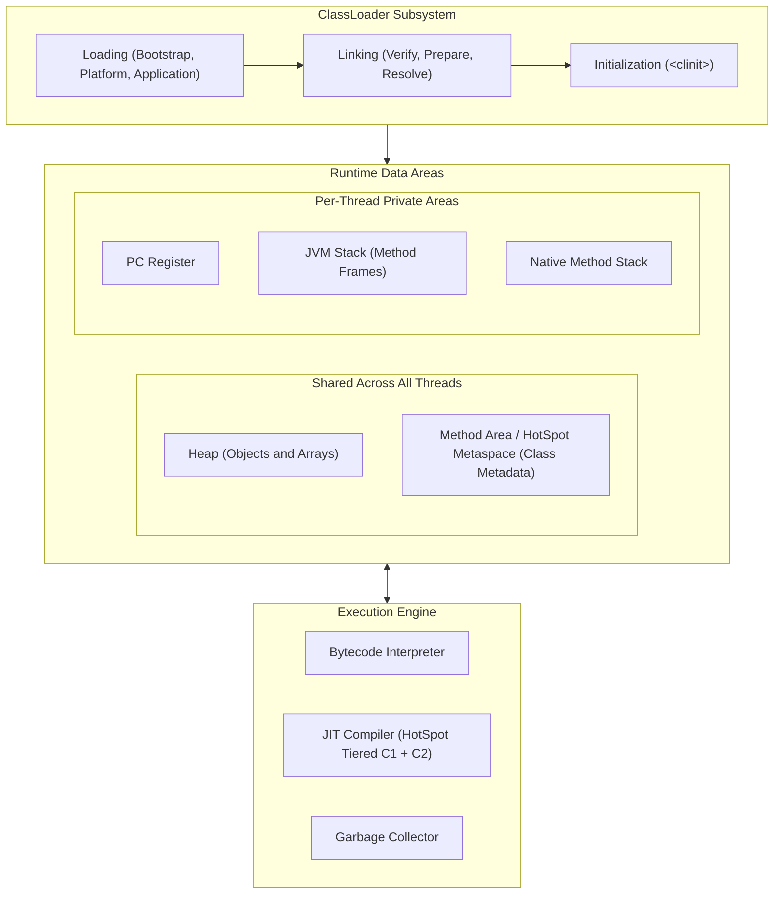
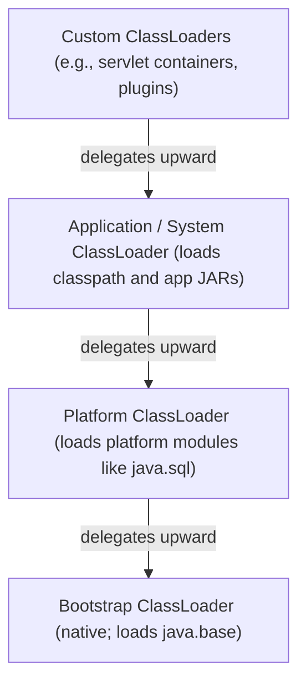
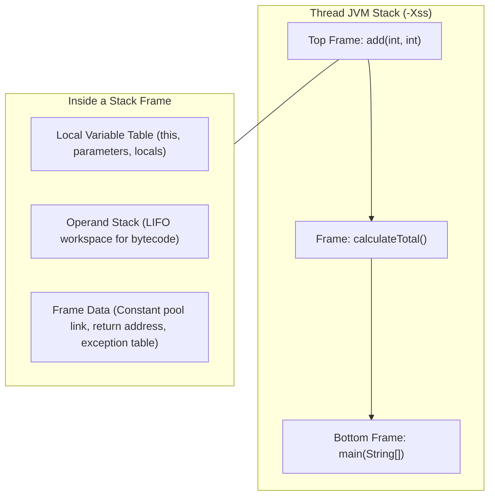
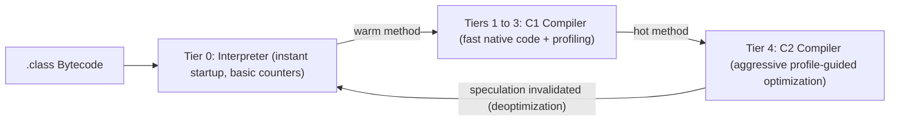

When you compile a `.java` file with `javac`, you do not get x86 or ARM machine instructions. You get platform-neutral bytecode inside a `.class` file, targeted at an abstract machine defined by the **Java Virtual Machine Specification**. At runtime, a concrete JVM implementation loads those `.class` files, verifies their safety, manages memory, and translates hot bytecode paths into native CPU instructions.

One distinction matters throughout this topic: the **JVM Specification** defines abstract contracts (such as class loading rules, stack frames, the heap, and the logical method area), while **HotSpot** (the default OpenJDK JVM) makes concrete engineering choices to implement them (such as Metaspace, generational garbage collectors, and C1/C2 tiered JIT compilation). Keeping the specification separate from HotSpot implementation details makes it much easier to diagnose `OutOfMemoryError`, `ClassNotFoundException`, `LinkageError`, and latency spikes in production.

---

## High-Level JVM Architecture

A running JVM is organized around three cooperating subsystems:



---

## The ClassLoader Subsystem

The JVM loads classes lazily on demand rather than pulling every class on the classpath into memory at startup. Class loading follows a three-stage lifecycle: **Loading**, **Linking**, and **Initialization**.

### The Standard ClassLoader Hierarchy

Modern Java (Java 9+, after the module system replaced the old Extension ClassLoader) uses three built-in ClassLoaders:

1. **Bootstrap ClassLoader**: Loads the core JDK runtime modules such as `java.base` (`java.lang.Object`, `java.lang.String`, `java.util.*`). In HotSpot, it is implemented in native C++, so calling `String.class.getClassLoader()` returns `null`.
2. **Platform ClassLoader**: Loads standard platform modules outside `java.base` (such as `java.sql`, `java.xml`, and `java.net.http`). It replaced the pre-Java 9 Extension ClassLoader.
3. **Application (System) ClassLoader**: Loads your application classes and third-party JARs from the classpath or module path.

Frameworks such as Tomcat, OSGi, and plugin hosts can also introduce **Custom ClassLoaders** that subclass `java.lang.ClassLoader`.



### The Parent Delegation Model

When a ClassLoader is asked to load a class such as `com.example.OrderService`, it follows the **Parent Delegation Model**:

1. It checks whether it has already loaded that class. If so, it returns the cached `Class<?>` object.
2. Otherwise, it does **not** immediately search its own classpath. It delegates the request upward to its parent ClassLoader.
3. Delegation climbs all the way to the Bootstrap ClassLoader.
4. Only if the parent cannot find the class does the child ClassLoader search its own locations (such as your application JARs) via `findClass()`.

You can inspect the chain directly in Java:

```java
public class ClassLoaderChain {
    public static void main(String[] args) {
        ClassLoader appLoader = ClassLoaderChain.class.getClassLoader();
        ClassLoader platformLoader = appLoader.getParent();
        ClassLoader bootstrapLoader = platformLoader.getParent();

        System.out.println("Application: " + appLoader);       // jdk.internal.loader.ClassLoaders$AppClassLoader
        System.out.println("Platform:    " + platformLoader);  // jdk.internal.loader.ClassLoaders$PlatformClassLoader
        System.out.println("Bootstrap:   " + bootstrapLoader); // null (native Bootstrap loader)
    }
}
```

Parent delegation exists for two practical reasons:

- **Security and core integrity**: A third-party JAR cannot sneak in a fake `java.lang.String` to intercept secrets, because the request always reaches the Bootstrap ClassLoader first, which returns the genuine JDK `String`.
- **Avoiding duplicate core classes**: Inside the JVM, a class's runtime identity is the pair **(fully qualified class name, defining ClassLoader)**. If two different classloaders define the same class bytes independently, the JVM treats them as two completely unrelated types, and casting an instance from one to the other throws `ClassCastException: Foo cannot be cast to Foo`.

Some containers deliberately invert delegation ("child-first" loading) for application packages so two web apps running in the same JVM can each ship a different version of Jackson or Guava. Even then, they still delegate core `java.*` packages upward to Bootstrap so core platform classes remain shared and tamper-proof.

### Linking and Initialization

Once a ClassLoader reads the raw `.class` bytes and creates a `Class<?>` representation, the class goes through **Linking** and **Initialization**:

1. **Verification** (Linking): Checks that the bytecode obeys JVM structural and type safety rules: stack operands match expected types, jumps stay within method bounds, private fields are not illegally accessed, and no stack overflows or underflows can occur within a frame. (Verification checks bytecode safety, not JAR cryptographic signatures, which are handled separately.)
2. **Preparation** (Linking): Allocates space for static fields and sets them to their **default zero values** (`0`, `false`, `null`), not the values written in your source code. One exception: compile-time constant fields (`static final` primitives or `String` literals like `public static final int MAX = 100;`) carry a `ConstantValue` attribute in bytecode and receive their final value during Preparation.
3. **Resolution** (Linking): Replaces symbolic references in the Runtime Constant Pool (strings like `java/lang/String`) with direct references to loaded types, methods, or fields. The JVM Specification allows Resolution to happen lazily, right when a bytecode instruction actually uses a symbolic reference.
4. **Initialization (`<clinit>`)**: Runs the compiler-generated `<clinit>` method, which executes static field initializers and `static { ... }` blocks in textual order. Initialization is thread-safe (synchronized by the JVM) and happens strictly upon the class's first **active use** (creating an instance with `new`, calling a static method, reading or writing a non-constant static field, initializing a subclass, or calling `Class.forName`).

```java
public class LifecycleDemo {
    // Preparation sets value = 0; Initialization (<clinit>) sets value = 42.
    public static int value = 42;

    // Compile-time constant: set to 100 during Preparation via ConstantValue.
    public static final int LIMIT = 100;

    static {
        System.out.println("Initialized value = " + value);
    }
}
```

---

## Runtime Memory Areas: Stack, Heap, and Metaspace

The JVM Specification defines five runtime data areas: two shared by all threads (**Heap** and **Method Area**) and three private to each thread (**JVM Stack**, **PC Register**, and **Native Method Stack**).

### Thread-Shared Memory: Heap and Metaspace

#### The Heap
The **Heap** is where object instances and arrays are allocated, and it is managed by the Garbage Collector.

In HotSpot, most garbage collectors organize the heap around the generational hypothesis (most objects die young):

- **Young Generation**: Contains **Eden** (where new objects are normally allocated) and two **Survivor** spaces (`S0` and `S1`) that hold objects surviving recent minor collections.
- **Old (Tenured) Generation**: Stores long-lived objects promoted after surviving several Young GC cycles, as well as large objects allocated directly there.

Keep in mind that physical heap layout is a HotSpot collector detail, not a JVM specification rule. Classic Parallel GC uses fixed contiguous regions for Young and Old, whereas modern **G1 GC** (the default since Java 9) and **Generational ZGC** split the heap into many regions that dynamically act as Eden, Survivor, Old, or Humongous spaces as needed.

#### Method Area and HotSpot Metaspace
The JVM Specification defines a logical **Method Area** that holds per-class structures: class metadata, field and method descriptors, method bytecode, and the Runtime Constant Pool.

How HotSpot implements the Method Area changed significantly in Java 8:

- **Java 7 and earlier (PermGen)**: HotSpot stored class metadata in **Permanent Generation**, a fixed-size memory block adjacent to the Java Heap (`-XX:MaxPermSize`). Applications that generated many dynamic classes (Spring proxies, JSPs, repeated WAR redeployments) frequently crashed with `OutOfMemoryError: PermGen space`.
- **Java 8 and later (Metaspace)**: HotSpot removed PermGen and moved class metadata (`Klass` structures, method metadata, constant pools) into **off-heap native OS memory** called **Metaspace**. By default, Metaspace grows dynamically using available host RAM, though production services should still set an upper cap (`-XX:MaxMetaspaceSize=512m`) so a classloader leak throws `OutOfMemoryError: Metaspace` cleanly instead of triggering the operating system's OOM killer.

A common misconception is that static variables and the interned `String` pool live in Metaspace. In HotSpot (since Java 7), both **static field values** (stored on each class's `java.lang.Class` mirror object) and the **String pool** live on the regular **Java Heap**, where the Garbage Collector can reclaim them normally.

### Thread-Private Memory: Stacks and Stack Frames

Every Java thread gets its own **JVM Stack** (sized via `-Xss`, typically around 1 MB on 64-bit Linux/Windows HotSpot), its own **PC Register** (tracking the current bytecode instruction, or undefined while running native code), and a **Native Method Stack** for JNI calls (in HotSpot, Java and native frames share the same OS thread stack).

Each time a thread calls a method, the JVM pushes a **Stack Frame** onto that thread's stack. When the method returns or unwinds due to an exception, the frame is popped immediately without needing GC.



Each Stack Frame holds three components:

1. **Local Variable Table (LVT)**: A zero-indexed array of slots holding parameters and local variables. For instance methods, slot `0` always holds `this`. Primitives (`int`, `boolean`, `float`, etc.) sit directly in the slots; object variables store references pointing to instances on the Heap. `long` and `double` values take two consecutive slots.
2. **Operand Stack**: A LIFO workspace where bytecode instructions push values, run arithmetic or method calls, and pop results. Because the JVM is a **stack-based** virtual machine (rather than register-based like x86), almost all bytecode operates through the operand stack.
3. **Frame Data**: A reference to the class's Runtime Constant Pool (for dynamic linking), normal method return information, and pointers to the exception dispatch table.

Here is how a tiny method maps to Local Variable Table and Operand Stack instructions (viewable with `javap -c`):

```java
public class FrameExample {
    public int add(int a, int b) {
        int sum = a + b;
        return sum;
    }
}
```

```text
// Bytecode produced by javac (javap -c FrameExample)
// LVT slots: [0] = this, [1] = a, [2] = b, [3] = sum
0: iload_1       // Push LVT slot 1 (a) onto Operand Stack
1: iload_2       // Push LVT slot 2 (b) onto Operand Stack
2: iadd          // Pop top two ints, add them, push result back
3: istore_3      // Pop result into LVT slot 3 (sum)
4: iload_3       // Push sum onto Operand Stack
5: ireturn       // Return top of Operand Stack to caller
```

If unbounded recursion pushes frames until the thread's stack limit (`-Xss`) is exhausted, the JVM throws `java.lang.StackOverflowError`.

---

## The Execution Engine: Interpreter and JIT Compiler

Executing bytecode purely one instruction at a time in an interpreter is portable and starts quickly, but it leaves a large amount of CPU performance on the table. Conversely, compiling every class to native machine code before `main()` runs would hurt startup time and waste memory on code paths that only run once.

HotSpot bridges both goals using **Tiered Compilation**, combining an **Interpreter** with two Just-In-Time (JIT) compilers: **C1** and **C2**.



### How Tiered Compilation Works

- **Tier 0 (Interpreter)**: Starts executing bytecode immediately with no compilation delay, while incrementing invocation counters and loop back-edge counters.
- **Tiers 1–3 (C1 / Client Compiler)**: Once a method warms up, C1 compiles it quickly into native code with light optimizations. At **Tier 3**, C1 inserts profiling instrumentation that records real runtime behavior: which branches are taken, whether an object reference is ever `null`, and which concrete classes show up at polymorphic call sites.
- **Tier 4 (C2 / Server Compiler)**: When a method becomes hot (thousands of invocations or long-running loops), C2 uses the rich profile gathered in Tier 3 to generate heavily optimized native machine code and stores it in the **Code Cache**.

You can watch methods move across tiers in real time by launching any Java app with `-XX:+PrintCompilation`.

### Key HotSpot C2 Optimizations

Because C2 compiles **at runtime** with live execution profiles, it can perform optimizations that ahead-of-time static compilers often cannot.

#### Method Inlining
Small, frequently called methods (such as getters, tiny helpers, and record accessors) are copied directly into the caller's compiled machine code. Inlining removes the call overhead, and more importantly, exposes the combined body to further optimizations like constant folding and dead-code elimination:

```java
// Source code
public int totalPrice(int base, int tax) {
    return add(base, tax);
}
private int add(int x, int y) {
    return x + y;
}

// Conceptually after C2 inlining: no call frame pushed for add()
public int totalPrice(int base, int tax) {
    return base + tax;
}
```

#### Escape Analysis and Scalar Replacement
Conceptually in Java, every object created with `new` lives on the Heap. In HotSpot, however, C2 runs **Escape Analysis** on inlined methods to see whether a newly allocated object's reference ever escapes the current method (for instance, by being returned, stored in a field, or passed to an un-inlined method).

If C2 proves the object never escapes (`NoEscape`), it can apply **Scalar Replacement**: instead of allocating the object on the Heap at all, C2 breaks the object apart into its individual fields and keeps them in CPU registers or on the stack. (Escape analysis can also trigger **lock elision**, removing `synchronized` locks on objects proven to be confined to a single thread.)

```java
public int manhattanDistance(int x, int y) {
    // Point never leaves this method. After inlining and escape analysis,
    // HotSpot C2 can eliminate the Point heap allocation via scalar replacement.
    Point p = new Point(x, y);
    return Math.abs(p.x()) + Math.abs(p.y());
}
```

Escape analysis is a HotSpot optimization, not a JVM specification guarantee. If a method grows too large to inline or if an object escapes along even a rarely taken branch, it falls back to normal Heap allocation.

#### Speculative Optimization and Deoptimization
Suppose your code calls `paymentProcessor.charge(amount)` through an interface, and during warmup only `StripeProcessor` has ever been loaded. C2 speculatively devirtualizes and inlines `StripeProcessor.charge()` directly, placing a tiny guard check in front of the call.

If a plugin or Spring profile later loads `PaypalProcessor` and passes it to that call site, the guard fails. HotSpot safely triggers **Deoptimization** at a **safepoint**: it converts the optimized native frame back into an interpreted stack frame, discards the invalidated compiled code, and later recompiles the method with updated polymorphic profiling data.

---

## Key Takeaways

- Always separate the **JVM Specification** (abstract class loading lifecycle, Heap, Method Area, Stack Frames) from **HotSpot specifics** (Metaspace, generational/regional GC layouts, C1/C2 tiered JIT).
- ClassLoaders follow the **Parent Delegation Model** (`Application -> Platform -> Bootstrap`) to protect core JDK classes and prevent duplicate definitions; a class's identity is `(className, definingClassLoader)`.
- Linking verifies bytecode safety, prepares static fields to zero defaults (except compile-time constants), and resolves symbolic references; Initialization (`<clinit>`) runs static blocks on first active use.
- Heap holds objects, arrays, static field values, and the String pool; HotSpot **Metaspace** stores class metadata in native OS memory (bound it with `-XX:MaxMetaspaceSize`); per-thread **JVM Stacks** hold method frames (LVT, Operand Stack, Frame Data).
- HotSpot's Execution Engine starts in the **Interpreter** for fast boot, profiles hot code with **C1**, and compiles hot paths with **C2** using inlining, escape analysis (scalar replacement), and speculative optimization with safe deoptimization.

---

## Interview Questions

### What is the Parent Delegation Model, and why do containers like Tomcat sometimes break it?
Under Parent Delegation, a ClassLoader always delegates a class lookup upward to its parent before searching its own classpath. That guarantees core classes like `java.lang.String` are always loaded by the trusted Bootstrap ClassLoader and prevents duplicate core class definitions. Servlet containers like Tomcat and plugin systems like OSGi intentionally break delegation (using child-first lookup) for application packages so multiple apps hosted in one JVM can isolate conflicting library versions (for example, two different versions of Jackson). Even child-first loaders still delegate `java.*` and core platform classes upward to Bootstrap.

### What happens during the Preparation phase of Linking versus the Initialization phase?
During **Preparation**, the JVM allocates storage for static fields and assigns them their standard zero defaults (`0`, `false`, `null`), without running any user code. (The only exception is compile-time `static final` constants of primitive or `String` type, which are initialized from their bytecode `ConstantValue` attribute.) During **Initialization**, triggered on the class's first active use, the JVM runs the compiler-generated `<clinit>` method, executing static field initializers and `static { ... }` blocks in the order they appear in source code.

### Why did HotSpot replace PermGen with Metaspace in Java 8, and where do static variables and the String pool live now?
PermGen was a fixed-size memory space contiguous with the Java Heap (`-XX:MaxPermSize`). Applications that loaded or dynamically generated many classes (such as Spring proxies or redeployed web apps) frequently hit `OutOfMemoryError: PermGen space` because sizing PermGen accurately up front was hard. Java 8 replaced PermGen with **Metaspace**, which stores class metadata in native OS memory and expands dynamically by default (though `-XX:MaxMetaspaceSize` is still recommended in production to prevent runaway native memory growth). Static field values and the interned String pool do not live in Metaspace; HotSpot moved them onto the regular Java Heap starting in Java 7.

### How does HotSpot's C2 JIT compiler eliminate heap allocations using Escape Analysis?
During Tier 4 compilation, C2 traces whether a newly constructed object's reference can ever escape the scope of the compiled method (after inlining). If the reference is proven not to escape (`NoEscape`), C2 can perform **scalar replacement**: instead of allocating the object on the Heap, it splits the object into its individual fields and places them directly in CPU registers or stack slots. This removes allocation overhead and GC pressure for short-lived helper objects, though it is a HotSpot optimization rather than a language guarantee.
