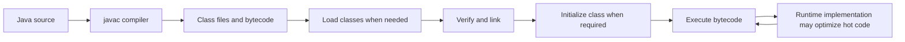
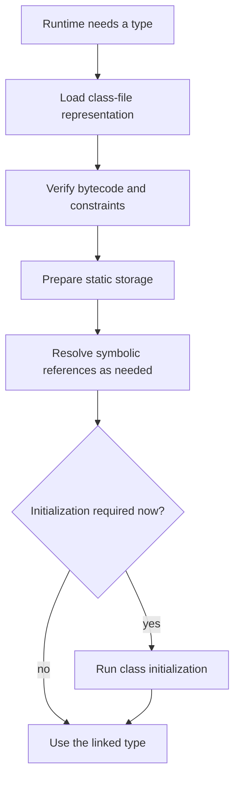
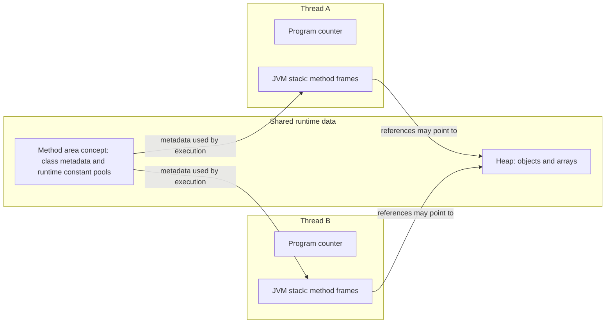

Java source code is not executed directly by the processor. The compiler translates it into class files containing bytecode and symbolic references; a Java Virtual Machine (JVM) implementation loads and executes those classes according to the JVM specification. Understanding the boundary between specification and implementation explains portability, memory behavior, class-loading bugs, and why performance changes as a program runs.

This lesson uses Java 21 and the Java Virtual Machine Specification (JVMS) 21. The JVMS defines an abstract machine; it deliberately does not require every vendor to use the same runtime layout or execution strategy. HotSpot details are identified as implementation-specific.

## From source code to execution

The usual path is:

1. `javac` compiles `.java` source files into `.class` files.
2. The JVM loads class-file representations as execution requires them.
3. The JVM verifies and links classes so their bytecode and symbolic references can be used safely.
4. Class initialization runs when the language/JVM rules require it.
5. The JVM executes bytecode. A runtime may interpret it, compile frequently executed code, or use another conforming strategy.



The optimization loop is intentionally qualified: interpretation, profiling, and JIT compilation are implementation strategies, not a bytecode-level guarantee that every JVM must follow.

### Bytecode and the class file

A class file is a portable binary format that includes a class's structure, method bytecode, symbolic references, and metadata. The bytecode instruction set is specified independently of a particular CPU. A JVM implementation translates or interprets those instructions for its runtime environment.

To inspect compiler output for a class you have compiled:

```text
javac Example.java
javap -c -v Example
```

`javap` displays disassembled instructions and class-file details; it is a diagnostic tool, not a representation of what a JIT-compiled machine-code body must look like.

## Class loading, linking, and initialization

The JVM specification distinguishes three related stages:

- **Loading** finds a binary representation and creates the runtime class or interface.
- **Linking** verifies and prepares it, and resolves symbolic references as required by the implementation and JVM rules.
- **Initialization** executes the class or interface initialization method, which runs static field initializers and static initializer blocks in the required order.

The stages are related but are not one eager operation for every class in the program. Loading and resolution can be triggered as execution encounters types and references. Initialization occurs at defined active-use points, such as creating an instance or invoking a static method, subject to the language rules.



The diagram separates preparation and reference resolution from initialization. A class can be loaded before its static initializer is run.

### Class loaders and delegation

A **class loader** maps a binary class name to a runtime class definition. The platform exposes bootstrap, platform, and system/application loader roles. In ordinary applications, a child loader typically asks its parent to load a class before searching its own sources. This delegation helps applications share platform types rather than accidentally defining copies of them.

Delegation is a common model, not an absolute requirement: custom class loaders can implement specialized loading strategies. Containers, plugin systems, application servers, and module environments may have different visibility rules.

Class identity is not just the class name. It includes the defining class loader. Two loaders can define classes with the same binary name, but those definitions are distinct runtime types and are not interchangeable. This is a common cause of confusing `ClassCastException` messages where the printed names appear identical.

```java
public class LoaderInfo {
    public static void main(String[] args) {
        ClassLoader applicationLoader = LoaderInfo.class.getClassLoader();
        ClassLoader platformLoader = ClassLoader.getPlatformClassLoader();

        System.out.println("Application class: " + applicationLoader);
        System.out.println("Platform loader: " + platformLoader);
        System.out.println("String loader: " + String.class.getClassLoader());
    }
}
```

The bootstrap loader is represented as `null` by `Class.getClassLoader()` for classes loaded by it. Avoid depending on the exact text printed for a loader; that representation is not the program's loading contract. The useful diagnostic is which loader defined a type and whether two references came from the same definition.

## JVM runtime data areas

The JVMS describes runtime data areas, but not every byte's physical location in a particular JVM. Broadly:

- The **heap** is shared among threads and supplies storage for class instances and arrays; garbage collection manages object lifetimes.
- Each thread has its own **JVM stack**, containing frames for method invocations. A frame includes local variables, an operand stack, and bookkeeping for dynamic linking and method return.
- Each thread has a **program counter** for the current JVM instruction; the specification's exact handling for native methods is special.
- The **method area** is a specification concept shared among threads for per-class structures such as runtime constant pools, field/method data, and method code. It does not mandate a physical memory region.
- A JVM may provide **native method stacks** for native code, with implementation-specific organization.



The diagram shows the specification's shared-versus-per-thread categories. It is not a literal memory map: JIT optimization may keep values in registers, eliminate allocations, or reorganize execution while preserving Java's observable behavior.

### Heap, stack, and object references

The Java language does not promise that every local variable physically resides on a native machine stack or that every object always exists as a distinct heap allocation. The JVMS defines abstract frames and a heap, while JIT compilers may optimize actual storage, including scalar replacement when an object's identity does not need to be observed.

The beginner mental model of “local references on the stack, objects on the heap” is useful for understanding reachability and method lifetimes, but do not use it to predict exact memory addresses or allocation counts. A reference is an abstract value in Java; its physical representation is implementation-dependent.

### Method area and Metaspace

The JVMS method area is an abstract shared area for per-class structures. HotSpot's **Metaspace** is an implementation detail that stores class metadata in native memory; it replaced PermGen in HotSpot starting with Java 8. This does not mean that all class-related data is outside the heap: runtime constant-pool objects, class mirrors such as `Class<?>`, interned strings, and related structures have their own specified or implementation-defined locations.

Class metadata consumes native memory and can be exhausted independently of the Java object heap. Applications that create large numbers of classes or class loaders should investigate class-loader leaks and metaspace metrics rather than only increasing `-Xmx`.

## Execution engine and JIT compilation

The JVM specification defines the effects of bytecode, not a mandatory interpreter or JIT compiler. In HotSpot, the execution engine can interpret methods and compile frequently executed code into native machine code. A **just-in-time (JIT) compiler** uses runtime observations and optimizations; the compiled result must preserve the program's required semantics, including deoptimization when assumptions no longer hold.

This is why a short benchmark run can mislead: warm-up, compilation, garbage collection, CPU frequency, and measurement overhead affect results. Use a Java-aware benchmark harness such as JMH for microbenchmarks, and profile representative workloads before changing code based on timing guesses.

The JIT can inline calls, remove redundant checks, and optimize object operations when it can prove that the transformation preserves behavior. Do not rely on a specific optimization occurring; write code for clarity and let measurements identify a genuine bottleneck.

## Garbage collection and JVM boundaries

The JVM reclaims objects that are no longer reachable through live references, but the specification does not guarantee when a particular collection will run. `System.gc()` is only a request to the runtime; it is not a deterministic “free memory now” command.

Native memory, direct buffers, thread stacks, class metadata, and resources such as file descriptors are not interchangeable with ordinary Java heap objects. Garbage collection does not replace closing files or sockets. Diagnose the resource category that is actually growing before selecting a memory setting or GC option.

## Observing a running JVM

Useful observations include:

- `java -version` to identify the runtime implementation and version.
- `jcmd <pid> VM.version` and `jcmd <pid> VM.flags` to inspect a running process.
- `jcmd <pid> GC.heap_info` and Java Flight Recorder to investigate allocation and runtime behavior.
- `javap -c -v` to inspect class-file bytecode and metadata.
- HotSpot unified logging options such as `-Xlog:class+load=info` to investigate class loading.

Tools and flags can differ between JVM implementations and releases. Keep diagnostic flags tied to the runtime in use, and avoid enabling verbose production logging without considering volume and operational impact.

## Further reading

- [Java Virtual Machine Specification, Java SE 21, Chapter 2: The Structure of the JVM](https://docs.oracle.com/javase/specs/jvms/se21/html/jvms-2.html)
- [Java Virtual Machine Specification, Java SE 21, Chapter 5: Loading, Linking, and Initializing](https://docs.oracle.com/javase/specs/jvms/se21/html/jvms-5.html)
- [Java 21 `ClassLoader`](https://docs.oracle.com/en/java/javase/21/docs/api/java.base/java/lang/ClassLoader.html)
- [Java 21 `Class`](https://docs.oracle.com/en/java/javase/21/docs/api/java.base/java/lang/Class.html)
- [Java 21 `Runtime`](https://docs.oracle.com/en/java/javase/21/docs/api/java.base/java/lang/Runtime.html)
