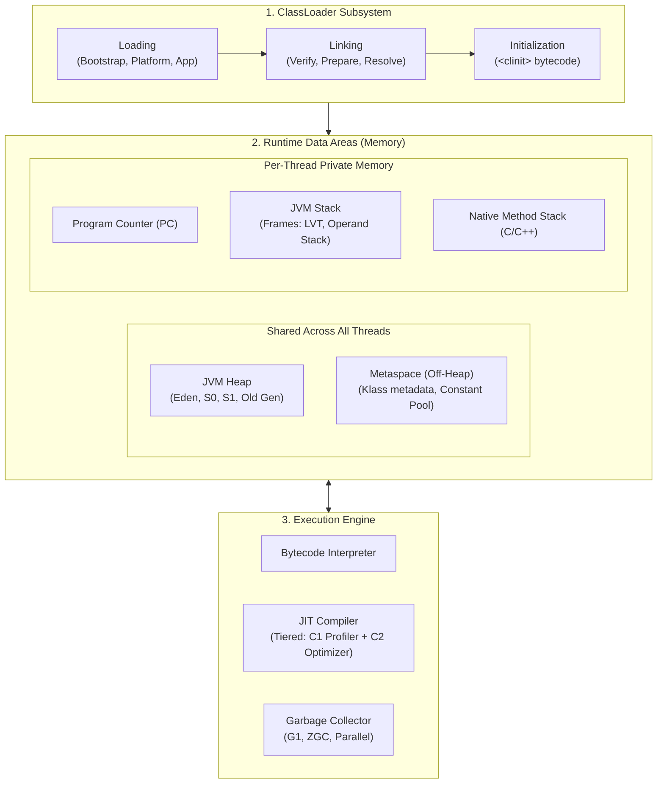
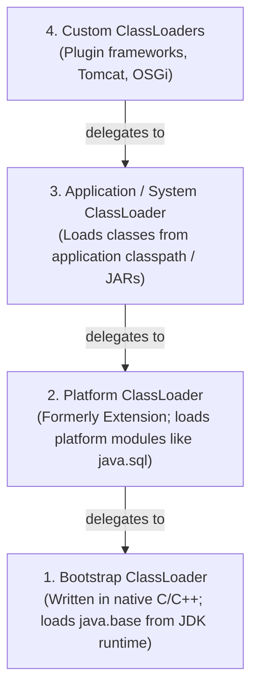
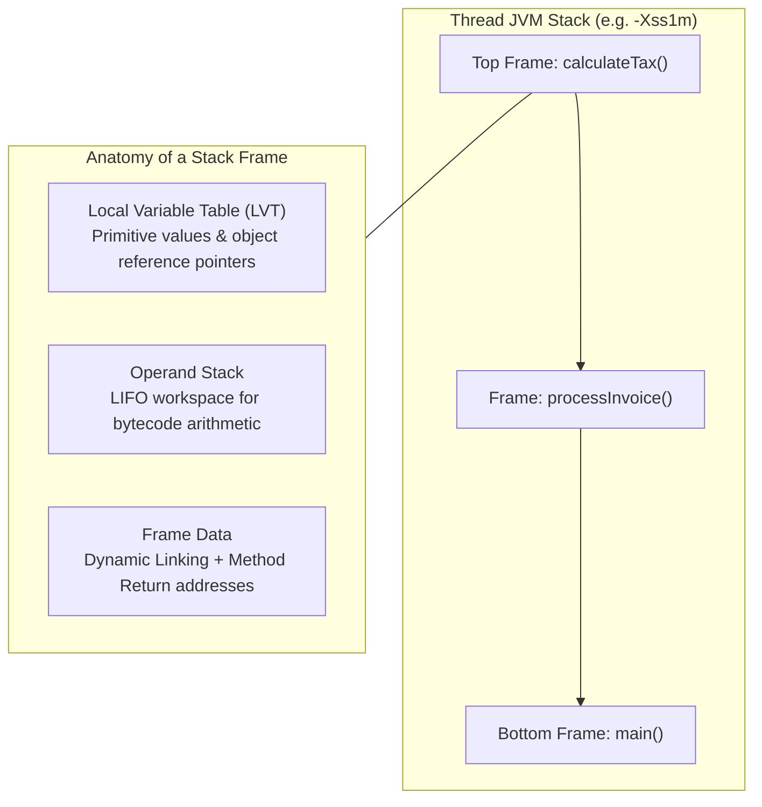
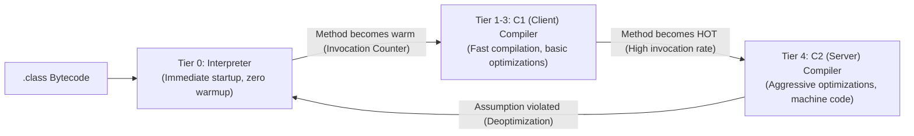

When you write Java code, you are not writing machine instructions for an x86 or ARM processor. You are writing high-level instructions for an abstract software computer: **The Java Virtual Machine (JVM)**.

The `javac` compiler converts your source files into standard bytecode (`.class` files). It is the JVM's job to load those bytes, verify their cryptographic and structural safety, link dependencies, and execute them at near-native speeds through adaptive Just-In-Time (JIT) compilation.

To troubleshoot memory leaks (`OutOfMemoryError`), tune latency-critical systems, or diagnose subtle `ClassNotFoundException` and `LinkageError` bugs in production, you must have an intimate mental model of the JVM's internal subsystems: **The ClassLoader Subsystem**, **Runtime Data Areas**, and **The Execution Engine**.

---

## High-Level JVM Architecture

The JVM is divided into three primary architectural pillars:



---

## Pillar 1: The ClassLoader Subsystem

The JVM does not load all classes into memory at startup. Classes are loaded dynamically on demand whenever an application touches them for the first time.

### The Loading Delegation Hierarchy
Java enforces the **Parent Delegation Model** across three standard ClassLoaders:



### How Parent Delegation Works
When an application asks for a class (e.g., `com.company.OrderService`):
1. The **Application ClassLoader** checks its internal cache. If not found, it does **not** attempt to load it; it delegates upward to the **Platform ClassLoader**.
2. The **Platform ClassLoader** delegates upward to the **Bootstrap ClassLoader**.
3. The **Bootstrap ClassLoader** checks if the class belongs to `java.base`. If not found, it throws control downward to the Platform ClassLoader.
4. If Platform cannot find it, control returns to the Application ClassLoader, which scans your application's classpath and loads the bytecode.

### Why Parent Delegation Matters for Security
Without parent delegation, a rogue library could include its own malicious `java.lang.String` class. If the application loaded that rogue class instead of the official JDK version, it could intercept passwords and compromise the entire operating system! 

Because parent delegation always delegates up to the Bootstrap ClassLoader first, the trusted JDK version of `java.lang.String` is always loaded, and rogue core classes are strictly rejected.

```java
public class ClassLoaderInspection {
    public static void main(String[] args) {
        // Application ClassLoader (AppClassLoader)
        ClassLoader appLoader = ClassLoaderInspection.class.getClassLoader();
        System.out.println("App Loader: " + appLoader);

        // Platform ClassLoader
        ClassLoader platformLoader = appLoader.getParent();
        System.out.println("Parent Loader: " + platformLoader);

        // Bootstrap ClassLoader (Returns null because it is implemented in native C++!)
        ClassLoader bootstrapLoader = platformLoader.getParent();
        System.out.println("Bootstrap Loader: " + bootstrapLoader); // prints null
    }
}
```

### The Three Phases of Linking
Once a class file is read from disk into memory, it passes through **Linking**:

1. **Verification**: Ensures the bytecode conforms to the JVM specification. It validates that pointers aren't forged, stack depths do not overflow, and variable types are legal.
2. **Preparation**: Allocates memory for **static fields** and initializes them to their **default zero values** (`0`, `false`, `null`), **NOT** their source code initializers!
   ```java
   public static int count = 50;
   // In Preparation phase: count is allocated and set to 0!
   // In Initialization phase: count is finally set to 50!
   ```
3. **Resolution**: Replaces symbolic references in the class's constant pool (e.g. `Ljava/lang/String;`) with direct physical memory pointers to types loaded in Metaspace.

### Class Initialization (`<clinit>`)
Initialization executes the generated `<clinit>` bytecode method, running static variable assignments and `static { ... }` blocks in textual order.

A class is initialized only upon its first **active use**:
- Creating a new instance using `new`.
- Invoking a static method.
- Accessing or modifying a non-constant static field.
- Invoking `Class.forName()`.

---

## Pillar 2: Runtime Data Areas (JVM Memory)

The JVM partitions memory into distinct regions, some shared across all threads and others completely private to individual threads.

### Thread-Shared Memory

#### The JVM Heap
The Heap is the global memory area where **all object instances and arrays** live. It is managed automatically by the Garbage Collector.
- **Young Generation**: Composed of **Eden** and two Survivor spaces (**S0** and **S1**). New objects are born in Eden.
- **Old (Tenured) Generation**: Holds long-lived objects that survive multiple GC promotion cycles.

#### Metaspace (Native Memory)
In Java 8, the old **PermGen (Permanent Generation)** was completely removed from the JVM Heap and replaced with **Metaspace**.
- Metaspace lives in **off-heap native OS memory** (C-heap).
- It stores **class metadata**, bytecode representations, the Runtime Constant Pool, method tables, and annotations.
- Unlike PermGen, Metaspace dynamically expands up to available OS memory by default, though production environments should bound it via `-XX:MaxMetaspaceSize=512m` to prevent out-of-memory kernel kills.

### Thread-Private Memory (Per Thread)

Each Java thread has its own private, isolated memory stack:



#### The JVM Stack and Stack Frames
Every time a Java method is invoked, the JVM pushes a new **Stack Frame** onto that thread's stack. When the method returns (or throws an exception), the frame is popped and discarded.

Each Stack Frame contains:
- **Local Variable Table (LVT)**: An array storing method arguments and local variables. Primitives (`int`, `boolean`, `double`) are stored by value; objects are stored as **4-byte or 8-byte reference pointers** pointing to instances on the Heap.
- **Operand Stack**: A pushdown LIFO workspace where the JVM performs calculations (e.g., loading two integers onto the stack, executing `IADD`, and popping the result).
- **Frame Data**: Bookkeeping data for exception dispatch, method return address, and dynamic linking to the constant pool.

If method calls recurse indefinitely without terminating, the stack exceeds `-Xss` (typically 1 MB), throwing `java.lang.StackOverflowError`.

#### Program Counter (PC) Register
Holds the memory address of the current JVM bytecode instruction being executed by that thread.

#### Native Method Stack
Allocates execution frames for native C/C++ code called through JNI (Java Native Interface).

---

## Pillar 3: The Execution Engine and JIT Compilation

How does the JVM take abstract bytecode instructions like `iload_1` and `invokevirtual` and run them on a silicon chip at near C++ speeds?

The secret is **Tiered Compilation**.



### The Interpreter: Instant Startup
When your application boots, compiling all bytecode to machine code upfront would cause massive startup delays. 

Instead, the **Interpreter** reads bytecode instructions one by one and executes them immediately. This provides instant startup, but execution speed is relatively slow.

### Tiered Compilation: C1 and C2 Compilers
As the program runs, the execution engine monitors execution using **Profiling Counters** (counting method invocations and loop iterations). When a method passes an execution threshold, it is considered **Hot Code**:

1. **C1 Compiler (Client Compiler - Tiers 1-3)**: Compiles the method into native machine code rapidly with basic profiling.
2. **C2 Compiler (Server / Opto Compiler - Tier 4)**: For methods executed tens of thousands of times, C2 performs aggressive, deep optimizations, translating bytecode into blistering-fast, vectorized CPU machine code!

### Crucial JIT Compiler Optimizations

#### Method Inlining
Method invocation incurs overhead: pushing a stack frame, passing parameters, and jumping CPU execution to a new memory address.
The JIT compiler eliminates this overhead by copying the body of small methods directly into the caller's code:

```java
// Original code:
public int calculateTotal(int price, int tax) {
    return add(price, tax);
}
private int add(int a, int b) { return a + b; }

// After JIT Method Inlining (Zero method call overhead!):
public int calculateTotal(int price, int tax) {
    return price + tax;
}
```

#### Escape Analysis and Scalar Replacement
The classic rule states that "all objects are allocated on the Heap." **The JIT compiler breaks this rule!**

Through **Escape Analysis**, the C2 compiler analyzes whether an object created inside a method is ever exposed outside that method. If the object never escapes:
- The JVM performs **Scalar Replacement**: it disassembles the object into its individual primitive fields and stores them directly in CPU registers or on the Stack!
- **Zero heap allocation occurs**, generating zero garbage for the Garbage Collector to clean up!

```java
public void processCoordinates() {
    // Point does NOT escape this method!
    Point p = new Point(10, 20);
    System.out.println(p.x + p.y);
    
    // JIT scalar-replaces Point into two local CPU variables:
    // int p_x = 10;
    // int p_y = 20;
    // Object allocation on the Heap is completely ELIMINATED!
}
```

#### Deoptimization (Safepoints)
C2 optimizations are **speculative**. For example, if an interface has only one implementing class loaded, C2 optimizes method calls using monomorphic inline caching (direct call without vtable lookup).

If an application later dynamically loads a second implementation (via reflection or plugin), the JIT's speculative assumption is invalidated. The JVM safely triggers **Deoptimization**, pauses threads at a **Safepoint**, discards the compiled machine code, and falls back to interpreted mode or recompiles!

---

## Summary & Mental Model Checkpoint

1. **Parent Delegation Model**: ClassLoaders delegate lookup upward to parents (Bootstrap -> Platform -> Application) before loading from local disk, preserving security.
2. **Linking Phases**: Verification checks bytecode safety; Preparation allocates static fields to zero-defaults; Resolution swaps symbolic names for direct memory pointers.
3. **Class Initialization**: Runs `<clinit>` bytecode (static blocks and assignments) strictly upon first active use.
4. **Metaspace vs Heap**: Heap stores all object instances and arrays; Metaspace lives in native C-memory storing class definitions and runtime constant pools.
5. **Stack Frames**: Each thread has its own stack containing method frames (Local Variable Table, Operand Stack, Frame Data).
6. **Tiered Compilation**: Hot methods progress from the Interpreter to C1 (fast compilation) and finally C2 (deeply optimized machine code).
7. **Escape Analysis**: If an object doesn't escape method scope, the JIT performs scalar replacement, storing fields in CPU registers and bypassing Heap allocation entirely.

---

## 🎯 Senior Engineer Interview Questions

### What is the Parent Delegation Model in the Java ClassLoader subsystem, and how would you break it to implement a plugin architecture?
> **Answer:** The Parent Delegation Model mandates that when a ClassLoader is requested to load a class, it must first delegate the search to its parent ClassLoader before searching its own repositories. This guarantees that core JDK classes (loaded by the Bootstrap ClassLoader) cannot be shadowed or replaced by untrusted code on the application classpath. To implement a dynamic plugin architecture (or a servlet container like Apache Tomcat or OSGi), you break parent delegation by creating a custom ClassLoader subclass and overriding the `loadClass(String name, boolean resolve)` method. Instead of calling `super.loadClass()`, the custom loader searches its own local JARs/paths first (`findClass()`), and only delegates upward to the parent if the class is not found locally or if the class belongs to a protected core package (such as `java.*`).

### What is the architectural difference between the Preparation phase and the Initialization phase during JVM class loading?
> **Answer:** During the **Preparation** phase (part of Linking), the JVM allocates memory in Metaspace for all static fields declared in the class and initializes them to their standard default values dictated by the JVM specification (`0` for numeric primitives, `false` for booleans, `null` for reference types). No user-written code is executed. During the **Initialization** phase, the JVM executes the synthetic `<clinit>` method generated by `javac`. This phase executes explicit static variable assignments (e.g. `public static int MAX = 100;`) and static initializer blocks (`static { ... }`) in the exact order they appear in source code, transforming default zero values into their intended runtime initial states.

### What is Escape Analysis in HotSpot C2 JIT compilation, and how does it optimize memory allocations?
> **Answer:** Escape Analysis is a static analysis technique performed by the C2 server compiler during JIT compilation. It tracks the reference scope of an instantiated object across control-flow graphs to determine if its pointer "escapes" the declaring method (e.g. returned from the method, stored in a static or instance field, or passed to an un-inlinable method). If the analysis proves an object is **NoEscape** (confined entirely to the method), the JIT compiler applies **Scalar Replacement**: it decomposes the object into its individual constituent primitive fields and maps them directly to CPU registers or the current thread's stack frame. This completely eliminates heap allocation, reducing GC allocation pressure to zero and avoiding object header and memory synchronization overhead.

### Why was PermGen replaced with Metaspace in Java 8, and what operational problem did this resolve?
> **Answer:** PermGen (Permanent Generation) was a contiguous memory region contiguous with the JVM Heap, managed by the Garbage Collector and bounded by a fixed maximum size (`-XX:MaxPermSize`). In applications that dynamically generated or loaded large numbers of classes (such as Spring applications using CGLIB proxies, runtime bytecode weavers, or application servers deploying multiple WAR files), PermGen frequently ran out of memory, throwing catastrophic `java.lang.OutOfMemoryError: PermGen space`. Tuning PermGen was notoriously difficult because predicting class metadata volume across multiple deployments was complex. Metaspace replaced PermGen by moving class metadata out of the contiguous JVM heap into **native operating system memory** (C-heap). By default, Metaspace dynamically resizes based on host OS memory, reducing out-of-memory errors and simplifying garbage collection, while allowing class metadata to be reclaimed through native unmapping.