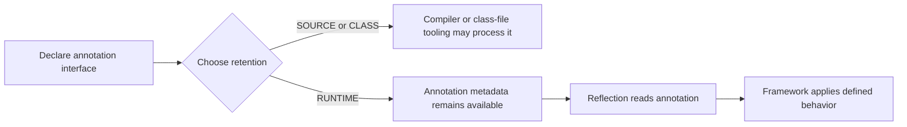

Ordinary Java code names its classes, fields, and methods when it is compiled. Frameworks often need to discover those same declarations at runtime: a dependency-injection container finds annotated components, a test runner finds test methods, or a serializer inspects fields. The Reflection API provides metadata objects and controlled access to members; annotations provide a declarative way to attach metadata to declarations and type uses.

Reflection is powerful, but it moves some mistakes from compile time to runtime and can interact with Java access control and modules. Prefer ordinary interfaces and explicit calls when the required types are already known.

This lesson uses Java 21.

## A `Class<?>` is runtime type metadata

Every loaded class or interface has an associated `Class<?>` object. Obtain it from an object with `getClass()`, from a class literal such as `String.class`, or by name with `Class.forName` when the name is genuinely dynamic.

```java
Class<?> type = String.class;
System.out.println(type.getName());
System.out.println(type.isRecord());
```

`Class<?>` means “a `Class` object for some unknown type.” Use a more specific `Class<T>` where the type is known and useful for type-safe APIs. Primitive types and array types also have class objects; a `Class<?>` is not limited to ordinary declared classes.

### Declared and inherited members

- `getDeclaredMethods()` reports methods declared directly by the class, including non-public ones.
- `getMethods()` reports public methods, including inherited public methods.
- `getDeclaredField(name)` looks for a field declared directly on that class.
- `getField(name)` looks for a public field, including inherited public fields.

Reflection arrays do not promise a source-order listing. If code needs a stable display or execution order, sort the results using an explicit rule.

Reflection also exposes generic metadata through methods such as `getGenericReturnType()`, but type erasure means some runtime generic information is unavailable. A declaration `List<String>` can carry its generic signature metadata, while the actual runtime class of the list does not remember the element type of each instance.

## Inspect and invoke a method

The following example discovers a method by name and parameter type, reads its annotation, and invokes it:

```java
import java.lang.annotation.ElementType;
import java.lang.annotation.Retention;
import java.lang.annotation.RetentionPolicy;
import java.lang.annotation.Target;
import java.lang.reflect.InvocationTargetException;
import java.lang.reflect.Method;

@Retention(RetentionPolicy.RUNTIME)
@Target(ElementType.METHOD)
@interface Audit {
    String value();
}

public class ReflectionExample {
    @Audit("welcome")
    public static String greet(String name) {
        return "Hello, " + name;
    }

    public static void main(String[] args)
            throws NoSuchMethodException, InvocationTargetException,
                   IllegalAccessException {
        Method method = ReflectionExample.class.getDeclaredMethod(
                "greet", String.class);

        Audit audit = method.getAnnotation(Audit.class);
        Object result = method.invoke(null, "Ada");

        System.out.println(audit.value() + ": " + result);
    }
}
```

Because `greet` is static, `invoke` receives `null` for its receiver; an instance method requires an object of the declaring type. The method parameter types passed to `getDeclaredMethod` must match the declared signature. Invocation can fail with checked exceptions such as `IllegalAccessException` or `InvocationTargetException`; the latter wraps an exception thrown by the invoked method, available through its cause.

Reflection does not waive Java's access rules by default. `setAccessible(true)` or `trySetAccessible()` can be restricted by module boundaries and may fail, for example with `InaccessibleObjectException`. Avoid treating forced access as a routine way around encapsulation. Prefer supported public APIs, especially when working with JDK or third-party modules.

## Custom annotations

An annotation interface declares metadata elements, optionally with defaults:

```java
import java.lang.annotation.ElementType;
import java.lang.annotation.Retention;
import java.lang.annotation.RetentionPolicy;
import java.lang.annotation.Target;

@Retention(RetentionPolicy.RUNTIME)
@Target({ElementType.TYPE, ElementType.METHOD})
public @interface Feature {
    String name();
    boolean enabledByDefault() default false;
}
```

It can be applied where the `@Target` permits:

```java
@Feature(name = "billing", enabledByDefault = true)
public class BillingService {
    @Feature(name = "monthly-report")
    public void generateReport() {}
}
```

An annotation declaration is not by itself executable behavior. A framework or application must read the annotation and define what it means. Annotation elements have restricted types: primitives, `String`, `Class`, enums, annotation types, and single-dimensional arrays of those types. Annotation elements cannot use arbitrary objects or generic type parameters.

### Retention policy and target

`@Retention` determines how long annotation information is retained:

- `SOURCE`: discarded by the compiler.
- `CLASS`: recorded in the class file but not required to be available through runtime reflection; this is the default when `@Retention` is absent.
- `RUNTIME`: recorded so it can be read reflectively at runtime.

Use `RUNTIME` when the code genuinely inspects the annotation through reflection. Build-time annotation processors can process source or class-file annotations without requiring runtime retention.

`@Target` states where the annotation may appear, such as a type, method, field, parameter, or type use. If no target is declared, the annotation can be written in declaration contexts as specified by the language rules; an explicit target communicates intent and lets the compiler reject misplaced uses.



The metadata only influences execution when some code discovers and interprets it.

## Annotation processing versus runtime reflection

An **annotation processor** runs during compilation and can inspect source-level elements, validate declarations, or generate source and resources. Runtime reflection operates on already compiled classes in a running JVM. Choose compile-time processing when validation or generation belongs in the build; use runtime scanning when the application must discover types that are not known until deployment or startup.

Runtime classpath scanning can increase startup work and may require configuration in modular or native-image environments. A processor can move some discovery work to build time, but adds build configuration and generated code. The choice should reflect when the metadata is needed.

## Performance and design boundaries

Reflection entails dynamic lookup, access checks, and less direct type information at call sites. Modern JVMs can optimize some reflective paths, so blanket performance claims such as “reflection is always slow” are not reliable. Measure the actual operation in context.

Frameworks often reduce repeated discovery by caching metadata, but caches must account for class-loader lifecycle: retaining a `Class`, `Method`, or annotation object can keep its defining class loader reachable. In plugin or redeployment systems, global reflection caches can therefore prevent unloading.

For code you control, prefer direct method calls, interfaces, dependency injection through constructors, and explicit registries. Reflection is appropriate when runtime discovery is a real requirement, not merely to avoid writing a small amount of ordinary code.

## Practical rules

- Use `getDeclaredMethod` only when declared-only lookup is intended; use `getMethod` for public inherited API lookup.
- Include parameter types when looking up overloaded methods.
- Handle `InvocationTargetException` separately when the underlying method's failure needs to be reported.
- Use `RUNTIME` retention only for annotations that must be read at runtime.
- Make annotation targets explicit and keep annotation semantics documented.
- Do not assume reflection bypasses module encapsulation or preserves generic type arguments for every instance.
- Cache reflective metadata only with a deliberate lifecycle and class-loader policy.

## Further reading

- [Java 21 `Class`](https://docs.oracle.com/en/java/javase/21/docs/api/java.base/java/lang/Class.html)
- [Java 21 `Method`](https://docs.oracle.com/en/java/javase/21/docs/api/java.base/java/lang/reflect/Method.html)
- [Java 21 `AnnotatedElement`](https://docs.oracle.com/en/java/javase/21/docs/api/java.base/java/lang/reflect/AnnotatedElement.html)
- [Java 21 `@Retention`](https://docs.oracle.com/en/java/javase/21/docs/api/java.base/java/lang/annotation/Retention.html), [`RetentionPolicy`](https://docs.oracle.com/en/java/javase/21/docs/api/java.base/java/lang/annotation/RetentionPolicy.html), and [`@Target`](https://docs.oracle.com/en/java/javase/21/docs/api/java.base/java/lang/annotation/Target.html)
