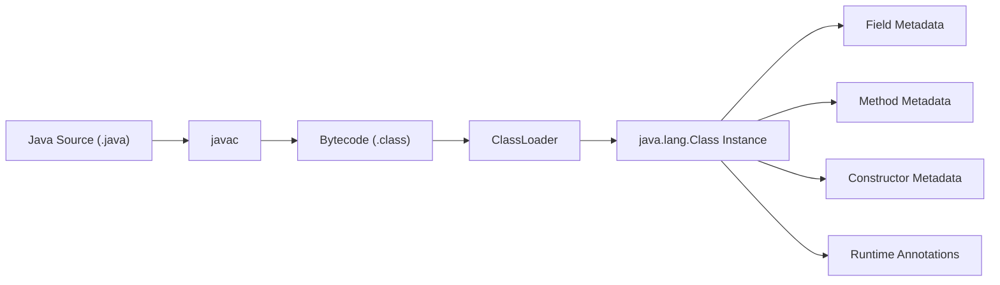
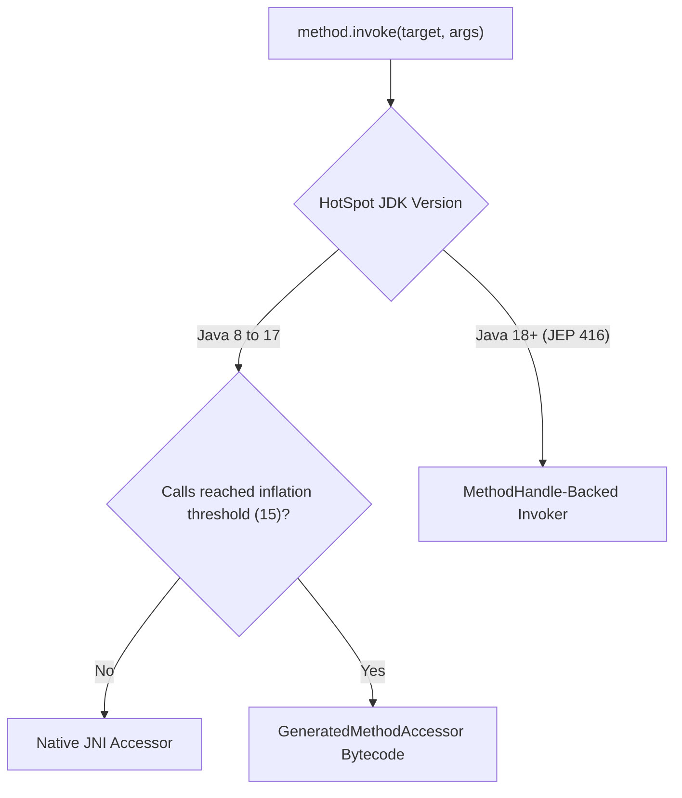

Normal Java code is statically bound. When you write `orderService.process(order)`, `javac` verifies at compile time that `OrderService` exists, that it has a `process` method accepting `Order`, and that your caller has visibility to invoke it.

Frameworks like Spring, Jackson, Hibernate, and JUnit face a different problem: they are compiled years before your application classes exist. They cannot import your `OrderService` or hardcode calls to your `@Test` methods. Instead, they rely on the **Java Reflection API (`java.lang.reflect`)** and **Custom Annotations (`java.lang.annotation`)** to inspect classes, read metadata, instantiate objects, and invoke methods at runtime.

Reflection is a practical tool to know well, both for understanding how frameworks behave under the hood and for recognizing when reflection is the wrong choice due to type-safety loss, JPMS encapsulation, or runtime overhead.

## The `Class<?>` Object

Whenever a `ClassLoader` loads a type into the JVM, the runtime creates a `java.lang.Class<?>` object that acts as the Java-level mirror for that type. In HotSpot, the JVM's internal C++ class metadata (`InstanceKlass`) lives in native Metaspace, while the `java.lang.Class<?>` instance itself is a regular Java object on the heap. Each loaded type has one `Class<?>` instance per class loader.



### Three Ways to Obtain a `Class<?>` Instance

You can acquire a `Class<?>` object in three ways, depending on what you know at compile time:

```java
public class ClassLookupDemo {
    public static void main(String[] args) throws ClassNotFoundException {
        // 1. Class literal: checked at compile time, works for primitives and void too
        Class<String> stringClass = String.class;
        Class<Integer> primitiveInt = int.class;

        // 2. From an existing instance: returns the actual runtime class (not the declared variable type)
        CharSequence text = "hello";
        Class<? extends CharSequence> runtimeClass = text.getClass(); // java.lang.String

        // 3. By fully qualified name: useful for plugins, JDBC drivers, or config-driven loading
        Class<?> dynamicClass = Class.forName("java.util.ArrayList");

        // Load a class without running its static initializer block yet
        Class<?> uninitialized = Class.forName(
                "java.util.HashMap",
                false,
                ClassLookupDemo.class.getClassLoader()
        );

        System.out.println(stringClass.getName());
        System.out.println(primitiveInt.isPrimitive());
        System.out.println(runtimeClass.getSimpleName());
        System.out.println(dynamicClass.getName());
        System.out.println(uninitialized.getName());
    }
}
```

One subtle detail with `Class.forName(String)`: the single-argument overload initializes the class immediately, running its `static { ... }` blocks. If you only want to inspect metadata without triggering static initialization side effects, use the three-argument overload with `initialize = false` or call `ClassLoader.loadClass(name)`.

### `get*` vs. `getDeclared*`

When inspecting fields, methods, or constructors on a `Class<?>`, there are two parallel sets of methods. Mixing them up is one of the most frequent reflection bugs.

| Method Pair | Visibility Returned | Includes Inherited Members? |
|---|---|---|
| `getFields()` / `getMethods()` / `getConstructors()` | `public` only | Yes (fields and methods from superclasses and interfaces) |
| `getDeclaredFields()` / `getDeclaredMethods()` / `getDeclaredConstructors()` | All (`public`, `protected`, package-private, `private`) | No (only members declared directly on this class) |

Because `getDeclaredFields()` stops at the current class, real frameworks that inspect annotations on private fields must walk up the superclass chain explicitly:

```java
import java.lang.reflect.Field;
import java.util.ArrayList;
import java.util.Arrays;
import java.util.List;

public class HierarchyInspector {
    public static List<Field> getAllDeclaredFields(Class<?> type) {
        List<Field> fields = new ArrayList<>();
        Class<?> current = type;
        while (current != null && current != Object.class) {
            fields.addAll(Arrays.asList(current.getDeclaredFields()));
            current = current.getSuperclass();
        }
        return fields;
    }
}
```

## Dynamic Method Invocation and Access Control

Once you hold a `Method` object, calling `invoke(target, args...)` executes it dynamically. Notice that parameter lookup requires exact parameter types, including distinguishing primitives (`double.class`) from boxed wrappers (`Double.class`).

```java
import java.lang.reflect.InvocationTargetException;
import java.lang.reflect.Method;

public class DynamicInvocationExample {

    static class PricingEngine {
        public double applyDiscount(String code, double price) {
            if (price < 0) {
                throw new IllegalArgumentException("Price cannot be negative");
            }
            return "SAVE10".equals(code) ? price * 0.90 : price;
        }

        public static String currency() {
            return "USD";
        }
    }

    public static void main(String[] args) throws Exception {
        PricingEngine engine = new PricingEngine();

        // Instance method lookup and invocation
        Method discountMethod = PricingEngine.class.getMethod(
                "applyDiscount", String.class, double.class
        );
        double discounted = (double) discountMethod.invoke(engine, "SAVE10", 200.0);
        System.out.println("Discounted: " + discounted);

        // Static method invocation passes null as the target instance
        Method currencyMethod = PricingEngine.class.getMethod("currency");
        String currency = (String) currencyMethod.invoke(null);
        System.out.println("Currency: " + currency);

        // Exceptions thrown inside the target method are wrapped in InvocationTargetException
        try {
            discountMethod.invoke(engine, "SAVE10", -50.0);
        } catch (InvocationTargetException e) {
            System.out.println("Real cause: " + e.getCause().getMessage());
        }
    }
}
```

Always unwrap `InvocationTargetException` via `e.getCause()`. Otherwise, logs and callers only see a generic reflection failure instead of the actual exception thrown by the target method.

### Accessing Private Members and JPMS Restrictions

By default, `Method.invoke()` and `Field.get()` / `Field.set()` enforce Java access rules and throw `IllegalAccessException` on inaccessible `private` or package-private members. Historically, libraries bypassed this with `setAccessible(true)`:

```java
Field secretField = Account.class.getDeclaredField("balance");
if (secretField.trySetAccessible()) { // Preferred since Java 9: returns false instead of throwing
    Object value = secretField.get(account);
}
```

Since Java 9, the Java Platform Module System (JPMS) enforces strong encapsulation across module boundaries (and starting in Java 16 and Java 17 via JEP 396 and JEP 403, internal JDK packages are strongly encapsulated by default). Calling `setAccessible(true)` on a non-public member inside a named module that does not `opens` that package throws `java.lang.reflect.InaccessibleObjectException`.

If a legacy serializer or test library needs reflective access to a JDK package like `java.lang` or `java.time`, the operator must explicitly grant permission at JVM startup:

```bash
java --add-opens java.base/java.time=ALL-UNNAMED -jar app.jar
```

For your own modularized code, prefer `opens com.example.model to com.fasterxml.jackson.databind;` in `module-info.java` rather than relying on global JVM flags.

## Building Custom Annotations

An annotation is structured metadata attached to a program element (a class, method, field, constructor, parameter, record component, or type use). Annotations contain no behavior of their own; either the compiler, a build tool, or runtime reflection code reads them and decides what to do.

### Meta-Annotations

You configure how a custom annotation behaves by annotating its `@interface` declaration with meta-annotations from `java.lang.annotation`:

- **`@Retention`**: Controls how far the annotation survives through the toolchain.
  - `RetentionPolicy.SOURCE`: Discarded by `javac` after compilation (examples: `@Override`, `@SuppressWarnings`, Lombok annotations).
  - `RetentionPolicy.CLASS`: Written into the `.class` file, but not retained by the JVM at runtime. This is the **default** if you omit `@Retention`, which is a frequent mistake when writing runtime annotations. Tools like static analyzers and bytecode weavers read `CLASS`-retained annotations without adding runtime memory overhead.
  - `RetentionPolicy.RUNTIME`: Stored in bytecode and loaded by the JVM so reflection methods like `getAnnotation(...)` and `isAnnotationPresent(...)` can read it.
- **`@Target`**: Restricts where the annotation can be placed (`ElementType.TYPE`, `METHOD`, `FIELD`, `PARAMETER`, `CONSTRUCTOR`, `RECORD_COMPONENT`, and others).
- **`@Documented`**: Includes the annotation in Javadoc output for annotated elements.
- **`@Inherited`**: Allows a class-level annotation to be inherited by subclasses (it does not apply to interfaces or methods).
- **`@Repeatable`**: Allows the same annotation to be applied multiple times to a single declaration, backed by a container annotation.

Annotation elements (methods on an `@interface`) can only return primitives, `String`, `Class<?>`, enums, other annotations, or one-dimensional arrays of those types, and default values cannot be `null`.

```java
import java.lang.annotation.Documented;
import java.lang.annotation.ElementType;
import java.lang.annotation.Retention;
import java.lang.annotation.RetentionPolicy;
import java.lang.annotation.Target;

@Documented
@Retention(RetentionPolicy.RUNTIME)
@Target(ElementType.METHOD)
public @interface Retryable {
    int maxAttempts() default 3;
    long delayMillis() default 250L;
    Class<? extends Throwable>[] retryOn() default { RuntimeException.class };
}
```

## Putting It Together: A Minimal DI Container

To see how reflection and custom annotations combine in practice, here is a compact dependency-injection container that discovers `@Service` classes, instantiates them, and wires `@Inject` fields.

### Defining the Annotations

```java
import java.lang.annotation.ElementType;
import java.lang.annotation.Retention;
import java.lang.annotation.RetentionPolicy;
import java.lang.annotation.Target;

@Retention(RetentionPolicy.RUNTIME)
@Target(ElementType.TYPE)
public @interface Service {}

@Retention(RetentionPolicy.RUNTIME)
@Target(ElementType.FIELD)
public @interface Inject {}
```

### Building the Container Engine

```java
import java.lang.reflect.Constructor;
import java.lang.reflect.Field;
import java.util.HashMap;
import java.util.Map;

public class SimpleContainer {
    private final Map<Class<?>, Object> beans = new HashMap<>();

    public <T> void register(Class<T> type) throws Exception {
        if (!type.isAnnotationPresent(Service.class)) {
            throw new IllegalArgumentException(type.getName() + " is not annotated with @Service");
        }
        Constructor<T> ctor = type.getDeclaredConstructor();
        ctor.setAccessible(true);
        beans.put(type, ctor.newInstance());
    }

    public void wire() throws IllegalAccessException {
        for (Object bean : beans.values()) {
            for (Field field : getAllDeclaredFields(bean.getClass())) {
                if (!field.isAnnotationPresent(Inject.class)) {
                    continue;
                }
                Object dependency = beans.get(field.getType());
                if (dependency == null) {
                    throw new IllegalStateException(
                            "No registered bean of type " + field.getType().getName()
                    );
                }
                field.setAccessible(true);
                field.set(bean, dependency);
            }
        }
    }

    public <T> T getBean(Class<T> type) {
        return type.cast(beans.get(type));
    }

    private static java.util.List<Field> getAllDeclaredFields(Class<?> type) {
        java.util.List<Field> result = new java.util.ArrayList<>();
        for (Class<?> c = type; c != null && c != Object.class; c = c.getSuperclass()) {
            result.addAll(java.util.Arrays.asList(c.getDeclaredFields()));
        }
        return result;
    }
}
```

### Running the Container

```java
@Service
class NotificationService {
    public void send(String recipient, String message) {
        System.out.println("Sent to " + recipient + ": " + message);
    }
}

@Service
class CheckoutService {
    @Inject
    private NotificationService notifications;

    public void checkout(String orderId) {
        System.out.println("Processed order " + orderId);
        notifications.send("buyer@example.com", "Order " + orderId + " confirmed");
    }
}

public class ContainerDemo {
    public static void main(String[] args) throws Exception {
        SimpleContainer container = new SimpleContainer();
        container.register(NotificationService.class);
        container.register(CheckoutService.class);
        container.wire();

        CheckoutService checkout = container.getBean(CheckoutService.class);
        checkout.checkout("ORD-4012");
    }
}
```

This is the same mechanical foundation used by larger containers, except production frameworks also handle constructor injection, interface-to-implementation resolution, bean scopes, circular dependency detection, and proxy creation.

## The Performance Cost of Reflection

Reflection has a reputation for being slow, though the real picture depends heavily on *what* you repeat on a hot path.

The main sources of overhead are:

1. **Metadata lookup:** Calling `getDeclaredMethod(...)` or `getAnnotation(...)` repeatedly inside a tight loop searches internal metadata tables and returns defensive copies of arrays. Always cache resolved `Method`, `Field`, or `Constructor` objects at startup.
2. **Argument boxing and array allocation:** `Method.invoke(Object, Object...)` takes a varargs `Object[]`. Passing primitives like `int` or `double` boxes them into heap objects and allocates an argument array on each call unless the JIT can scalar-replace them via escape analysis.
3. **Access checks:** Unless suppressed via `setAccessible(true)` or already validated, reflective calls verify caller visibility.
4. **Harder JIT inlining:** Standard method calls have a statically known target (or a monomorphic inline cache) that the JIT can inline directly into the caller. Reflective invocations add indirection that often prevents inlining unless the call site is constant.

### How HotSpot Optimizes Reflective Calls

HotSpot does not run reflective calls through a slow native path forever, and its implementation changed substantially in modern Java:

- **Java 8 through Java 17 (Inflation):** For the first 15 calls (controlled by `-Dsun.reflect.inflationThreshold=15`), HotSpot invoked the target through a native C++ JNI accessor to keep startup cheap. On the 16th call, it dynamically generated a small bytecode class (`GeneratedMethodAccessor`) that called the target method directly without JNI overhead.
- **Java 18 and later (JEP 416):** Core reflection (`Method`, `Constructor`, and `Field`) was reimplemented on top of `java.lang.invoke.MethodHandles`. Rather than maintaining two separate bytecode-generation systems, reflection now delegates directly to `MethodHandle` internals, reducing maintenance complexity and letting reflective invocations share the same JIT optimizations as `invokedynamic`.



Even with JEP 416, uncached reflective lookups and non-constant `Method.invoke()` calls remain slower than direct method calls in tight inner loops, so you still want to avoid reflection on per-request hot paths when better tools exist.

## Faster Alternatives: `MethodHandles` and Compile-Time Processing

When you need dynamic dispatch or annotation-driven behavior without paying reflection's runtime cost, modern Java offers two strong alternatives.

### `java.lang.invoke.MethodHandles`

Introduced in Java 7 alongside `invokedynamic`, a `MethodHandle` is a typed, directly executable reference to a method, constructor, or field. Access checks happen once when you look up the handle, not on every invocation.

When you call `invokeExact(...)`, the compiler writes the exact call-site type signature into bytecode (no `Object[]` varargs array and no primitive boxing), and the JVM checks that the handle's `MethodType` matches exactly, throwing `WrongMethodTypeException` if not. If you store the `MethodHandle` in a `static final` field so the JIT treats it as a constant, HotSpot can inline through `invokeExact` just like a normal direct call.

```java
import java.lang.invoke.MethodHandle;
import java.lang.invoke.MethodHandles;
import java.lang.invoke.MethodType;

public class MethodHandleExample {

    // Storing the handle in a static final field allows HotSpot to constant-fold and inline it
    private static final MethodHandle CONCAT_HANDLE;

    static {
        try {
            MethodHandles.Lookup lookup = MethodHandles.lookup();
            MethodType type = MethodType.methodType(String.class, String.class);
            CONCAT_HANDLE = lookup.findVirtual(String.class, "concat", type);
        } catch (ReflectiveOperationException e) {
            throw new ExceptionInInitializerError(e);
        }
    }

    public static void main(String[] args) throws Throwable {
        String greeting = (String) CONCAT_HANDLE.invokeExact("Hello, ", "Java");
        System.out.println(greeting);
    }
}
```

### Compile-Time Annotation Processing (APT) and AOT

If your annotations describe wiring, object mapping, or serialization rules that are completely known at build time, you can skip runtime reflection altogether.

Java's **Pluggable Annotation Processing API (`javax.annotation.processing.Processor`)** hooks directly into `javac`. When you compile the project, an annotation processor inspects `@Retention(RetentionPolicy.SOURCE)` or `CLASS` annotations on your syntax tree and generates plain `.java` source files, which `javac` then compiles into ordinary bytecode.

- **MapStruct** generates plain getter/setter DTO mapping classes at compile time instead of reflecting over bean properties at runtime.
- **Dagger** validates dependency graphs at compile time and generates factory classes with zero runtime reflection.
- **Micronaut**, **Quarkus**, and **Spring Boot AOT** shift bean discovery and proxy generation to build time.

Moving work to compile time brings three practical benefits: faster application startup, compile-time failure when a dependency or mapping is misconfigured, and straightforward compatibility with GraalVM Native Image (which otherwise requires explicit reflection configuration files).

| Approach | When Work Happens | Runtime Call Overhead | Compile-Time Safety | Typical Use Case |
|---|---|---|---|---|
| **Core Reflection** | Runtime | Moderate (boxing, indirection) | None | Dynamic plugins, test runners, generic serializers |
| **`MethodHandle` (`static final`)** | Lookup at startup, invoke at runtime | Minimal (JIT-inlinable) | Partial (runtime type match) | Language runtimes, high-throughput frameworks |
| **Annotation Processor (APT)** | Compile time (`javac`) | Zero (plain generated Java) | Full | DTO mappers (MapStruct), DI (Dagger, Micronaut) |

## Summary

- Every loaded type has a `java.lang.Class<?>` object (one per class loader) accessible via `Type.class`, `obj.getClass()`, or `Class.forName(...)`.
- Use `getMethods()` / `getFields()` for inherited `public` members, and walk the superclass chain with `getDeclaredMethods()` / `getDeclaredFields()` to inspect non-public members.
- Custom runtime annotations require `@Retention(RetentionPolicy.RUNTIME)` and appropriate `@Target` restrictions.
- Dynamic invocation wraps target exceptions in `InvocationTargetException`, and JPMS blocks `setAccessible(true)` across un-opened modules with `InaccessibleObjectException`.
- Cache reflective lookups, understand Java 18+'s `MethodHandle`-backed reflection, and prefer `static final` `MethodHandle`s or compile-time annotation processing when startup time or throughput matters.

## Practical Questions

### Why does a custom annotation often return `null` from `method.getAnnotation(...)` even when it is present in source code?

Because the default retention policy for an annotation without `@Retention` is `RetentionPolicy.CLASS`. That writes the annotation into the `.class` file, where bytecode tools can see it, but the JVM drops it when loading the class into memory. To inspect an annotation with reflection at runtime, you must explicitly mark the annotation definition with `@Retention(RetentionPolicy.RUNTIME)`.

### What is the difference between `Class.getDeclaredFields()` and `Class.getFields()`, and why does it matter for frameworks?

`getFields()` returns only `public` fields, including those inherited from superclasses and interfaces. `getDeclaredFields()` returns fields of any visibility (`private`, `protected`, package-private, `public`), but only those declared directly on that exact class. A DI container or ORM scanning a subclass with `getDeclaredFields()` alone will miss private `@Inject` or `@Id` fields declared on an abstract base class unless it walks up `clazz.getSuperclass()` until `Object.class`.

### How did Java 18 (JEP 416) change HotSpot's reflection implementation compared to Java 8 through 17?

Through Java 17, HotSpot ran the first 15 reflective calls through a native JNI bridge and then generated a dedicated bytecode class (`GeneratedMethodAccessor`) once the inflation threshold was crossed. Starting in Java 18, JEP 416 reimplemented core reflection directly on top of `java.lang.invoke.MethodHandles`, eliminating the older separate bytecode generator so reflective calls share the same underlying invocation and JIT machinery as `MethodHandle`.

### When should you choose compile-time annotation processing over runtime reflection?

Choose compile-time annotation processing (such as MapStruct, Dagger, or custom `AbstractProcessor` implementations) whenever the types and relationships are known at build time and you care about fast startup, zero reflective call overhead, early compile-time validation, or GraalVM Native Image builds. Keep runtime reflection for genuinely dynamic scenarios like loading user plugins at runtime or writing generic test harnesses.
