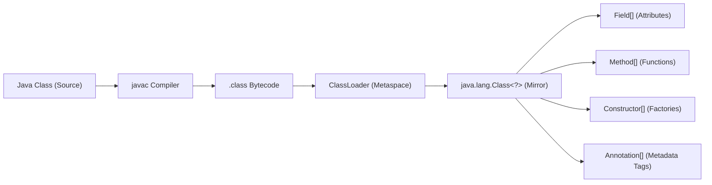
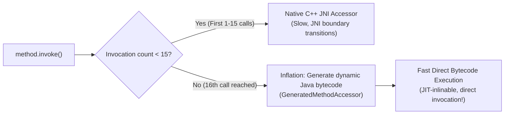

Have you ever wondered how Spring Boot can scan your project, discover classes annotated with `@RestController`, automatically wire dependencies via `@Autowired`, and serve HTTP requests without you writing a single factory method? 

Or how JUnit 5 discovers and runs methods marked with `@Test`?

The magic behind virtually every major enterprise Java framework—from Spring and Hibernate to Jackson and Mockito—is **The Java Reflection API (`java.lang.reflect`)** coupled with **Custom Annotations (`java.lang.annotation`)**.

Reflection gives Java programs the superpower of **metaprogramming**: the ability to inspect classes, constructors, methods, and fields at runtime, invoke methods dynamically, and read metadata tags. But with immense power comes significant architectural responsibility: reflection bypasses compile-time type safety, impacts performance if used naively, and collides with modern Java 9+ module encapsulation.

---

## The Core Mental Model: Runtime Metaprogramming

In standard Java, code is static and compiled: you type `user.getName()`, and the compiler checks that `getName()` exists on `User`.

Reflection flips this dynamic on its head. Instead of writing code against concrete types, your code interacts with the JVM's **runtime mirror representations**:



Every loaded type in the JVM has an associated **`java.lang.Class<?>`** singleton object living in Metaspace. Through this mirror, you can inspect and manipulate any aspect of the class at runtime.

---

## Inspecting Classes, Fields, and Methods

There are three canonical ways to obtain a `Class<?>` token:

```java
// 1. Via class literal (Compile-time known)
Class<String> stringClass = String.class;

// 2. Via instance (Object runtime inspection)
User user = new User("Alice");
Class<? extends User> userClass = user.getClass();

// 3. Via fully qualified string name (Dynamic runtime discovery)
Class<?> loadedClass = Class.forName("com.company.service.PaymentService");
```

### The Critical Difference: `get` vs. `getDeclared`
When inspecting members, one of the most common beginner mistakes is confusing public methods with declared methods:

| Method Call | Scope | Includes Inherited Members? | Includes Non-Public (`private`, `protected`)? |
|---|---|---|---|
| **`getFields()` / `getMethods()`** | **Public Only** | **Yes** (includes inherited public members from parent classes) | No |
| **`getDeclaredFields()` / `getDeclaredMethods()`** | **Current Class Only** | **No** (ignores parent class hierarchy) | **Yes** (inspects `private`, `protected`, `default`, `public`) |

```java
public class ReflectionInspector {
    public static void inspect(Class<?> clazz) {
        System.out.println("Class Name: " + clazz.getName());
        System.out.println("Superclass: " + clazz.getSuperclass().getSimpleName());

        // Inspecting declared private fields
        for (Field field : clazz.getDeclaredFields()) {
            System.out.println("Field: " + field.getType().getSimpleName() + " " + field.getName());
        }

        // Inspecting declared methods
        for (Method method : clazz.getDeclaredMethods()) {
            System.out.println("Method: " + method.getReturnType().getSimpleName() + " " + method.getName());
        }
    }
}
```

---

## Dynamic Invocation and Access Control

To invoke a method reflectively:
1. Lookup the `Method` object by name and its exact parameter types.
2. Call `method.invoke(targetInstance, arguments...)`.

```java
public class DynamicInvoker {
    public static void main(String[] args) throws Exception {
        OrderProcessor processor = new OrderProcessor();

        // Lookup: void process(String orderId, double amount)
        Method method = OrderProcessor.class.getDeclaredMethod(
                "process", 
                String.class, 
                double.class
        );

        // Dynamic execution!
        method.invoke(processor, "ORD-9901", 450.50);
    }
}
```

### Breaking Encapsulation: `setAccessible(true)`
By default, reflection obeys Java access modifiers. If you attempt to invoke a `private` method or modify a `private` field, the JVM throws `IllegalAccessException`.

Historically, frameworks bypassed this using `field.setAccessible(true)`:

```java
Field privateField = User.class.getDeclaredField("passwordHash");
privateField.setAccessible(true); // Suppresses Java language access checks!
privateField.set(userInstance, "new-secret-hash");
```

> [!CAUTION]
> **Java 9+ Strong Encapsulation (JEP 396/403)**:
> Starting in Java 9 with the JPMS module system, the JDK strictly enforces encapsulation. Calling `setAccessible(true)` on internal JDK classes (e.g. `java.lang.String` or `sun.misc.Unsafe`) will throw **`java.lang.reflect.InaccessibleObjectException`** unless explicit JVM command-line flags (`--add-opens java.base/java.lang=ALL-UNNAMED`) are passed at startup!

---

## Designing Custom Annotations

An annotation is a type of metadata tag that can be bound to classes, methods, parameters, or fields. Annotations do not contain executable logic themselves; they are declarative markers interpreted by reflection.

### Meta-Annotations: The Four Building Blocks
When defining a custom annotation, you configure its lifecycle and scope using **meta-annotations**:

1. **`@Retention`**: Determines how long the annotation survives:
   - `RetentionPolicy.SOURCE`: Stripped by the compiler; invisible in bytecode (e.g. `@Override`, Lombok).
   - `RetentionPolicy.CLASS`: Recorded in `.class` file bytecode, but **not loaded into memory** at runtime (default).
   - **`RetentionPolicy.RUNTIME`**: Preserved in Metaspace and **readable via reflection at runtime**. (Mandatory for Spring/JUnit style annotations!)
2. **`@Target`**: Restricts where the annotation can be attached (`ElementType.TYPE`, `METHOD`, `FIELD`, `PARAMETER`).
3. **`@Inherited`**: Automatically propagates the annotation to subclasses.
4. **`@Documented`**: Includes the annotation in generated Javadoc.

```java
import java.lang.annotation.*;

@Retention(RetentionPolicy.RUNTIME) // Readable at runtime via reflection
@Target(ElementType.METHOD)         // Can only be placed on methods
@Documented
public @interface Transactional {
    String isolation() default "READ_COMMITTED";
    int timeoutSeconds() default 30;
    boolean readOnly() default false;
}
```

---

## Building a Production Mini Dependency-Injection Framework

To truly understand how Spring works, let's build our own lightweight Dependency Injection container using reflection and custom annotations in fewer than 60 lines of code!

### Step 1: Define the Annotations

```java
import java.lang.annotation.*;

// Marks a class as a candidate for managed injection
@Retention(RetentionPolicy.RUNTIME)
@Target(ElementType.TYPE)
public @interface Service {}

// Marks a field that requires automatic dependency injection
@Retention(RetentionPolicy.RUNTIME)
@Target(ElementType.FIELD)
public @interface Autowire {}
```

### Step 2: Build the Container Engine

```java
import java.lang.reflect.Field;
import java.util.HashMap;
import java.util.Map;

public class MiniIoCContainer {
    // Registry of managed singleton instances
    private final Map<Class<?>, Object> singletons = new HashMap<>();

    // Registers and instantiates a managed component
    public <T> void register(Class<T> clazz) throws Exception {
        if (!clazz.isAnnotationPresent(Service.class)) {
            throw new IllegalArgumentException(clazz.getName() + " is missing @Service annotation!");
        }

        // Instantiate using default zero-arg constructor
        T instance = clazz.getDeclaredConstructor().newInstance();
        singletons.put(clazz, instance);
    }

    // Injects dependencies into all registered instances
    public void wireDependencies() throws Exception {
        for (Object bean : singletons.values()) {
            Class<?> clazz = bean.getClass();

            // Scan all declared fields
            for (Field field : clazz.getDeclaredFields()) {
                if (field.isAnnotationPresent(Autowire.class)) {
                    Class<?> dependencyType = field.getType();
                    Object dependency = singletons.get(dependencyType);

                    if (dependency == null) {
                        throw new IllegalStateException("No candidate found for type: " + dependencyType.getName());
                    }

                    // Inject the dependency directly into the private field!
                    field.setAccessible(true);
                    field.set(bean, dependency);
                }
            }
        }
    }

    @SuppressWarnings("unchecked")
    public <T> T getBean(Class<T> clazz) {
        return (T) singletons.get(clazz);
    }
}
```

### Step 3: Verify the Container

```java
@Service
class EmailService {
    public void sendEmail(String to, String msg) {
        System.out.println("Dispatched email to " + to + ": " + msg);
    }
}

@Service
class OrderService {
    @Autowire
    private EmailService emailService; // Injected automatically!

    public void completeOrder(String orderId) {
        System.out.println("Completed order " + orderId);
        emailService.sendEmail("customer@company.com", "Your order confirmed!");
    }
}

public class MiniSpringDemo {
    public static void main(String[] args) throws Exception {
        MiniIoCContainer container = new MiniIoCContainer();

        // 1. Register components
        container.register(EmailService.class);
        container.register(OrderService.class);

        // 2. Wire dependencies reflectively
        container.wireDependencies();

        // 3. Execute!
        OrderService orderService = container.getBean(OrderService.class);
        orderService.completeOrder("ORD-5544");
    }
}
```

---

## The Performance Cost of Reflection: Inflation Thresholds

Junior engineers often hear that "reflection is slow," but senior engineers understand *why* and *how the JVM optimizes it*.

### Why Naive Reflection is Slower
1. **Dynamic Resolution**: Every call to `getMethod()` scans Metaspace tables and verifies parameter types dynamically.
2. **Security & Access Checks**: The JVM must inspect caller stack frames to verify access visibility.
3. **Boxing & Argument Array Churn**: Arguments must be packaged into an `Object[]` array, boxing primitives (e.g. `int` to `Integer`), generating heap garbage.
4. **Prevents JIT Inlining**: The JIT compiler cannot inline reflective method calls as easily because the target method is indeterminate.

### The HotSpot "Inflation Threshold" Optimization
To optimize reflection, HotSpot employs an internal optimization mechanism:



For the first **15 invocations** (`-Dsun.reflect.inflationThreshold=15`), HotSpot uses a native C++ JNI bridge. 

On the **16th invocation**, the JVM **inflates** the accessor: it dynamically generates pure Java bytecode (`sun.reflect.GeneratedMethodAccessorXXX`) on the fly and compiles it! Subsequent calls bypass JNI entirely and execute at near-direct call speeds.

---

## Modern High-Speed Alternative: `java.lang.invoke.MethodHandles`

Java 7 introduced `java.lang.invoke.MethodHandles` as part of JSR 292 (supporting `invokedynamic`). 

`MethodHandle` is a typed, directly executable reference to an underlying method. Unlike `Method.invoke()`, a `MethodHandle` performs access and security checks **only once at creation time**, allowing the JIT compiler to inline it directly into machine code:

```java
import java.lang.invoke.MethodHandle;
import java.lang.invoke.MethodHandles;
import java.lang.invoke.MethodType;

public class MethodHandleBenchmark {
    public static void main(String[] args) throws Throwable {
        MethodHandles.Lookup lookup = MethodHandles.lookup();

        // Define method signature: Return type String, parameter String
        MethodType type = MethodType.methodType(String.class, String.class);

        // Creates a DirectMethodHandle
        MethodHandle handle = lookup.findVirtual(String.class, "concat", type);

        // Executes with near-native CPU speed!
        String result = (String) handle.invokeExact("Hello, ", "World!");
        System.out.println(result); // "Hello, World!"
    }
}
```

---

## Summary & Mental Model Checkpoint

1. **`Class<?>` Mirror**: Every loaded type has a runtime `Class` object in Metaspace exposing constructors, fields, methods, and annotations.
2. **`getDeclared*` vs `get*`**: `getMethods()` returns public members including inherited ones; `getDeclaredMethods()` returns all visibility levels but excludes inherited members.
3. **Runtime Retention**: Custom annotations must be tagged with `@Retention(RetentionPolicy.RUNTIME)` to be discoverable via reflection.
4. **Strong Encapsulation**: Java 9+ strictly blocks `setAccessible(true)` on internal JDK packages (`InaccessibleObjectException`).
5. **Inflation Threshold**: HotSpot uses JNI for the first 15 reflective calls, then generates direct bytecode (`GeneratedMethodAccessor`) on the 16th call.
6. **`MethodHandle` Alternative**: Use `java.lang.invoke.MethodHandle` for compile-time verified, high-performance dynamic invocations.

---

## 🎯 Senior Engineer Interview Questions

### What is the difference between `Class.getMethods()` and `Class.getDeclaredMethods()`, and how does this impact writing a dependency injection or ORM framework?
> **Answer:** `Class.getMethods()` returns an array of all `public` methods belonging to the target class, including all public methods inherited from superclasses and superinterfaces (up through `java.lang.Object`). However, it completely ignores `private`, `protected`, and package-private methods. Conversely, `Class.getDeclaredMethods()` returns all methods explicitly declared within that specific class regardless of visibility (`public`, `protected`, `default`, and `private`), but completely excludes inherited methods from parent classes. When writing a dependency injection or ORM framework, calling `getDeclaredFields()` or `getDeclaredMethods()` on a subclass will fail to discover annotated fields (like `@Id` or `@Autowired`) declared on abstract mapped superclasses. Robust frameworks must recursively traverse the class inheritance hierarchy (`clazz.getSuperclass()`) calling `getDeclared*` at each level until reaching `Object.class`.

### How does HotSpot optimize reflective method invocation using the "Inflation Threshold" (`sun.reflect.inflationThreshold`), and why does it do this?
> **Answer:** When `Method.invoke()` is called, HotSpot initially delegates execution to a native C++ accessor via JNI (`NativeMethodAccessorImpl`). Native calls have low startup latency (zero bytecode generation required), but high invocation overhead due to JNI context-switching boundaries and argument boxing. HotSpot tracks an invocation counter for each `Method` object. Once the invocation count reaches the inflation threshold (default is 15), HotSpot "inflates" the accessor: it dynamically generates a custom Java class in memory at runtime (`sun.reflect.GeneratedMethodAccessor<N>`) whose bytecode directly casts the arguments and invokes the target method. This eliminates JNI transitions and allows the JIT compiler to apply standard optimizations (such as method inlining and escape analysis), making long-term reflective invocations nearly as fast as direct Java calls.

### What is the difference between `RetentionPolicy.CLASS` and `RetentionPolicy.RUNTIME`, and what is a real-world use case for `CLASS` retention?
> **Answer:** Annotations marked with `RetentionPolicy.CLASS` are recorded by `javac` into the compiled `.class` file bytecode attributes, but the JVM ClassLoader discards them when loading the class into Metaspace; consequently, they cannot be read reflectively at runtime using `method.getAnnotation()`. `RetentionPolicy.RUNTIME` annotations are retained in bytecode and loaded into JVM Metaspace memory, allowing runtime reflection. A real-world use case for `CLASS` retention is **build-time static analysis and bytecode post-processing**. Tools like SpotBugs, Checker Framework, or Android's `@NonNull`/`@Nullable` annotations inspect `.class` files during CI/CD builds or bytecode weaving (e.g., AspectJ or Lombok) without burdening runtime Metaspace memory footprint.

### How does `java.lang.invoke.MethodHandle` differ architecturally from `java.lang.reflect.Method`, and why is it preferred in modern low-latency runtimes?
> **Answer:** `java.lang.reflect.Method` represents an indirect metadata descriptor. Every call to `Method.invoke()` performs dynamic runtime type checking, checks caller accessibility, and wraps arguments into an `Object[]` array, causing CPU instruction pipeline stalls and heap allocation churn. In contrast, `MethodHandle` (introduced in Java 7 for JSR 292 `invokedynamic`) is a strongly-typed, direct executable reference. Access and security checks are performed strictly **once** when the lookup is created (`MethodHandles.Lookup`). When invoked via `invokeExact()`, the JVM verifies the call-site descriptor at compile time and translates the handle directly into native machine instructions without argument array allocation or boxing. This enables the JIT compiler to inline the invocation just as aggressively as a normal direct method call.