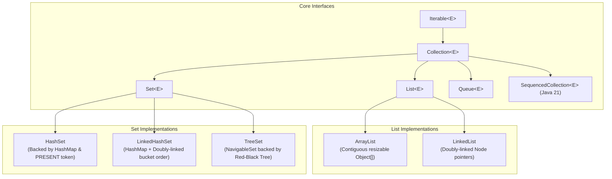
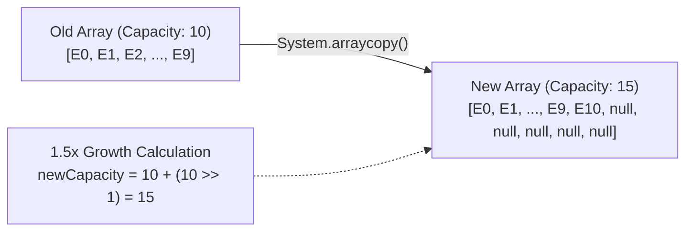
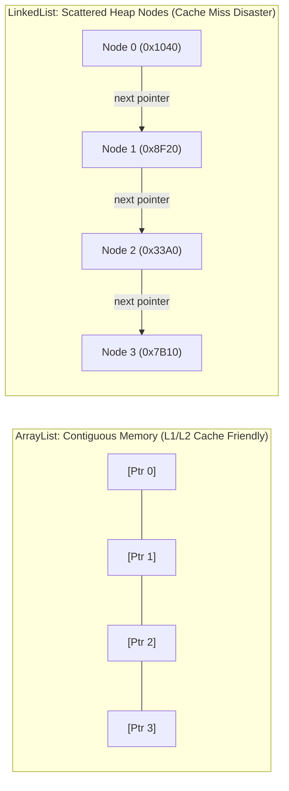
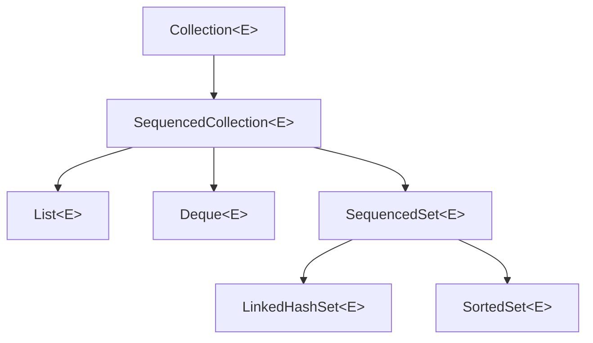

When building software, almost every business domain model involves collections of objects: lists of bank transactions, sets of unique user permissions, or queues of pending messages.

In Java, the **Collections Framework (`java.util`)** provides standardized, battle-tested interfaces and data structures. However, choosing the wrong collection implementation can quietly decimate application throughput, blow up memory budgets, and introduce subtle bugs under concurrency.

To write high-performance Java, you must look past interface signatures and understand the physical realities under the hood: **CPU cache lines**, **memory footprint per node**, **amortized array resizing**, and **internal hashing mechanics**.

---

## The Hierarchy Blueprint: Interfaces vs. Physical Implementations

The Collections Framework separates abstract contracts from concrete memory representations:



---

## `ArrayList`: The Industry Workhorse

`ArrayList` is backed by a contiguous `Object[]` array on the Heap. It is the gold standard default for 95% of collection use cases in modern Java.

### The Resizing Formula and Amortized Cost
When you instantiate `new ArrayList<>()`, Java creates an empty internal buffer. Upon inserting the first element, it allocates a default backing array of length **10**.

When the 11th element is added, the array is full. The JVM cannot simply expand contiguous memory in place because adjacent heap addresses might be claimed by other objects. Instead, it must:
1. Allocate a brand-new, larger array on the Heap.
2. Copy all elements from the old array into the new array using `System.arraycopy()`.
3. Abandon the old array to be reclaimed by Garbage Collection.



The OpenJDK growth formula uses bitwise right-shift for maximum efficiency:

```java
// OpenJDK ArrayList internal growth formula:
int newCapacity = oldCapacity + (oldCapacity >> 1); // 1.5x growth (50% expansion)
```

Because an array resize happens less and less frequently as the collection grows, appending an element has an **amortized constant time `O(1)`** cost. However, the resize operation itself is `O(n)`.

### Production Rule: Always Pre-Size When Known
If you know your service will process 100,000 records from a database query, never use empty constructors!

```java
// ❌ Resizes and copies 28 times, generating thousands of discarded arrays!
List<Order> orders = new ArrayList<>(); 

// ✅ Zero resizes! Allocates exactly one backing array of size 100,000
List<Order> orders = new ArrayList<>(100_000); 
```

---

## The `LinkedList` Fallacy: Why Senior Engineers Avoid It

Computer science textbooks often praise `LinkedList` because inserting or removing at the head or tail is `O(1)` without array resizing. 

In real-world production Java on modern hardware, **`LinkedList` is almost always a performance anti-pattern**.



### Astronomical Memory Overhead
Let's calculate the heap memory footprint on a 64-bit JVM with Compressed Oops enabled:

- **`ArrayList`**: Holds a single `Object[]` containing 4-byte references. Storing 1,000,000 elements requires ~**4 Megabytes** of memory.
- **`LinkedList`**: Every single element requires allocating a dedicated `Node` object:
  - Object Header: 12 bytes
  - `Node.item` reference: 4 bytes
  - `Node.prev` reference: 4 bytes
  - `Node.next` reference: 4 bytes
  - Memory padding to 8-byte boundary: 0 bytes
  - Total per element: **24 bytes** (plus the 4-byte pointer in the list itself = 28 bytes!).
  - Storing 1,000,000 elements consumes **28 Megabytes** of RAM—a **700% memory overhead**!

### CPU Cache Locality vs. Pointer Chasing
Modern CPU cores do not read individual 4-byte pointers from RAM. They fetch **64-byte Cache Lines** into high-speed L1/L2/L3 caches.

- When iterating through an `ArrayList`, elements are adjacent in physical memory. The CPU's hardware prefetcher loads contiguous cache lines ahead of time, achieving near-zero latency memory reads.
- When traversing a `LinkedList`, each `Node` is scattered across random heap locations. Every step requires dereferencing a pointer, triggering **L1/L2 cache misses** that stall the CPU while it waits hundreds of cycles for RAM to respond.

> [!TIP]
> If you need high-performance FIFO queue or LIFO stack operations at both ends, **do not use `LinkedList`**. Use **`ArrayDeque`**! It provides `O(1)` double-ended operations backed by a circular array with zero node allocation overhead.

---

## Sets: Uniqueness and Membership

A `Set` represents an unordered collection of elements containing no duplicates. The three primary implementations each serve specific architectural requirements:

| Set Implementation | Underlying Data Structure | Insertion / Lookup Cost | Iteration Order | Permits Null? |
|---|---|---|---|---|
| **`HashSet`** | Hash Table (`HashMap`) | **`O(1)`** constant | Unordered / Non-deterministic | Yes (at bucket 0) |
| **`LinkedHashSet`** | Hash Table + Doubly-Linked Buckets | **`O(1)`** constant | **Insertion Order** | Yes |
| **`TreeSet`** | Red-Black Self-Balancing Binary Tree | **`O(log n)`** logarithmic | **Sorted (Natural or Comparator)** | No (throws NPE) |

---

## `HashSet`: The Disguised `HashMap`

One of the neatest architectural secrets of the JDK is that `HashSet` does not contain its own custom hashing logic. Under the hood, **`HashSet` is simply a facade wrapping a `HashMap`**:

```java
// OpenJDK HashSet source code:
public class HashSet<E> implements Set<E> {
    private transient HashMap<E, Object> map;

    // Dummy value associated with every key in the backing Map
    private static final Object PRESENT = new Object();

    public HashSet() {
        map = new HashMap<>();
    }

    public boolean add(E e) {
        // Adds element as the MAP KEY, and dummy PRESENT object as value!
        return map.put(e, PRESENT) == null;
    }

    public boolean contains(Object o) {
        return map.containsKey(o);
    }
}
```

Because `HashSet` uses `HashMap` keys, it inherits all hash table rules:
1. It relies on the **`hashCode()`** method to compute bucket positions.
2. It relies on the **`equals()`** method to resolve hash collisions.
3. If an object's state changes while inside a `HashSet`, its hash code changes, making the object **impossible to locate or remove**, creating a permanent memory leak!

---

## `TreeSet` and the Comparator Trap

`TreeSet` stores elements in a **Red-Black Tree** (via `TreeMap`), keeping elements continuously sorted.

Whenever you add an element to a `TreeSet`, it traverses the tree comparing nodes using either the element's `Comparable.compareTo()` method or a custom `Comparator`:

```java
record TradeOrder(String orderId, double price) {}

// Sorted by price ascending:
Set<TradeOrder> book = new TreeSet<>(Comparator.comparingDouble(TradeOrder::price));
book.add(new TradeOrder("ORD-001", 150.0));
book.add(new TradeOrder("ORD-002", 150.0)); // ⚠️ WHAT HAPPENS HERE?

System.out.println("Orders in book: " + book.size()); // PRINTS 1, NOT 2!
```

### The Fatal Comparator Trap
Why did `ORD-002` vanish? 

`HashSet` determines duplicates using `.equals()`. But **`TreeSet` ignores `.equals()` completely!** It determines equality strictly by checking if `comparator.compare(a, b) == 0`.

Because both orders had price `150.0`, the comparator returned `0`. `TreeSet` assumed `ORD-002` was a duplicate of `ORD-001` and silently dropped it!

```java
// ✅ Safe Comparator: Always include a unique tie-breaker field!
Comparator<TradeOrder> safeOrderComparator = Comparator
        .comparingDouble(TradeOrder::price)
        .thenComparing(TradeOrder::orderId); // Guarantees uniqueness!
```

---

## Fail-Fast Iteration and `ConcurrentModificationException`

Iterators on standard collections (`ArrayList`, `HashSet`, etc.) are **Fail-Fast**.

Inside `ArrayList`, the JVM maintains an internal counter called **`modCount`** that increments on every structural modification (adding, removing, resizing):

```java
// Inside ArrayList:
int modCount = 0;

public boolean add(E e) {
    modCount++; // Incremented on every mutation!
    ...
}
```

When an iterator is created, it captures `int expectedModCount = modCount;`. On every call to `.next()` or `.hasNext()`, it checks:

```java
if (modCount != expectedModCount) {
    throw new ConcurrentModificationException();
}
```

```java
// ❌ BUGS IN PRODUCTION: Modifying collection during foreach loop
List<String> list = new ArrayList<>(List.of("A", "B", "C"));
for (String s : list) {
    if (s.equals("B")) {
        list.remove(s); // Mutates modCount directly! Iterator throws CME on next loop!
    }
}

// ✅ Safe Solution 1: Use Iterator.remove()
Iterator<String> it = list.iterator();
while (it.hasNext()) {
    if (it.next().equals("B")) {
        it.remove(); // Safely updates both modCount AND expectedModCount!
    }
}

// ✅ Safe Solution 2: Modern removeIf (Java 8+)
list.removeIf(s -> s.equals("B"));
```

---

## Java 21 Sequenced Collections (JEP 431)

Prior to Java 21, getting the first or last element of a collection was frustratingly inconsistent across types:
- `List`: `list.get(0)` and `list.get(list.size() - 1)`
- `Deque`: `deque.getFirst()` and `deque.getLast()`
- `SortedSet`: `set.first()` and `set.last()`
- `LinkedHashSet`: Impossible without iterating the entire set!

**Java 21 introduced `SequencedCollection`**, establishing a unified contract for collections with defined encounter orders:



```java
// Java 21 unified sequenced methods:
SequencedCollection<String> items = new ArrayList<>(List.of("alpha", "beta", "gamma"));

System.out.println(items.getFirst()); // "alpha"
System.out.println(items.getLast());  // "gamma"

// Zero-copy reverse view!
SequencedCollection<String> reversed = items.reversed();
System.out.println(reversed.getFirst()); // "gamma"
```

---

## Summary & Mental Model Checkpoint

1. **`ArrayList` Growth**: Backed by a single `Object[]` array that expands by 50% (`1.5x`) on overflow. Always pre-size when collection size is known.
2. **The `LinkedList` Trap**: Node allocations create 700% memory overhead and shatter CPU cache locality. Prefer `ArrayList` or `ArrayDeque`.
3. **`HashSet` Facade**: Operates as a thin wrapper around `HashMap` keys using a static `PRESENT` dummy object.
4. **`TreeSet` Equality**: Equality is governed entirely by `compare(a, b) == 0`, ignoring `.equals()`. Always include a unique tie-breaker field in custom comparators.
5. **Fail-Fast Mechanics**: The `modCount` vs `expectedModCount` check detects unauthorized concurrent structural mutations, throwing `ConcurrentModificationException`.
6. **Sequenced Collections (Java 21)**: Standardizes `getFirst()`, `getLast()`, and `reversed()` across Lists, Deques, and LinkedHashSets.

---

## 🎯 Senior Engineer Interview Questions

### Why does iterating over an `ArrayList` perform significantly faster than iterating over a `LinkedList` on modern hardware, even though both have an asymptotic complexity of `O(n)`?
> **Answer:** Asymptotic notation (`O(n)`) models operation growth relative to input size, but ignores physical hardware architecture and constant factor overhead. Modern CPUs read memory in 64-byte chunks called Cache Lines. `ArrayList` elements are stored in a single contiguous `Object[]` array; when an element is read, the CPU hardware prefetcher loads adjacent references into L1/L2 caches ahead of time, resulting in near-zero latency cache hits. In contrast, `LinkedList` stores elements in individual `Node` instances scattered non-contiguously across the JVM Heap. Iterating requires pointer dereferencing (`node.next`), which repeatedly misses CPU cache lines and stalls execution while the CPU waits hundreds of clock cycles to fetch data from main system RAM. Furthermore, each `LinkedList` node carries 24 bytes of object header and pointer overhead, increasing overall memory footprint.

### How does `ArrayList` implement its resizing mechanism, and what is the amortized cost of the `.add()` operation?
> **Answer:** `ArrayList` maintains an internal `Object[] elementData` buffer. When an element is added and `size == elementData.length`, the list triggers the internal `grow()` method. The new capacity is computed using bitwise shifting: `oldCapacity + (oldCapacity >> 1)`, which represents a 50% expansion (1.5x growth factor). A new array of this size is allocated on the heap, and `System.arraycopy()` (a native JVM bulk memory copy routine) copies the old elements to the new buffer. While a resize operation takes `O(n)` time, resizes occur geometrically less frequently as the list expands. Over a sequence of `N` insertions, the total copying operations sum to roughly `2N`, resulting in an amortized time complexity of `O(1)` per append operation.

### How does `HashSet` determine whether an incoming element is a duplicate, and what happens if the element's fields are mutated after insertion?
> **Answer:** `HashSet` delegates directly to an internal `HashMap` where the element serves as the map key and a dummy singleton `Object` (`PRESENT`) serves as the value. To check for duplicates, the map computes the element's hash using `(key == null) ? 0 : (h = key.hashCode()) ^ (h >>> 16)` to locate the appropriate bucket index. If the bucket is empty, the element is inserted. If a collision occurs, it traverses the bucket's nodes, checking both identity (`node.key == key`) and logical equality (`node.key.equals(key)`). If an equal key is found, the insertion returns false and the duplicate is rejected. If an object is mutated after being placed in a `HashSet` such that its `hashCode()` changes, the set will look in the wrong bucket during subsequent `contains()` or `remove()` calls, rendering the object unfindable and creating a memory leak.

### Why can adding two distinct objects to a `TreeSet` result in one of them being silently dropped, even if their `.equals()` method returns `false`?
> **Answer:** `TreeSet` implements `NavigableSet` backed by a `TreeMap` (Red-Black self-balancing tree). Crucially, `TreeSet` completely ignores the `equals()` method when enforcing set uniqueness. Instead, it relies exclusively on the ordering contract: either the natural order via `Comparable.compareTo()` or an explicitly provided `Comparator.compare()`. If `compare(a, b)` returns `0`, the tree data structure considers the two elements logically identical within its ordering hierarchy and does not insert the second element. If a custom comparator compares objects only on a non-unique attribute (such as sorting by `price`), two distinct products with identical prices will return `0`, causing the second product to be dropped. To prevent this bug, comparators for `TreeSet` must include a unique secondary tie-breaker field (such as a unique `id`).