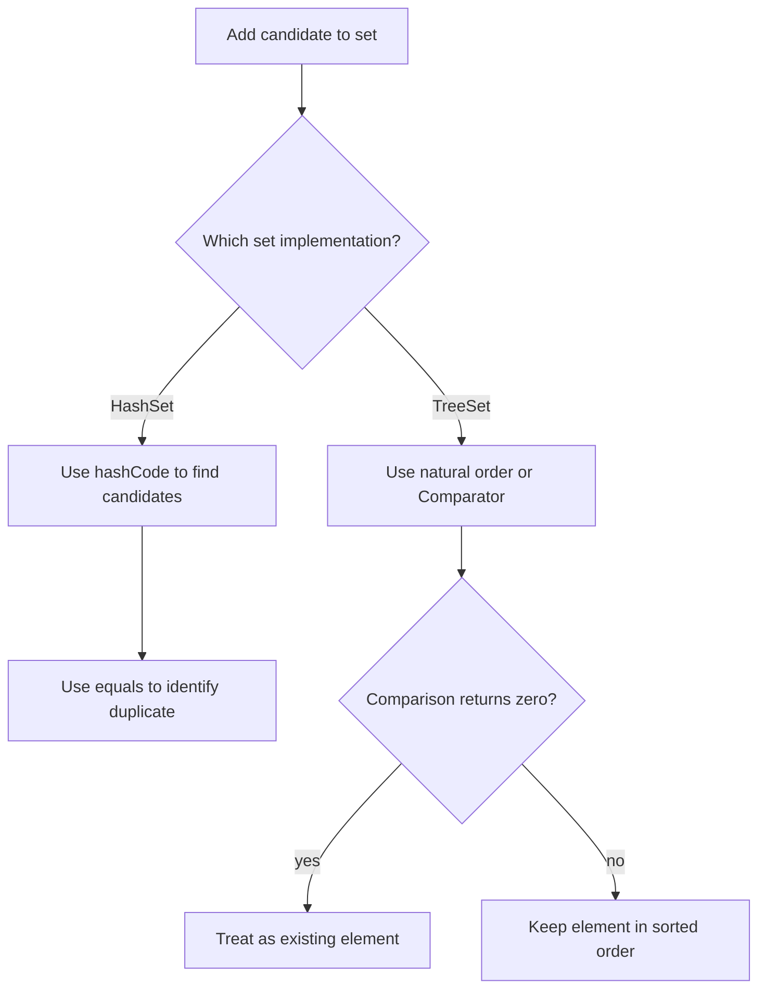

Collections let an application work with groups of objects through common interfaces rather than committing every method to one storage structure. The choice of implementation still matters: it determines whether positions are cheap to access, whether duplicates are retained, and what ordering the caller sees.

This lesson uses Java 21's `java.util` APIs. The complexity descriptions refer to documented or typical costs; they are not wall-clock guarantees, and behavior can depend on the input, collection size, and implementation.

## Interfaces describe behavior; implementations choose representation

- `Collection<E>` is the common root for most collection types.
- `List<E>` is an ordered sequence that permits duplicates and supports indexed operations.
- `Set<E>` models membership without duplicate elements according to that set's equality rule.
- `Deque<E>` adds operations at both ends and is often a clearer stack or queue abstraction than indexed list operations.

Declare variables and method parameters using the interface when callers do not need implementation-specific operations:

```java
import java.util.ArrayList;
import java.util.HashSet;
import java.util.List;
import java.util.Set;

List<String> names = new ArrayList<>();
Set<String> uniqueNames = new HashSet<>();
```

The interface communicates the contract; the concrete implementation provides a storage and performance strategy. A type like `List` alone does not promise constant-time indexing or thread safety.

## Lists: array-backed and node-linked

### `ArrayList`: contiguous indexed storage

`ArrayList` is a resizable-array implementation of `List`. It is a good default when the application needs frequent iteration, indexed reads, and appends:

```java
import java.util.ArrayList;
import java.util.HashSet;
import java.util.List;
import java.util.Set;

List<String> tasks = new ArrayList<>();
tasks.add("compile");
tasks.add("test");
String current = tasks.get(1);
```

The Java API documents constant-time `get` and `set`, and amortized constant-time append. Inserting or removing near the beginning or middle shifts subsequent elements, so these operations cost time proportional to the affected suffix. An append can occasionally trigger a resize and copy; amortized analysis spreads that occasional cost across many appends.

An `ArrayList` has a logical **size** and an internal **capacity**. Size is the number of elements currently stored; capacity is the backing storage available before another growth is needed. Supplying an initial capacity can reduce resize events when a reasonable final size is known, but capacity is not the same as list size and does not create placeholder elements. Exact growth policy is an implementation detail, not a Java API guarantee.

### `LinkedList`: nodes connected by links

`LinkedList` stores elements in linked nodes and implements both `List` and `Deque`. It can be useful when the main operations are at the ends of the sequence, but its indexed operations require walking from an end toward the requested index. It also stores link references for each node, which adds per-element memory and pointer-chasing overhead compared with a resizable array.

The name “linked list” does not mean arbitrary insertion is automatically fast: finding the insertion point may still require traversing the list. When an iterator already points at the location, iterator-based insertion can avoid a separate search, but the node allocation and link updates remain.

| Operation | `ArrayList` | `LinkedList` |
|---|---|---|
| Read by index | Constant time | Traversal from a nearer end |
| Append at end | Amortized constant time | Constant time |
| Insert/remove at an arbitrary index | Shift a suffix | Find the node, then relink |
| Storage overhead | Backing array with spare capacity | Node object and links per element |
| Common fit | General-purpose list, iteration, indexed access | Deque-like operations at both ends |

For most ordinary list usage, start with `ArrayList`. Prefer `ArrayDeque` for a queue or stack where indexed `List` behavior is unnecessary. Select another structure because the measured workload or required semantics call for it, not just because an operation has a favorable asymptotic label.

## Sets: uniqueness and membership

A `Set` prevents duplicate elements according to its implementation's membership rule:

```java
import java.util.HashSet;
import java.util.Set;

Set<String> languages = new HashSet<>();
languages.add("Java");
languages.add("Java"); // The second insertion does not add another element
System.out.println(languages.size()); // 1
```

The `Set` interface does not generally promise iteration order. Use the concrete type whose ordering semantics match the requirement.

### `HashSet`: hash-based membership

`HashSet` is backed by a `HashMap` in the Java implementation and uses `hashCode()` to locate a candidate region, then `equals()` to distinguish keys with matching hashes. A collision is not proof that two objects are equal; it means they need further comparison.

The `equals`/`hashCode` contract is essential: if two objects are equal according to `equals`, they must return the same hash code. If equality-relevant fields mutate while an object is stored in a hash set, later lookup or removal can fail because the object may no longer be found in the location selected from its new hash.

Do not rely on `HashSet` iteration order. It may change as the set changes, and it is not sorted. The API documents expected constant-time basic operations under a well-dispersed hash distribution; excessive collisions can worsen performance. Iteration cost also depends on the table capacity as well as the number of entries, so reserving an enormous capacity for a small set can make traversal wasteful.

### `TreeSet`: sorted membership

`TreeSet` implements a navigable set ordered by natural ordering or a supplied `Comparator`. It provides logarithmic-time basic operations and useful range/navigation operations such as `first`, `higher`, and `subSet`:

```java
import java.util.Comparator;
import java.util.Set;
import java.util.TreeSet;

public class SortedJobs {
    record Job(String id, int priority) {}

    public static void main(String[] args) {
        Comparator<Job> byPriorityThenId =
                Comparator.comparingInt(Job::priority)
                          .thenComparing(Job::id);
        Set<Job> jobs = new TreeSet<>(byPriorityThenId);
        jobs.add(new Job("report", 2));
        jobs.add(new Job("backup", 1));
        System.out.println(jobs);
    }
}
```

The comparator determines both order and whether the set considers an element already present. If `compare(a, b) == 0`, a `TreeSet` treats the values as the same set element, even if `a.equals(b)` is false. Comparators should generally be consistent with `equals` when the set is expected to obey the ordinary `Set` equality contract. If a business rule intentionally groups different objects into one sorted key, document that distinct equivalence clearly.



The equality path differs: a hash set uses `hashCode` and `equals`, while a tree set uses its ordering relation.

### `equals`, `hashCode`, and ordering

For a class used as a hash-set element, implement `equals` and `hashCode` together using the same stable identity fields. For a class used in a `TreeSet`, implement a consistent `Comparable` or provide a comparator with a total, stable ordering. Never change fields that participate in the set's identity or ordering while the object is stored in the set.

For example, a set of users may define uniqueness by immutable user ID, while sorting is by display name. Those are different concepts: a `HashSet` can use equality by ID, and a `TreeSet` comparator should include a stable tie-breaker such as ID if distinct users can share a display name.

## Iteration and modification

Most mutable collections return **fail-fast** iterators. If the collection is structurally modified outside the iterator while iteration is in progress, an iterator may throw `ConcurrentModificationException`. This is a best-effort bug detector, not a synchronization mechanism and not a guarantee that every race will be detected.

When removing elements during traversal, use the iterator's own `remove` method where supported, or use collection methods such as `removeIf` when their predicate expresses the intended operation:

```java
import java.util.ArrayList;
import java.util.List;

List<String> queue = new ArrayList<>(List.of("ready", "skip", "done"));
queue.removeIf("skip"::equals);
```

None of `ArrayList`, `LinkedList`, `HashSet`, or `TreeSet` is synchronized by default. Concurrent mutation requires an explicit design: external synchronization, immutable snapshots, or a suitable concurrent collection from `java.util.concurrent`. Wrapping an ordinary collection with a synchronized view also requires callers to follow that wrapper's synchronization rules while iterating.

## Choosing a list or set

| Requirement | Start with |
|---|---|
| General list with fast indexing and iteration | `ArrayList` |
| Queue or stack operations at both ends | `ArrayDeque` |
| Unique membership without order requirements | `HashSet` |
| Unique elements in sorted order or range queries | `TreeSet` |
| Stable insertion order with unique values | `LinkedHashSet` |

The right choice follows from the required semantics first, then from realistic workload measurements. Big-O notation helps identify scaling behavior, but it does not account for constant factors, allocation, cache locality, or actual input distribution.

## Further reading

- [Java 21 `List`](https://docs.oracle.com/en/java/javase/21/docs/api/java.base/java/util/List.html), [`ArrayList`](https://docs.oracle.com/en/java/javase/21/docs/api/java.base/java/util/ArrayList.html), and [`LinkedList`](https://docs.oracle.com/en/java/javase/21/docs/api/java.base/java/util/LinkedList.html)
- [Java 21 `Set`](https://docs.oracle.com/en/java/javase/21/docs/api/java.base/java/util/Set.html), [`HashSet`](https://docs.oracle.com/en/java/javase/21/docs/api/java.base/java/util/HashSet.html), and [`TreeSet`](https://docs.oracle.com/en/java/javase/21/docs/api/java.base/java/util/TreeSet.html)
- [Java 21 `Comparator`](https://docs.oracle.com/en/java/javase/21/docs/api/java.base/java/util/Comparator.html)
