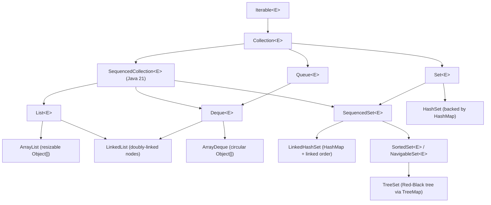
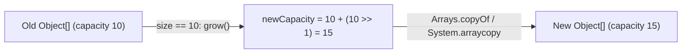
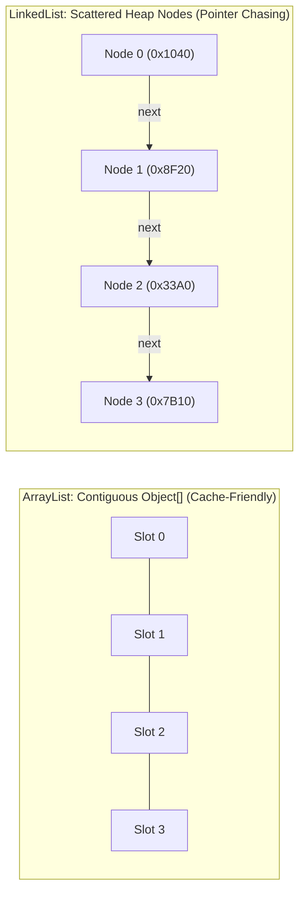

Almost every Java application spends a large portion of its time storing, filtering, and iterating over groups of objects. The `java.util` Collections Framework gives you clean interfaces like `List<E>` and `Set<E>`, so it is tempting to treat implementations as interchangeable.

In practice, the backing data structure matters a great deal. Picking `LinkedList` where `ArrayList` belongs can multiply memory consumption and stall CPU caches. Passing a sloppy `Comparator` to `TreeSet` can silently drop valid records. Understanding how `ArrayList`, `LinkedList`, `HashSet`, `LinkedHashSet`, and `TreeSet` organize data in memory helps you pick the right tool on the first try and diagnose subtle production bugs quickly.

---

## Core Interfaces and Implementations

The Collections Framework separates behavioral contracts (interfaces) from concrete memory layouts (implementations). In Java 21, `SequencedCollection` and `SequencedSet` were inserted into the hierarchy (JEP 431) to give ordered collections a consistent API for accessing both ends.



Notice that `List` preserves index order and allows duplicates, while `Set` enforces uniqueness. Within each interface, the implementation controls lookup speed, iteration order, null handling, and memory layout.

---

## `ArrayList` Dynamic Resizing Mechanics

`ArrayList` is backed by a single contiguous `Object[]` array (`elementData` in OpenJDK) plus an `int size` counter tracking how many slots are occupied. For the vast majority of list workloads in Java, `ArrayList` is the right default.

### How Growth Works in OpenJDK

When you call `new ArrayList<>()`, OpenJDK does not allocate a 10-element array right away. It starts with a shared empty array (`DEFAULTCAPACITY_EMPTY_ELEMENTDATA`) so that empty lists do not waste heap space. On the **first `add()`**, it allocates a backing array of length **10**. (Keep in mind that the initial capacity of 10 and the growth factor are OpenJDK implementation details, not guaranteed by the `List` specification.)

When you append an element and `size == elementData.length`, `ArrayList` cannot expand the array in place because adjacent heap memory may already belong to other objects. Instead, its internal `grow()` method:

1. Computes a new capacity by increasing the current capacity by 50% (1.5x growth):
   ```java
   int newCapacity = oldCapacity + (oldCapacity >> 1);
   ```
2. Allocates a new `Object[]` of `newCapacity`.
3. Copies all existing references over with `Arrays.copyOf`, which delegates to the native `System.arraycopy()` intrinsic.
4. Replaces `elementData` with the new array, leaving the old array eligible for garbage collection.



A single resize takes `O(n)` time because every existing reference has to be copied. Because capacity grows geometrically (10, 15, 22, 33, 49, ...), resizes happen less and less frequently as the list gets larger. Averaged across `n` appends, the total work is roughly linear in `n`, which gives `ArrayList.add(element)` an **amortized `O(1)`** cost.

By contrast, inserting or removing at index `0` or in the middle shifts every element to the right of that index using `System.arraycopy()`, making those operations `O(n)`.

### Pre-Sizing When You Know the Expected Count

If you are mapping 100,000 rows from a database result set into a list, letting `ArrayList` start at 10 forces more than 20 array allocations and copies along the way, generating unnecessary short-lived garbage. Pass an initial capacity instead:

```java
// Bad: triggers ~24 resizes and array copies for 100,000 elements
List<Order> orders = new ArrayList<>();

// Good: allocates one backing array up front; zero resizes
List<Order> sizedOrders = new ArrayList<>(100_000);
```

If an existing `ArrayList` is about to receive a large batch of elements, you can also call `list.ensureCapacity(targetSize)` before the loop.

---

## `LinkedList` vs. `ArrayList` Performance

`LinkedList` implements both `List` and `Deque` using a doubly-linked list of `Node<E>` objects, each holding a reference to the element (`item`), the previous node (`prev`), and the next node (`next`).

On paper, `LinkedList` looks competitive for certain workloads. Here is the theoretical Big-O comparison:

| Operation | `ArrayList` | `LinkedList` |
|---|---|---|
| Random access `get(index)` | `O(1)` | `O(n)` |
| Append at tail `add(e)` | `O(1)` amortized | `O(1)` |
| Insert or remove at head | `O(n)` | `O(1)` |
| Insert or remove at middle (by index) | `O(n)` | `O(n)` (traversal dominates) |
| Remove current element via `ListIterator` | `O(n)` | `O(1)` |

In real production code, Big-O hides two hardware realities that make `ArrayList` dramatically faster than `LinkedList` for almost every workload.

### Memory Footprint per Element

Consider a typical 64-bit HotSpot JVM with Compressed OOPs enabled (the default for heaps under 32 GB, where object references are 4 bytes and object headers are 12 bytes, aligned to 8-byte boundaries):

- **`ArrayList`**: stores one 4-byte reference per slot in its backing `Object[]`. One million elements take roughly **4 MB** for the array itself (slightly more if the array has spare capacity after a resize).
- **`LinkedList`**: allocates a separate `Node` object for every single element:
  - 12-byte object header
  - 4-byte `item` reference
  - 4-byte `next` reference
  - 4-byte `prev` reference
  - Total: **24 bytes per node**. One million elements consume **24 MB** just for the wrapper nodes, roughly **6x the memory** of a full `ArrayList`, plus a million extra objects for the garbage collector to trace.

(Exact byte counts are HotSpot implementation details and vary if Compressed OOPs are disabled or on different JVMs, though `LinkedList` always carries substantial per-node overhead.)

### CPU Cache Locality and Pointer Chasing

Modern CPUs do not fetch individual 4-byte values from main memory; they pull **64-byte cache lines** into L1/L2/L3 caches.



When you iterate over an `ArrayList`, up to 16 adjacent references fit into a single 64-byte cache line, and the CPU's hardware prefetcher predicts the linear scan and fetches the next cache line ahead of time. When you iterate over a `LinkedList`, each `Node` can sit in a completely different region of the heap. The CPU has to dereference `node.next` before it even knows the next memory address to fetch, leading to frequent cache misses.

Even for head/tail queue or stack operations where `LinkedList` is `O(1)`, Java has a better alternative.

> [!TIP]
> If you need a FIFO queue or LIFO stack with `O(1)` operations at both ends, prefer `ArrayDeque` over `LinkedList`. `ArrayDeque` uses a resizable circular array with no per-element `Node` allocations and much better cache locality. (Unlike `LinkedList`, `ArrayDeque` does not permit `null` elements.)

---

## Sets: Uniqueness and Implementation Trade-Offs

A `Set<E>` models a mathematical set: no duplicate elements. The three main general-purpose implementations in `java.util` trade off speed, ordering, and null support:

| Implementation | Backing Structure | `add` / `contains` / `remove` | Iteration Order | Allows `null`? |
|---|---|---|---|---|
| `HashSet` | `HashMap` | `O(1)` average | Unspecified | Yes (at most one) |
| `LinkedHashSet` | `LinkedHashMap` | `O(1)` average | Insertion order | Yes (at most one) |
| `TreeSet` | `TreeMap` (Red-Black tree) | `O(log n)` | Sorted (`Comparable` / `Comparator`) | No (under natural ordering) |

---

## `HashSet` Internals

OpenJDK's `HashSet` does not implement its own hash table. It wraps a `HashMap<E, Object>` and stores every set element as a **map key**, paired with a single shared dummy value:

```java
// Simplified excerpt of OpenJDK java.util.HashSet
public class HashSet<E> extends AbstractSet<E> implements Set<E> {
    private transient HashMap<E, Object> map;
    private static final Object PRESENT = new Object();

    public HashSet() {
        map = new HashMap<>();
    }

    @Override
    public boolean add(E e) {
        return map.put(e, PRESENT) == null;
    }

    @Override
    public boolean contains(Object o) {
        return map.containsKey(o);
    }

    @Override
    public boolean remove(Object o) {
        return map.remove(o) == PRESENT;
    }
}
```

When you call `set.add(element)`, the underlying `HashMap`:

1. Computes a spread hash from `element.hashCode()` (or `0` if `element == null`) to pick a bucket index.
2. Checks if the bucket is empty; if so, inserts the new node and returns `null` (so `add()` returns `true`).
3. If other entries already live in that bucket (a hash collision), compares each existing key against `element` using reference identity (`==`) and `equals()`. If a match exists, the duplicate is not added and `add()` returns `false`.

Because `HashSet` depends directly on `hashCode()` and `equals()`, two rules apply to any custom type stored in a `HashSet`:

- Always override both `equals()` and `hashCode()` together consistently.
- Never mutate fields that participate in `hashCode()` while the object is inside the set.

```java
import java.util.HashSet;
import java.util.Objects;
import java.util.Set;

public class MutableElementBug {
    static class Tag {
        String name;

        Tag(String name) { this.name = name; }

        @Override
        public boolean equals(Object o) {
            return o instanceof Tag other && Objects.equals(name, other.name);
        }

        @Override
        public int hashCode() {
            return Objects.hash(name);
        }
    }

    public static void main(String[] args) {
        Set<Tag> tags = new HashSet<>();
        Tag tag = new Tag("java");
        tags.add(tag);

        // Mutating a field used by hashCode() strands the object in its old bucket
        tag.name = "jvm";

        System.out.println(tags.contains(tag)); // false
        System.out.println(tags.remove(tag));   // false (cannot even be removed!)
        System.out.println(tags.size());        // 1
    }
}
```

If you need `O(1)` lookups **and** predictable insertion order, use `LinkedHashSet`. It extends `HashSet` by backing itself with a `LinkedHashMap`, maintaining a doubly-linked chain across all entries so iteration follows the exact order in which elements were first added.

---

## `TreeSet` and `Comparable` vs. `Comparator`

`TreeSet` implements `NavigableSet<E>` and is backed by a `TreeMap` (a Red-Black self-balancing binary search tree). Every `add`, `remove`, and `contains` call walks down the tree in `O(log n)` time, and iteration always visits elements in sorted order.

Because the tree has to decide whether a new element goes left or right at every node, `TreeSet` needs a total ordering defined in one of two ways:

1. **Natural ordering (`Comparable<T>`)**: the element class implements `Comparable<T>` and overrides `compareTo(T other)`.
2. **External ordering (`Comparator<T>`)**: you pass a `Comparator<T>` to the `TreeSet` constructor, which works even for classes you do not control or when you need multiple sort orders for the same type.

```java
import java.util.Comparator;
import java.util.NavigableSet;
import java.util.TreeSet;

public class TreeSetOrdering {

    // Natural ordering: sorted by priority ascending, then id ascending
    record Task(String id, int priority) implements Comparable<Task> {
        @Override
        public int compareTo(Task other) {
            int cmp = Integer.compare(this.priority, other.priority);
            return (cmp != 0) ? cmp : this.id.compareTo(other.id);
        }
    }

    public static void main(String[] args) {
        // Uses Task.compareTo (natural ordering)
        NavigableSet<Task> byPriority = new TreeSet<>();
        byPriority.add(new Task("T-2", 2));
        byPriority.add(new Task("T-1", 1));
        byPriority.add(new Task("T-3", 1));
        System.out.println(byPriority); // [Task[id=T-1, priority=1], Task[id=T-3, priority=1], Task[id=T-2, priority=2]]

        // Custom external Comparator: reverse priority, then id
        Comparator<Task> highFirst = Comparator
                .comparingInt(Task::priority).reversed()
                .thenComparing(Task::id);
        NavigableSet<Task> custom = new TreeSet<>(highFirst);
        custom.addAll(byPriority);

        // NavigableSet range and neighbor queries in O(log n)
        Task first = custom.first();
        Task ceiling = byPriority.ceiling(new Task("T-0", 2)); // Task[id=T-2, priority=2]
    }
}
```

### Consistency with `equals()` and the Silent Duplicate Bug

Here is a subtle pitfall that catches even experienced developers. `HashSet` checks duplicates with `equals()`. **`TreeSet` does not call `equals()` at all.** It treats two elements as equal whenever `compareTo(b) == 0` (or `comparator.compare(a, b) == 0`).

Look at what happens if you sort trade orders by price alone:

```java
record TradeOrder(String orderId, double price) {}

// Bug: compares only by price, with no tie-breaker
Set<TradeOrder> orders = new TreeSet<>(Comparator.comparingDouble(TradeOrder::price));
orders.add(new TradeOrder("ORD-001", 150.0));
orders.add(new TradeOrder("ORD-002", 150.0)); // compare() returns 0 -> treated as duplicate!

System.out.println(orders.size()); // Prints 1, not 2
```

Because both orders have the same price, `compare()` returns `0`, so `TreeSet` concludes `ORD-002` is already present and discards it silently. Even the JDK itself has a famous case of `compareTo` being inconsistent with `equals`: `new BigDecimal("1.0").equals(new BigDecimal("1.00"))` is `false` (different scale), so a `HashSet` keeps both, whereas `new BigDecimal("1.0").compareTo(new BigDecimal("1.00"))` is `0`, so a `TreeSet` keeps only one.

Whenever you build a `Comparator` for a `TreeSet`, chain a unique tie-breaker with `.thenComparing(...)` so two distinct domain objects never compare as `0`:

```java
Comparator<TradeOrder> orderComparator = Comparator
        .comparingDouble(TradeOrder::price)
        .thenComparing(TradeOrder::orderId);
```

---

## Fail-Fast Iteration and `ConcurrentModificationException`

Iterators returned by `ArrayList`, `LinkedList`, `HashSet`, and `TreeSet` are **fail-fast**. Internally, these collections track a `modCount` integer that increments whenever the collection's structure changes (adding, removing, or clearing elements).

When you start iterating (including with an enhanced `for-each` loop), the iterator snapshots `expectedModCount = modCount`. Before advancing on each step, it verifies that `modCount == expectedModCount`. If the collection was modified directly outside the iterator, it throws `ConcurrentModificationException` immediately rather than risking corrupted traversal:

```java
List<String> items = new ArrayList<>(List.of("alpha", "beta", "gamma"));

// Bug: mutating the list directly inside a for-each loop throws ConcurrentModificationException
// for (String item : items) {
//     if (item.equals("beta")) {
//         items.remove(item);
//     }
// }

// Safe option 1: remove through the Iterator itself (keeps expectedModCount in sync)
Iterator<String> it = items.iterator();
while (it.hasNext()) {
    if (it.next().equals("beta")) {
        it.remove();
    }
}

// Safe option 2: use removeIf (Java 8+), which is also O(n) on ArrayList
// instead of O(n^2) for repeated removals
items.removeIf(item -> item.equals("gamma"));
```

Note that `ConcurrentModificationException` does not require multiple threads; the single-threaded loop above triggers it reliably. Also, fail-fast checks are best-effort bug detectors rather than a thread-safety guarantee. For concurrent access across threads, use collections from `java.util.concurrent`.

---

## Java 21 Sequenced Collections (JEP 431)

Before Java 21, fetching the first or last element of an ordered collection depended on which interface you held:

- `List`: `list.get(0)` and `list.get(list.size() - 1)`
- `Deque`: `deque.getFirst()` and `deque.getLast()`
- `SortedSet`: `set.first()` and `set.last()`
- `LinkedHashSet`: no direct way to fetch the last element without iterating through the entire set

Java 21 unified these operations under `SequencedCollection<E>` and `SequencedSet<E>`, providing `getFirst()`, `getLast()`, `addFirst()`, `addLast()`, `removeFirst()`, `removeLast()`, and `reversed()` across `List`, `Deque`, `LinkedHashSet`, and `SortedSet`:

```java
import java.util.LinkedHashSet;
import java.util.List;
import java.util.SequencedSet;

public class SequencedExample {
    public static void main(String[] args) {
        SequencedSet<String> stages = new LinkedHashSet<>(List.of("build", "test", "deploy"));

        System.out.println(stages.getFirst()); // build
        System.out.println(stages.getLast());  // deploy

        // Returns a reverse-ordered view backed by the original set (no copy)
        SequencedSet<String> reversed = stages.reversed();
        System.out.println(reversed.getFirst()); // deploy
    }
}
```

Because `reversed()` returns a live view rather than copying elements, iterating backward over an `ArrayList` or `LinkedHashSet` takes no extra allocation.

---

## Key Takeaways

- `ArrayList` stores references in a contiguous `Object[]`, lazily allocating capacity 10 in OpenJDK and growing by 1.5x (`oldCapacity + (oldCapacity >> 1)`). Pre-size it when you know the expected element count.
- `LinkedList` incurs heavy per-node memory overhead (24 bytes per `Node` on typical 64-bit HotSpot with Compressed OOPs) and poor CPU cache locality. Prefer `ArrayList` for lists and `ArrayDeque` for queues/stacks.
- `HashSet` delegates to a backing `HashMap` with a dummy `PRESENT` value. Never mutate fields involved in `hashCode()` after inserting an element.
- `TreeSet` is backed by a Red-Black tree (`O(log n)`) and determines uniqueness strictly through `compareTo`/`compare == 0`, not `equals()`. Always include a unique tie-breaker in custom comparators.
- Use `Iterator.remove()` or `removeIf()` to avoid `ConcurrentModificationException` during iteration, and use Java 21's `SequencedCollection` API for clean first/last/reversed operations.

---

## Interview Questions

### Why is iterating over an `ArrayList` usually much faster than iterating over a `LinkedList`, even though both are `O(n)`?
Big-O notation ignores constant factors and hardware memory access patterns. Modern CPUs load memory in 64-byte cache lines. Because `ArrayList` stores references contiguously in a single `Object[]`, scanning it sequentially triggers hardware prefetching and keeps reads in L1/L2 cache. A `LinkedList` allocates an independent `Node` object for every element, and those nodes can end up scattered across the heap. Traversing `node.next` pointers repeatedly misses CPU caches and forces the processor to stall waiting on main memory, on top of carrying roughly 6x the memory overhead per element on typical 64-bit HotSpot setups.

### How does `ArrayList` grow when it runs out of space, and why is `add()` amortized `O(1)`?
When `size` reaches `elementData.length`, OpenJDK's `ArrayList.grow()` calculates `oldCapacity + (oldCapacity >> 1)` (a 50% increase), allocates a new `Object[]`, and copies existing elements over with `Arrays.copyOf` / `System.arraycopy`. Although a single resize costs `O(n)`, multiplying capacity by 1.5 means resizes happen exponentially less often as the list grows. Summing the copy work across `n` sequential appends forms a geometric series bounded by a small constant multiple of `n`, so the average cost per append is `O(1)`.

### How does `HashSet` prevent duplicates, and what goes wrong if you mutate an element after adding it?
`HashSet` is a thin wrapper around `HashMap<E, Object>`. Calling `add(e)` calls `map.put(e, PRESENT)`, using `e` as the map key. `HashMap` hashes `e`, locates the bucket, and compares against existing keys in that bucket with `==` and `equals()`. If a matching key is found, the duplicate is rejected and `add()` returns `false`. If you later mutate a field that `hashCode()` depends on, `e.hashCode()` changes, so future calls to `contains(e)` or `remove(e)` inspect the wrong bucket. The object remains trapped inside the set until the entire set is cleared or garbage-collected.

### Why can two objects where `a.equals(b)` is `false` still collide as duplicates in a `TreeSet`?
`TreeSet` delegates to a `TreeMap` and orders elements exclusively with `Comparable.compareTo()` or the supplied `Comparator.compare()`. It never invokes `equals()` to check membership. Whenever `compare(a, b)` returns `0`, `TreeSet` considers `a` and `b` equivalent and refuses to insert the second one. For example, a `TreeSet` comparing `Order` objects only by `price` will silently discard a second distinct order at the same price. To avoid losing elements, make comparators consistent with `equals()` by adding a unique tie-breaker field with `thenComparing()`.
