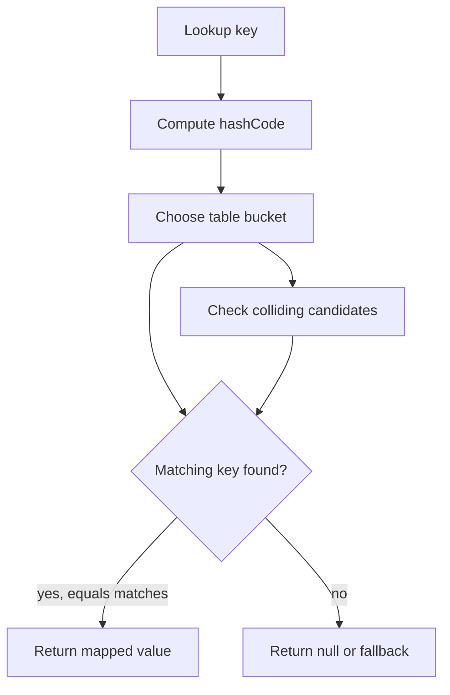

A map represents associations: a key identifies a value. Unlike a list, a map is not primarily about positions; unlike a set, a map exposes the value associated with a key. The most important design question is what makes two keys the same and whether iteration needs an order.

This lesson uses Java 21's `Map`, `HashMap`, `LinkedHashMap`, and `TreeMap`.

## The `Map<K, V>` contract

Each key maps to at most one value. Calling `put` with a key that is already present replaces its previous value:

```java
import java.util.HashMap;
import java.util.List;
import java.util.Map;

Map<String, Integer> inventory = new HashMap<>();
inventory.put("notebook", 12);
inventory.put("notebook", 15);

System.out.println(inventory.get("notebook")); // 15
```

`Map` is separate from the `Collection` hierarchy, but it exposes collection views: `keySet()`, `values()`, and `entrySet()`. Those views are backed by the map, so removing through a view changes the map; structural changes to the map are reflected in the view.

### A missing key versus a null value

Some map implementations allow `null` keys or values, while others do not. In a map that permits null values, `get(key)` returning `null` is ambiguous: either the key is absent or the key maps to null. Use `containsKey` if that distinction matters:

```java
import java.util.HashMap;
import java.util.Map;

Map<String, Integer> inventory = new HashMap<>();
inventory.put("missing", null);
if (inventory.containsKey("missing")) {
    Integer count = inventory.get("missing");
    // The key exists even if count is null in a null-permitting map.
}
```

For general application data, avoiding null map values often makes behavior clearer. `getOrDefault` supplies a fallback for a missing mapping, but it does not treat an explicitly mapped null as absent in the same way as `computeIfAbsent`; check each method's null behavior when it matters.

## `HashMap`: hashing and bucket lookup

`HashMap` is the general-purpose map when key lookup is needed and no iteration order is required. Conceptually, a hash-based map:

1. Calls the key's `hashCode()` to derive a hash.
2. Uses that hash to choose a bucket in an internal table.
3. If multiple keys land in the same bucket, compares candidates with `equals()`.
4. Resizes the table as it grows to preserve expected lookup behavior.



The diagram shows why both `hashCode` and `equals` are required: hashing narrows the search, while equality determines whether a candidate is the requested key.

The `equals` and `hashCode` contract says that equal objects must have equal hash codes. Unequal objects may share a hash; collisions are expected and handled. A poor hash distribution can degrade performance, so a custom key should distribute likely values reasonably.

### Mutable keys can become unreachable

Map keys should have stable equality and hash behavior while stored in the map. If fields used by `equals` or `hashCode` change after insertion, a later lookup computes a different bucket and may fail even though the same object reference remains somewhere in the table:

```java
final class UserKey {
    String id;

    UserKey(String id) {
        this.id = id;
    }

    @Override
    public boolean equals(Object other) {
        return other instanceof UserKey key && id.equals(key.id);
    }

    @Override
    public int hashCode() {
        return id.hashCode();
    }
}
```

Changing `id` while an instance is used as a `HashMap` key breaks the lookup assumption. Prefer immutable key objects, such as records whose components are themselves immutable, or remove and reinsert after changing identity fields.

Expected basic operation costs for `HashMap` are constant time when hashes are suitably dispersed, but this is not a hard latency guarantee. The Java implementation can use tree structures for heavily-colliding buckets, but exact thresholds and internal layout are implementation details. Iteration order is unspecified and should never be used as a business rule.

## Map update methods and atomicity boundaries

`Map` provides compound methods that make common update logic clearer:

```java
import java.util.HashMap;
import java.util.List;
import java.util.Map;

Map<String, Integer> wordCounts = new HashMap<>();
for (String word : List.of("oak", "pine", "oak")) {
    wordCounts.merge(word, 1, Integer::sum);
}
```

Other useful operations include `putIfAbsent`, `computeIfAbsent`, `computeIfPresent`, and `compute`. Read their null and removal semantics carefully; for example, a remapping function that returns null can remove a mapping for several of these operations.

The default `Map` interface does not promise that a compound update is atomic under concurrent access. A plain `HashMap` is not thread-safe. When updates must be coordinated across threads, use a concurrent map and follow that implementation's documented rules. Even then, do not assume a sequence of unrelated operations becomes one transaction merely because each individual method is thread-safe.

## `LinkedHashMap`: predictable encounter order

`LinkedHashMap` maintains a defined encounter order, typically insertion order. It also has an access-order mode, which moves entries when accessed. Access order is useful for a bounded least-recently-used cache:

```java
import java.util.LinkedHashMap;
import java.util.Map;

public class RecentCache<K, V> extends LinkedHashMap<K, V> {
    private final int maximumSize;

    public RecentCache(int maximumSize) {
        super(16, 0.75f, true);
        this.maximumSize = maximumSize;
    }

    @Override
    protected boolean removeEldestEntry(Map.Entry<K, V> eldest) {
        return size() > maximumSize;
    }
}
```

The third `LinkedHashMap` constructor argument enables access order. The eldest entry is removed after an insertion when the predicate says the map is too large.

This small cache is not thread-safe, does not expire entries by time, and does not provide production cache features such as statistics, loading, or asynchronous refresh. Use a dedicated cache library when those requirements exist. Also note that a read can change encounter order in access-order mode, so reads are structural for iteration purposes.

## `TreeMap`: keys kept in sorted order

`TreeMap` orders keys by their natural ordering or by a comparator supplied at construction. Basic lookup and update operations have logarithmic time cost, and the navigable-map API offers range views and neighbor queries.

```java
import java.util.Comparator;
import java.util.Map;
import java.util.TreeMap;

public class TreeMapExample {
    record Ticket(int priority, String id) {}

    public static void main(String[] args) {
        Comparator<Ticket> order = Comparator.comparingInt(Ticket::priority)
                .thenComparing(Ticket::id);
        Map<Ticket, String> tickets = new TreeMap<>(order);
        tickets.put(new Ticket(1, "T-7"), "urgent");
        tickets.put(new Ticket(2, "T-3"), "normal");
    }
}
```

The comparator defines key identity for this map: if two keys compare as zero, the map treats them as the same key and the later `put` replaces the earlier mapping. `TreeMap` can therefore behave unexpectedly if its comparator is inconsistent with `equals`; aim for consistency or document intentional equivalence.

Unlike `HashMap`, a `TreeMap` is useful when sorted iteration or range queries are part of the requirement. It is not automatically preferable just because sorted output is convenient once; sorting the entries of a hash map at a presentation boundary may be simpler when the map itself does not need ongoing sorted operations.

## Choosing a map

| Requirement | Start with |
|---|---|
| General key-to-value lookup without ordering | `HashMap` |
| Defined insertion or access order | `LinkedHashMap` |
| Sorted keys, range views, or neighbor queries | `TreeMap` |
| Concurrent access with atomic per-key operations | `ConcurrentHashMap` |

Pick semantics first, then consider memory and measured performance. Use immutable keys with stable equality and hashing. Do not rely on unspecified iteration order, and do not assume basic maps make multi-step workflows thread-safe.

## Further reading

- [Java 21 `Map`](https://docs.oracle.com/en/java/javase/21/docs/api/java.base/java/util/Map.html)
- [Java 21 `HashMap`](https://docs.oracle.com/en/java/javase/21/docs/api/java.base/java/util/HashMap.html)
- [Java 21 `LinkedHashMap`](https://docs.oracle.com/en/java/javase/21/docs/api/java.base/java/util/LinkedHashMap.html)
- [Java 21 `TreeMap`](https://docs.oracle.com/en/java/javase/21/docs/api/java.base/java/util/TreeMap.html)
