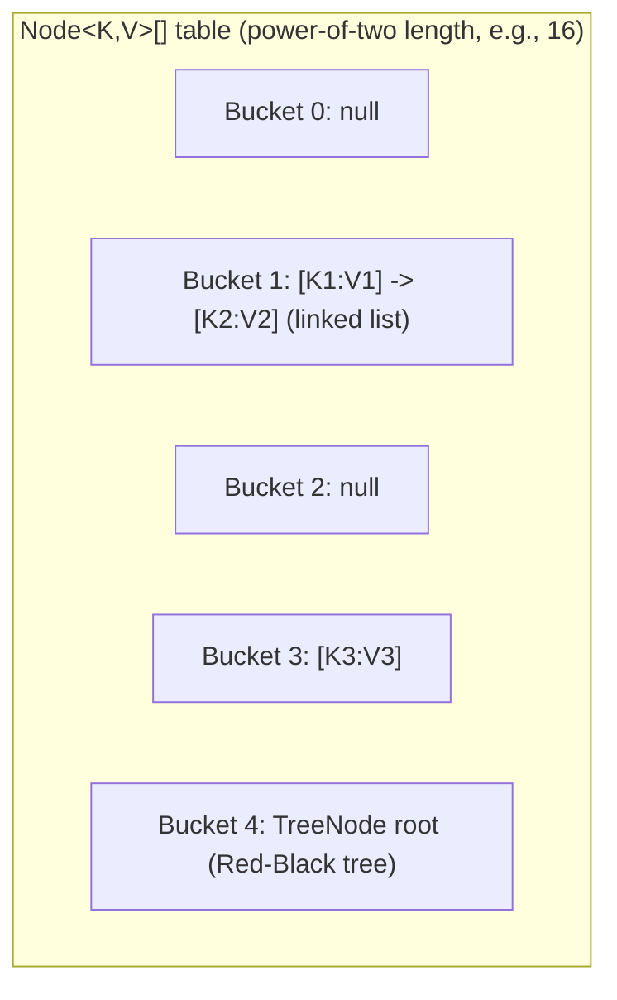
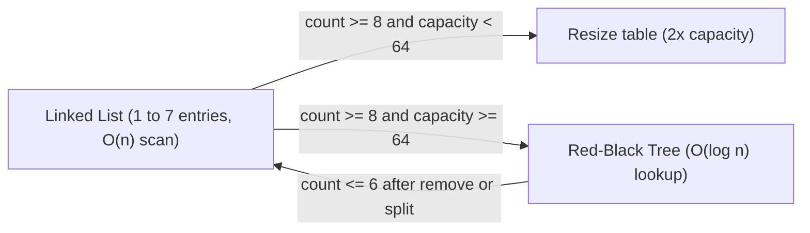
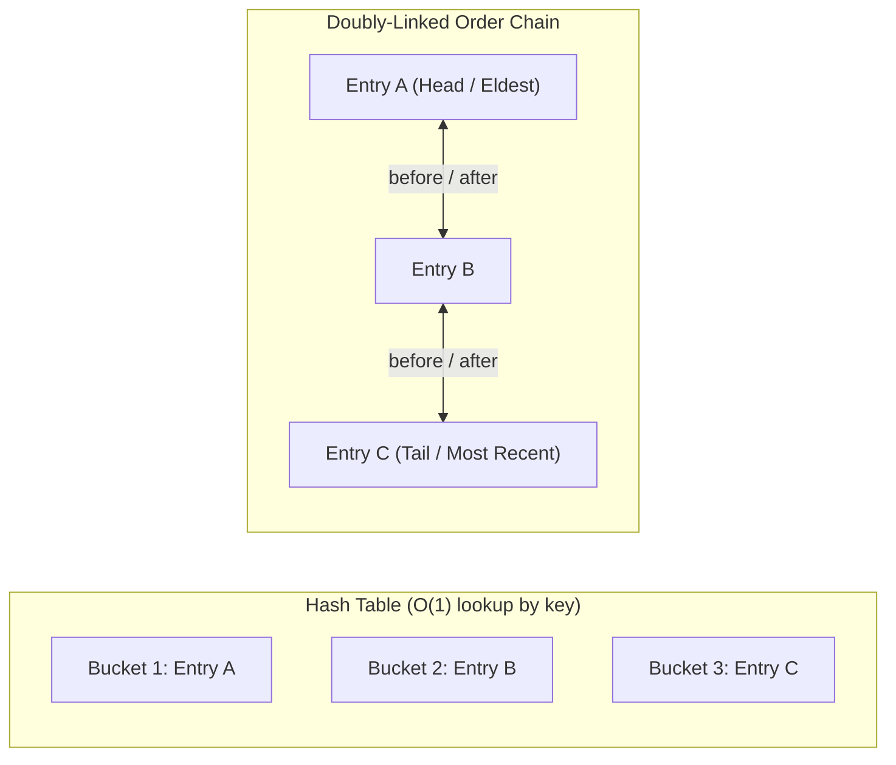

When you look up a user by ID, count word frequencies, or cache database responses in memory, you almost always reach for a `Map<K, V>`. The interface looks minimal (`put`, `get`, `remove`), yet the implementations behind it behave very differently under load, under hash collisions, and across multiple threads.

Knowing how `HashMap` computes bucket indices, why Java 8 added Red-Black trees to collided buckets, how `LinkedHashMap` tracks insertion or access order, when `TreeMap` makes sense, and why `ConcurrentHashMap` exists helps you avoid subtle memory leaks, slow lookups, and concurrency bugs.

---

## Choosing a `Map` Implementation

Unlike `List` and `Set`, `Map<K, V>` does not extend `Collection`. Instead, it exposes three collection views over its entries: `keySet()`, `values()`, and `entrySet()`.

| Implementation | Backing Structure | Average `get` / `put` | Iteration Order | `null` Keys / Values |
|---|---|---|---|---|
| `HashMap` | Hash table (buckets + Red-Black trees) | `O(1)` | Unspecified | 1 `null` key, any `null` values |
| `LinkedHashMap` | Hash table + doubly-linked list | `O(1)` | Insertion or access order | 1 `null` key, any `null` values |
| `TreeMap` | Red-Black binary search tree | `O(log n)` | Sorted (`Comparable` or `Comparator`) | No `null` keys (under natural order), `null` values allowed |
| `ConcurrentHashMap` | Hash table (CAS + per-bucket locking) | `O(1)` thread-safe | Unspecified | No `null` keys and no `null` values |

---

## `HashMap` Internals: Buckets, Hashing, and Collisions

In OpenJDK, `HashMap` stores its entries in an array of bucket heads:

```java
transient Node<K, V>[] table;
```

Like `ArrayList`, `HashMap` allocates `table` lazily on the first `put()`, starting with a default capacity of **16**. Each `Node<K, V>` holds four fields:

- `final int hash`: the cached spread hash of the key
- `final K key`: the key reference
- `V value`: the associated value
- `Node<K, V> next`: pointer to the next colliding entry in the same bucket



### Hash Perturbation and Bitwise Indexing

When you call `map.put(key, value)`, `HashMap` needs to turn a 32-bit `hashCode()` into a valid array index between `0` and `n - 1` (where `n = table.length`).

First, OpenJDK spreads the key's hash bits using a perturbation function:

```java
static final int hash(Object key) {
    int h;
    return (key == null) ? 0 : (h = key.hashCode()) ^ (h >>> 16);
}
```

Why bother with the XOR shift? Because `HashMap` always keeps its table capacity `n` as a **power of two** (16, 32, 64, 128, ...). That power-of-two invariant lets `HashMap` replace a slow integer remainder (`hash % n`) with a single-cycle bitwise AND:

```java
int index = (n - 1) & hash;
```

When `n = 16`, `n - 1` is `15` (`0000 1111` in binary), so `(n - 1) & hash` only looks at the lowest 4 bits of `hash`. If your keys have hash codes that vary mostly in their upper bits (for example, floats or sequential shifted identifiers), they would all land in the same bucket without perturbation. XORing the upper 16 bits into the lower 16 bits mixes high-bit variation down into the bits that actually select the bucket.

### Load Factor and Resizing

As more entries enter the table, the probability of collisions rises. `HashMap` controls when to grow using two constants:

- `DEFAULT_INITIAL_CAPACITY = 16`
- `DEFAULT_LOAD_FACTOR = 0.75f`

Whenever `size` exceeds `threshold` (`capacity * loadFactor`, so `12` for a 16-bucket table), `HashMap` calls `resize()`, doubling the table capacity (`16 -> 32 -> 64`) and redistributing existing nodes.

Java 8 introduced a clean optimization for that redistribution. Because the new capacity is `2 * oldCap`, the new mask `(2 * oldCap - 1)` adds exactly one bit to the left of the old mask: the bit at `oldCap`. For any existing node, checking `(e.hash & oldCap) == 0` tells `HashMap` immediately where it goes without recomputing `hashCode()`:

- If `(e.hash & oldCap) == 0`, the node stays at its **exact same bucket index** (`loHead`).
- If `(e.hash & oldCap) != 0`, the node moves to **`oldIndex + oldCap`** (`hiHead`).

If you know up front how many entries you will store, pre-size the map to avoid repeated resizing. Watch out for one subtle detail: calling `new HashMap<>(100)` sets capacity to the next power of two (128), whose threshold is `128 * 0.75 = 96`, so inserting 100 entries still triggers a resize! Since Java 19, use `HashMap.newHashMap(expectedSize)`, which calculates the exact capacity needed to hold `expectedSize` mappings without resizing:

```java
// Java 19+: accounts for the 0.75 load factor automatically
Map<String, User> users = HashMap.newHashMap(100);
```

### Handling Collisions: Linked Lists to Red-Black Trees

Two distinct keys can map to the same bucket index either because they have identical `hashCode()` values or because their hashes share the same lower bits. When that happens, `HashMap` checks each existing node in the bucket by comparing cached hashes first, then reference identity (`==`), then `equals()`. If an equal key is found, its value is replaced; otherwise the new node is appended.

In Java 7 and earlier, a bucket was always a singly-linked list. Under heavy collisions (such as a poor `hashCode()` implementation or a deliberate hash-flooding attack against a web endpoint), lookup degraded to `O(n)`.

Java 8 fixed this worst case with **treeification**:

- When a bucket reaches **`TREEIFY_THRESHOLD = 8`** nodes **and** the total table length is at least **`MIN_TREEIFY_CAPACITY = 64`**, `HashMap` converts that bucket from a linked list of `Node` objects into a **Red-Black self-balancing binary search tree** of `TreeNode` objects.
- If the table length is still below 64 when a bucket hits 8 entries, `HashMap` **resizes the table** instead of building a tree, because spreading entries across more buckets is cheaper than maintaining tree nodes.
- Within a treeified bucket, lookup drops from `O(n)` to **`O(log n)`**. (If colliding keys have identical hashes, `HashMap` orders them in the tree using `Comparable` if the keys implement it, falling back to a deterministic tie-breaker based on class name and `System.identityHashCode`.)
- If removals or resizes shrink a treeified bucket down to **`UNTREEIFY_THRESHOLD = 6`** nodes, `HashMap` converts it back to a lightweight linked list. Leaving a gap between 8 and 6 avoids thrashing back and forth around a single boundary.



Under a reasonably well-distributed hash function, the JDK documentation notes that bucket counts follow a Poisson distribution where 8 entries in a single bucket occur with probability less than one in ten million (`~0.00000006`), so treeification acts as a safety net rather than normal steady-state behavior.

---

## The `equals()` and `hashCode()` Contract

Every hash-based collection in Java (`HashMap`, `HashSet`, `LinkedHashMap`, `ConcurrentHashMap`) depends on the contract declared on `java.lang.Object`:

1. **`equals()` must be an equivalence relation**: reflexive (`x.equals(x)`), symmetric (`x.equals(y)` matches `y.equals(x)`), transitive, consistent, and `x.equals(null)` must return `false`.
2. **Equal objects must have equal hash codes**: if `a.equals(b)` is `true`, then `a.hashCode() == b.hashCode()` must also be `true`.
3. **Unequal objects may collide**: if `a.equals(b)` is `false`, their hash codes are allowed to be equal, though spreading them out reduces collisions.
4. **Consistency while in a map**: an object's `hashCode()` must not change while it is being used as a key in a `Map`.

Two mistakes show up regularly in real codebases.

### Mistake One: Overriding `equals()` Without `hashCode()`

If you override `equals()` on a key class but forget `hashCode()`, two logically equal instances inherit `Object.hashCode()` (derived from object identity) and land in completely different buckets. Calling `map.get(new EmployeeId("E-42"))` returns `null` even though an equal `EmployeeId("E-42")` is sitting right there in the map.

### Mistake Two: Using Mutable Objects as Keys

If you mutate a field that feeds into `hashCode()` after putting the key in a `HashMap`, the entry stays in its original bucket while every future lookup hashes to a different bucket:

```java
import java.util.HashMap;
import java.util.Map;
import java.util.Objects;

public class MutableKeyBug {
    static class AccountKey {
        private String accountId;

        AccountKey(String accountId) { this.accountId = accountId; }
        void setAccountId(String accountId) { this.accountId = accountId; }

        @Override
        public boolean equals(Object o) {
            return o instanceof AccountKey other && Objects.equals(accountId, other.accountId);
        }

        @Override
        public int hashCode() {
            return Objects.hash(accountId);
        }
    }

    public static void main(String[] args) {
        Map<AccountKey, String> accounts = new HashMap<>();
        AccountKey key = new AccountKey("ACC-101");
        accounts.put(key, "Active");

        // Mutating the key changes its hashCode while the entry stays in the old bucket
        key.setAccountId("ACC-999");

        System.out.println(accounts.get(key)); // null! Entry is orphaned in memory
        System.out.println(accounts.size());   // 1
    }
}
```

> [!CAUTION]
> Use immutable objects for map keys whenever possible: Java `record` types with immutable components, `String`, `UUID`, `Integer`, or classes with `final` fields and proper `equals()`/`hashCode()`.

---

## `LinkedHashMap`: Insertion Order and LRU Caching

`HashMap` makes no guarantees about iteration order, and the order can change unexpectedly after a resize. When you want `O(1)` hash lookups **plus** deterministic iteration order, use `LinkedHashMap`.

`LinkedHashMap` extends `HashMap` and wraps each entry in `LinkedHashMap.Entry`, which adds two pointers (`before` and `after`) to form a doubly-linked list across all entries in the map:



By default, `LinkedHashMap` maintains **insertion order**: iterating visits keys in the order they were first inserted. Calling `put` on an existing key updates its value without moving its position in the list.

### Access-Order Mode and Building an LRU Cache

If you construct a `LinkedHashMap` with `accessOrder = true`, every `get()` or `put()` on an existing key moves that entry to the **tail** (most recently used position) of the doubly-linked list, leaving the least recently used entry at the **head**.

Combine `accessOrder = true` with overriding `removeEldestEntry()`, and you get a working single-threaded LRU (Least Recently Used) cache in very little code:

```java
import java.util.LinkedHashMap;
import java.util.Map;

public class SimpleLruCache<K, V> extends LinkedHashMap<K, V> {
    private final int maxEntries;

    public SimpleLruCache(int maxEntries) {
        // initialCapacity, loadFactor, accessOrder = true
        super(16, 0.75f, true);
        this.maxEntries = maxEntries;
    }

    @Override
    protected boolean removeEldestEntry(Map.Entry<K, V> eldest) {
        // Called after insertion; returns true to evict the head (eldest) entry
        return size() > maxEntries;
    }

    public static void main(String[] args) {
        SimpleLruCache<String, String> cache = new SimpleLruCache<>(3);
        cache.put("k1", "v1");
        cache.put("k2", "v2");
        cache.put("k3", "v3");

        cache.get("k1");       // Moves k1 to the tail (most recently used); k2 is now eldest
        cache.put("k4", "v4"); // Exceeds capacity 3 -> evicts k2

        System.out.println(cache.keySet()); // [k3, k1, k4]
    }
}
```

> [!WARNING]
> `LinkedHashMap` is **not thread-safe**. In `accessOrder = true` mode, even a read via `get()` mutates the internal doubly-linked list pointers and increments `modCount`. Calling `get()` concurrently from multiple threads without synchronization can corrupt the list. For production multi-threaded caching, use a dedicated library such as Caffeine rather than a hand-rolled `LinkedHashMap`.

In Java 21+, `LinkedHashMap` also implements `SequencedMap<K, V>`, giving you `firstEntry()`, `lastEntry()`, `putFirst()`, `putLast()`, and a zero-copy `reversed()` view.

---

## `TreeMap`: Sorted Keys and Range Queries

`TreeMap` stores entries in a **Red-Black self-balancing binary search tree**, keeping keys continuously sorted according to their natural `Comparable` order or a `Comparator` passed to the constructor. Every `get`, `put`, and `remove` takes `O(log n)` time.

Because `TreeMap` implements `NavigableMap<K, V>`, it is especially useful whenever you need range slices or nearest-key lookups, such as latency buckets, rate tables, or time-series intervals:

```java
import java.util.NavigableMap;
import java.util.TreeMap;

public class LatencyThresholds {
    public static void main(String[] args) {
        NavigableMap<Integer, String> bands = new TreeMap<>();
        bands.put(100, "FAST");
        bands.put(500, "NORMAL");
        bands.put(1000, "SLOW");
        bands.put(5000, "CRITICAL");

        // Nearest-neighbor lookups in O(log n)
        System.out.println("Floor of 450ms: " + bands.floorKey(450));     // 100
        System.out.println("Ceiling of 450ms: " + bands.ceilingKey(450)); // 500
        System.out.println("Floor entry: " + bands.floorEntry(450));      // 100=FAST

        // Inclusive range view backed by the original TreeMap
        NavigableMap<Integer, String> midRange = bands.subMap(500, true, 1000, true);
        System.out.println("500..1000ms: " + midRange); // {500=NORMAL, 1000=SLOW}
    }
}
```

Just like `TreeSet`, `TreeMap` determines key equivalence using `compareTo()` or `Comparator.compare() == 0` rather than `equals()`, and throws `NullPointerException` if you insert a `null` key under natural ordering.

---

## `ConcurrentHashMap` Overview and Compound Operations

A regular `HashMap` is strictly single-threaded. If two threads write to a `HashMap` at the same time (especially during a resize), entries can be silently lost, values can become invisible to other threads, or internal links can be corrupted. Wrapping it with `Collections.synchronizedMap(map)` or using legacy `Hashtable` makes operations safe, but wraps the entire map in a single coarse lock so threads block one another even when accessing unrelated keys.

`java.util.concurrent.ConcurrentHashMap` solves that contention problem. In Java 8+, its internal structure mirrors `HashMap` (an array of buckets that treeify at 8 entries), with key concurrency mechanisms:

- **Lock-free reads**: `get()` reads `volatile` references (`table` slots, node `val` and `next` pointers) without acquiring any lock at all.
- **CAS on empty buckets**: inserting into an empty bucket uses an atomic Compare-And-Swap (`CAS`) instruction without taking a lock.
- **Per-bucket locking on collisions**: only when inserting into or updating a non-empty bucket does it acquire a `synchronized` lock on that single bucket's head node. Threads working on different buckets proceed in parallel.
- **Cooperative resizing**: if a thread hits a bucket marked with a `ForwardingNode` during a resize, it helps migrate buckets to the new table rather than sitting idle.
- **No `null` keys or values**: `ConcurrentHashMap` deliberately rejects `null` keys and `null` values with a `NullPointerException`. In a single-threaded `HashMap`, if `map.get(k)` returns `null`, you can call `map.containsKey(k)` to tell whether the key is absent or explicitly mapped to `null`. In a concurrent map, another thread could mutate the key between those two calls, making `null` ambiguous.

### Compound Operations (`computeIfAbsent`, `merge`, `getOrDefault`)

Java 8 added functional compound methods to the `Map` interface that replace noisy check-then-act boilerplate:

```java
import java.util.List;
import java.util.Map;
import java.util.concurrent.ConcurrentHashMap;

public class MapCompoundOps {
    public static void main(String[] args) {
        Map<String, Integer> counts = new ConcurrentHashMap<>();

        // 1. merge: inserts 1 if absent, or sums existing + 1 if present
        for (String word : List.of("java", "jvm", "java", "map")) {
            counts.merge(word, 1, Integer::sum);
        }
        System.out.println(counts); // {java=2, jvm=1, map=1}

        // 2. computeIfAbsent: computes value only when key is missing
        Map<String, List<String>> grouped = new ConcurrentHashMap<>();
        grouped.computeIfAbsent("backend", k -> new java.util.concurrent.CopyOnWriteArrayList<>())
               .add("OrderService");

        // 3. getOrDefault: safe fallback without inserting anything
        int missing = counts.getOrDefault("kotlin", 0);
        System.out.println("Missing count: " + missing); // 0
    }
}
```

On `HashMap`, these methods simply keep code concise. On `ConcurrentHashMap`, `computeIfAbsent` and `merge` execute **atomically per key** under the bucket lock, which eliminates check-then-act race conditions (just avoid running slow blocking I/O or modifying other keys of the same map inside the mapping lambda, as that holds the bucket lock or can deadlock).

---

## Key Takeaways

- `HashMap` keeps its capacity as a power of two so it can map perturbed hashes (`h ^ (h >>> 16)`) to buckets with `(n - 1) & hash`, resizing at a `0.75` load factor and splitting buckets in place using `(e.hash & oldCap) == 0`.
- When a `HashMap` bucket reaches 8 colliding nodes and table capacity is at least 64, Java 8+ treeifies that bucket into a Red-Black tree (`O(log n)` worst-case lookup) and untreeifies back to a list at 6 nodes.
- Equal keys must have equal hash codes, and key fields used in `hashCode()` must stay immutable while the key lives in a hash-based map.
- `LinkedHashMap` preserves insertion order by default and switches to LRU access order when constructed with `accessOrder = true` (not thread-safe).
- `TreeMap` keeps keys sorted in a Red-Black tree (`O(log n)`) and exposes `NavigableMap` range and nearest-neighbor operations.
- `ConcurrentHashMap` provides lock-free reads, CAS/per-bucket locking for writes, atomic compound updates, and forbids `null` keys and values.

---

## Interview Questions

### Why does `HashMap` require a power-of-two capacity, and what is the role of `(h = key.hashCode()) ^ (h >>> 16)`?
Mapping a hash code into a table of size `n` conceptually requires `hash % n`, which uses integer division. When `n` is a power of two, `(n - 1)` is a mask of consecutive `1` bits in the lower positions, so `(n - 1) & hash` gives the exact same remainder in a single bitwise instruction. The catch is that a small table (like 16 buckets) only inspects the lowest 4 bits of the hash. Shifting the upper 16 bits right and XORing them into the lower 16 bits ensures that differences in the high bits still affect bucket selection, cutting down collisions on small tables.

### How do `TREEIFY_THRESHOLD` (8), `MIN_TREEIFY_CAPACITY` (64), and `UNTREEIFY_THRESHOLD` (6) work together in Java 8+ `HashMap`?
When a bucket accumulates 8 colliding nodes, `HashMap` checks the table's total capacity first. If capacity is still below 64, it doubles the table size instead of building a tree because resizing usually disperses those collisions more cheaply. Once capacity is at least 64, a bucket with 8 or more nodes is converted from a singly-linked list into a Red-Black tree (`TreeNode`), reducing worst-case bucket search from `O(n)` to `O(log n)` to defend against poor hash functions or hash-flooding attacks. It waits until the bucket drops to 6 nodes before converting back to a list so repeated insertions and deletions near 8 do not thrash between representations.

### Why is it dangerous to use a mutable object as a `HashMap` key?
`HashMap` computes the key's bucket index at insertion time and stores the entry inside that bucket. If a field participating in `hashCode()` is mutated afterward, future `get()`, `containsKey()`, or `remove()` calls hash the modified key to a different bucket. The lookup misses even though the key is still inside the map, and you cannot remove it by key anymore, effectively leaking the entry until the map itself is cleared or discarded.

### Why does `ConcurrentHashMap` disallow `null` keys and `null` values when `HashMap` allows them?
In a single-threaded `HashMap`, if `map.get(key)` returns `null`, you can call `map.containsKey(key)` to find out whether the key was absent or explicitly mapped to `null`. In a concurrent environment, another thread can insert or remove the key between those two calls, so `containsKey()` cannot reliably disambiguate a `null` return from `get()`. By forbidding `null` keys and `null` values altogether, `ConcurrentHashMap` guarantees that a `null` return from `get()` unambiguously means the key was not present at the moment of the read.
