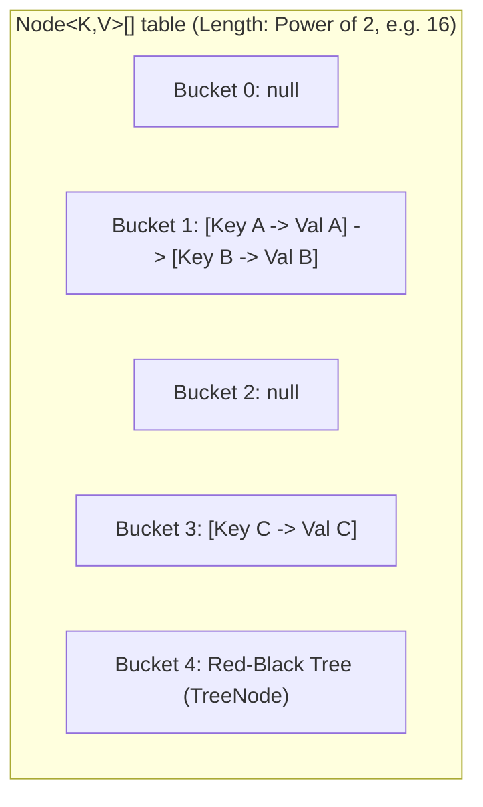
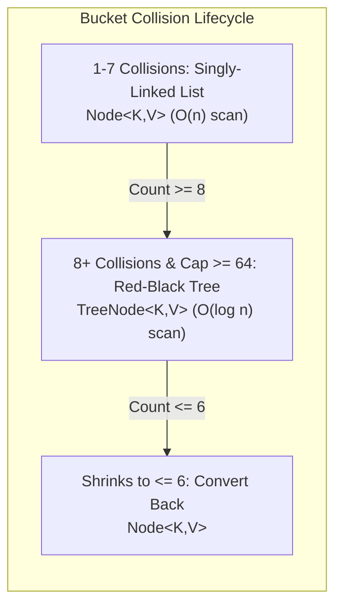
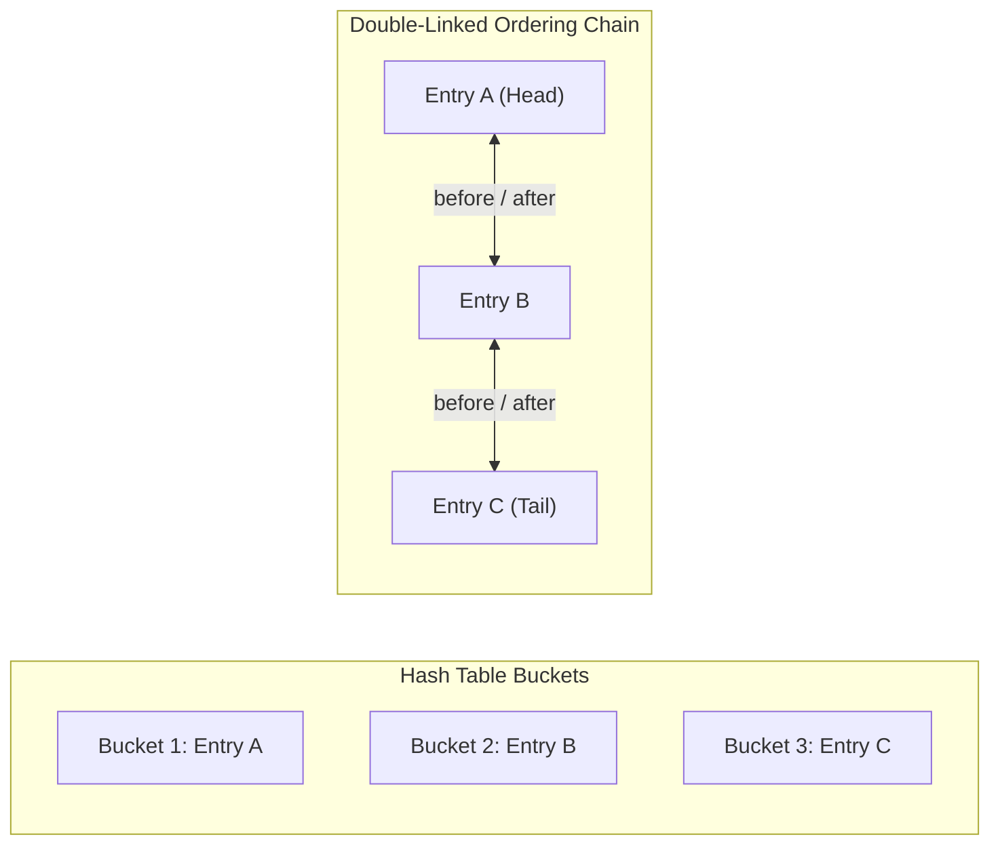

If you ask any senior Java engineer what single data structure powers the majority of backend services, microservices caches, and in-memory indexes, the answer is unanimous: **`java.util.HashMap`**.

On the surface, a map is straightforward: you insert a key-value pair with `.put(key, value)` and fetch it with `.get(key)`. But under the hood lies one of the most sophisticated, hardware-optimized engineering marvels in the entire OpenJDK standard library.

Understanding how `HashMap` calculates bucket indices via bitwise masking, how Java 8 defends against algorithmic hash-flooding DoS attacks using **Red-Black Treeification**, and how `LinkedHashMap` and `TreeMap` achieve deterministic ordering is mandatory knowledge for any senior engineer.

---

## The Map Ecosystem: Choosing the Right Data Structure

The `java.util.Map<K, V>` interface defines key-value associations. Unlike `List` or `Set`, `Map` does not inherit from `Collection`, but exposes collection views (`keySet()`, `values()`, `entrySet()`).

| Map Type | Underlying Data Structure | Lookup / Insertion | Order Guarantees | Permits Null? |
|---|---|---|---|---|
| **`HashMap`** | Hash Table (Buckets + Red-Black Trees) | **`O(1)`** amortized | None (Non-deterministic) | Yes (1 null key at bucket 0) |
| **`LinkedHashMap`** | Hash Table + Doubly-Linked Pointers | **`O(1)`** amortized | **Insertion or Access Order** | Yes |
| **`TreeMap`** | Red-Black Self-Balancing Binary Tree | **`O(log n)`** logarithmic | **Sorted (Natural or Comparator)** | No null keys |
| **`ConcurrentHashMap`** | Partitioned CAS + Synchronized Buckets | **`O(1)`** thread-safe | None | **No null keys or values** |

---

## Anatomy of a `HashMap`: The JVM Mechanics

At its core, a `HashMap` is an array of bucket nodes:

```java
// OpenJDK HashMap internal storage:
transient Node<K, V>[] table;
```

Each `Node<K, V>` is a lightweight container holding:
1. `final int hash`: The cached 32-bit hash code.
2. `final K key`: The key reference.
3. `V value`: The value reference.
4. `Node<K, V> next`: Pointer to the next colliding node in this bucket.



### The Three Steps of `.put(key, value)`
When you call `map.put(key, value)`, the JVM executes three precise mathematical operations:

### Hash Perturbation (Spreading High Bits)
A naive hash implementation would use `key.hashCode()` directly. However, typical table capacities are small powers of two (e.g., 16, 32, 64). Only the lowest 4 or 6 bits of the hash would participate in bucket selection!

If multiple keys have identical low-order bits, catastrophic collisions occur. To prevent this, Java applies a **perturbation function** that XORs the high 16 bits into the low 16 bits:

```java
// OpenJDK HashMap hash spreading:
static final int hash(Object key) {
    int h;
    return (key == null) ? 0 : (h = key.hashCode()) ^ (h >>> 16);
}
```

This guarantees that high-order bits influence lower-order bucket placement, dispersing keys evenly across the table.

### Fast Bitwise Modulo Masking
In mathematics, mapping a hash code into an array of length `n` requires a modulo operation: `index = hash % n`.

However, the CPU integer division opcode (`IDIV`) is expensive, consuming 10 to 40 clock cycles! 

Because `HashMap` strictly forces its capacity `n` to be a **Power of Two** (16, 32, 64, 128, ...), `javac` uses a lightning-fast bitwise AND mask instead:

```java
// Fast bitwise indexing (takes only 1 CPU clock cycle!):
int index = (n - 1) & hash;
```

For example, if capacity `n = 16`, `n - 1 = 15` (`0000 1111` in binary). Performing `hash & 15` zeroes out everything except the lowest 4 bits, achieving instantaneous modulo arithmetic!

### Collision Resolution: Linked List to Red-Black Tree
When two unequal keys calculate the same bucket index, a **hash collision** occurs.

- **Java 7**: Colliding nodes were simply prepended to a singly-linked list. In the worst case (e.g., an attacker maliciously crafting thousands of keys with identical hash codes), lookup degraded to **`O(n)` linear search**, opening web applications to Hash-DOS denial-of-service vulnerabilities.
- **Java 8+ (Treeification)**: When a single bucket accumulates **8 or more colliding nodes** (`TREEIFY_THRESHOLD = 8`) AND the total map capacity is at least **64** (`MIN_TREEIFY_CAPACITY = 64`), the JVM converts that bucket's linked list into a **Red-Black Self-Balancing Binary Search Tree (`TreeNode`)**!
- Search time within that collided bucket drops from `O(n)` to **`O(log n)`**, neutralizing algorithmic collision attacks.
- If entries are removed and bucket size shrinks to **6** (`UNTREEIFY_THRESHOLD = 6`), the JVM converts the tree back into a lightweight linked list to conserve memory.



---

## Load Factor and High-Speed Resizing

How does `HashMap` know when to expand?

1. **`DEFAULT_INITIAL_CAPACITY`**: 16.
2. **`DEFAULT_LOAD_FACTOR`**: `0.75` (a mathematically derived sweet spot balancing memory usage and collision probability).
3. **`threshold = capacity * loadFactor`**: For capacity 16, threshold is `16 * 0.75 = 12`.

When `size > threshold`, the map triggers **`resize()`**, doubling the table capacity (`16 -> 32 -> 64`).

### The Java 8 High-Speed Resize Trick
In Java 7, resizing required re-running the index formula for every single entry in the map.

In Java 8+, the architects realized a brilliant binary trick: because the capacity doubles (`n -> 2n`), the bitwise mask `(2n - 1)` has exactly **one new bit turned on** (the bit corresponding to `oldCap`).

When an entry is rehashed, its new bucket index is either:
- **Exact same index** as before (if the new bit in the hash is `0`).
- **`oldIndex + oldCap`** (if the new bit in the hash is `1`).

```java
// Java 8 tests the new bit with zero division:
if ((e.hash & oldCap) == 0) {
    // Keep in original bucket index (Low head)
} else {
    // Move to (index + oldCap) bucket (High head)
}
```

The JVM partitions the colliding bucket into two linked lists (`loHead` and `hiHead`) and assigns them directly without recalculating hashes, doubling resizing speed!

---

## The Sacred Contract: `equals()` and `hashCode()`

If you store custom objects as `HashMap` keys, you **must strictly honor the `equals()` and `hashCode()` contract**:

1. **Consistency:** If `a.equals(b) == true`, then `a.hashCode() == b.hashCode()` **MUST ALWAYS BE TRUE**.
2. **Unequal Hashes:** If `a.equals(b) == false`, their hash codes do not have to be distinct (though distinct codes improve performance).
3. **Key Immutability:** Fields used to compute `hashCode()` must never change after the object is inserted into the map!

```java
// ❌ PRODUCTION DISASTER: Mutable HashMap Key
public class AccountKey {
    private String accountId;

    public AccountKey(String accountId) { this.accountId = accountId; }
    public void setAccountId(String accountId) { this.accountId = accountId; }

    @Override
    public boolean equals(Object o) {
        return o instanceof AccountKey other && Objects.equals(accountId, other.accountId);
    }

    @Override
    public int hashCode() {
        return Objects.hash(accountId);
    }
}

// What happens in production:
Map<AccountKey, String> map = new HashMap<>();
AccountKey key = new AccountKey("ACC-101");
map.put(key, "VIP Customer");

// Later, another method mutates the key:
key.setAccountId("ACC-999"); // HashCode changes!

// map.get(key) now looks in a COMPLETELY DIFFERENT BUCKET!
System.out.println(map.get(key)); // PRINTS NULL! Entry is permanently lost in memory!
```

> [!CAUTION]
> Always use **immutable objects** (such as Java `record`, `String`, `UUID`, or classes with `final` fields) as `HashMap` keys.

---

## `LinkedHashMap`: Deterministic Encounter Order & LRU Caching

`HashMap` provides zero guarantees regarding iteration order. Iterating across a `HashMap` yields keys in arbitrary bucket order that can shift abruptly whenever the map resizes.

If your application requires deterministic ordering, use **`LinkedHashMap`**:



`LinkedHashMap.Entry` extends `HashMap.Node` by adding two extra pointers:
- `Entry<K,V> before`: points to the previous inserted entry.
- `Entry<K,V> after`: points to the next inserted entry.

### Building an In-Memory LRU (Least Recently Used) Cache
By passing `accessOrder = true` to the `LinkedHashMap` constructor, the map repositions an entry to the tail of the linked list every time `.get()` or `.put()` is called.

Overriding `removeEldestEntry()` creates a complete, production-ready LRU cache in 15 lines of code:

```java
import java.util.LinkedHashMap;
import java.util.Map;

public class SimpleLruCache<K, V> extends LinkedHashMap<K, V> {
    private final int maxEntries;

    public SimpleLruCache(int maxEntries) {
        // initialCapacity, loadFactor, accessOrder = true (enables LRU mode!)
        super(maxEntries, 0.75f, true);
        this.maxEntries = maxEntries;
    }

    @Override
    protected boolean removeEldestEntry(Map.Entry<K, V> eldest) {
        // Automatically evicts the oldest untouched entry when size exceeds limit
        return size() > maxEntries;
    }

    public static void main(String[] args) {
        SimpleLruCache<String, String> cache = new SimpleLruCache<>(3);
        cache.put("k1", "v1");
        cache.put("k2", "v2");
        cache.put("k3", "v3");

        cache.get("k1"); // Access k1 -> moves k1 to head of freshness!
        cache.put("k4", "v4"); // Cache full! Evicts least-recently used: k2!

        System.out.println(cache.keySet()); // [k3, k1, k4] (k2 was evicted!)
    }
}
```

---

## `TreeMap`: Sorted Navigability

`TreeMap` stores keys in a **Red-Black Self-Balancing Binary Tree**. It implements the rich **`NavigableMap<K, V>`** interface, providing range queries and nearest-neighbor lookups in `O(log n)` time:

```java
import java.util.NavigableMap;
import java.util.TreeMap;

public class MetricHistogram {
    public static void main(String[] args) {
        NavigableMap<Integer, String> thresholds = new TreeMap<>();
        thresholds.put(100, "LOW");
        thresholds.put(500, "MEDIUM");
        thresholds.put(1000, "HIGH");
        thresholds.put(5000, "CRITICAL");

        // Finding nearest keys in logarithmic time:
        System.out.println("Floor of 450: " + thresholds.floorKey(450));     // 100
        System.out.println("Ceiling of 450: " + thresholds.ceilingKey(450)); // 500

        // Sub-map slice:
        System.out.println("Range 500..1000: " + thresholds.subMap(500, true, 1000, true));
    }
}
```

---

## Modern Map Methods: Atomic Updates (Java 8+)

Stop writing verbose `if (map.containsKey(k))` blocks! Modern Java provides powerful functional compound operations directly on the `Map` interface:

```java
Map<String, Integer> wordFrequencies = new HashMap<>();

// 1. computeIfAbsent: Compute expensive value ONLY if missing
wordFrequencies.computeIfAbsent("java", key -> queryExternalDatabase(key));

// 2. merge: The cleanest way to accumulate counters
List<String> words = List.of("apple", "banana", "apple", "cherry");
for (String word : words) {
    // If missing, sets to 1. If present, applies Integer::sum (existing + 1)
    wordFrequencies.merge(word, 1, Integer::sum);
}
System.out.println(wordFrequencies); // {banana=1, cherry=1, apple=2}

// 3. getOrDefault: Provide safe fallbacks without inserting nulls
int score = wordFrequencies.getOrDefault("missing_word", 0);
```

---

## Summary & Mental Model Checkpoint

1. **Bitwise Masking**: `HashMap` forces capacity to a power of two to replace slow integer division modulo (`%`) with fast bitwise AND: `(n - 1) & hash`.
2. **Perturbation Function**: `hash ^ (hash >>> 16)` blends high 16 bits into low 16 bits to prevent lower-bit bucket clustering.
3. **Treeification (Java 8)**: Buckets with 8 or more colliding nodes transform into Red-Black Trees (`TreeNode`), dropping worst-case lookup from `O(n)` to `O(log n)`.
4. **Resizing Efficiency**: Java 8 checks `(e.hash & oldCap) == 0` to partition buckets into low and high chains without recomputing hashes.
5. **The Immutable Key Rule**: Keys must have consistent `equals()` and `hashCode()`. Never mutate an object's state while it is stored as a map key.
6. **`LinkedHashMap` LRU**: Pass `accessOrder = true` and override `removeEldestEntry()` to build a self-evicting cache in minutes.
7. **`TreeMap` Power**: Implements `NavigableMap` for sorted range views (`subMap`, `floorKey`, `ceilingKey`) in `O(log n)` time.

---

## 🎯 Senior Engineer Interview Questions

### Why does `HashMap` require its capacity to always be a power of two, and how does it compute bucket indices?
> **Answer:** In a hash table of capacity `N`, mapping a 32-bit hash code to a valid bucket index requires modulo arithmetic: `index = hash % N`. On modern CPUs, integer division is a high-latency instruction taking 10 to 40 clock cycles. When `N` is guaranteed to be a power of two (`2^k`, such as 16, 32, 64), the mathematical property `hash % 2^k == hash & (2^k - 1)` holds true. Calculating `(n - 1) & hash` uses the bitwise AND instruction, which executes in a single CPU clock cycle. Furthermore, having `(n - 1)` produce a continuous mask of binary 1s guarantees that every bit position in the lower range contributes to bucket distribution without creating blind spots.

### What is the hash perturbation function in `HashMap` (`(h = key.hashCode()) ^ (h >>> 16)`), and what problem does it solve?
> **Answer:** When a `HashMap` table is small (e.g. initial capacity 16), the bitwise index calculation `(n - 1) & hash` only evaluates the lowest 4 bits of the hash code (since 15 is `0000 1111` in binary). If multiple distinct keys produce hash codes that differ in their higher 16 or 24 bits but share identical lower 4 bits, they all map to the exact same bucket, causing catastrophic clustering and collisions. The perturbation function shifts the 32-bit integer right by 16 bits (`h >>> 16`) and XORs it with the original hash (`h ^ (h >>> 16)`). This forces the randomness from the higher 16 bits to fold into the lower 16 bits, ensuring that high-order bits influence bucket index calculations even for small table capacities.

### Explain the mechanics of Java 8 HashMap Treeification and Untreeification. Why is the threshold set to 8, and why does it untreeify at 6?
> **Answer:** Under Java 7, colliding keys in a bucket formed a singly-linked list, resulting in `O(n)` worst-case lookup performance. Attackers exploited this via Hash-DOS attacks by crafting thousands of strings with identical hash codes to overwhelm web application CPUs. Java 8 introduced Treeification: when a bucket reaches `TREEIFY_THRESHOLD = 8` entries AND the table capacity is at least `MIN_TREEIFY_CAPACITY = 64` (resizing is preferred if capacity is smaller), the bucket is converted into a Red-Black self-balancing binary search tree (`TreeNode`), dropping search complexity to `O(log n)`. The threshold of 8 was chosen based on Poisson distribution probabilities: under well-distributed hash codes, the probability of 8 collisions occurring in a single bucket is less than one in ten million (approximately 0.00000006). The untreeification threshold is set to 6 (rather than 7 or 8) to provide a hysteresis buffer, preventing a bucket from constantly toggling between list and tree when elements are repeatedly inserted and deleted near the boundary.

### How does `LinkedHashMap` implement an LRU (Least Recently Used) cache, and why does reading an entry cause structural modification in access-order mode?
> **Answer:** `LinkedHashMap` extends `HashMap` by maintaining a doubly-linked list running through all its entries (`before` and `after` pointers on `LinkedHashMap.Entry`). When constructed with `accessOrder = true`, the map overrides the internal `afterNodeAccess(Node e)` callback. Whenever an existing key is accessed via `.get()` or updated via `.put()`, the JVM unlinks the node from its current position in the doubly-linked list and re-inserts it at the end (tail) of the list, keeping the most recently accessed entries at the tail and the least recently used at the head. In access-order mode, calling `.get()` modifies the pointers of the doubly-linked list, which represents a structural modification for iteration purposes and increments `modCount`. Overriding `removeEldestEntry(Map.Entry eldest)` instructs `afterNodeInsertion()` to evict the head node when `size() > maxCapacity`, achieving an O(1) LRU eviction policy.