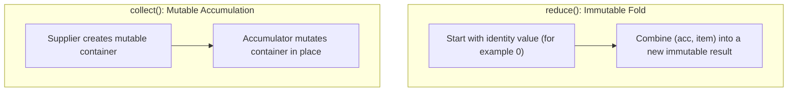
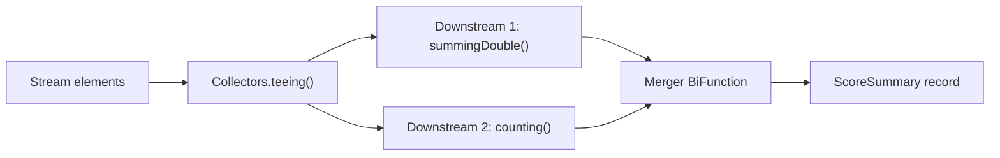
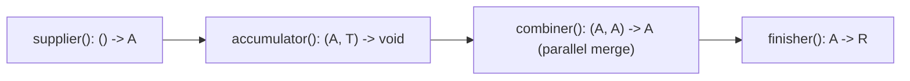
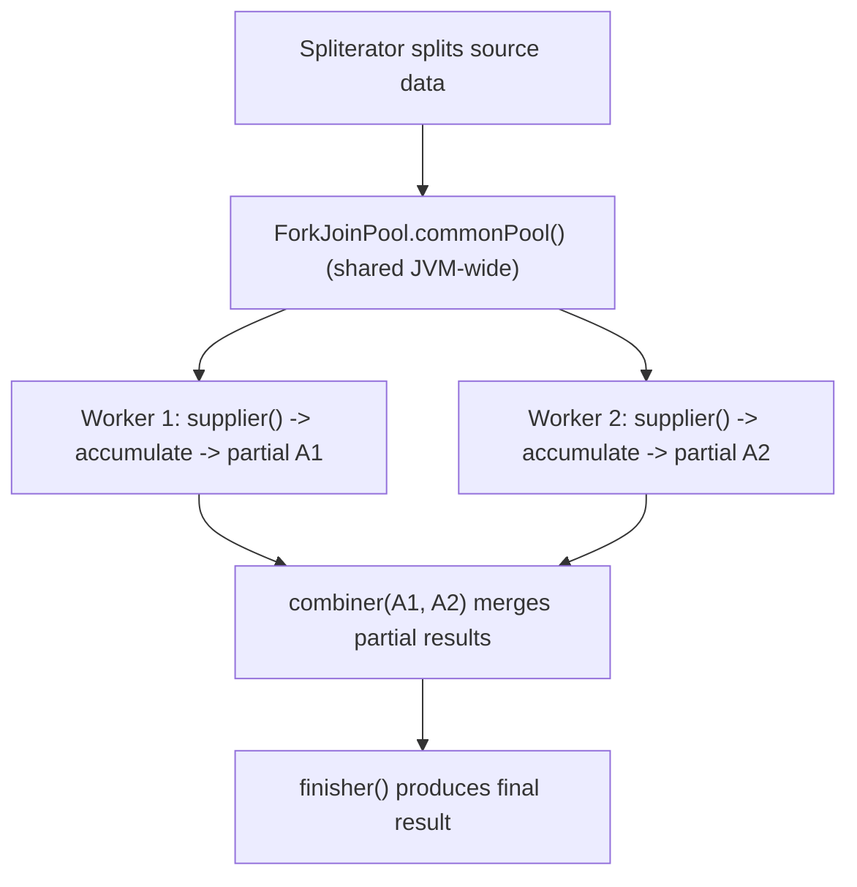

Filtering and mapping elements is only the first half of a stream pipeline. Most real pipelines end by summarizing elements into a list, a set, a lookup map, a grouped report, or a domain summary object. In Java, that work belongs to terminal reductions, primarily `Stream.collect()` and the `Collectors` utility class, alongside parallel execution on the Fork/Join pool when workloads genuinely benefit from multiple cores.

## `reduce()` vs. `collect()`: Immutable Fold vs. Mutable Accumulation

Both `reduce()` and `collect()` collapse a stream into a single result, but they are built for different jobs:

- **`reduce()`** performs an **immutable reduction**. On every step, the accumulator function takes the current value and the next element and returns a new value. That works naturally for numbers, `BigDecimal`, or finding a maximum.
- **`collect()`** performs a **mutable reduction**. It creates a mutable container (such as an `ArrayList`, `HashMap`, or `StringBuilder`) and updates it in place as elements arrive.



Trying to build a `List` with `reduce()` is a classic performance mistake:

```java
// Bad: copies the entire list on every element -> O(n^2) time and heavy GC pressure
List<String> slow = stream.reduce(
        new ArrayList<>(),
        (acc, item) -> {
            List<String> copy = new ArrayList<>(acc);
            copy.add(item);
            return copy;
        },
        (left, right) -> {
            List<String> merged = new ArrayList<>(left);
            merged.addAll(right);
            return merged;
        }
);
```

Copying an ever-growing list on every element turns an `O(n)` task into `O(n^2)`. Using `collect()` (or `Stream.toList()`) appends into a single container in amortized `O(1)` per element.

## Collecting into Lists, Sets, and Maps

### `Collectors.toList()` vs. Java 16 `Stream.toList()`

Before Java 16, collecting into a list meant writing `.collect(Collectors.toList())`. Java 16 added `stream.toList()` directly on `Stream`:

```java
// Classic Java 8 collector
List<String> mutableList = names.stream().collect(Collectors.toList());

// Java 16+ direct terminal operation
List<String> unmodifiableList = names.stream().toList();
```

The differences matter in production code:

| Aspect | `Collectors.toList()` | `Stream.toList()` (Java 16+) | `Collectors.toUnmodifiableList()` (Java 10+) |
|---|---|---|---|
| Mutability | No spec guarantee (returns a mutable `ArrayList` in OpenJDK) | Strictly unmodifiable (`UnsupportedOperationException` on mutation) | Strictly unmodifiable |
| `null` elements | Allowed | Allowed | Throws `NullPointerException` on `null` |
| Typical use | Only when callers expect to mutate the returned list | Default choice in Java 16+ | When you want unmodifiable and explicitly forbid `null` elements |

If you specifically need a guaranteed mutable `ArrayList` or `LinkedList`, make that explicit with `Collectors.toCollection(ArrayList::new)` instead of relying on the undocumented implementation detail of `Collectors.toList()`.

### `Collectors.toSet()` and Specific Set Types

`Collectors.toSet()` collects elements into a `Set`, automatically removing duplicates based on `equals()` and `hashCode()`:

```java
Set<String> uniqueDepartments = employees.stream()
        .map(Employee::department)
        .collect(Collectors.toSet());
```

Like `Collectors.toList()`, `Collectors.toSet()` makes no specification guarantee about mutability or iteration order (OpenJDK returns a `HashSet`). Use more specific collectors when the contract matters:

```java
// Unmodifiable set (Java 10+, rejects null elements)
Set<String> readOnly = employees.stream()
        .map(Employee::department)
        .collect(Collectors.toUnmodifiableSet());

// Preserves stream encounter order
Set<String> ordered = employees.stream()
        .map(Employee::department)
        .collect(Collectors.toCollection(LinkedHashSet::new));

// Sorted alphabetically
Set<String> sorted = employees.stream()
        .map(Employee::department)
        .collect(Collectors.toCollection(TreeSet::new));
```

### `Collectors.toMap()` and Duplicate Key Handling

`Collectors.toMap()` builds a `Map<K, V>` from a key mapper and a value mapper. The two-argument overload is a frequent source of runtime exceptions because it throws `IllegalStateException` if two elements produce the same key:

```java
record Employee(String id, String department, String name) {}

List<Employee> employees = List.of(
        new Employee("E1", "ENG", "Alice"),
        new Employee("E2", "HR", "Bob"),
        new Employee("E3", "ENG", "Charlie")
);

// Throws IllegalStateException: Duplicate key ENG
Map<String, String> broken = employees.stream()
        .collect(Collectors.toMap(Employee::department, Employee::name));
```

Whenever keys are not guaranteed to be unique, use the three-argument overload and provide a **merge function** `(existing, incoming) -> ...`:

```java
// Keep the first value, or keep the latest, or combine them
Map<String, String> byDepartment = employees.stream()
        .collect(Collectors.toMap(
                Employee::department,
                Employee::name,
                (existing, replacement) -> existing + ", " + replacement
        ));
// Result: {HR=Bob, ENG=Alice, Charlie}
```

A four-argument overload also lets you pick the map implementation, such as `LinkedHashMap::new` (to preserve encounter order) or `TreeMap::new` (for sorted keys). Also note a subtle `HashMap.merge` behavior: `Collectors.toMap()` throws `NullPointerException` if any **value** produced by the value mapper is `null`.

## Grouping and Partitioning

### `Collectors.groupingBy()` and Downstream Collectors

`groupingBy()` groups elements by a classification function into a `Map<K, List<T>>`. Its real flexibility comes from pairing it with a **downstream collector** to aggregate each group in a single pass instead of building intermediate lists first.

```java
record Transaction(String customerId, String category, long amountCents) {}

List<Transaction> txs = List.of(
        new Transaction("C1", "GROCERY", 4500),
        new Transaction("C2", "TECH", 120_000),
        new Transaction("C1", "TECH", 8500),
        new Transaction("C1", "GROCERY", 3000),
        new Transaction("C2", "GROCERY", 1500)
);

// Single-level grouping: customer -> transactions
Map<String, List<Transaction>> byCustomer = txs.stream()
        .collect(Collectors.groupingBy(Transaction::customerId));

// Multi-level grouping with downstream sum: customer -> category -> total cents
Map<String, Map<String, Long>> spendByCustomerAndCategory = txs.stream()
        .collect(Collectors.groupingBy(
                Transaction::customerId,
                Collectors.groupingBy(
                        Transaction::category,
                        Collectors.summingLong(Transaction::amountCents)
                )
        ));

// Transform each group's elements with mapping()
Map<String, Set<String>> categoriesPerCustomer = txs.stream()
        .collect(Collectors.groupingBy(
                Transaction::customerId,
                Collectors.mapping(Transaction::category, Collectors.toSet())
        ));
```

Java 9 also added `Collectors.filtering(predicate, downstream)` and `Collectors.flatMapping(mapper, downstream)`. Unlike calling `.filter()` before `groupingBy()`, putting `Collectors.filtering()` as a downstream collector keeps groups with zero matching elements in the resulting map (with an empty list), which is often what reporting queries need:

```java
// Keeps every customer key, even if they had no transactions >= 10_000 cents
Map<String, List<Transaction>> largeTxPerCustomer = txs.stream()
        .collect(Collectors.groupingBy(
                Transaction::customerId,
                Collectors.filtering(tx -> tx.amountCents() >= 10_000, Collectors.toList())
        ));
```

One constraint to remember: the classifier function passed to `groupingBy()` must not return `null`, or it throws `NullPointerException`.

### `Collectors.partitioningBy()`

`partitioningBy(Predicate<T>)` is a specialized binary grouping that always returns a `Map<Boolean, List<T>>` (or `Map<Boolean, D>` with a downstream collector). Unlike `groupingBy()`, both keys (`true` and `false`) are **always present** in the returned map, even when one bucket is empty:

```java
Map<Boolean, List<Transaction>> splitBySize = txs.stream()
        .collect(Collectors.partitioningBy(tx -> tx.amountCents() >= 10_000));

List<Transaction> highValue = splitBySize.get(true);
List<Transaction> standard = splitBySize.get(false);

// With a downstream collector: count high-value vs standard transactions
Map<Boolean, Long> counts = txs.stream()
        .collect(Collectors.partitioningBy(
                tx -> tx.amountCents() >= 10_000,
                Collectors.counting()
        ));
```

## Computing Two Aggregations in One Pass with `Collectors.teeing()`

Introduced in Java 12, `Collectors.teeing()` feeds every stream element to two independent downstream collectors at once and merges their results when the stream completes. This avoids traversing an expensive stream source twice.



```java
record ScoreSummary(double sum, double average, long count) {}

List<Double> scores = List.of(95.0, 80.0, 90.0, 85.0, 100.0);

ScoreSummary summary = scores.stream()
        .collect(Collectors.teeing(
                Collectors.summingDouble(Double::doubleValue),
                Collectors.counting(),
                (sum, count) -> new ScoreSummary(sum, count == 0 ? 0.0 : sum / count, count)
        ));
```

Checking `count == 0` in the merger avoids `NaN` when the input stream is empty.

## Writing Custom Collectors (`Collector<T, A, R>` and `Collector.of`)

Every collector implements `java.util.stream.Collector<T, A, R>`, where:

- `T` is the input element type.
- `A` is the mutable intermediate accumulator type.
- `R` is the final result type.

The interface consists of four functions plus a set of optimization characteristics:



1. **`supplier()`**: Creates a fresh mutable accumulator `A`.
2. **`accumulator()`**: Folds one element `T` into `A`.
3. **`combiner()`**: Merges two partial accumulators into one. The runtime calls this during parallel execution to merge results from worker threads.
4. **`finisher()`**: Converts the accumulator `A` into the final result `R`.
5. **`characteristics()`**: Optional hints (`IDENTITY_FINISH`, `UNORDERED`, `CONCURRENT`).

Be careful with **`IDENTITY_FINISH`**: setting it tells the stream runtime that `A` can be cast directly to `R` and that **`finisher()` can be skipped entirely**. If your finisher actually transforms or wraps the container (for example, making it unmodifiable), do **not** include `IDENTITY_FINISH`.

### Example: Building a Batching Collector with `Collector.of()`

Here is a custom collector that packs stream elements into fixed-size unmodifiable batches:

```java
import java.util.ArrayList;
import java.util.Collections;
import java.util.List;
import java.util.stream.Collector;

public final class BatchCollectors {

    public static <T> Collector<T, List<List<T>>, List<List<T>>> intoBatches(int batchSize) {
        if (batchSize <= 0) {
            throw new IllegalArgumentException("batchSize must be positive: " + batchSize);
        }

        return Collector.of(
                // 1. Supplier: empty list of mutable batches
                ArrayList::new,

                // 2. Accumulator: append element to current batch or start a new one
                (batches, item) -> {
                    if (batches.isEmpty() || batches.get(batches.size() - 1).size() == batchSize) {
                        batches.add(new ArrayList<>(batchSize));
                    }
                    batches.get(batches.size() - 1).add(item);
                },

                // 3. Combiner: merge right batches into left while keeping chunk sizes exact
                (left, right) -> {
                    if (left.isEmpty()) return right;
                    if (right.isEmpty()) return left;

                    List<T> current = left.get(left.size() - 1);
                    for (List<T> batch : right) {
                        for (T item : batch) {
                            if (current.size() == batchSize) {
                                current = new ArrayList<>(batchSize);
                                left.add(current);
                            }
                            current.add(item);
                        }
                    }
                    return left;
                },

                // 4. Finisher: freeze each inner batch and the outer list
                batches -> batches.stream()
                        .map(Collections::unmodifiableList)
                        .toList()
                // No IDENTITY_FINISH because finisher() must run!
        );
    }
}
```

Usage:

```java
List<List<Integer>> chunks = List.of(1, 2, 3, 4, 5, 6, 7, 8).stream()
        .collect(BatchCollectors.intoBatches(3));
// [[1, 2, 3], [4, 5, 6], [7, 8]]
```

You can also implement the `Collector<T, A, R>` interface as a dedicated class when the collector needs configurable state or clearer unit testing, and use `Collector.of(...)` for compact reusable factories like the one above.

## Parallel Streams and the Fork/Join Pool

Calling `collection.parallelStream()` or `stream.parallel()` splits the input into chunks using the source's **`Spliterator`** and processes those chunks across multiple threads in **`ForkJoinPool.commonPool()`**.

### How the Fork/Join Pool Works

The Fork/Join framework uses **work-stealing**: each worker thread maintains its own deque of subtasks. When a worker finishes its own tasks, it steals tasks from the tail of another busy worker's deque, keeping CPU cores utilized without a single central lock bottleneck.

By default, `ForkJoinPool.commonPool()` is shared across the entire JVM process and sized to `Runtime.getRuntime().availableProcessors() - 1` worker threads (the calling thread also participates in executing stream tasks, so total parallelism matches available CPU cores).



### When Parallel Streams Hurt Performance

Adding `.parallelStream()` does not automatically speed up code. In many server applications, it makes throughput worse or causes outages:

1. **Blocking I/O starves the entire JVM**: Because `ForkJoinPool.commonPool()` is shared by parallel streams and default `CompletableFuture` tasks across the whole application, running HTTP calls, JDBC queries, or file I/O inside a parallel stream parks those few common-pool threads and stalls unrelated work elsewhere in the service. For blocking I/O, use a dedicated `ExecutorService` or Java 21+ Virtual Threads instead.
2. **Small datasets lose to coordination overhead**: Splitting tasks, scheduling threads, and merging partial containers with `combiner()` takes time. For small collections (hundreds or a few thousand simple items), a sequential stream is usually faster.
3. **Poorly splittable sources**: `ArrayList`, arrays, and `IntStream.range` split in `O(1)` because their size and midpoint are known. `LinkedList`, `Stream.iterate`, and `BufferedReader.lines()` cannot jump to the midpoint, so splitting degrades into sequential traversal.
4. **Shared mutable state causes race conditions**: Never write into a non-thread-safe collection like an external `ArrayList` inside `forEach` on a parallel stream. Always use `collect()` or `Collectors.groupingByConcurrent()` when order does not matter.
5. **Ordering and stateful operations add synchronization**: Operations like `limit()`, `skip()`, and `findFirst()` on ordered parallel streams require extra coordination to preserve encounter order.

### When Parallel Streams Actually Help

Parallel streams earn their keep when all four conditions hold:

- The work is **CPU-bound** (numeric simulations, parsing large in-memory buffers, cryptographic or statistical computations) with no blocking I/O.
- The source splits cheaply (arrays, `ArrayList`, `IntStream.range`).
- The dataset is large enough, or the per-element computation is heavy enough, to outweigh splitting and combining overhead.
- You **benchmark with JMH** on realistic inputs rather than guessing.

> [!TIP]
> If you have a large `groupingBy()` on an unordered parallel stream, `Collectors.groupingByConcurrent()` uses a single `ConcurrentHashMap` with the `CONCURRENT` characteristic, avoiding the expensive step of merging multiple `HashMap` instances in `combiner()`.

## Interview Questions

### Why is `Stream.collect()` preferred over `Stream.reduce()` when building a `List` or `Map`?

`reduce()` is designed for immutable values: its accumulator returns a new result on each step. Using it properly with a `List` requires copying the accumulated list on every element, causing `O(n^2)` copy overhead and heavy garbage collection. `collect()` creates a mutable container via `supplier()` and mutates it in place via `accumulator()` in `O(n)` total time, while still staying parallel-safe because each thread gets its own container and merges them via `combiner()`.

### What happens if you include `Collector.Characteristics.IDENTITY_FINISH` on a custom collector that has a non-trivial `finisher()`?

The stream runtime treats `IDENTITY_FINISH` as a promise that the accumulator type `A` can be cast directly to the final type `R` without running `finisher()`. As a result, `finisher()` is skipped completely. If your finisher converts the accumulator to a different type, you get a `ClassCastException`; if it wraps a mutable list into an unmodifiable list, you silently return a mutable list instead. Only specify `IDENTITY_FINISH` when `finisher()` is literally `Function.identity()`.

### What are the practical differences between `Collectors.toList()`, `Collectors.toUnmodifiableList()`, and Java 16's `Stream.toList()`?

`Collectors.toList()` makes no formal mutability guarantee (though OpenJDK returns a mutable `ArrayList`) and permits `null` elements. `Collectors.toUnmodifiableList()` (Java 10+) returns an unmodifiable list and rejects `null` elements with `NullPointerException`. `Stream.toList()` (Java 16+) returns an unmodifiable list, **does** permit `null` elements, and avoids allocating an intermediate `Collector` object while sizing the backing array directly when the stream size is known.

### Why is running blocking HTTP or database calls inside `parallelStream()` dangerous in a backend service?

Parallel streams execute on `ForkJoinPool.commonPool()`, which is shared across the entire JVM and normally has only `availableProcessors() - 1` worker threads (for example, 3 worker threads in a 4-core container). Blocking those threads on network or database I/O starves other parallel streams, `CompletableFuture` callbacks, and library tasks sharing the same pool. Blocking I/O should run on a dedicated thread pool or Java 21+ Virtual Threads instead.
