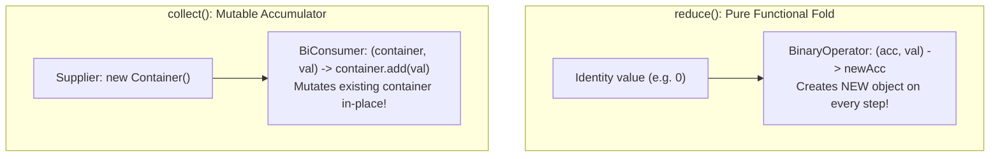
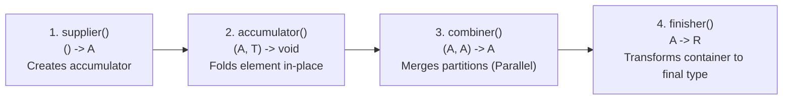
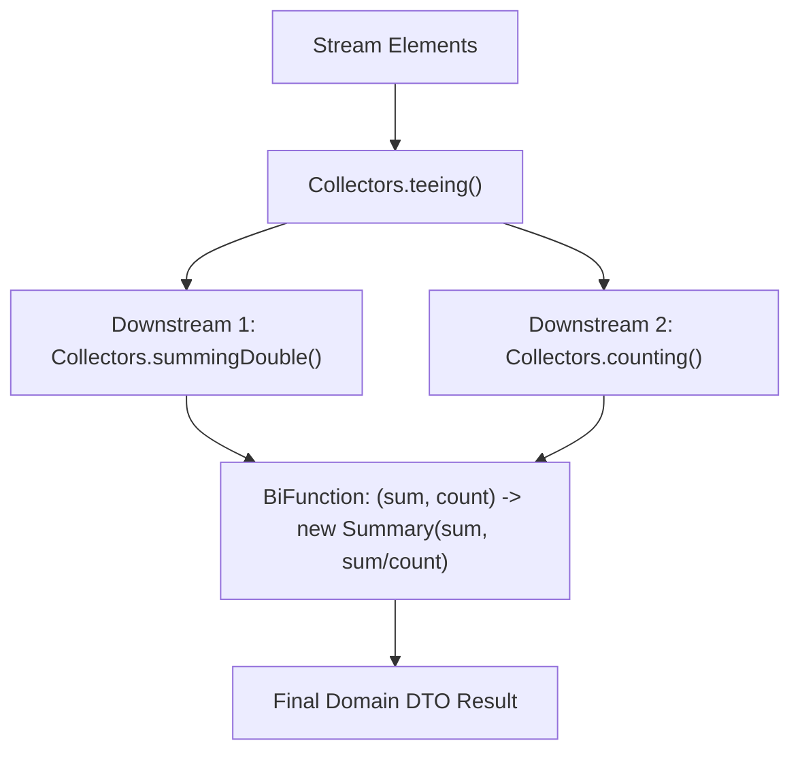

Transforming data with `filter()` and `map()` is only half of the functional equation. At the end of every meaningful Stream pipeline, you must aggregate the results into a structured domain model: generating grouped hierarchies, calculating multi-dimensional metrics, or serializing summary reports.

This is the domain of **Terminal Reductions** and the **`Collector<T, A, R>` API**.

While most developers stop at `Collectors.toList()`, senior engineers treat Collectors as an expressive, composable algebra. By mastering **downstream multi-level aggregators**, **Java 12's `teeing()` collector**, and building **custom collectors**, you can execute complex statistical and hierarchical data transformations in a single, lightning-fast pass across your data.

---

## `reduce()` vs. `collect()`: The Fundamental Architectural Divide

The Streams API offers two distinct reduction paradigms:



### The Catastrophic `reduce()` Anti-Pattern
Why can't you just use `reduce()` to accumulate items into an `ArrayList`?

```java
// ❌ PRODUCTION DISASTER: O(n²) Quadratic Time & Gigabytes of Garbage!
List<String> list = stream.reduce(
        new ArrayList<>(),
        (acc, item) -> {
            ArrayList<String> next = new ArrayList<>(acc); // Copies entire previous list!
            next.add(item);
            return next;
        },
        (left, right) -> {
            ArrayList<String> combined = new ArrayList<>(left);
            combined.addAll(right);
            return combined;
        }
);
```

Because `reduce()` is strictly designed for **immutable value types** (like numbers, strings, and BigDecimals), returning a new collection instance on every element forces copying all previous items, producing quadratic `O(n²)` copying churn!

**`collect()` is engineered for mutable containers.** It creates a single accumulator container (like an `ArrayList` or `StringBuilder`) and mutates it in place (`O(1)` per insertion), providing maximum performance.

---

## The Four Functions of `Collector<T, A, R>`

To understand how collectors work—and how to write your own—you must understand the four functional pillars of the `java.util.stream.Collector` interface:



1. **`supplier()`**: `() -> A`  
   A factory function that creates a fresh, empty mutable accumulation container (e.g. `ArrayList::new` or `HashMap::new`).
2. **`accumulator()`**: `(A, T) -> void`  
   A function that folds an incoming stream element `T` into the mutable container `A` (e.g. `List::add`).
3. **`combiner()`**: `(A, A) -> A`  
   A function that merges two partial accumulation containers into one. **Crucial for Parallel Streams!** When a parallel stream divides work across CPU threads, the combiner merges results from separate partitions.
4. **`finisher()`**: `A -> R`  
   Transforms the intermediate accumulation container `A` into the final result type `R` (e.g. converting a mutable `StringBuilder` to an immutable `String`, or wrapping a list in `Collections.unmodifiableList()`).
5. **`characteristics()`**: Returns a set of optimization flags:
   - `IDENTITY_FINISH`: The container `A` is cast directly to result `R` without invoking `finisher()`.
   - `UNORDERED`: Accumulation does not depend on encounter order.
   - `CONCURRENT`: The accumulator can be invoked concurrently by multiple threads on a single shared container without external synchronization.

---

## The Modern Duel: `Collectors.toList()` vs. `Stream.toList()` (Java 16+)

Starting in Java 16, a new convenience method arrived directly on the `Stream` interface: `stream.toList()`.

Do not confuse these two methods:

```java
// Option A: Classic Java 8 Collector
List<String> listA = stream.collect(Collectors.toList());

// Option B: Modern Java 16 Direct Terminal
List<String> listB = stream.toList();
```

| Dimension | `Collectors.toList()` (Java 8) | `Stream.toList()` (Java 16+) |
|---|---|---|
| **Mutability** | Returns a standard mutable `ArrayList` (in OpenJDK implementation). | Returns a **strictly unmodifiable list** (`UnsupportedOperationException` on mutation). |
| **Null Elements** | Permits `null` elements. | Permits `null` elements. |
| **Memory Allocation** | Allocates intermediate `Collector` objects and resizes `ArrayList`. | **Zero intermediate collector allocation**; sized directly to exact element count! |
| **Recommendation** | Use only if you specifically require a mutable list. | **Default choice for 99% of modern Java pipelines.** |

---

## The Duplicate Key Trap in `Collectors.toMap()`

The two-argument version of `Collectors.toMap()` is one of the most frequent sources of runtime crashes in production:

```java
record Employee(String department, String name) {}

List<Employee> employees = List.of(
        new Employee("ENG", "Alice"),
        new Employee("HR", "Bob"),
        new Employee("ENG", "Charlie") // Duplicate key "ENG"!
);

// ❌ PRODUCTION OUTAGE CRASH:
Map<String, String> map = employees.stream()
        .collect(Collectors.toMap(Employee::department, Employee::name));
// Throws: java.lang.IllegalStateException: Duplicate key ENG (attempted merging values Alice and Charlie)
```

By default, `toMap()` assumes keys are globally unique. If a duplicate key occurs, it throws `IllegalStateException`.

### The Safe Production Fix: Provide a Merge Function
Always use the three-argument overload of `toMap()` specifying how to handle key collisions:

```java
// ✅ Safe: Declares an explicit merge resolution policy
Map<String, String> safeMap = employees.stream()
        .collect(Collectors.toMap(
                Employee::department,
                Employee::name,
                (existing, replacement) -> existing + ", " + replacement // Merges colliding values!
        ));

System.out.println(safeMap); // {HR=Bob, ENG=Alice, Charlie}
```

---

## Downstream Multi-Level Grouping & Partitioning

`Collectors.groupingBy()` is exceptionally powerful because it can be nested with **Downstream Collectors** to build multi-dimensional data models in a single pass:

```java
record Transaction(String customerId, String category, double amount) {}

List<Transaction> txs = List.of(
        new Transaction("CUST-1", "GROCERY", 45.0),
        new Transaction("CUST-2", "TECH", 1200.0),
        new Transaction("CUST-1", "TECH", 85.0),
        new Transaction("CUST-1", "GROCERY", 30.0),
        new Transaction("CUST-2", "GROCERY", 15.0)
);
```

### Scenario 1: Group By Customer -> Group By Category (Two-Level Map)

```java
Map<String, Map<String, List<Transaction>>> nestedHierarchy = txs.stream()
        .collect(Collectors.groupingBy(
                Transaction::customerId,
                Collectors.groupingBy(Transaction::category) // Downstream collector!
        ));
```

### Scenario 2: Total Spending per Customer per Category

```java
Map<String, Map<String, Double>> spendingBreakdown = txs.stream()
        .collect(Collectors.groupingBy(
                Transaction::customerId,
                Collectors.groupingBy(
                        Transaction::category,
                        Collectors.summingDouble(Transaction::amount) // Downstream sum!
                )
        ));

System.out.println(spendingBreakdown);
// {CUST-2={TECH=1200.0, GROCERY=15.0}, CUST-1={GROCERY=75.0, TECH=85.0}}
```

### Scenario 3: Partitioning by High-Value Threshold
`partitioningBy()` divides data into exactly two buckets: `true` and `false`:

```java
Map<Boolean, List<Transaction>> highValueSplit = txs.stream()
        .collect(Collectors.partitioningBy(tx -> tx.amount() >= 100.0));

System.out.println("Transactions >= $100: " + highValueSplit.get(true).size());
```

---

## The Java 12 Superpower: `Collectors.teeing()`

Prior to Java 12, if you needed to calculate two independent metrics from a single stream—such as finding both the **Average** and the **Total Sum**—you had to run the stream twice, iterating over the data twice!

**`Collectors.teeing()`** splits incoming elements into two separate downstream collectors and then fuses their results together using a merger BiFunction, **in a single pass**:



```java
record StreamSummary(double sum, double average, long count) {}

List<Double> scores = List.of(95.0, 80.0, 90.0, 85.0, 100.0);

StreamSummary summary = scores.stream()
        .collect(Collectors.teeing(
                Collectors.summingDouble(Double::doubleValue), // Branch 1: Sum
                Collectors.counting(),                         // Branch 2: Count
                (sum, count) -> new StreamSummary(sum, sum / count, count) // Merger!
        ));

System.out.println("Total: " + summary.sum());       // 450.0
System.out.println("Average: " + summary.average()); // 90.0
System.out.println("Count: " + summary.count());     // 5
```

---

## Writing a Custom Collector from Scratch

When built-in collectors do not satisfy your business requirements, you can construct a custom `Collector` using **`Collector.of()`**:

Let's build an **`ImmutableBatchCollector`** that partitions elements into fixed-size batches of `N` items:

```java
import java.util.ArrayList;
import java.util.Collections;
import java.util.List;
import java.util.stream.Collector;

public class BatchCollector {

    public static <T> Collector<T, List<List<T>>, List<List<T>>> intoBatches(int batchSize) {
        return Collector.of(
                // 1. Supplier: creates intermediate container
                ArrayList::new,

                // 2. Accumulator: packs items into chunks of batchSize
                (batches, item) -> {
                    if (batches.isEmpty() || batches.get(batches.size() - 1).size() == batchSize) {
                        batches.add(new ArrayList<>(batchSize));
                    }
                    batches.get(batches.size() - 1).add(item);
                },

                // 3. Combiner: merges chunks across parallel worker partitions
                (leftBatches, rightBatches) -> {
                    if (leftBatches.isEmpty()) return rightBatches;
                    if (rightBatches.isEmpty()) return leftBatches;

                    List<T> lastLeft = leftBatches.get(leftBatches.size() - 1);
                    for (List<T> rightBatch : rightBatches) {
                        for (T item : rightBatch) {
                            if (lastLeft.size() < batchSize) {
                                lastLeft.add(item);
                            } else {
                                lastLeft = new ArrayList<>(batchSize);
                                lastLeft.add(item);
                                leftBatches.add(lastLeft);
                            }
                        }
                    }
                    return leftBatches;
                },

                // 4. Finisher: wrap each batch in an unmodifiable view
                batches -> batches.stream()
                                  .map(Collections::unmodifiableList)
                                  .toList(),

                // 5. Characteristics: none (requires finisher)
                Collector.Characteristics.IDENTITY_FINISH
        );
    }

    public static void main(String[] args) {
        List<Integer> numbers = List.of(1, 2, 3, 4, 5, 6, 7, 8);
        List<List<Integer>> chunked = numbers.stream().collect(intoBatches(3));
        System.out.println(chunked); // [[1, 2, 3], [4, 5, 6], [7, 8]]
    }
}
```

---

## Summary & Mental Model Checkpoint

1. **`reduce()` vs. `collect()`**: `reduce` is for immutable value reduction (generates garbage if used for collections); `collect` is for high-speed in-place mutable accumulation.
2. **The 4 Functions of a Collector**: `supplier` (factory), `accumulator` (fold), `combiner` (parallel merge), and `finisher` (output transform).
3. **`Stream.toList()` (Java 16)**: Outperforms `Collectors.toList()` by returning an unmodifiable list with zero intermediate collector allocation.
4. **`toMap()` Collision Rule**: Always provide a merge function `(existing, replacement) -> ...` to prevent `IllegalStateException` on duplicate keys.
5. **Downstream Composition**: Nest collectors within `groupingBy` to compute multi-level hierarchies and statistics in a single pass.
6. **`Collectors.teeing()` (Java 12)**: Runs two independent collectors simultaneously in a single iteration pass and merges their results.
7. **Custom Collectors**: Build domain-specific aggregators using `Collector.of()`, ensuring the `combiner` properly merges partial partitions.

---

## 🎯 Senior Engineer Interview Questions

### Why does accumulating elements into a collection using `Stream.reduce()` result in `O(n²)` quadratic time complexity, and how does `Stream.collect()` solve this problem?
> **Answer:** `Stream.reduce()` implements a purely functional fold designed for immutable values. Its accumulating function takes an accumulator and an element, and returns a new accumulator: `(acc, item) -> newAcc`. If you attempt to collect elements into a collection using `reduce()`, functional immutability requires you to allocate a new collection on every single element and copy all previously accumulated elements into it. Over `N` elements, the total number of element copying operations follows the arithmetic progression `1 + 2 + ... + N = N(N+1)/2`, resulting in `O(n²)` quadratic time complexity and massive young-generation heap churn. In contrast, `Stream.collect()` implements a mutable reduction: it instantiates a single mutable container via `supplier()` and mutates that exact container in-place via `accumulator()` (`container.add(item)`), delivering optimal `O(n)` linear time and minimal memory allocations.

### What is the functional contract of the `combiner()` in the `Collector` interface, and when is it executed by the Streams runtime?
> **Answer:** The `combiner()` function has the signature `BinaryOperator<A> combiner()`. It takes two partial mutable accumulation containers of type `A` and merges them into a single container of type `A`. The Streams runtime invokes the `combiner()` strictly during **parallel stream execution**. When a parallel stream executes, the underlying `Spliterator` partitions the source dataset across multiple worker threads in the `ForkJoinPool`. Each worker thread calls `supplier()` to create its own thread-local accumulator and populates it independently via `accumulator()`. Once subtasks complete, the runtime uses `combiner()` in a fork-join merge tree to combine partial accumulators from sibling threads until a single unified accumulator container remains to be passed to `finisher()`. In sequential streams, `combiner()` is never invoked.

### How does Java 12's `Collectors.teeing()` optimize stream performance compared to running two separate terminal operations?
> **Answer:** In traditional Java, if you need to calculate two independent metrics from a stream that cannot be computed by a single built-in collector (such as calculating both the sum and the variance of a dataset), you are forced to iterate through the data source twice by running two separate stream pipelines. If the stream source is an expensive operation (such as reading from a disk file via `Files.lines()`, querying a database cursor, or performing complex upstream calculations), doubling the pipeline traversal doubles execution latency and I/O load. `Collectors.teeing()` accepts two downstream collectors and a merging `BiFunction`. As elements flow through the pipeline, each element is passed to **both** downstream collectors simultaneously in a single pass. When the pipeline finishes, the results of both collectors are supplied to the merger function to create a consolidated domain object, eliminating duplicate I/O and halving pipeline traversal time.

### What are the operational differences between `Collectors.toList()` and Java 16's `Stream.toList()`?
> **Answer:** There are three key architectural differences: (1) **Mutability:** `Collectors.toList()` makes no specification guarantees regarding list mutability (though in OpenJDK it returns a mutable `ArrayList`). In contrast, `Stream.toList()` guarantees that the returned list is strictly unmodifiable; calling `.add()` or `.set()` throws `UnsupportedOperationException`. (2) **Memory and Performance:** `Collectors.toList()` allocates an intermediate `Collector` instance, a supplier, an accumulator, and uses a standard `ArrayList` which resizes dynamically (wasting unused trailing capacity). `Stream.toList()` is a direct terminal operation implemented natively in the stream pipeline; if the upstream source is `SIZED`, it allocates an internal compact array sized to the exact element count with zero excess memory and zero intermediate collector allocation. (3) **Interoperability:** `Stream.toList()` produces compact `ListN` instances similar to `List.of()`, which are cache-friendly and consume significantly less heap memory than traditional `ArrayList` wrappers.