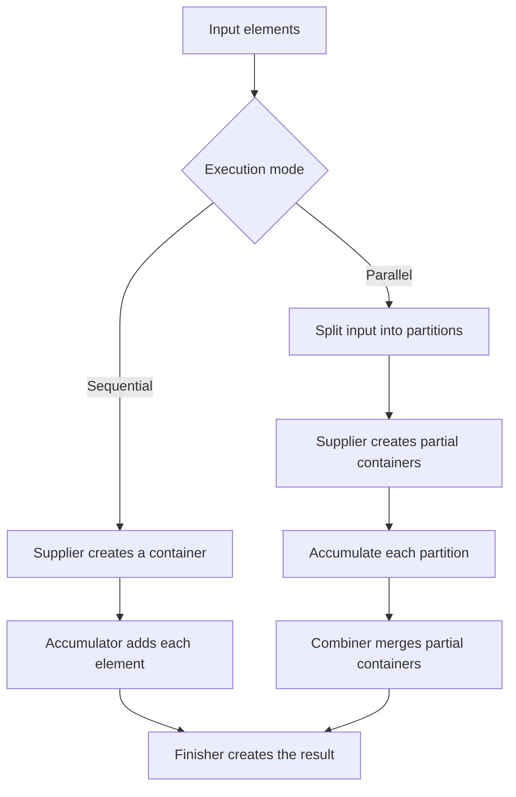

Once a stream has filtered and transformed elements, an application often needs a structured result: a map of items grouped by category, counts by status, or a summary statistic. Collectors express these **reductions** without exposing every mutation step to the pipeline.

This lesson uses Java 21's `Collector` and `Collectors` APIs. For stream creation, laziness, and behavioral rules, see [The Streams API](./the-streams-api).

## Terminal reductions: `reduce` and `collect`

`reduce` combines stream elements into a single result using an identity and an associative accumulation operation:

```java
import java.util.List;

public class ReductionExample {
    public static void main(String[] args) {
        int total = List.of(3, 5, 8).stream()
                .reduce(0, Integer::sum);
        System.out.println(total);
    }
}
```

For mutable result containers such as lists, maps, and `StringJoiner`, use `collect`. A `Collector<T, A, R>` describes input elements `T`, a mutable accumulation type `A`, and a final result type `R`. It defines how to create partial containers, accumulate elements, combine partial results, and optionally finish the result.

Use the operation that matches the result. A mutable `reduce` that mutates and returns the same accumulator is usually the wrong abstraction, especially for parallel execution, because reduction identities and combiners must obey strict algebraic requirements.

## Common collectors

The standard collectors cover common tasks:

```java
import java.util.List;
import java.util.Map;
import java.util.stream.Collectors;

record Order(String id, String department, int cents) {}

public class CollectorExamples {
    public static void main(String[] args) {
        List<Order> orders = List.of(
                new Order("A-1", "books", 1200),
                new Order("A-2", "games", 3500),
                new Order("A-3", "books", 800));

        List<String> ids = orders.stream()
                .map(Order::id)
                .toList();

        Map<String, List<Order>> byDepartment = orders.stream()
                .collect(Collectors.groupingBy(Order::department));

        Map<String, Integer> centsByDepartment = orders.stream()
                .collect(Collectors.groupingBy(
                        Order::department,
                        Collectors.summingInt(Order::cents)));

        Map<String, Integer> centsById = orders.stream()
                .collect(Collectors.toMap(Order::id, Order::cents));

        System.out.println(ids);
        System.out.println(byDepartment.keySet());
        System.out.println(centsByDepartment);
        System.out.println(centsById);
    }
}
```

`groupingBy` creates a map whose values are lists by default; a downstream collector changes the aggregation performed within each group. This avoids collecting every group and then making a second pass to count or sum it.

## How a collector reduces data

The collector separates per-element accumulation from merging partial results. A sequential stream generally accumulates into a result container; a parallel stream can build partial containers and combine them before finishing:



Not every collector uses a distinct finishing transformation: an identity-finish collector can expose its accumulation container as the result. The contract still requires the result of a reduction to be equivalent whether elements are accumulated together or through valid partial combinations.

### `toList` is not a mutability guarantee

`Collectors.toList()` does not guarantee a particular list implementation, mutability, serializability, or thread-safety. If the result must be mutable, select the collection explicitly with `toCollection(ArrayList::new)`. Java 16's `Stream.toList()` returns an unmodifiable list; do not assume it can be modified.

Likewise, collectors that return maps or sets do not necessarily promise a concrete implementation unless a factory overload specifies one. Use the overload with an explicit map/set factory when encounter order, key ordering, or concrete type is part of the requirement.

## Duplicate keys in `toMap`

The two-argument `toMap(keyMapper, valueMapper)` throws `IllegalStateException` if two input elements produce the same key. That failure prevents silent overwriting but is a common surprise when the key is not unique:

```java
import java.util.List;
import java.util.Map;
import java.util.stream.Collectors;

public class DuplicateKeyExample {
    record Order(String id, String department, int cents) {}

    public static void main(String[] args) {
        List<Order> orders = List.of(
                new Order("A-1", "books", 1200),
                new Order("A-3", "books", 800));

        Map<String, Integer> totalsByDepartment = orders.stream()
                .collect(Collectors.toMap(
                        Order::department,
                        Order::cents,
                        Integer::sum));
        System.out.println(totalsByDepartment);
    }
}
```

The third argument is a merge function for collisions. Choose its meaning deliberately: sum, keep the first value, keep the last, or reject duplicates with an explicit domain error. “Keep one arbitrarily” is usually not a business rule.

## Grouping and partitioning

`groupingBy` classifies each input into a key. `partitioningBy` divides inputs into exactly two groups based on a predicate, with `true` and `false` keys:

```java
import java.util.List;
import java.util.Map;
import java.util.stream.Collectors;

public class PartitionExample {
    record Order(String id, int cents) {}

    public static void main(String[] args) {
        List<Order> orders = List.of(
                new Order("A-1", 1200),
                new Order("A-2", 3500));
        Map<Boolean, List<Order>> expensiveOrders = orders.stream()
                .collect(Collectors.partitioningBy(order -> order.cents() >= 2_000));
        System.out.println(expensiveOrders);
    }
}
```

Downstream collectors compose reductions:

- `counting()` counts elements per group.
- `summingInt`, `averagingDouble`, and `summarizingInt` compute numeric results.
- `mapping` transforms elements before a downstream collector receives them.
- `filtering` filters within a group while retaining a group entry even if none of its values pass.
- `collectingAndThen` applies a finishing transformation to another collector's result.

The grouping map's iteration order is not generally guaranteed by the simplest overload. Use a map-factory overload such as `TreeMap::new` when sorted group keys are required, or an insertion-ordered map factory when that encounter-order contract is needed.

## A custom collector

Most application code should prefer a built-in collector. `Collector.of` is useful when an operation needs a custom accumulation container and a correct combiner:

```java
import java.util.List;
import java.util.StringJoiner;
import java.util.stream.Collector;

public class CustomCollectorExample {
    public static void main(String[] args) {
        Collector<String, StringJoiner, String> joiningWithPipes =
                Collector.of(
                        () -> new StringJoiner(" | "),
                        StringJoiner::add,
                        StringJoiner::merge,
                        StringJoiner::toString);

        String result = List.of("parse", "validate", "save").stream()
                .collect(joiningWithPipes);

        System.out.println(result);
    }
}
```

The supplier creates a fresh accumulator, the accumulator adds one input, the combiner merges two partial accumulators, and the finisher produces the final string. The combiner is essential for parallel reductions; it must produce a result equivalent to accumulating the corresponding partitions together.

Do not declare collector characteristics such as `CONCURRENT`, `UNORDERED`, or `IDENTITY_FINISH` unless the implementation satisfies their contracts. Incorrect characteristics can lead the stream framework to perform a reduction under assumptions your collector does not meet.

## Parallel streams and collector costs

A parallel stream divides source work into partitions and combines partial results. A collector therefore needs an appropriate combiner, and some collectors incur significant cost merging maps or lists. For example, `groupingBy` can require combining maps from different partitions; `groupingByConcurrent` may be a better fit for unordered concurrent grouping, but it does not preserve the same ordering semantics.

Parallel execution is not automatically faster. Measure realistic input sizes and include allocation, merge cost, thread contention, and downstream work. Keep behavioral parameters non-interfering and stateless. In particular:

- Do not append into a shared mutable list from `forEach`.
- Do not assume a `HashMap` or `ArrayList` is safe for unsynchronized concurrent mutation.
- Use a collector's supported reduction contract instead of writing shared mutable accumulation.
- Remember that floating-point addition is not mathematically associative under finite precision; regrouping can change rounding.

The default execution mechanism and scheduling details are implementation concerns. If the application needs explicit executor selection, task isolation, or resource bounds, use a concurrency abstraction that exposes those controls rather than treating a parallel stream as a configurable thread pool.

## Practical rules

- Use `reduce` for associative immutable combination and `collect` for mutable result containers.
- Handle possible duplicate keys in `toMap` with an explicit merge policy.
- Select concrete collection factories when order or mutability is required.
- Compose downstream collectors instead of building unnecessary intermediate maps and lists.
- Implement custom collectors only when built-ins do not clearly express the required reduction.
- Validate the supplier, accumulator, combiner, finisher, and characteristics before using a custom collector in parallel.
- Benchmark parallel collectors on representative workloads; correctness and order semantics come first.

## Further reading

- [Java 21 `Collectors`](https://docs.oracle.com/en/java/javase/21/docs/api/java.base/java/util/stream/Collectors.html)
- [Java 21 `Collector`](https://docs.oracle.com/en/java/javase/21/docs/api/java.base/java/util/stream/Collector.html)
- [Java 21 `Stream.collect`](https://docs.oracle.com/en/java/javase/21/docs/api/java.base/java/util/stream/Stream.html#collect(java.util.stream.Collector))
