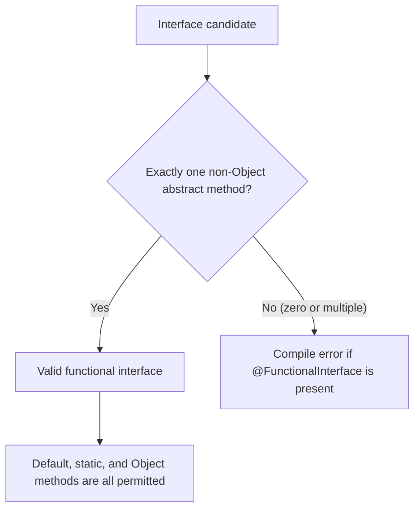
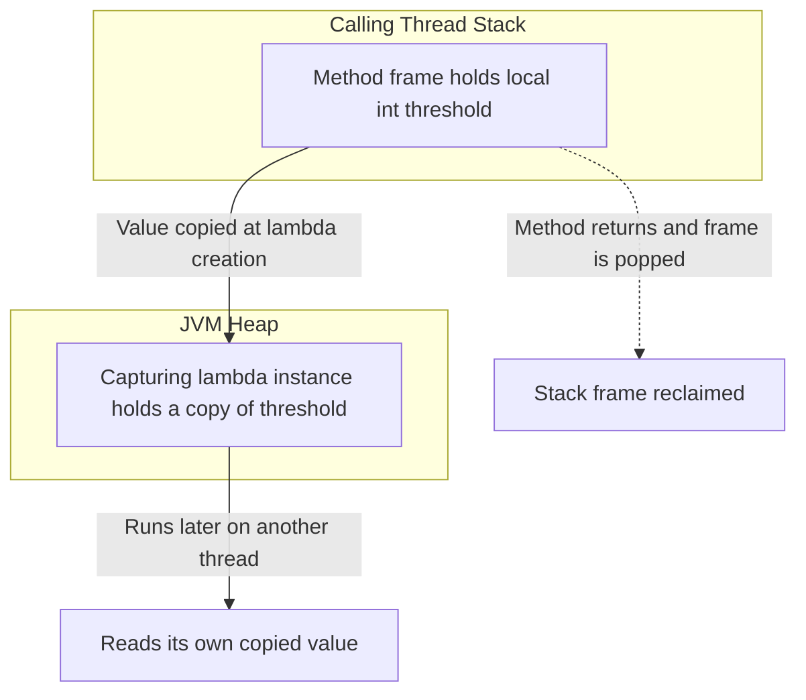
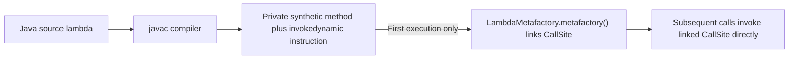

Before Java 8, passing a small piece of behavior into a method meant writing an anonymous inner class. Even sorting a list by string length took six lines of ceremony:

```java
Collections.sort(names, new Comparator<String>() {
    @Override
    public int compare(String a, String b) {
        return Integer.compare(a.length(), b.length());
    }
});
```

With a lambda expression, the same sort reads directly as what you intend:

```java
names.sort((a, b) -> Integer.compare(a.length(), b.length()));
```

Or even shorter, using a comparator helper and a method reference:

```java
names.sort(Comparator.comparingInt(String::length));
```

Beyond cutting boilerplate, Java 8 introduced a dedicated runtime mechanism for lambdas instead of treating them as shorthand for anonymous inner classes. Understanding functional interfaces, variable capture rules, method references, built-in `java.util.function` types, and how the JVM wires lambdas at runtime will help you read and write modern Java cleanly without tripping over subtle bugs.

## Functional Interfaces and `@FunctionalInterface`

A functional interface is any interface with **exactly one abstract method** (often called a SAM, or Single Abstract Method, interface). A lambda expression supplies the implementation of that single abstract method, and the compiler uses the target context (assignment, method parameter, or return type) to figure out which functional interface the lambda implements.

Annotating an interface with `@FunctionalInterface` is optional, but it is a good habit. It tells the compiler to reject the code if someone later adds a second abstract method, which would break every lambda implementing that interface.

```java
@FunctionalInterface
public interface PaymentGateway {
    // The single abstract method (SAM)
    PaymentReceipt charge(String accountId, long amountInCents);

    // Default methods have an implementation, so they do not count
    default PaymentReceipt chargeWithLogging(String accountId, long amountInCents) {
        System.out.println("Charging account " + accountId);
        return charge(accountId, amountInCents);
    }

    // Static helper methods do not count either
    static boolean isValidAccount(String accountId) {
        return accountId != null && !accountId.isBlank();
    }

    // Public methods inherited from java.lang.Object do not count
    @Override
    boolean equals(Object other);
}
```

That last rule surprises people the first time they look at `java.util.Comparator<T>`. `Comparator` declares both `compare(T, T)` and `equals(Object)` as abstract methods, yet it is still annotated with `@FunctionalInterface`. According to the Java Language Specification (JLS §9.8), abstract methods that override public methods of `java.lang.Object` (`equals`, `hashCode`, `toString`) do not count toward the single-abstract-method limit because every implementing class inherits them from `Object` anyway.



## Lambda Syntax and Scoping

A lambda expression has three parts: a parameter list, the arrow token `->`, and a body. The compiler infers parameter types from the target functional interface, so you usually omit them.

```java
// Zero parameters
Runnable task = () -> System.out.println("Running");

// Single parameter (parentheses are optional when type is omitted)
Predicate<String> isBlank = s -> s.isBlank();

// Multiple parameters with inferred types
BiFunction<Integer, Integer, Integer> add = (a, b) -> a + b;

// Explicit parameter types (required if you want annotations like @NonNull, or var in Java 11+)
BiFunction<Integer, Integer, Integer> multiply = (Integer a, Integer b) -> a * b;

// Multi-statement block body requires braces and an explicit return
Function<String, String> normalize = raw -> {
    String trimmed = raw.trim();
    return trimmed.toLowerCase(Locale.ROOT);
};
```

### How `this` and Variable Shadowing Differ from Anonymous Inner Classes

A lambda does **not** create a new lexical scope of its own, and it is not a subclass of `Object` the way an anonymous inner class is. That leads to two practical differences:

1. Inside a lambda, `this` refers to the **enclosing instance**, not the lambda itself. Inside an anonymous inner class, `this` refers to the anonymous class instance.
2. You cannot redeclare a local variable or parameter inside a lambda with the same name as a local variable in the enclosing method. An anonymous inner class can shadow enclosing local variables because it introduces a new class scope.

```java
public class ScopeExample {
    private final String label = "outer";

    public void demo() {
        String prefix = "msg";

        Runnable withLambda = () -> {
            // 'this' is the ScopeExample instance
            System.out.println(this.label + ": " + prefix);
            // String prefix = "other"; // Compile error: already defined in enclosing scope
        };

        Runnable withAnonClass = new Runnable() {
            private final String label = "inner";

            @Override
            public void run() {
                String prefix = "shadowed"; // Allowed in anonymous inner class
                System.out.println(this.label + ": " + prefix);
            }
        };

        withLambda.run();    // outer: msg
        withAnonClass.run(); // inner: shadowed
    }
}
```

## Variable Capture and Effectively Final

A lambda can read variables from its enclosing method, provided those local variables are either declared `final` or are **effectively final**. A variable is effectively final if it is assigned once and never reassigned anywhere in its scope.

```java
public List<Order> filterHighValue(List<Order> orders, boolean includeTax) {
    long thresholdCents = includeTax ? 10_000L : 8_500L; // Effectively final

    // Valid: thresholdCents is never reassigned
    return orders.stream()
            .filter(order -> order.totalCents() >= thresholdCents)
            .toList();
}
```

If you try to mutate a local variable either inside the lambda or anywhere else in the enclosing method, compilation fails:

```java
int matched = 0;
orders.forEach(order -> {
    if (order.isPaid()) {
        // Compile error: local variables referenced from a lambda must be final or effectively final
        matched++;
    }
});
```

### Why Java Enforces Effectively Final on Locals

Local variables live in a thread's call stack frame. When the enclosing method returns, that stack frame is popped and its slots are gone. A lambda, however, can easily outlive the method that created it: you might store it in a callback registry or hand it to an `ExecutorService` that runs on another thread seconds later.



To make that safe without moving every local variable onto the heap, Java **captures local variables by value**, copying the primitive value or object reference into the lambda. If Java allowed you to reassign the local variable inside the lambda, you would be mutating a private copy while the original stack variable stayed untouched (or vice versa), creating confusing discrepancies and race conditions across threads.

### Fields vs. Local Variables

The effectively final restriction applies only to **local variables and method parameters**. It does **not** apply to instance fields or `static` fields, because fields already live on the heap (or in class metadata/heap objects). A lambda that accesses an instance field captures the `this` reference, which is itself effectively final, and reads or writes the field through `this`.

Similarly, an effectively final object reference does not make the referenced object immutable:

```java
// Compiles because the reference 'counter' is never reassigned
AtomicInteger counter = new AtomicInteger(0);
orders.forEach(order -> {
    if (order.isPaid()) {
        counter.incrementAndGet();
    }
});
```

Using an `AtomicInteger` works safely even across threads, though for simple counting a stream terminal operation like `.filter(Order::isPaid).count()` is cleaner. Avoid the old trick of wrapping a counter in a one-element array (`int[] count = {0};`): it compiles, but it is not thread-safe and usually signals that a stream reduction or a plain `for` loop is a better fit.

## Method References

When a lambda body does nothing except call an existing method or constructor with the exact arguments it received, you can replace it with a **method reference** (`::`). Java defines four kinds of method references:

| Kind | Syntax | Method Reference Example | Equivalent Lambda |
|---|---|---|---|
| Static method | `ClassName::staticMethod` | `Integer::parseInt` | `s -> Integer.parseInt(s)` |
| Bound instance method | `instanceExpr::instanceMethod` | `System.out::println` | `x -> System.out.println(x)` |
| Unbound instance method | `ClassName::instanceMethod` | `String::toUpperCase` | `s -> s.toUpperCase()` |
| Constructor | `ClassName::new` | `ArrayList::new` | `() -> new ArrayList<>()` |

### Bound vs. Unbound Instance Method References

The two instance forms look similar, so it helps to see them side by side:

```java
// 1. Static method reference
Function<String, Integer> parse = Integer::parseInt;

// 2. Bound instance method reference: receiver 'prefix' is fixed up front
String prefix = "ORDER-";
Function<String, String> addPrefix = prefix::concat;
System.out.println(addPrefix.apply("42")); // ORDER-42

// 3. Unbound instance method reference: first lambda parameter becomes the receiver
BiFunction<String, String, Boolean> startsWith = String::startsWith;
System.out.println(startsWith.apply("ORDER-42", "ORDER-")); // true

// 4. Constructor references (including array constructors)
Supplier<List<String>> newList = ArrayList::new;
IntFunction<String[]> newArray = String[]::new;
```

Watch out for one subtle detail with **bound** instance references: the expression on the left of `::` is evaluated **once, when the method reference is created**, not each time the functional method is called.

```java
// Evaluates getLogger() immediately when the reference is created, even if consumer is never called!
Consumer<String> logNow = getLogger()::info;

// Evaluates getLogger() lazily on each invocation
Consumer<String> logLater = msg -> getLogger().info(msg);
```

If `getLogger()` can return `null` at creation time, `getLogger()::info` throws a `NullPointerException` right away rather than when `accept` is called.

## Built-in Functional Interfaces (`java.util.function`)

Rather than making every library invent its own single-method interfaces, Java 8 added 43 standard functional interfaces in `java.util.function`. Almost all of them are variations on four core shapes:

| Interface | Abstract Method | Role | Typical Example |
|---|---|---|---|
| `Predicate<T>` | `boolean test(T t)` | Tests a condition | `user -> user.isActive()` |
| `Function<T, R>` | `R apply(T t)` | Maps input `T` to output `R` | `User::email` |
| `Consumer<T>` | `void accept(T t)` | Performs an action with no return | `System.out::println` |
| `Supplier<T>` | `T get()` | Produces a value on demand | `UUID::randomUUID` |

From those four shapes, the package derives two useful families:

- **Two-argument variants**: `BiPredicate<T, U>`, `BiFunction<T, U, R>`, and `BiConsumer<T, U>`.
- **Same-type operators**: `UnaryOperator<T>` (extends `Function<T, T>`) and `BinaryOperator<T>` (extends `BiFunction<T, T, T>`), used heavily by `List.replaceAll` and `Stream.reduce`.

### Primitive Specializations

Because Java generics only work with reference types, `Predicate<Integer>` actually takes a boxed `Integer`. Calling it inside a tight loop over millions of primitive `int` values forces autoboxing (`Integer.valueOf(int)`), allocating objects on the heap for every value outside the small `Integer` cache (-128 to 127).

The `java.util.function` package solves this with primitive specializations for `int`, `long`, and `double`:

```java
// Boxes every primitive int into an Integer
Predicate<Integer> boxedCheck = n -> n > 0;

// Works directly on primitive int values with no boxing
IntPredicate primitiveCheck = n -> n > 0;
ToIntFunction<String> stringLength = String::length;
IntToDoubleFunction centsToDollars = cents -> cents / 100.0;
LongConsumer recordLatencyNanos = nanos -> metrics.observe(nanos);
DoubleSupplier randomRate = Math::random;
```

You do not need to memorize all 43 interfaces. Once you recognize the naming pattern (`Int*`, `Long*`, `Double*`, `ToInt*`, `ObjInt*`), you can look up the exact one you need in seconds.

## Composing Functions and Predicates

The built-in functional interfaces include default methods for combining small pieces of behavior into larger pipelines without writing nested lambdas.

### Composing Predicates

`Predicate` provides `and`, `or`, `negate`, and (since Java 11) the static helper `Predicate.not`:

```java
Predicate<User> isActive = User::isActive;
Predicate<User> hasVerifiedEmail = User::isEmailVerified;
Predicate<User> isSuspended = User::isSuspended;

Predicate<User> canCheckout = isActive
        .and(hasVerifiedEmail)
        .and(isSuspended.negate());

List<String> nonBlankTags = tags.stream()
        .filter(Predicate.not(String::isBlank))
        .toList();
```

`Predicate.not(String::isBlank)` is especially handy because you cannot call `.negate()` directly on a raw method reference without first casting or storing it in a variable.

### Composing Functions: `andThen` vs. `compose`

`Function` provides two composition methods whose order is easy to mix up:

- `f.andThen(g)` runs `f` first, then passes the result to `g` (left to right: `g(f(x))`).
- `f.compose(g)` runs `g` first, then passes the result to `f` (right to left: `f(g(x))`).

```java
Function<String, String> trim = String::trim;
Function<String, String> toLower = s -> s.toLowerCase(Locale.ROOT);
Function<String, String> addDomain = user -> user + "@example.com";

Function<String, String> buildEmail = trim
        .andThen(toLower)
        .andThen(addDomain);

System.out.println(buildEmail.apply("  Alice  ")); // alice@example.com
```

In day-to-day Java code, `andThen` is almost always easier to read because execution order matches reading order from top to bottom. `Consumer` also offers `andThen` to chain side effects sequentially.

## How Lambdas Compile and Run: `invokedynamic` and `LambdaMetafactory`

A common misconception is that `javac` simply rewrites every lambda into an anonymous inner class. It does not.

If `javac` emitted anonymous inner classes for every lambda, every call site would produce a separate `.class` file on disk, increasing JAR sizes and forcing the classloader to load and verify thousands of tiny classes at startup. Worse, the translation strategy would be frozen into bytecode forever.

Instead, `javac` translates lambdas using the `invokedynamic` instruction (introduced in Java 7) and the standard bootstrap class `java.lang.invoke.LambdaMetafactory`.



Here is what happens step by step in OpenJDK's `javac` and HotSpot JVM:

1. **Compile time (`javac`)**: The compiler extracts the lambda body into a private synthetic method inside the enclosing class (marked `ACC_SYNTHETIC` in bytecode, with a compiler-generated name like `lambda$0`). If the lambda does not access instance members of the enclosing class, that synthetic method is `private static`. At the point where the lambda appeared, `javac` emits an `invokedynamic` instruction referencing `LambdaMetafactory.metafactory()` as its bootstrap method.
2. **First execution (HotSpot runtime)**: The first time the JVM executes that `invokedynamic` site, it runs `LambdaMetafactory.metafactory()`. On HotSpot, this dynamically generates a lightweight hidden class in memory implementing the target functional interface, wires its SAM method to the synthetic method, and returns a linked `CallSite`.
3. **Subsequent executions**: The `invokedynamic` site stays linked to that `CallSite`. HotSpot's JIT compiler can inline across the call site just as it inlines regular method calls.

### Language Guarantees vs. HotSpot Implementation Details

It is worth separating what the Java Language Specification guarantees from what HotSpot happens to do:

- **HotSpot behavior**: For a **non-capturing** lambda (one that does not capture local variables or `this`), `LambdaMetafactory` typically creates a single instance once and returns that same cached instance on every subsequent evaluation, avoiding repeated heap allocations. For a **capturing** lambda, each evaluation generally allocates a new object holding the captured values (unless JIT escape analysis eliminates the allocation).
- **JLS guarantee (JLS §15.27.4)**: The language specification deliberately does **not** guarantee whether evaluating a lambda produces a brand-new object or reuses an existing one. That freedom is the whole reason the JDK can improve lambda translation in future releases without recompiling your code.

Because identity is unspecified, never compare lambda instances with `==` and never use a lambda instance as a `synchronized` lock.

## Common Pitfalls

### Checked Exceptions Inside Standard Functional Interfaces

None of the standard interfaces in `java.util.function` declare checked exceptions in their method signatures. If you call a method that throws `IOException` inside a `Function`, the compiler rejects it:

```java
// Compile error: unhandled IOException
List<String> contents = paths.stream()
        .map(path -> Files.readString(path))
        .toList();
```

You have three practical options:

1. Handle the exception inside a helper method and call that helper via a method reference (keeps the pipeline clean).
2. Wrap the checked exception in `UncheckedIOException` (or a domain-specific unchecked exception) if a failure should abort the whole operation.
3. Use a plain `for` loop if the enclosing method already declares `throws IOException`.

```java
private static String readFileUnchecked(Path path) {
    try {
        return Files.readString(path);
    } catch (IOException e) {
        throw new UncheckedIOException("Failed to read " + path, e);
    }
}

List<String> contents = paths.stream()
        .map(FileLoader::readFileUnchecked)
        .toList();
```

### Overusing Lambdas Where a Named Method Is Clearer

A lambda with ten lines of nested `if` blocks and local helper variables is hard to read and harder to step through in a debugger. Extract anything longer than a few lines into a private method with a clear name and pass a method reference instead.

## Interview Questions

### Why did Java use `invokedynamic` and `LambdaMetafactory` for lambdas instead of compiling them to anonymous inner classes?

Compiling lambdas to anonymous inner classes would generate a separate `.class` file for every lambda, bloating JARs and adding classloading and verification cost at startup. It would also lock every compiled class file to one specific implementation strategy. Using `invokedynamic` keeps bytecode compact (just a private synthetic method and a call site) and delegates the actual implementation strategy to `LambdaMetafactory` at runtime. On HotSpot, non-capturing lambdas can be cached as a single instance without creating extra `.class` files on disk, and future JVMs can optimize lambda linkage further without recompiling user bytecode.

### Why must local variables captured by a lambda be `final` or effectively final, while instance fields do not have that rule?

Local variables live in a method's stack frame and disappear as soon as the method returns, whereas a lambda can escape the method and run later on another thread. Java copies captured local variables by value into the lambda. If reassignment were allowed, the lambda and the enclosing method would hold two separate copies that could silently drift out of sync. Instance fields and `static` fields do not have this problem because they already live on the heap; the lambda simply captures `this` (which never changes) and accesses the field through it.

### What is the difference between a bound and an unbound instance method reference?

A bound instance method reference (`instance::method`) fixes the target object when the reference is created, so the functional interface only supplies the method's parameters. For example, `String prefix = "ID-"; Function<String, String> f = prefix::concat;` is equivalent to `s -> prefix.concat(s)`. An unbound instance method reference (`ClassName::method`) leaves the target object unspecified; the first parameter of the functional interface becomes the receiver at call time. For example, `BiFunction<String, String, String> f = String::concat;` is equivalent to `(a, b) -> a.concat(b)`.

### When should you prefer primitive functional interfaces like `IntPredicate` or `ToIntFunction` over `Predicate<Integer>` or `Function<T, Integer>`?

Standard generic interfaces operate on reference types, so passing primitive `int`, `long`, or `double` values triggers autoboxing into heap objects (`Integer`, `Long`, `Double`). In occasional UI or configuration code, that cost is negligible. In hot loops or large numeric streams processing millions of values, autoboxing generates heavy short-lived heap allocations and increases GC pressure. Primitive specializations like `IntPredicate` (`boolean test(int)`) and `ToIntFunction<T>` (`int applyAsInt(T)`) pass raw primitives directly, avoiding boxing altogether.
